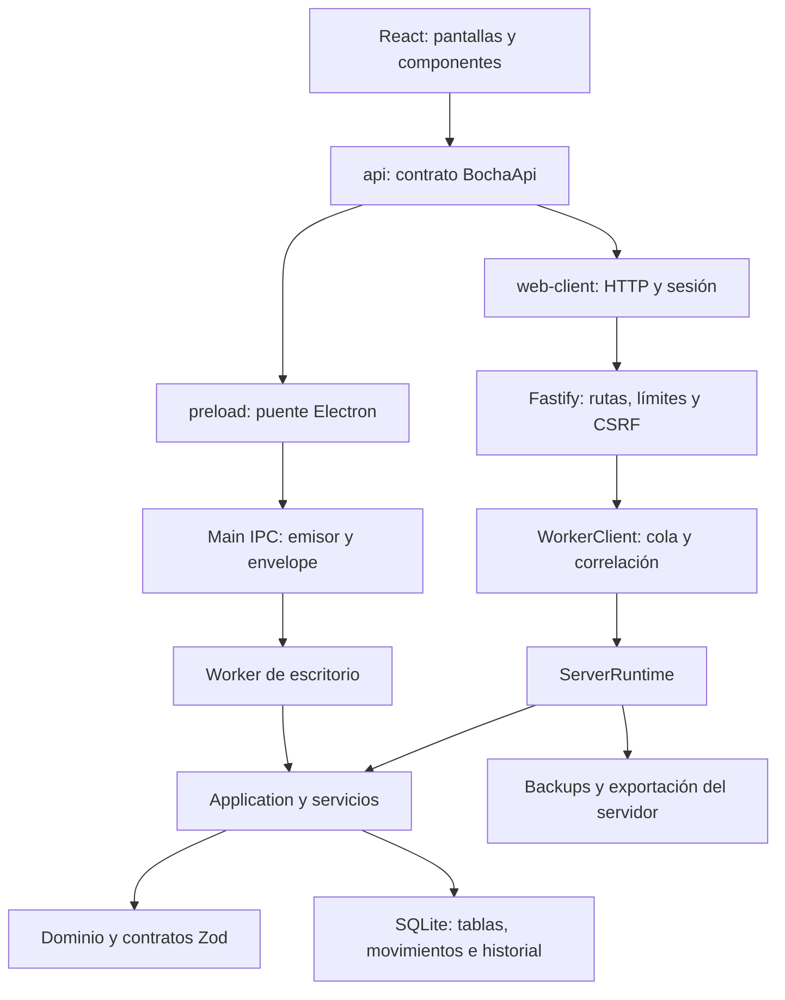

# 04. Arquitectura e implementación

[Volver al índice](README.md)

## 1. Panorama técnico

El programa está escrito principalmente en TypeScript. El frontend utiliza React y Vite; la web expone una API Fastify; SQLite se accede mediante `better-sqlite3`. Electron aporta la variante de escritorio. Zod valida contratos compartidos y SQL explícito implementa la persistencia. No se identificó un ORM que genere automáticamente el modelo de datos.

La distribución de responsabilidades evita poner las reglas financieras sólo en componentes visuales. El dominio contiene cálculos puros; los servicios coordinan reglas y persistencia; los adaptadores HTTP/IPC transportan solicitudes; el renderer interpreta resultados y organiza la interacción.

## 2. Estructura del repositorio

| Directorio | Responsabilidad |
|---|---|
| `src/domain` | Cálculos y políticas: importes, cantidades, venta, pagos, inventario, costos, promociones, permisos y funciones |
| `src/shared` | Esquemas de entrada/salida, tipos, errores, envelopes y contratos usados entre capas |
| `src/worker` | Aplicación, servicios de negocio, repositorios y migraciones |
| `src/server` | Arranque web, HTTP, runtime, worker, lease, CLI, exportación y backups |
| `src/main` | Arranque Electron, ventana, preload, validación IPC y cliente del worker |
| `src/renderer` | React, navegación, adaptadores, componentes, pantallas, estilos y assets del frontend |
| `tests/unit` | Pruebas de reglas y utilidades aisladas |
| `tests/integration` | Pruebas de servicios, base, autorización y circuitos sin navegador |
| `tests/web-e2e` | Circuitos de navegador con Playwright |
| `tests/e2e` | Pruebas de escritorio/Electron y empaquetado según configuración |
| `scripts` | Construcción, instalación nativa, simulación, herramientas y arranque de pruebas |
| `docs` | Decisiones, manuales, informes y esta referencia integral |
| `specs` | Especificaciones y planes de funcionalidades elaborados durante el desarrollo |
| `docker` | Configuración complementaria de despliegue, incluido el proxy |
| `.data` | Datos locales por entorno; no es código fuente ni debe versionarse como catálogo real |
| `dist`, `out`, `release` | Artefactos de construcción y distribución; pueden estar desactualizados respecto de `src` |
| `output`, `test-results` | Evidencia y salidas de trabajo/QA; no son garantía automática de estado actual |

El [inventario](referencia-inventario.md) enlaza cada archivo de implementación y pruebas. La estructura anterior explica su papel; no obliga a recorrer 214 archivos para entender la aplicación.

## 3. Dependencias principales

El manifiesto fija versiones concretas. El corte analizado incluye React 19.3.0, Fastify 5.12.5, Vite 7.3.6, Electron 44.4.1, TypeScript 6.0.3, Zod 4.6.5, `better-sqlite3` 13.0.3, ExcelJS 4.4.0 y TanStack React Query 5.103.1. Node debe pertenecer a la rama 24 y npm a la 11 según `engines`.

La presencia de una dependencia no implica su uso transversal. Por ejemplo, el estado de Caja se gestiona mediante un controlador propio y suscripciones; no debe suponerse que todo el estado está en Zustand sólo porque está declarado. La referencia generada conserva la lista completa de dependencias de ejecución, desarrollo y overrides.

## 4. Camino de una solicitud web

1. La pantalla obtiene el adaptador mediante `api()` o un cliente específico de su módulo.
2. `web-client` prepara URL, JSON y, en escrituras, token CSRF. Utiliza cookies del mismo origen.
3. Fastify comprueba cabeceras, origen, límites, tipo de entrada y sesión según la ruta.
4. La ruta traduce parámetros, query y cuerpo a una operación del servidor.
5. `WorkerClient` envía una solicitud correlacionada al worker.
6. `ServerRuntime` resuelve funciones transversales o delega en `Application`/`OperationsService`.
7. Se autorizan rol y estado, se validan esquemas y se ejecuta la operación sobre SQLite.
8. El resultado vuelve como `Result`, o como descarga en las rutas que corresponden.
9. La interfaz actualiza su estado y sus consultas, o muestra un error de negocio recuperable.

Las consultas GET tienen coerción controlada para `limit`, `offset` y booleanos permitidos. No se aceptan indiscriminadamente campos extra sólo porque llegaron en una URL. Las operaciones que requieren un cuerpo estricto se validan con Zod.

## 5. ServerRuntime: coordinación del negocio web

El runtime obtiene primero un lease del archivo de base. Recupera una restauración interrumpida si corresponde y abre la base con migraciones. Construye `AuthService`, `Application`, `OperationsService` y el servicio de copias.

También resuelve selección de terminal asociada a la sesión, integración de ventas con turno y ubicación, exportaciones XLSX, importación y administración de backups. Es una capa de orquestación, no un reemplazo de las validaciones internas de cada servicio.

Hay tareas periódicas. El runtime intenta recuperar semanas pendientes de resumen comercial, una por ciclo, aproximadamente cada minuto cuando la función está habilitada. El worker comprueba el respaldo diario al iniciar y periódicamente. Estas tareas dependen de que el proceso esté funcionando; no son un servicio externo independiente capaz de trabajar con la aplicación apagada.

## 6. Worker, cola y SQLite síncrono

`better-sqlite3` ofrece consultas síncronas. Separarlas en un hilo de `node:worker_threads` evita que cada consulta bloquee directamente el hilo HTTP principal, pero no las convierte en trabajo ilimitadamente paralelo. El worker no es un servidor independiente ni una réplica de la base. Las solicitudes se ordenan y los recursos siguen teniendo límites.

El cliente RPC maneja una cola máxima de 64 solicitudes y un timeout de 60 segundos. Que un llamador deje de esperar no significa que la operación ejecutándose haya sido cancelada. El cupo se conserva hasta recibir la respuesta real para no permitir que muchos timeouts vacíen artificialmente el límite. La idempotencia de negocio sigue siendo necesaria.

Una consulta larga, la preparación de un reporte o la lectura de muchas filas puede ocupar el worker y retrasar otras operaciones. Excel limita filas y usa una exclusión para no preparar varios archivos simultáneamente. Eso reduce riesgo, pero no constituye una garantía de latencia constante para cajas concurrentes bajo cualquier carga.

## 7. Application y servicios

`Application` funciona como despachador de operaciones de negocio. Relaciona nombre, autorización, esquemas y servicios concretos. Entre éstos se encuentran catálogo, stock, ventas, compras, costos, devoluciones, lotes, promociones, notificaciones, clientes, cuentas, ubicaciones y Control.

`OperationsService` reúne operaciones de configuración, terminales, caja, turnos, actividad y exportaciones CSV. Tiene su propia comprobación de permisos y utiliza `OperationSchemas`. El hecho de que Runtime haya reconocido una solicitud no basta para autorizarla.

El módulo Control tiene cuatro áreas: `workspace`, `replenishment`, `commercial` y `operations`. Una sola ruta HTTP despacha varias acciones. Cada servicio valida sus acciones y restricciones; por ejemplo, el control comercial exige jefe o administrador para revisiones y resúmenes. El permiso base `control.execute` no abre automáticamente todo ese conjunto a un supervisor.

## 8. Repositorios y SQL

El acceso utiliza sentencias preparadas, parámetros y transacciones. Los repositorios separan algunas consultas de catálogo e inventario; otros servicios contienen directamente SQL porque la coordinación de movimientos y agregaciones es específica del caso.

Las tablas usan restricciones CHECK, claves foráneas, índices únicos y tablas STRICT para reforzar validaciones. Una restricción de base no reemplaza mensajes de negocio: el servicio intenta detectar conflictos antes para ofrecer una explicación útil. `normalizeError` traduce fallos de SQLite a categorías conocidas cuando llegan hasta esa capa.

Los listados no tienen una única estrategia universal. Algunos usan cursor, otros offset/página y ciertas colas devuelven todos sus registros. Antes de agregar un panel con miles de filas hay que leer su contrato real; no asumir paginación sólo por compartir estilo visual.

## 9. Camino Electron

El proceso principal configura una única instancia, crea la ventana y arranca un worker de negocio. La ventana tiene aislamiento de contexto y sandbox; no expone Node directamente al contenido. `preload` publica un contrato limitado en `window.bocha`.

La llamada IPC utiliza el canal `bocha:request`. Se valida el emisor, que sea el frame principal y que el envelope tenga una operación permitida. Las acciones de archivo, como elegir CSV, se ejecutan desde el proceso principal después de verificar el permiso. El renderer no recibe una API genérica para leer todo el disco.

La ruta de datos conserva el nombre histórico `ElBochaPOS` o `ElBochaPOS-dev`; la base de escritorio se ubica bajo `data/bocha.sqlite` dentro de `userData`. La opción de prueba puede redirigir ese directorio. No deben confundirse esos datos con `.data/web/bocha.sqlite` o con la base de demostración de la web.

La ventana predeterminada es 1440×960, con mínimo 1024×720. Esto es una restricción de escritorio; el diseño responsive del navegador móvil se maneja en el frontend web.

## 10. Construcción y recursos

`electron-vite` genera el bundle de escritorio; Vite web genera `dist/web`; esbuild construye los entrypoints de API, worker y CLI como CommonJS en `dist/api`. Las migraciones `.sql?raw` se incorporan como texto mediante un plugin de construcción.

El binario nativo de `better-sqlite3` debe corresponder al runtime que lo carga. Los scripts de instalación y prueba contemplan esta particularidad. Copiar `node_modules` desde otro sistema operativo o ABI no es una forma segura de preparar una instalación.

Las fuentes Manrope y Cinzel se distribuyen mediante dependencias locales. La identidad visual utiliza assets de marca e iconos del repositorio. Los estilos tienen capas históricas y actuales, por lo que el orden de importación forma parte del resultado final.

## 11. Límites arquitectónicos

La base pertenece a una instancia de negocio. No hay separación multi-tenant por organización en todas las tablas. No se deben juntar varios clientes comerciales en un mismo archivo esperando que un campo de ubicación los aísle.

El lease exige una única instancia de servidor activa por archivo. Escalar horizontalmente copiando contenedores que escriban el mismo SQLite no es el diseño contemplado. Crecer a una infraestructura distinta requeriría revisar base de datos, transacciones, sesiones, trabajos periódicos, archivos de respaldo e idempotencia distribuida.

La arquitectura privilegia un despliegue pequeño y controlable. Para una tienda real esto puede ser una ventaja operativa, siempre que almacenamiento persistente, respaldo externo, monitoreo y recuperación estén efectivamente preparados.
