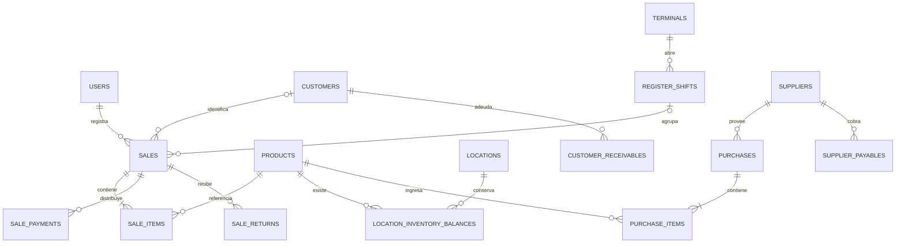

# 05. Persistencia y modelo de datos

[Volver al índice](README.md)

## 1. Archivo, conexión y garantías

La persistencia principal es SQLite. `openDatabase` configura `foreign_keys=ON`, `trusted_schema=OFF`, `journal_mode=WAL`, `synchronous=FULL` y espera de bloqueo de 5 segundos. Antes de utilizar una base existente hace `quick_check`; una base no vacía sin historial esperado no se adopta silenciosamente como si perteneciera al producto.

WAL permite que SQLite registre cambios en un archivo auxiliar antes de consolidarlos. El archivo `.sqlite` puede tener acompañantes `-wal` y `-shm` mientras está abierto. Copiar sólo el archivo principal durante escritura no equivale necesariamente a una copia consistente. Para respaldar se utiliza el mecanismo de la aplicación o un procedimiento con la base detenida y validada.

Las transacciones, restricciones e índices mejoran la integridad, pero no protegen contra pérdida física del disco, robo del equipo o una persona con acceso de escritura al directorio. La base en uso no está cifrada por el simple hecho de que los backups sí lo estén.

## 2. Identificadores y convenciones

Predominan identificadores UUID almacenados como texto. Las ventas, compras y devoluciones también pueden tener numeración para lectura humana. Un número visible no reemplaza la clave estable de una relación.

Convenciones frecuentes:

| Sufijo/campo | Interpretación |
|---|---|
| `_cents` | Entero monetario en centavos |
| `_base` | Cantidad base: unidades o gramos según producto |
| `_micros` / `rate_micros_per_base` | Tasa de costo con escala adicional |
| `_at_utc` | Instante UTC serializado |
| `business_date` | Día comercial utilizado para agrupaciones |
| `local_month` | Clave mensual comercial |
| `revision` | Versión para concurrencia optimista |
| `operation_key` | Identidad de una acción para recuperación/idempotencia |
| `payload_hash` | Huella de los datos de la solicitud |
| `snapshot_json` | Instantánea del contenido representado |
| `active` | Disponibilidad lógica, no borrado físico |

Cada tabla tiene su definición exacta en el [diccionario completo](referencia-base-datos.md). Las convenciones ayudan a leerlo, pero no deben sustituir CHECKs y tipos declarados.

## 3. Configuración e identidad

`app_settings` conserva parámetros de aplicación. `business_settings` contiene la configuración del negocio, moneda, medios y revisión. `business_features` registra funciones habilitadas. `terminals` define puestos de atención y `terminal_locations` su asignación física.

`users`, `auth_sessions` y `auth_attempts` separan perfiles, sesiones y control de intentos. La representación ADMIN se apoya en el atributo administrativo del usuario; no es simplemente otro nombre decorativo de OWNER. Las consultas de perfil devuelven columnas públicas, no hashes de contraseña.

## 4. Catálogo e identificación

`products` conserva el artículo y su configuración. `product_categories` y `product_brands` normalizan clasificaciones. `barcode_sequences` permite generar identificadores internos; `product_labels` registra etiquetas. `import_batches` conserva aplicación de cargas y sus claves/huellas.

La restricción de unicidad sobre identificadores evita que un escaneo resuelva ambiguamente dos artículos. Las relaciones históricas no dependen de que el nombre actual sea único. Un mismo nombre puede ser insuficiente para identificar una presentación o marca.

## 5. Inventario

`inventory_balances` y `stock_movements` representan saldo e historial. `locations` y `location_inventory_balances` agregan la dimensión de ubicación. La evolución del esquema mantiene estructuras previas por compatibilidad; leer todas como inventarios distintos y sumarlas duplicaría cantidades.

`lot_product_settings` configura seguimiento por lote; `inventory_lots` describe partidas; `location_lot_balances` ubica su cantidad; `lot_movements` y `lot_operations` conservan movimientos y operación. `sale_item_lots` relaciona lo vendido con partidas asignadas. Las devoluciones tienen su relación equivalente.

El saldo acelera consulta; el historial conserva explicación. Reparar una diferencia no debería consistir en editar sólo el saldo con SQL: se perdería la relación con movimientos, revisiones y lotes.

## 6. Ventas, pagos y documentos

`checkout_drafts` conserva borradores. `sales` es la cabecera confirmada; `sale_items` son las instantáneas de líneas; `sale_payments` distribuye el pago; `sale_events` registra hechos como confirmación o anulación. `sale_promotions` y `sale_promotion_allocations` conservan la aplicación de promociones.

`sale_returns`, `sale_return_items`, `sale_return_refunds` y `sale_return_events` modelan devoluciones. `sale_return_item_lots` mantiene trazabilidad de partidas. Las devoluciones no se expresan como una venta negativa inventada sin relación con la original.

`sale_receipts` contiene comprobantes y su instantánea, formato, estado, autor y fecha. `printer_profiles` existe en el esquema para perfiles de impresión; la existencia de la tabla no prueba que haya selección nativa automática de cualquier impresora implementada en todos los clientes.

## 7. Turnos y movimientos de efectivo

`register_shifts` guarda apertura y cierre. `register_movements` representa ingresos, retiros y reintegros, con enlaces a operaciones cuando corresponde. Las ventas se vinculan al turno; cobros de clientes y pagos a proveedores pueden generar movimientos específicos.

`control_cash_reviews` y `control_cash_review_history` agregan la revisión posterior sin alterar la evidencia del cierre original. De esta manera la diferencia detectada y su explicación posterior son hechos separados.

## 8. Compras y costos

`suppliers` identifica proveedores. `purchase_drafts` conserva recepción en preparación; `purchases`, `purchase_items` y `purchase_events` guardan recepción e historia. `product_cost_states` mantiene el estado de costo y `product_cost_events` su evolución.

`price_change_previews`, `price_change_batches` y `price_change_items` separan propuesta de actualización masiva, aplicación y detalle. `promotions` almacena las reglas promocionales y sus atributos. El historial de la venta conserva la versión que se aplicó, aunque la promoción se edite después.

## 9. Clientes y cuentas

`customers` conserva datos y condiciones de crédito. `customer_receivables` identifica obligaciones nacidas de ventas. `customer_collections` registra cobros, `customer_collection_allocations` su distribución y `customer_credits` los créditos que surgen del circuito.

El proveedor tiene el conjunto simétrico: `supplier_payables`, `supplier_payments`, `supplier_payment_allocations` y `supplier_credits`. No se debe calcular deuda sumando a la vez obligación original y sus imputaciones como si todas fueran nuevos cargos.

`control_due_history` guarda cambios de fecha de obligaciones. La agenda consulta las obligaciones existentes; no necesita crear un segundo libro de cuentas independiente.

## 10. Traslados

`stock_transfers` guarda origen, destino y estado; `stock_transfer_items` detalla productos; `stock_transfer_item_lots` identifica partidas; `stock_transfer_events` registra hechos del circuito. El estado en tránsito conserva una etapa operativa que no es stock libre de ambos lugares a la vez.

## 11. Control, reposición y revisión

`saved_views` y `workspace_preferences` permiten personalización por usuario. `control_operation_results` conserva resultados recuperables. `control_count_sessions` y `control_count_lines` modelan conteos parciales y su aplicación.

`replenishment_calendars` define días de apertura y cierres; `replenishment_product_rules` registra múltiplos u otras reglas de compra. `replenishment_orders`, `replenishment_order_lines`, `replenishment_receipts` y `replenishment_events` mantienen pedidos, recepciones y trazabilidad.

`commercial_settings`, `commercial_price_reviews` y `commercial_price_events` registran parámetros y revisión de precios. `weekly_snapshots` guarda resúmenes por semana y versión. No es una vista SQL que siempre refleje el presente: contiene información consolidada al generarse.

## 12. Auditoría y notificaciones

`audit_events` conserva eventos de aplicación. `control_audit_details` agrega estado anterior/posterior con selección de campos. `notification_reads` registra qué avisos se leyeron. No necesariamente existe una fila permanente por cada condición de alerta: parte de las notificaciones se deriva de consultas al estado del negocio.

La auditoría sirve para rastrear acciones dentro del sistema. No es un registro criptográficamente inmutable ante un administrador del archivo SQLite. Tampoco reconstruye cambios manuales hechos por fuera de los servicios.

## 13. Migraciones

Hay 29 versiones registradas en `schema_migrations`, cada una con fecha y checksum. La primera crea configuración básica y las siguientes agregan catálogo, inventario, ventas, usuarios, operación web, administración, clasificación, identificación, comprobantes, marca, módulos y el resto de áreas hasta Control y resúmenes semanales.

Antes de actualizar una base existente se crea un respaldo de migración mediante `VACUUM INTO`, validado con comprobaciones de integridad y claves foráneas. La migración se aplica en transacción inmediata. Una base con versión superior al código se rechaza; no existe downgrade automático.

No se deben editar migraciones ya aplicadas para acomodar un cambio nuevo. El checksum detecta diferencias y el programa puede negarse a abrir la base. La compatibilidad contempla normalización de finales de línea para no confundir CRLF/LF con una modificación real. Una evolución debe añadir otra migración y pruebas de actualización desde datos anteriores.

## 14. Diagrama conceptual

El diagrama es conceptual y omite tablas auxiliares. Las nulabilidades y cardinalidades efectivas de cada FK se consultan en el diccionario; no usar este dibujo como DDL de instalación.

## 15. Datos de demostración y datos reales

El repositorio contiene herramientas de simulación de un comercio y referencias a una base local de cinco meses. Esos datos permiten mostrar ventas variables, compras, stock, clientes y otras situaciones. La documentación no certifica el volumen de una instancia actual sin consultarla, ni copia sus personas o credenciales.

Una simulación sirve para demostrar flujos y probar escala, pero no valida por sí sola consistencia con la caja física de un negocio. Una instalación real requiere separar directorios, definir saldos iniciales, comprobar unidades y costos y acordar qué historia se importa.

## 16. Acceso de análisis y reparación

Para analizar, trabajar sobre una copia consistente y preferir acceso de sólo lectura. Para reparar, preservar el original, reproducir el problema y aplicar una migración o comando específico con auditoría cuando corresponda. No desactivar claves foráneas ni borrar movimientos para lograr que una pantalla “cierre”. La relación entre stock, costo, lotes y cuentas hace que un arreglo aislado pueda crear varias inconsistencias.
