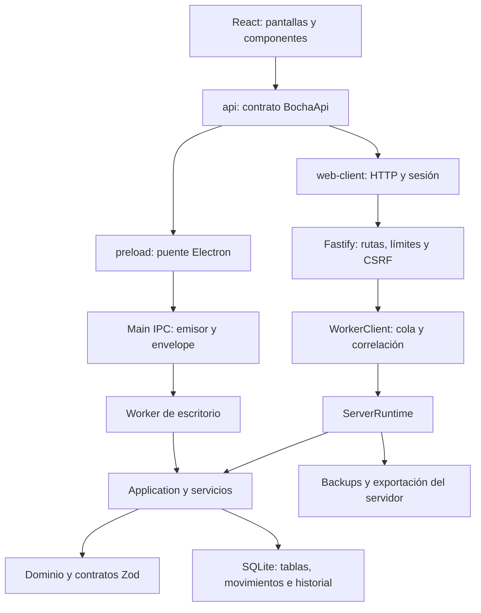
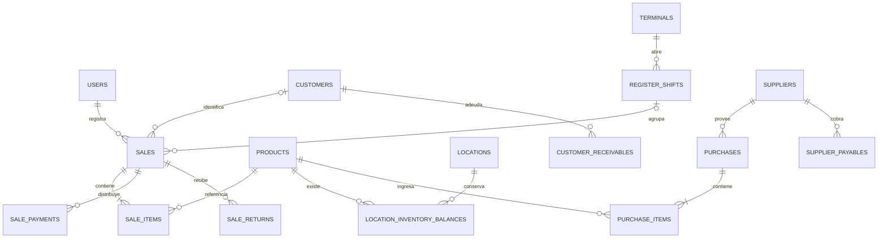

# Perla Negra POS — documentación completa

Autor del producto: Luis Agustín Arispe. Corte documental: 9 de octubre de 2026. Paquete 0.1.0; esquema SQLite 29.

Esta edición reúne el manual funcional, arquitectura, reglas, seguridad, operación y referencias exhaustivas del código local. No contiene credenciales ni datos personales del negocio. Las pruebas históricas se distinguen de las verificaciones realizadas para esta documentación.

[Índice por archivos](README.md)

## Contenido

- [01. Producto y alcance](#01-producto-y-alcance)
- [02. Manual funcional completo](#02-manual-funcional)
- [03. Reglas de negocio y consistencia](#03-reglas-de-negocio)
- [04. Arquitectura e implementación](#04-arquitectura)
- [05. Persistencia y modelo de datos](#05-persistencia)
- [06. Frontend, UX, escáner e impresión](#06-frontend-y-dispositivos)
- [07. API, permisos y seguridad](#07-api-y-seguridad)
- [08. Instalación, despliegue y mantenimiento](#08-operacion-y-despliegue)
- [09. Reportes, Excel y lectura de métricas](#09-reportes-y-exportaciones)
- [10. Pruebas, limitaciones y evolución](#10-calidad-y-evolucion)
- [11. Glosario y guía de mantenimiento del código](#11-glosario-y-mantenimiento)
- [Diccionario completo de la base de datos](#referencia-base-datos)
- [Referencia de rutas, permisos, filtros y contratos](#referencia-api-permisos)
- [Inventario de código, dependencias, comandos y pruebas](#referencia-inventario)


---

<a id="01-producto-y-alcance"></a>

# 01. Producto y alcance

## 1. Qué es Perla Negra POS

Perla Negra POS es un sistema de punto de venta y gestión comercial para un negocio minorista. Reúne la venta de mostrador, el control de mercadería, las compras, las cuentas de clientes y proveedores y la lectura de resultados. Su objetivo es que una operación cotidiana deje información útil sin obligar al operador a mantener planillas paralelas para cada parte del negocio.

La unidad central del programa es la operación comercial: una venta, una recepción de compra, un movimiento de stock, un traslado, un cobro o un cierre de caja. Cada operación puede afectar varios módulos. Una venta confirmada, por ejemplo, conserva sus precios e importes, registra el medio de pago, descuenta existencias cuando corresponde, utiliza el costo conocido para los resultados y puede originar una deuda del cliente o un comprobante para imprimir.

El sistema está pensado para crecer desde una persona que atiende y administra hasta un comercio con empleados, más de una terminal y varias ubicaciones de mercadería. El jefe conserva las capacidades de vendedor y supervisor. No necesita otra cuenta de vendedor para atender su propia caja. Esa acumulación de capacidades no elimina los controles de una operación: también debe seleccionar una terminal válida, abrir su turno y respetar los límites de crédito y estados de inventario.

## 2. Qué problemas organiza

### Venta y atención

Permite identificar productos por búsqueda o código, registrar unidades y porciones por peso, aplicar promociones, cobrar mediante uno o varios medios y recuperar operaciones ante errores de comunicación. Reduce la dependencia de memorizar precios y de calcular manualmente descuentos y vuelto.

### Mercadería y reposición

Distingue la existencia conocida de un producto sin conteo inicial. Registra entradas, salidas, ventas, devoluciones, ajustes y traslados. Los mínimos, el historial de demanda y los pedidos pendientes ayudan a decidir qué comprar o mover entre depósitos. El sistema no puede conocer la mercadería física que nunca se registró; el conteo y la disciplina de carga siguen siendo parte del trabajo.

### Control económico

Relaciona precios, costos, descuentos, cuentas pendientes y ventas. Presenta margen bruto conocido y cobertura de costos para no mostrar como ganancia un importe para el que falta información. Separa una venta a cuenta de su cobro posterior: vender y recibir efectivo no son el mismo hecho.

### Continuidad y trazabilidad

Conserva borradores, identificadores para evitar duplicaciones, revisiones de registros, eventos e historial. Incluye respaldo y restauración. Una corrección importante se expresa mediante un movimiento o reversión, no borrando indiscriminadamente el pasado.

## 3. Conceptos que no deben confundirse

| Concepto | Significado dentro del producto |
|---|---|
| Producto | Identidad del artículo, unidad de venta, precio, clasificación y configuración de seguimiento |
| SKU | Identificador interno del catálogo; puede ser distinto del código de barras |
| Código de barras | Texto que identifica un producto para buscarlo; no contiene necesariamente precio, marca o stock |
| Terminal | Puesto de atención, por ejemplo Caja 1; no es una empresa ni un depósito |
| Turno de caja | Apertura, operaciones y cierre de una terminal con un responsable |
| Ubicación | Lugar donde existe mercadería: salón, depósito, cámara de frío u otro local |
| Lote | Partida identificable de un producto, con existencia y eventual vencimiento |
| Venta | Operación confirmada con líneas, precios, cantidades, descuentos y pagos o saldo a cuenta |
| Borrador | Operación todavía no confirmada; no es una venta ni una compra recibida |
| Compra recibida | Mercadería efectivamente registrada como ingresada, con sus costos y proveedor |
| Pedido de reposición | Necesidad encargada o planificada; puede recibirse parcialmente y no equivale a stock disponible |
| Cuenta corriente | Obligaciones pendientes y sus imputaciones; no es un medio de pago bancario |
| Comprobante | Representación imprimible de una operación del sistema; no presupone autorización fiscal |
| Resumen | Consulta calculada o versión guardada de resultados, según el módulo |

## 4. Plataformas y alcance de esta versión

El repositorio contiene dos caminos de ejecución. La web utiliza un navegador, un servidor Fastify y un hilo worker de Node que accede a SQLite. Electron incluye un renderer React y un puente IPC hacia un worker local. Comparten una parte importante del dominio, contratos y servicios.

La experiencia web concentra la implementación de terminales conectadas, sesión HTTP, exportaciones XLSX y backups del servidor. Electron tiene su propio arranque, almacenamiento y transporte. Compartir interfaz no permite asumir que cada capacidad agregada al servidor está disponible automáticamente en la aplicación local. El inventario técnico identifica esta diferencia para evitar promesas de paridad sin verificar.

El empaquetado de este repositorio está configurado para Windows x64 con NSIS. La preparación de una aplicación Mac se trató como una versión separada. Tampoco hay aquí un sistema de sincronización entre bases locales de varias computadoras: dos cajas web trabajan contra la misma instancia; dos bases independientes no se fusionan solas.

## 5. Mapa general de módulos

| Área | Funciones principales |
|---|---|
| Inicio | Pendientes y acceso a tareas: vender, revisar existencias, vencimientos, diferencias, pagos y precios |
| Caja | Apertura, identificación de productos, carrito, peso, descuentos, cliente, cobro y cierre |
| Ventas | Historial, detalle, anulaciones, devoluciones y comprobantes |
| Productos | Catálogo, categorías, marcas, identificadores, importación, etiquetas y revisión comercial |
| Stock | Existencias, movimientos, mínimos, conteos y vencimientos |
| Compras | Recepción, borradores, historial, proveedores y pedidos de reposición |
| Ubicaciones | Existencias por lugar, asignación de terminales y transferencias |
| Clientes | Datos básicos, disponibilidad de crédito, deuda, cobros y estados |
| Cobros y pagos | Agenda de obligaciones, fechas acordadas, historial y pagos parciales |
| Promociones | Porcentaje, X por Y, precio por cantidad y combos |
| Turnos | Historial de cajas, efectivo esperado, contado y revisión de diferencias |
| Resultados | Resumen mensual, comparaciones, márgenes, rankings y resumen semanal versionado |
| Administración | Negocio, funciones, terminales, usuarios, actividad y copias |
| Ayuda y cuenta | Explicaciones operativas, búsqueda de ayuda y gestión de la sesión |

## 6. Configuración modular

Hay quince funciones configurables: reposición, control de stock, resumen mensual, comprobantes, etiquetas, proveedores y compras, costos y margen, devoluciones, lotes, promociones, notificaciones, cuentas de proveedores, clientes, crédito a clientes y ubicaciones/traslados.

Esto permite reducir la complejidad visible para un comercio que comienza. La configuración no se interpreta como eliminación de datos. Existen dependencias y bloqueos cuando quedan obligaciones o movimientos en curso. Deshabilitar una función tampoco concede permisos a otro rol. Son dos decisiones distintas: qué utiliza el negocio y qué puede hacer la persona que inició sesión.

## 7. Qué no debe venderse como capacidad ya resuelta

No se identificó una integración de facturación fiscal con ARCA/AFIP, emisión de CAE, liquidación tributaria, conexión directa a una balanza, autorización de tarjetas mediante un adquirente, conciliación automática de bancos, catálogo universal por código de barras, tienda online sincronizada ni sincronización offline de múltiples bases. Registrar “Débito” es clasificar un pago recibido por el comercio; no procesa por sí mismo la transacción del posnet.

Tampoco se presenta como contabilidad general de doble partida, cálculo de utilidad final, liquidación de sueldos ni SaaS multiempresa. Las ubicaciones corresponden a mercadería dentro de la instancia. El tratamiento de datos personales, el hospedaje contratado, las obligaciones fiscales y la política comercial del negocio deben definirse al desplegar una instalación real.

## 8. Principio de adopción

La puesta en marcha puede ser gradual: catálogo y caja primero; stock contado después; compras y costos para mejorar márgenes; clientes a cuenta si el comercio fía; ubicaciones y reposición cuando el volumen lo justifica. El diseño modular ayuda a ese proceso, pero cada activación debe acompañarse de datos iniciales fiables y una explicación corta al usuario.

El valor del sistema está en convertir cada acción rutinaria en información consistente. Un tablero vistoso con costos ausentes o stock ficticio no reemplaza una buena carga inicial. Por eso el programa diferencia estados desconocidos, conserva revisiones y ofrece circuitos de conteo y recuperación.

## 9. Perla: nombre, identidad y significado de marca

### Marca del producto y marca del comercio

**Perla** es el nombre elegido para el producto de gestión comercial. **Perla Negra** es la identidad del comercio de pescados y mariscos que utiliza el sistema. Esta definición de marca, trabajada el 9 de octubre de 2026, permite presentar el software a distintos comercios con una identidad propia.

Los capítulos técnicos describen la implementación existente, que todavía utiliza el nombre Perla Negra POS. Documentar la marca Perla no implica que ya se hayan reemplazado nombres, logos, pantallas o identificadores en la aplicación. La disponibilidad comercial del nombre y del dominio sigue sin verificarse.

La presentación propuesta es **«Perla — Gestión para tu comercio»**. Como frase breve de comunicación se propone **«Tu negocio en orden»**.

### Qué significa el nombre

Perla representa lo valioso que hay dentro de cada negocio: el trabajo de sus personas, sus productos, sus clientes y todo lo que construyen día a día. El software ayuda a cuidar ese valor mediante información clara y procesos cotidianos ordenados.

Una perla se forma de a poco, por capas. Como metáfora de marca, ese proceso conecta con un comercio que crece con tiempo, constancia y decisiones cotidianas. El nombre es corto, cercano y fácil de incorporar al lenguaje de trabajo: «cargalo en Perla» o «revisalo en Perla».

La historia de marca acordada se expresa así:

> Cada negocio tiene algo valioso. Perla te ayuda a cuidarlo, ordenarlo y hacerlo crecer.

La sensación que se busca transmitir es: **«Mi negocio está en orden y puedo avanzar con tranquilidad»**. Es una intención de comunicación y experiencia, no una garantía automática de resultados comerciales.

### Qué representa el logo

El símbolo combina una perla con una forma abierta y ondulante inspirada en el mar. Su dirección visual surgió de la búsqueda de ligereza y movimiento suspendido, tomando como referencia expresiva los pliegues del emblema de Qatar 2022. La propuesta de Perla desarrolla una cinta marina abierta y asimétrica, con la perla en su espacio interior.

| Elemento | Significado propuesto |
|---|---|
| Perla central | El negocio y su valor: personas, relaciones, productos y trabajo acumulado. Es el punto de atención que el sistema acompaña. |
| Forma del mar | El movimiento diario de ventas, mercadería, compras y dinero. |
| Curvas abiertas | Libertad, adaptación y capacidad de acompañar distintas etapas del comercio. |
| Perla suspendida | Equilibrio y tranquilidad para manejar la actividad cotidiana con orden. |
| Azul profundo | Serenidad, confianza y estabilidad. |
| Dorado | El valor del negocio y el protagonismo de la perla. |
| Letras de carácter tecnológico | La identidad del producto como herramienta de software contemporánea. |

Estos significados constituyen la narrativa de marca elegida; no se presupone que todas las personas interpreten espontáneamente cada forma o color del mismo modo.

### Paleta y tratamiento visual

La paleta de referencia conserva los colores trabajados en el proyecto:

| Color | Valor de referencia | Uso de marca |
|---|---|---|
| Azul tinta | `#152B36` | Símbolo y nombre; base de la identidad. |
| Azul mar | `#223C49` | Color de apoyo heredado del sistema visual. |
| Dorado latón | `#B38B47` | Perla y acentos que destacan el valor. |
| Marfil | `#F2EFE8` | Interior del pliegue y detalles claros. |
| Blanco | `#FFFFFF` | Fondo principal y espacio alrededor del logo. |

Estos códigos son los valores de diseño indicados durante la generación; el PNG puede contener variaciones tonales y píxeles de suavizado. Para una futura versión vectorial se deberán fijar los rellenos con estos valores.

La dirección más reciente prioriza formas simples y una perla gráfica con un detalle de luz recortado. Se descartó el acabado nacarado realista porque sus brillos y volumen transmitían una estética anterior a la buscada. El objetivo visual es una marca actual, con movimiento libre y pocos elementos.

### Tipografía del logo: qué se utilizó realmente

El nombre **Perla** está dibujado dentro de una imagen generada con la herramienta de generación de imágenes. **No se utilizó ni se identificó una fuente tipográfica comercial o instalada con un nombre concreto.** No existe un archivo de fuente asociado a estas letras ni un alfabeto completo definido por esta exploración.

La dirección tipográfica solicitada fue un lettering de aspecto futurista y profesional: construcción geométrica, trazos de peso medio, curvas suavizadas, proporciones algo extendidas y terminaciones con cortes angulares. La «P» abierta y los recortes de las letras aportan carácter tecnológico; las curvas mantienen relación con el movimiento del símbolo. El texto se presenta como «Perla», con inicial mayúscula.

La versión de letras futuristas recibió la aprobación del autor del producto durante la exploración. Las siguientes iteraciones ajustaron el protagonismo y el acabado de la perla. El último archivo es una propuesta de trabajo; todavía no se registró una aprobación explícita del conjunto definitivo.

Este lettering es distinto de las fuentes de la interfaz existente: **Manrope** se usa en la operación del sistema y **Cinzel 600** se reserva a la identidad de Perla Negra documentada en el diseño actual. Ninguna de las dos debe presentarse como la fuente del nuevo logo Perla.

Para producir una identidad reproducible se deberá vectorizar y ajustar el lettering, revisar espaciado y legibilidad a tamaños pequeños, y conservar el resultado como trazados. Si se desea una familia tipográfica para títulos, web o piezas comerciales, habrá que seleccionarla por separado y comprobar su licencia. La generación de esta imagen no permite atribuir exclusividad tipográfica ni disponibilidad registral.

### Archivos de la exploración

- [Propuesta gráfica más reciente, v9](../../output/branding/perla-logo-grafico-v9.png): perla dorada con detalle claro y lettering futurista.
- [Referencia de tipografía futurista, v7](../../output/branding/perla-logo-futurista-v7.png): versión en la que se aprobó la dirección de las letras.
- [Exploración de perla nacarada, v8](../../output/branding/perla-logo-perla-protagonista-v8.png): antecedente reemplazado por la búsqueda de un acabado más actual.

Los entregables actuales son imágenes PNG. No son archivos vectoriales ni fuentes instalables. Se conservan en `output/branding/`; su incorporación a la aplicación y la preparación de variantes para fondos oscuros, iconos o impresión son trabajos posteriores.


---

<a id="02-manual-funcional"></a>

# 02. Manual funcional completo

Los nombres de navegación corresponden a la organización actual. La visibilidad depende del rol y de las funciones activadas. Una pantalla que no aparece puede estar deshabilitada o fuera del permiso del usuario; no significa necesariamente que sus datos se hayan borrado.

## 1. Ingreso, cuenta y jornada

Cada persona entra con su usuario y contraseña. Los perfiles son vendedor, supervisor, jefe y administrador del sistema. Conviene asignar una cuenta a cada responsable para que ventas, cierres y movimientos tengan autor identificable. La cuenta administrativa técnica no reemplaza el usuario cotidiano de la dueña o del jefe.

En la web, la sesión puede vencer por inactividad, duración máxima o cambios de la cuenta. Un nuevo ingreso del mismo usuario reemplaza su sesión anterior bajo la configuración del runtime web. Si dos empleados necesitan atender simultáneamente, deben utilizar usuarios distintos y las terminales correspondientes.

Antes de vender se elige una terminal disponible. Abrir caja registra el efectivo inicial: es fondo para cambio, no una venta. El turno permite reunir los movimientos de esa jornada de atención. Cambiar una terminal o cerrar un turno no debe hacerse mientras se ignora el resultado de un cobro pendiente.

## 2. Inicio: tareas que necesitan atención

Inicio organiza pendientes en grupos con un total y una muestra limitada. Las categorías incluyen vencimientos, reposición, diferencias de caja, obligaciones de cobro/pago y revisión de precios. El usuario entra al módulo correspondiente para trabajar el conjunto completo. El panel no pretende mostrar miles de productos en una sola lista.

“Vender” lleva a Caja. El acceso a conteos inicia la revisión de inventario cuando está habilitada. El total de un grupo es una cantidad de pendientes, no necesariamente dinero ni operaciones nuevas del día. Una muestra breve no significa que los restantes registros hayan desaparecido.

Una buena rutina del jefe es comenzar por obligaciones urgentes, revisar faltantes importantes y atender la caja. El análisis comercial completo puede hacerse en otro momento. Esta separación reduce la cantidad de decisiones que el operador debe tomar al abrir el programa.

### Notificaciones y preferencias

La campana muestra avisos generados a partir del estado del negocio: stock bajo o agotado, lotes próximos a vencer o vencidos y, para jefe/administrador, diferencias de caja y una caída semanal que cumple las condiciones del servicio. No es un canal de mensajes externos ni un sistema de correo automático.

La lectura es individual por usuario y se asocia a una firma de la condición. Si cambia el dato que originó el aviso, puede volver a mostrarse como no leído. Marcar un aviso leído no repone stock, no descarta un lote y no resuelve una diferencia de caja: sólo registra que se vio. Inicio y la campana utilizan consultas y muestras diferentes; sus cantidades no tienen por qué coincidir una a una.

Las preferencias del espacio de trabajo permiten guardar la sección inicial dentro de las opciones autorizadas. Las vistas guardadas conservan filtros privados por usuario; el servicio limita a treinta vistas por persona. Elegir una vista facilita volver a una búsqueda habitual, pero no concede acceso a funciones o datos fuera del rol.

## 3. Caja: identificar y agregar productos

### Escaneo

Con el campo de código enfocado, el lector envía el identificador y termina con Enter. El programa busca ese código en el catálogo. Si el producto está activo y puede venderse, lo agrega o inicia el ingreso de peso. Un producto desconocido requiere buscarlo o cargarlo mediante el circuito autorizado; no se inventa una descripción o un precio.

Los códigos se conservan como texto, incluidos sus ceros iniciales. El lector debe estar configurado como teclado USB HID. El sonido del lector indica que pudo decodificar una etiqueta; la interfaz confirma si el sistema encontró el producto.

### Búsqueda y cantidades

La búsqueda permite seleccionar por nombre o identificador. En una venta por unidades, repetir un producto puede aumentar su cantidad. Las porciones por peso mantienen su identidad de línea para que una porción se pueda corregir sin alterar otra. Quitar una línea modifica el carrito, todavía no una venta confirmada.

El precio del catálogo se copia al borrador junto con su revisión. Si alguien modifica ese producto mientras se prepara la venta, el servidor puede exigir revisar la operación antes de confirmar. No conviene tratar esa advertencia como un error que debe saltarse: protege al negocio de cobrar con una versión incompatible.

### Productos por kilo

Se ingresa el peso leído de la balanza o el importe de una porción usando el diálogo correspondiente. Debe observarse explícitamente la unidad mostrada: gramos y kilos no son intercambiables. Para un producto de $12.000 por kilo, 250 gramos representan $3.000. La existencia de ese producto también se controla en una unidad base equivalente a gramos.

La calculadora ayuda a cargar la porción, pero no recibe automáticamente el peso de cualquier balanza. Una integración de balanza exige otro protocolo y pruebas del equipo real.

## 4. Carrito, promociones y descuento

El carrito muestra productos, cantidades, subtotal, descuentos y total. Las promociones se calculan en función de los productos y cantidades presentes. Agregar o quitar una unidad puede cambiar la promoción aplicable. El sistema conserva en la venta qué promociones participaron y sus importes.

El descuento manual permite porcentaje o importe fijo según el formulario. Debe distinguirse del ahorro por promoción. La cotización del servidor determina el resultado final; no se acepta que el navegador decida libremente cuánto cobrar o cuánto descontar.

Cancelar la venta en curso descarta el borrador del carrito. Anular una venta ya confirmada es otra acción, con consecuencias de stock y dinero y mayores permisos. Esta distinción es importante al capacitar al usuario.

## 5. Cliente desde Caja

Se puede elegir un cliente existente desde el carrito o desde el cobro. También se puede crear uno desde esos lugares: nombre obligatorio y contacto opcional. Al guardar se selecciona para la operación actual. Cancelar la creación vuelve al contexto anterior y conserva el carrito.

El vendedor puede crear los datos básicos necesarios para atender. No puede aprovechar ese formulario para habilitar crédito, cambiar su límite o editar arbitrariamente la ficha de otro cliente. El jefe o administrador habilita la cuenta corriente y define el límite desde el módulo correspondiente.

Asociar un cliente a una venta no obliga a fiarla. Puede pagar de contado y quedar identificado. Para dejar saldo a cuenta, el cliente debe estar activo, tener crédito habilitado y disponibilidad suficiente. Una ficha recién creada no debe interpretarse como autorización automática para fiar.

## 6. Cobrar una venta

1. Revisar el total calculado.
2. Elegir el cliente si la venta debe identificarse o quedar a cuenta.
3. Seleccionar el medio de pago.
4. Si se recibe efectivo, ingresar lo entregado por el cliente y revisar el vuelto.
5. Si se combinan medios, dividir el pago y completar los importes de cada parte.
6. Comprobar que el importe aplicado cubra el total que se paga en el momento.
7. Confirmar expresamente la venta.

Los medios configurables son efectivo, débito, crédito, transferencia y otro. “Crédito” en esa lista se refiere a tarjeta de crédito; “dejar a cuenta” corresponde a la cuenta corriente del cliente. No son equivalentes.

Sólo efectivo admite monto entregado y vuelto. Los pagos se registran por lo aplicado a la venta, no por el efectivo bruto antes de devolver cambio. Dividir el pago no permite que la suma quede corta o exceda el total exigido por el servidor.

Si se corta la conexión al confirmar, no debe generarse otra venta a ciegas. El programa conserva una clave de operación para consultar si la anterior se confirmó. Una respuesta que no llegó al navegador puede corresponder a una venta correctamente guardada en el servidor.

## 7. Borradores y recuperación

Los borradores permiten conservar una venta o una compra que todavía se está preparando. El frontend mantiene su estado y envía escrituras ordenadas; también existen datos locales de recuperación para situaciones pendientes. La recuperación no transforma al navegador en una caja offline autónoma.

Cuando aparece una operación pendiente, la tarea es resolver su estado: recuperar el resultado, reintentar de forma idempotente o descartar el borrador cuando se haya confirmado que no produjo efectos. Borrar manualmente el almacenamiento del navegador puede perder esa ayuda; por eso no es una primera solución recomendable ante una duda de cobro.

## 8. Ingresos, retiros y cierre de caja

Un ingreso o retiro de efectivo debe registrarse con su motivo. Esto permite explicar por qué el dinero físico no coincide sólo con las ventas en efectivo. Las transferencias y tarjetas se controlan en sus medios, pero no aumentan por sí mismas el efectivo del cajón.

Al cerrar se cuenta lo que hay y se compara con el esperado. El cierre conserva el resultado y la diferencia. La revisión posterior de una diferencia agrega una explicación o estado de revisión; no reescribe el importe original para que deje de verse el desvío.

Un terminal con turno abierto no puede desactivarse como si no estuviera trabajando. El responsable debe cerrar o resolver el turno primero. El historial permite consultar quién abrió y cerró, el fondo inicial, los movimientos y el resultado.

## 9. Ventas, detalle, anulaciones y devoluciones

El historial permite filtrar por fechas y estado, recorrer páginas y abrir el detalle. El detalle conserva nombres, unidades, precios y costos relevantes del momento de la venta, además de sus pagos y eventos. Cambiar hoy el nombre o precio del producto no debe reemplazar el comprobante histórico.

**Anulación:** invalida una venta mediante una operación registrada. Se revisa una vista previa y se confirma con las condiciones requeridas. Reversa los efectos permitidos por el circuito, en lugar de eliminar sus filas históricas. Si el estado cambió, la confirmación debe recalcularse.

**Devolución:** permite seleccionar cantidades de líneas vendidas. No puede devolverse más que lo vendido menos lo ya devuelto. El importe devuelto respeta el precio y descuento originales; no toma el precio actual del catálogo. El destino de la mercadería y el tratamiento del dinero se resuelven en el flujo de devolución. Si existe saldo a cuenta, parte de la devolución puede reducir esa deuda antes de producir un reintegro efectivo.

Una devolución de mercadería dañada no debe usarse para aumentar stock vendible sin revisar su destino. En productos con lotes, también importa qué partida se está recuperando.

## 10. Comprobantes y reimpresión

El sistema genera comprobantes en formatos térmicos de 58 y 80 mm y en A4. El comprobante se construye con una instantánea de la operación y conserva su estado de impresión. La cola permite volver a encontrar documentos pendientes.

La impresión utiliza el diálogo del sistema/navegador. Desde allí puede elegirse una impresora o guardar como PDF cuando el entorno lo permite. Registrar el intento o marcar un comprobante como impreso no constituye una confirmación física de que salió el papel: una impresora puede no tener papel o el usuario puede cancelar el diálogo.

La reimpresión debe distinguirse de una venta nueva. El documento sigue representando la misma operación. La presencia de un formato A4 similar a una factura no lo convierte en una factura fiscal autorizada.

## 11. Productos, categorías y marcas

El catálogo contiene nombre, SKU, identificadores, unidad de venta, precio, estado y configuración de stock, entre otros campos del contrato. Categoría y marca son clasificaciones diferentes: “Lácteos” agrupa un rubro; una marca identifica un fabricante o línea comercial. Se usan para buscar, filtrar, exportar y analizar.

Un producto puede desactivarse cuando deja de venderse. Desactivarlo es preferible a borrar su identidad, porque ventas, compras y movimientos históricos siguen referenciándolo. El precio se cambia mediante revisión controlada, y el stock se modifica por movimientos, no reemplazando un número sin explicación.

Si el artículo trae código, se registra el leído del envase. Si no lo trae, el sistema puede proponer un código interno y generar una etiqueta. Ese código identifica el producto dentro de la instalación; no es una alta automática en un registro comercial internacional ni descarga datos del fabricante.

### Importación masiva

La importación utiliza CSV UTF-8, con vista previa de altas, modificaciones, cambios de precio y aperturas de stock. Las columnas actuales son `sku`, `barcode`, `nombre`, `precio_ars`, `unidad`, `activo`, `categoria`, `marca`, `stock_inicial` y `stock_minimo`. También existe compatibilidad con una plantilla anterior sin marca.

Antes de aplicar deben corregirse filas inválidas y revisar los cambios. El archivo admite separador punto y coma o coma según su encabezado y los importes se interpretan con las reglas locales del importador. La vista previa tiene una vigencia limitada y no autoriza a aplicar sobre datos que cambiaron sin validar sus revisiones.

Exportar XLSX e importar CSV son capacidades distintas. No se debe prometer que cualquier planilla descargada pueda volver a importarse sin ajustarse a la plantilla.

## 12. Revisión comercial de productos

La revisión ayuda a encontrar costos faltantes, costos superiores al precio, margen bajo, costos actualizados y precios que llevan tiempo sin revisar. También permite identificar productos nunca vendidos o sin ventas recientes, diferenciando casos donde todavía no hay historial suficiente.

Marcar un artículo como revisado no aumenta automáticamente su precio. Registra que el responsable lo evaluó. Un cambio posterior del costo puede volver a generar la necesidad de revisión. Las decisiones se conservan con información de auditoría.

Las actualizaciones masivas de precios tienen una etapa de vista previa y confirmación. El jefe debe mirar alcance, selección e importes resultantes antes de confirmar. No conviene usar la herramienta para modificar todo el catálogo cuando se pretendía actualizar una categoría filtrada.

## 13. Stock y movimientos

La pantalla distingue sin conteo, agotado, bajo mínimo, negativo, disponible y sin control. “Sin conteo” no equivale a cero: significa que no hay una base fiable para el seguimiento. El mínimo es una referencia de reposición, no una prohibición de venta.

Las entradas y salidas se registran por tipo y motivo. Un ingreso por compra debe utilizar el circuito de recepción para conservar también proveedor y costo. Una merma representa una pérdida de mercadería. Un ajuste corrige una diferencia identificada. El historial permite reconstruir por qué cambió la existencia.

Un saldo negativo requiere el tratamiento explícito previsto por la operación, incluyendo motivo cuando corresponde. La existencia de esa posibilidad sirve para registrar una realidad excepcional; no convierte un inventario negativo en una situación normal o deseable.

## 14. Conteos recuperables

Se elige la ubicación y, cuando corresponde, la categoría a contar. El conteo se guarda como sesión recuperable. Las líneas no contadas permanecen distintas de las contadas en cero. Escanear ayuda a localizar artículos, pero la cantidad debe representar el recuento físico.

Al aplicar, se comprueba que el inventario observado no haya cambiado de manera incompatible desde el inicio. Si se vendió o recibió mercadería durante el conteo, puede aparecer un conflicto que debe revisarse. Esto evita que un recuento viejo sobrescriba movimientos nuevos.

El criterio operativo es trabajar por sectores o momentos de menor movimiento. Un conteo no debe convertirse en un reemplazo global de existencias sin entender qué mercadería se contó y cuál quedó fuera.

## 15. Lotes y vencimientos

El seguimiento por lotes permite registrar partida, fecha de vencimiento, estado y cantidad. La habilitación sobre un producto con stock exige reconciliar las cantidades para que las partidas correspondan con el total existente.

En ventas, la asignación automática prioriza los lotes que vencen antes entre los disponibles y habilitados. Los bloqueados o vencidos quedan fuera de esa asignación. Los lotes sin fecha se ordenan detrás de los fechados. Esa lógica ayuda al control, pero el empleado debe retirar físicamente la mercadería del lote correspondiente.

La vista de vencimientos se filtra por período y ubicación y se pagina. Desde un resultado se abre el lote para revisar la situación. Bloquear una partida no equivale a eliminar sus unidades físicas: requiere después la decisión comercial o movimiento que corresponda.

## 16. Proveedores y recepción de compras

Un proveedor conserva identidad y datos de contacto operativos. Puede desactivarse sin borrar sus compras y deudas previas. Desde Compras se selecciona el proveedor, se agregan productos por búsqueda o escaneo, se indican cantidades y costos y se revisa el total.

La recepción confirmada registra la entrada de mercadería y el costo. Puede incorporar lotes y ubicación según las funciones activas. El borrador permite preparar la carga sin aumentar existencias antes de recibirla. Una compra recibida tiene una clave propia para resolver reintentos sin duplicar el ingreso.

El costo sugerido o último costo es una ayuda; debe cotejarse con la compra actual. Anular una compra puede afectar existencias, costos y cuenta del proveedor, por lo que el sistema utiliza validación y vista previa en lugar de permitir borrar arbitrariamente el documento.

## 17. Pedidos y reposición

La reposición evalúa una ubicación, sus existencias, ventas observadas, calendario de apertura, mínimos, pedidos esperados y múltiplos de compra. Presenta sugerencias que el responsable puede revisar. Una propuesta de compra no es una orden enviada automáticamente a un proveedor.

El pedido pasa por preparación y confirmación, y puede tener fecha esperada. Se registran recepciones parciales, cantidades recibidas y cantidades pendientes. Recibir un pedido reutiliza el circuito de compras para que las existencias, costos, lotes y obligaciones mantengan una misma lógica.

Los pedidos vencidos o sin fecha y los traslados en tránsito se muestran como información para decidir. El cálculo no presupone que toda mercadería en camino llegará dentro del horizonte elegido. También indica existencias de otras ubicaciones para considerar un traslado antes de comprar.

## 18. Ubicaciones y traslados

Cada ubicación es un lugar de mercadería. Una terminal puede estar asignada al salón de ventas mientras una cámara o depósito conserva reserva. Una ubicación no se trata como una empresa con facturación propia independiente de toda la instalación.

Al preparar un traslado se eligen origen, destino y artículos, revisando lo disponible en origen. Despachar mueve la mercadería a un estado en tránsito; recibir registra lo que efectivamente llegó y sus diferencias según el contrato. Cancelar sigue un circuito específico de reversión. No debe repetirse el despacho para “forzar” que aparezca la recepción.

El historial conserva cada envío y sus productos. Un filtro por estado permite distinguir recibido, cancelado y en tránsito. La exportación del stock por varias ubicaciones identifica el lugar de cada existencia, para no confundir unidades de distintos depósitos.

## 19. Clientes y cuentas corrientes

El cliente puede existir sólo para identificar ventas, o tener crédito habilitado con un límite. La disponibilidad depende de sus obligaciones pendientes. Un cobro reduce deuda y conserva cómo se imputó. Los pagos parciales permiten seguir una cuenta sin exigir que el cliente cancele todo junto.

El jefe controla el límite y la habilitación. La pantalla de cuenta detalla obligaciones, cobros y posibles créditos. Desactivar una ficha no debe usarse para esconder una deuda. La agenda permite acordar cuándo se espera cobrar, sin inventar fechas para operaciones históricas que nunca las tuvieron.

## 20. Cuentas de proveedores y agenda

Una compra puede originar una obligación hacia el proveedor. Los pagos se registran con su importe y aplicación. La cuenta permite distinguir cuánto se compró, cuánto se pagó y qué saldo resta. La anulación de una compra debe tratar también las imputaciones y créditos relacionados.

La agenda reúne cobros a clientes y pagos a proveedores, con filtros de obligaciones vencidas, de la semana, siguientes y sin fecha. Se puede acordar una fecha, revisar su historial e imputar un pago a una obligación específica. Una fecha modificada no borra la trazabilidad del acuerdo anterior.

## 21. Promociones

Las promociones pueden reducir un porcentaje, ofrecer llevar X y pagar Y, fijar un precio a partir de una cantidad o formar un combo con componentes. Se define su alcance, vigencia y prioridad con las validaciones del formulario.

El motor las aplica al carrito; el usuario no necesita recordar cada regla en el mostrador. Las cantidades consumidas por una promoción no vuelven a utilizarse indiscriminadamente en otra. La prioridad configurada importa y el algoritmo no se presenta como un optimizador global de todas las combinaciones posibles.

Antes de usar una promoción en producción conviene probar: cantidad menor al umbral, cantidad exacta, cantidad superior, repetición de productos y convivencia con descuento manual. Una promoción mal configurada puede ser técnicamente válida y comercialmente inconveniente.

## 22. Resultados y exportaciones

El resumen mensual muestra ventas netas, cantidad de ventas, ticket promedio, evolución diaria, medios de pago, productos destacados, margen y situación de mercadería. El resumen semanal conserva versiones para comparar lo que se informó en un momento con un recálculo posterior.

El botón Exportar Excel toma los filtros del contexto y permite ajustarlos, incluidas selecciones múltiples donde corresponden. Exporta todas las coincidencias hasta el límite permitido, no sólo la página visible. La hoja de filtros explica qué se incluyó. El capítulo 09 detalla cada fórmula y las diferencias entre ventas, efectivo, crédito y rentabilidad.

## 23. Administración y ayuda

Configuración administra nombre del negocio, moneda soportada por el sistema, medios habilitados, terminales y funciones. Los cambios usan revisión para detectar que otro usuario modificó la configuración simultáneamente.

Usuarios permite administrar perfiles según la jerarquía autorizada. Actividad muestra acciones y, para las operaciones que lo registran, el estado anterior y posterior con campos permitidos. Los eventos históricos que no tenían desglose no adquieren mágicamente información retroactiva.

Copias permite generar, descargar, cargar, inspeccionar y restaurar respaldos mediante el circuito protegido. Restaurar vuelve el conjunto de datos al momento del respaldo; no es una forma de importar algunos productos. Ayuda reúne explicaciones buscables; Mi cuenta concentra acciones de la sesión y contraseña.

## 24. Circuito diario recomendado

Al abrir: iniciar sesión, seleccionar terminal, abrir turno y revisar pendientes urgentes. Durante la atención: escanear o buscar, verificar cantidades y cobrar; registrar ingresos, retiros y cobros de cuenta con su circuito. Al recibir mercadería: cargar la compra en la ubicación correcta, verificar costo y lotes. Al terminar: resolver operaciones pendientes, contar efectivo, cerrar turno y revisar diferencias. Periódicamente: contar sectores, revisar vencimientos, precios, deudas y resultados, y comprobar que existan respaldos recuperables.


---

<a id="03-reglas-de-negocio"></a>

# 03. Reglas de negocio y consistencia

## 1. Unidades y representación monetaria

Los importes de negocio se representan como enteros en centavos. `$1.250,50` se almacena como `125050`. Evitar importes binarios fraccionarios reduce errores como que varias líneas sumen un centavo distinto al total esperado. Las operaciones que multiplican o prorratean utilizan `BigInt` en partes centrales del dominio y verifican el rango antes de regresar a `number`.

El límite monetario definido en `src/domain/values.ts` es `9_999_999_999` centavos. Las cantidades base tienen límite `1_000_000_000`, aunque cada circuito puede imponer restricciones adicionales. Los productos `UNIT` usan unidades enteras; `KG` utiliza gramos como cantidad base. La calculadora y las líneas de venta por peso limitan una porción a 99.999 gramos. No debe extrapolarse ese límite de venta a toda cantidad de inventario sin leer el contrato específico.

Los porcentajes suelen expresarse en puntos básicos: `10000` representa 100 %, `1250` representa 12,50 %. Esto permite validar descuentos sin depender de una cadena formateada. Para mostrar se emplea formato `es-AR`, moneda ARS, separador de miles y coma decimal. El texto de pantalla no es el formato interno de las operaciones.

## 2. Cálculo de una venta

`calculateSale` admite de 1 a 200 líneas y valida unidad, cantidad y precio. Para unidades, bruto de línea = precio en centavos × cantidad. Para kilos, bruto = precio por kilo × gramos / 1000, redondeado al centavo con la regla del código. La suma forma el subtotal.

El descuento puede ser inexistente, fijo o porcentual. No puede superar el subtotal. Cuando debe distribuirse un descuento total entre líneas, se calcula la parte proporcional entera y se distribuyen los centavos restantes por el mayor resto, con desempate determinista por posición. Así, la suma de descuentos por línea coincide con el descuento de la venta. Esto importa para devolver después una parte sin perder o inventar centavos.

Una cotización no es una confirmación. La confirmación vuelve a comprobar catálogo, revisiones, promociones, stock, pagos y cliente. Los datos enviados por el navegador se consideran una solicitud; el servidor no confía en un total escrito por el cliente.

## 3. Precio, costo y clasificación históricos

Una línea vendida conserva instantáneas: nombre, SKU, código, unidad, precio, cantidad, descuentos, neto y, cuando existe, costo y método. También guarda clasificación relevante como el nombre de categoría para análisis histórico.

Este diseño evita que actualizar el catálogo altere el significado de una venta anterior. Una categoría histórica no siempre coincide con la categoría que hoy tiene el producto. Un reporte debe decidir si quiere clasificar por el momento de la venta o por la clasificación actual; el código usa instantáneas en determinados desgloses de rentabilidad.

La ausencia de costo se representa como falta de información, no como costo cero. Si se vendió un producto sin costo conocido, no puede calcularse su ganancia como si todo el precio fuera margen.

## 4. Confirmación, transacciones e idempotencia

La atomicidad significa que los efectos de una operación se confirman juntos o se revierten juntos. Una venta no debe quedar con cabecera guardada y stock sin descontar por una excepción intermedia. Los servicios utilizan transacciones SQLite; las escrituras sensibles recurren a transacciones inmediatas para obtener el control de escritura antes de avanzar.

La idempotencia evita que un reintento duplique efectos. Una venta utiliza `checkoutKey`; las compras, movimientos y otros circuitos usan claves equivalentes. Se conserva la clave junto con un hash de la solicitud o resultado según el servicio. Repetir la misma operación recupera su resultado; reutilizar la clave con contenido incompatible produce conflicto en los circuitos que comparan ese hash.

Ejemplo: se confirma una venta, el servidor la guarda y la conexión se interrumpe antes de responder. El navegador consulta por la misma clave. Si existía, recupera esa venta. Crear otra clave y volver a cobrar produciría otra operación legítima desde la perspectiva del sistema; por eso la recuperación necesita conservar la identidad original.

No toda acción de lectura o todo registro del programa usa idéntico mecanismo. Los contratos distinguen `operationKey`, revisiones, claves de checkout y tokens de vista previa. No deben intercambiarse.

## 5. Concurrencia y revisión optimista

Muchos registros tienen `revision` y las modificaciones reciben `expectedRevision`. Si un formulario cargó la revisión 4 y otra persona ya guardó la revisión 5, no se aplica silenciosamente el contenido viejo. Se rechaza con conflicto y se solicita recuperar el estado actual.

La revisión se utiliza en productos, configuración, clientes, terminales, existencias, promociones, pedidos y otros objetos según su contrato. En operaciones que abarcan muchas filas, una vista previa o un hash de estado protege el conjunto. No reemplaza una transacción: la revisión detecta la decisión desactualizada y la transacción preserva integridad al escribir.

## 6. Pagos y efectivo

`validatePayments` valida hasta 20 partes y exige que sus importes aplicados sumen exactamente el total que recibe. Sólo `CASH` admite `tenderedCents`; si el dinero recibido es menor al aplicado, se rechaza. El vuelto es recibido menos aplicado. En medios no efectivos, el vuelto es cero y no se admite monto entregado separado.

Cuando existe crédito a cliente, el circuito distingue el componente pagado ahora del componente dejado a cuenta. La suma económica de ambos debe cubrir la venta conforme a `SalesService`; no se permite convertir una diferencia sin pagar en un descuento implícito.

El efectivo esperado del turno se construye con fondo inicial, pagos efectivos vinculados, ingresos, retiros y reintegros registrados. Los cobros en efectivo de cuenta corriente y pagos efectivos a proveedores se vinculan a movimientos del turno dentro de transacciones. El servicio exige una transacción activa en esas integraciones para evitar que una cuenta cambie sin que cambie la caja, o viceversa.

## 7. Inventario y estados

La función `stockState` tiene este orden de evaluación:

1. Si no se controla: `DISABLED`.
2. Si no se inicializó: `UNKNOWN`.
3. Si cantidad < 0: `NEGATIVE`.
4. Si cantidad = 0: `OUT`.
5. Si cantidad ≤ mínimo: `LOW`.
6. En otro caso: `OK`.

El orden evita llamar “agotado” a un producto que nunca se contó. El saldo base y el historial de movimientos permiten explicar el resultado. Una operación verifica rangos y rechaza stock insuficiente cuando no se habilitó expresamente el comportamiento negativo correspondiente.

Activar seguimiento de stock sobre información antigua no vuelve fiable el saldo por sí solo. La desactivación global del control invalida la inicialización de productos controlados para exigir revisión al retomarlo. Es preferible una advertencia “sin conteo” a un saldo presentado como exacto después de vender durante un período sin seguimiento.

## 8. Ubicaciones, lotes y transferencias

Las existencias por ubicación resuelven dónde está cada producto. Los saldos de lote por ubicación agregan la dimensión de partida. No deben sumarse indistintamente una tabla global y una tabla por lugar: pueden representar perspectivas del mismo inventario.

Un despacho descuenta o reserva materialmente la salida de origen mediante los movimientos definidos y conserva el envío en tránsito. Recibir acredita el destino con las cantidades aceptadas. Cancelar genera la reversión permitida por su estado. Se mantienen eventos, líneas y asignaciones de lotes para rastrear el traslado.

Para ventas de productos con lotes se seleccionan partidas activas, con cantidad positiva y no vencidas en la ubicación. El orden es vencimiento más próximo, fecha de creación e identificador como desempate; los lotes sin vencimiento van después. Esa estrategia se conoce como FEFO, “primero vence, primero sale”. La política no lee etiquetas físicas por sí sola.

Los conteos de productos con lotes necesitan reconciliar el detalle y el saldo agregado. Corregir sólo uno dejaría stock que el motor de venta no podría asignar a una partida válida.

## 9. Compras y costos

Una compra recibida conserva proveedor, líneas, cantidades, costo unitario, total y eventos. Su entrada actualiza el inventario cuando corresponde y participa del cálculo de costos. Un pedido todavía no recibido no debe afectar como disponible ese stock.

El costo se maneja con una tasa en microcentavos por cantidad base (`COST_SCALE = 1_000_000`). Para kilo se convierte el costo por kilo a costo por gramo; así se evitan pérdidas de precisión al vender porciones pequeñas. La conversión a centavos de una línea ocurre con redondeo controlado.

El promedio ponderado calcula `(cantidad anterior × costo anterior + cantidad recibida × costo recibido) / cantidad total`. Si no hay cantidad anterior positiva o no hay costo previo, se toma la referencia de la recepción conforme a la función de dominio. Una existencia anterior negativa no actúa como un peso negativo que distorsione el promedio.

Existen estados y eventos de costo. Fijar una referencia es distinto de registrar una compra. Las ventas conservan el costo conocido al confirmarse; cambiar el costo hoy no recalcula automáticamente su margen histórico. Anular una recepción requiere tratar cómo se compensa su efecto y qué movimientos posteriores impiden una reversión simple.

## 10. Promociones y precedencia

El motor recibe líneas de precio y reglas elegibles. Agrupa prioridades de mayor a menor. Dentro de una prioridad calcula candidatos y selecciona el de mayor descuento; usa identificador como desempate estable. Consume la cantidad utilizada y vuelve a evaluar las reglas restantes sobre lo disponible.

Tipos implementados:

- `PERCENT`: descuento proporcional sobre productos elegibles.
- `X_FOR_Y`: grupos de unidades en los que se llevan X y se pagan Y; se limita a productos vendidos por unidad en el cálculo.
- `QUANTITY_PRICE`: precio especial cuando se alcanza un umbral de cantidad.
- `COMBO_PRICE`: precio total para conjuntos de componentes y sus cantidades.

Se descartan candidatos que no generan ahorro positivo. El descuento se distribuye por líneas para conservar detalle y soportar devoluciones. Las asignaciones guardan promoción, revisión, línea, cantidad e importe. El algoritmo es determinista, pero no explora todas las combinaciones posibles para hallar un máximo global. Configurar prioridades equivale a una decisión comercial explícita.

## 11. Devoluciones y anulaciones

Una devolución parcial parte de la venta original, sus cantidades y devoluciones previas. Calcula el neto reintegrable sin superar el remanente. Conserva líneas, eventos, reintegro y tratamiento de stock/lotes. Los centavos se distribuyen de forma que varias devoluciones parciales no excedan el importe original.

Si hay deuda de cliente, se aplica primero la compensación que define el servicio y se calcula el reintegro restante. Cuando el reintegro es efectivo, se integra a un turno válido. No se da por hecho que todo el total devuelto tenga que salir en efectivo: parte puede cancelar una cuenta pendiente.

La anulación cambia el estado e incorpora su evento y motivo. No borra la venta. Los informes excluyen ventas anuladas de los importes de ventas completadas y muestran la información de anulación por separado. El estado actual puede modificar la lectura de un período pasado; el resumen semanal guardado preserva una versión anterior si ya existía.

## 12. Cuentas e imputaciones

Una cuenta de cliente se compone de obligaciones (`customer_receivables`), cobros, imputaciones y créditos. Una cuenta de proveedor utiliza obligaciones de compras, pagos, imputaciones y créditos. El saldo no debe mantenerse como un número aislado sin su origen.

Imputar significa asignar parte de un cobro o pago a una obligación concreta. Un pago parcial puede dejar remanente. Los contratos permiten orientar el pago a una obligación desde Agenda. La corrección de ventas y compras conserva el efecto sobre lo ya imputado y los créditos resultantes según el servicio.

La habilitación de crédito y su límite son decisiones del jefe/administrador. La venta verifica cliente activo, función habilitada y disponibilidad, incluso si el botón había quedado visible en un navegador con información vieja.

## 13. Reposición: cálculo explicable

El servicio toma una ubicación, una fecha de corte, días de referencia y días de cobertura. Cuando hay calendario configurado, calcula días abiertos observados excluyendo cierres declarados. La demanda histórica descuenta devoluciones registradas en el período consultado.

La disponibilidad considera existencia inicializada y descuenta cantidades bloqueadas o vencidas de lotes. La demanda diaria se estima dividiendo demanda neta no negativa por días abiertos observados. El objetivo es el mayor entre mínimo y demanda diaria × cobertura, redondeado hacia arriba.

La sugerencia descuenta disponibilidad y entradas de pedidos con fecha dentro del horizonte; luego redondea al múltiplo de compra. Si no existe inventario conocido o no hay mínimo ni historia suficiente, puede devolver una sugerencia indeterminada en lugar de fabricar un cero. Los pedidos sin fecha, vencidos y traslados sin ETA se presentan por separado. Las existencias de otras ubicaciones informan una alternativa de traslado.

No es una predicción estadística avanzada ni conoce estacionalidad futura, feriados no cargados o promociones que todavía no se realizaron. Es una propuesta basada en reglas y datos observados, revisable por el responsable.

## 14. Conteos, revisiones y agenda

Las sesiones de conteo tienen líneas propias, revisiones y estado. Guardar una línea no aplica inmediatamente un ajuste global. Al cerrar el circuito se validan revisiones y se escriben movimientos. El valor no contado se mantiene separado de cero.

La revisión de diferencia de caja conserva el cierre original y agrega su historial. Las fechas de cobro/pago se guardan con historial de cambios. Los controles comerciales registran qué se revisó, y los eventos de costo pueden invalidar la vigencia de una revisión previa. Los resultados de operaciones de Control permiten recuperar acciones idempotentes.

## 15. Funciones y dependencias

La configuración usa una revisión global y cambios transaccionales. Reposición requiere control de stock y compras; cuentas de proveedores requiere compras; crédito a clientes requiere clientes; ubicaciones y traslados requiere control de stock. Se valida además el estado del negocio antes de deshabilitar.

Ejemplos de bloqueo: pedidos confirmados/parciales pendientes al quitar reposición, traslados en tránsito al quitar ubicaciones, obligaciones pendientes de clientes o proveedores al quitar sus módulos relacionados. Los permisos de consulta de historia al desactivar ciertas funciones son restringidos y se tratan expresamente en el servicio.

## 16. Fechas, días comerciales y tiempo

Se conservan instantes UTC y claves de fecha comercial/mes local. Los reportes usan períodos definidos con la zona de Buenos Aires. La fecha comercial hace que una venta se agrupe por el día del negocio sin depender de cómo formatee la fecha cada navegador.

Algunas tareas técnicas usan otro criterio: la copia diaria agrupa por día UTC en su implementación. No debe suponerse que todo cambio de fecha del programa sucede a la medianoche argentina. El reloj del servidor importa para vigencias, vencimiento de sesiones, promociones y respaldos.

## 17. Reglas transversales para nuevas funciones

Cualquier desarrollo que cambie dinero o inventario debería resolver: permiso, función habilitada, validación de entrada, versión esperada, clave idempotente, transacción, auditoría, recuperación tras respuesta perdida y presentación comprensible del error. Un botón visible no satisface ninguno de estos controles por sí solo. Los límites específicos y nombres exactos están en los contratos y en el diccionario de base enlazados desde el índice.


---

<a id="04-arquitectura"></a>

# 04. Arquitectura e implementación

## 1. Panorama técnico

El programa está escrito principalmente en TypeScript. El frontend utiliza React y Vite; la web expone una API Fastify; SQLite se accede mediante `better-sqlite3`. Electron aporta la variante de escritorio. Zod valida contratos compartidos y SQL explícito implementa la persistencia. No se identificó un ORM que genere automáticamente el modelo de datos.

La distribución de responsabilidades evita poner las reglas financieras sólo en componentes visuales. El dominio contiene cálculos puros; los servicios coordinan reglas y persistencia; los adaptadores HTTP/IPC transportan solicitudes; el renderer interpreta resultados y organiza la interacción.



## 2. Estructura del repositorio

| Directorio | Responsabilidad |
|---|---|
| `src/domain` | Cálculos y políticas: importes, cantidades, venta, pagos, inventario, costos, promociones, permisos y funciones |
| `src/shared` | Esquemas de entrada/salida, tipos, errores, envelopes y contratos usados entre capas |
| `src/worker` | Aplicación, servicios de negocio, repositorios y migraciones |
| `src/server` | Arranque web, HTTP, runtime, worker, lease, CLI, exportación y backups |
| `src/main` | Arranque Electron, ventana, preload, validación IPC y cliente del worker |
| `src/renderer` | React, navegación, adaptadores, componentes, pantallas, estilos y assets del frontend |
| `tests/unit` | Pruebas de reglas y utilidades aisladas |
| `tests/integration` | Pruebas de servicios, base, autorización y circuitos sin navegador |
| `tests/web-e2e` | Circuitos de navegador con Playwright |
| `tests/e2e` | Pruebas de escritorio/Electron y empaquetado según configuración |
| `scripts` | Construcción, instalación nativa, simulación, herramientas y arranque de pruebas |
| `docs` | Decisiones, manuales, informes y esta referencia integral |
| `specs` | Especificaciones y planes de funcionalidades elaborados durante el desarrollo |
| `docker` | Configuración complementaria de despliegue, incluido el proxy |
| `.data` | Datos locales por entorno; no es código fuente ni debe versionarse como catálogo real |
| `dist`, `out`, `release` | Artefactos de construcción y distribución; pueden estar desactualizados respecto de `src` |
| `output`, `test-results` | Evidencia y salidas de trabajo/QA; no son garantía automática de estado actual |

El [inventario](referencia-inventario.md) enlaza cada archivo de implementación y pruebas. La estructura anterior explica su papel; no obliga a recorrer 214 archivos para entender la aplicación.

## 3. Dependencias principales

El manifiesto fija versiones concretas. El corte analizado incluye React 19.3.0, Fastify 5.12.5, Vite 7.3.6, Electron 44.4.1, TypeScript 6.0.3, Zod 4.6.5, `better-sqlite3` 13.0.3, ExcelJS 4.4.0 y TanStack React Query 5.103.1. Node debe pertenecer a la rama 24 y npm a la 11 según `engines`.

La presencia de una dependencia no implica su uso transversal. Por ejemplo, el estado de Caja se gestiona mediante un controlador propio y suscripciones; no debe suponerse que todo el estado está en Zustand sólo porque está declarado. La referencia generada conserva la lista completa de dependencias de ejecución, desarrollo y overrides.

## 4. Camino de una solicitud web

1. La pantalla obtiene el adaptador mediante `api()` o un cliente específico de su módulo.
2. `web-client` prepara URL, JSON y, en escrituras, token CSRF. Utiliza cookies del mismo origen.
3. Fastify comprueba cabeceras, origen, límites, tipo de entrada y sesión según la ruta.
4. La ruta traduce parámetros, query y cuerpo a una operación del servidor.
5. `WorkerClient` envía una solicitud correlacionada al worker.
6. `ServerRuntime` resuelve funciones transversales o delega en `Application`/`OperationsService`.
7. Se autorizan rol y estado, se validan esquemas y se ejecuta la operación sobre SQLite.
8. El resultado vuelve como `Result`, o como descarga en las rutas que corresponden.
9. La interfaz actualiza su estado y sus consultas, o muestra un error de negocio recuperable.

Las consultas GET tienen coerción controlada para `limit`, `offset` y booleanos permitidos. No se aceptan indiscriminadamente campos extra sólo porque llegaron en una URL. Las operaciones que requieren un cuerpo estricto se validan con Zod.

## 5. ServerRuntime: coordinación del negocio web

El runtime obtiene primero un lease del archivo de base. Recupera una restauración interrumpida si corresponde y abre la base con migraciones. Construye `AuthService`, `Application`, `OperationsService` y el servicio de copias.

También resuelve selección de terminal asociada a la sesión, integración de ventas con turno y ubicación, exportaciones XLSX, importación y administración de backups. Es una capa de orquestación, no un reemplazo de las validaciones internas de cada servicio.

Hay tareas periódicas. El runtime intenta recuperar semanas pendientes de resumen comercial, una por ciclo, aproximadamente cada minuto cuando la función está habilitada. El worker comprueba el respaldo diario al iniciar y periódicamente. Estas tareas dependen de que el proceso esté funcionando; no son un servicio externo independiente capaz de trabajar con la aplicación apagada.

## 6. Worker, cola y SQLite síncrono

`better-sqlite3` ofrece consultas síncronas. Separarlas en un hilo de `node:worker_threads` evita que cada consulta bloquee directamente el hilo HTTP principal, pero no las convierte en trabajo ilimitadamente paralelo. El worker no es un servidor independiente ni una réplica de la base. Las solicitudes se ordenan y los recursos siguen teniendo límites.

El cliente RPC maneja una cola máxima de 64 solicitudes y un timeout de 60 segundos. Que un llamador deje de esperar no significa que la operación ejecutándose haya sido cancelada. El cupo se conserva hasta recibir la respuesta real para no permitir que muchos timeouts vacíen artificialmente el límite. La idempotencia de negocio sigue siendo necesaria.

Una consulta larga, la preparación de un reporte o la lectura de muchas filas puede ocupar el worker y retrasar otras operaciones. Excel limita filas y usa una exclusión para no preparar varios archivos simultáneamente. Eso reduce riesgo, pero no constituye una garantía de latencia constante para cajas concurrentes bajo cualquier carga.

## 7. Application y servicios

`Application` funciona como despachador de operaciones de negocio. Relaciona nombre, autorización, esquemas y servicios concretos. Entre éstos se encuentran catálogo, stock, ventas, compras, costos, devoluciones, lotes, promociones, notificaciones, clientes, cuentas, ubicaciones y Control.

`OperationsService` reúne operaciones de configuración, terminales, caja, turnos, actividad y exportaciones CSV. Tiene su propia comprobación de permisos y utiliza `OperationSchemas`. El hecho de que Runtime haya reconocido una solicitud no basta para autorizarla.

El módulo Control tiene cuatro áreas: `workspace`, `replenishment`, `commercial` y `operations`. Una sola ruta HTTP despacha varias acciones. Cada servicio valida sus acciones y restricciones; por ejemplo, el control comercial exige jefe o administrador para revisiones y resúmenes. El permiso base `control.execute` no abre automáticamente todo ese conjunto a un supervisor.

## 8. Repositorios y SQL

El acceso utiliza sentencias preparadas, parámetros y transacciones. Los repositorios separan algunas consultas de catálogo e inventario; otros servicios contienen directamente SQL porque la coordinación de movimientos y agregaciones es específica del caso.

Las tablas usan restricciones CHECK, claves foráneas, índices únicos y tablas STRICT para reforzar validaciones. Una restricción de base no reemplaza mensajes de negocio: el servicio intenta detectar conflictos antes para ofrecer una explicación útil. `normalizeError` traduce fallos de SQLite a categorías conocidas cuando llegan hasta esa capa.

Los listados no tienen una única estrategia universal. Algunos usan cursor, otros offset/página y ciertas colas devuelven todos sus registros. Antes de agregar un panel con miles de filas hay que leer su contrato real; no asumir paginación sólo por compartir estilo visual.

## 9. Camino Electron

El proceso principal configura una única instancia, crea la ventana y arranca un worker de negocio. La ventana tiene aislamiento de contexto y sandbox; no expone Node directamente al contenido. `preload` publica un contrato limitado en `window.bocha`.

La llamada IPC utiliza el canal `bocha:request`. Se valida el emisor, que sea el frame principal y que el envelope tenga una operación permitida. Las acciones de archivo, como elegir CSV, se ejecutan desde el proceso principal después de verificar el permiso. El renderer no recibe una API genérica para leer todo el disco.

La ruta de datos conserva el nombre histórico `ElBochaPOS` o `ElBochaPOS-dev`; la base de escritorio se ubica bajo `data/bocha.sqlite` dentro de `userData`. La opción de prueba puede redirigir ese directorio. No deben confundirse esos datos con `.data/web/bocha.sqlite` o con la base de demostración de la web.

La ventana predeterminada es 1440×960, con mínimo 1024×720. Esto es una restricción de escritorio; el diseño responsive del navegador móvil se maneja en el frontend web.

## 10. Construcción y recursos

`electron-vite` genera el bundle de escritorio; Vite web genera `dist/web`; esbuild construye los entrypoints de API, worker y CLI como CommonJS en `dist/api`. Las migraciones `.sql?raw` se incorporan como texto mediante un plugin de construcción.

El binario nativo de `better-sqlite3` debe corresponder al runtime que lo carga. Los scripts de instalación y prueba contemplan esta particularidad. Copiar `node_modules` desde otro sistema operativo o ABI no es una forma segura de preparar una instalación.

Las fuentes Manrope y Cinzel se distribuyen mediante dependencias locales. La identidad visual utiliza assets de marca e iconos del repositorio. Los estilos tienen capas históricas y actuales, por lo que el orden de importación forma parte del resultado final.

## 11. Límites arquitectónicos

La base pertenece a una instancia de negocio. No hay separación multi-tenant por organización en todas las tablas. No se deben juntar varios clientes comerciales en un mismo archivo esperando que un campo de ubicación los aísle.

El lease exige una única instancia de servidor activa por archivo. Escalar horizontalmente copiando contenedores que escriban el mismo SQLite no es el diseño contemplado. Crecer a una infraestructura distinta requeriría revisar base de datos, transacciones, sesiones, trabajos periódicos, archivos de respaldo e idempotencia distribuida.

La arquitectura privilegia un despliegue pequeño y controlable. Para una tienda real esto puede ser una ventaja operativa, siempre que almacenamiento persistente, respaldo externo, monitoreo y recuperación estén efectivamente preparados.


---

<a id="05-persistencia"></a>

# 05. Persistencia y modelo de datos

## 1. Archivo, conexión y garantías

La persistencia principal es SQLite. `openDatabase` configura `foreign_keys=ON`, `trusted_schema=OFF`, `journal_mode=WAL`, `synchronous=FULL` y espera de bloqueo de 5 segundos. Antes de utilizar una base existente hace `quick_check`; una base no vacía sin historial esperado no se adopta silenciosamente como si perteneciera al producto.

WAL permite que SQLite registre cambios en un archivo auxiliar antes de consolidarlos. El archivo `.sqlite` puede tener acompañantes `-wal` y `-shm` mientras está abierto. Copiar sólo el archivo principal durante escritura no equivale necesariamente a una copia consistente. Para respaldar se utiliza el mecanismo de la aplicación o un procedimiento con la base detenida y validada.

Las transacciones, restricciones e índices mejoran la integridad, pero no protegen contra pérdida física del disco, robo del equipo o una persona con acceso de escritura al directorio. La base en uso no está cifrada por el simple hecho de que los backups sí lo estén.

## 2. Identificadores y convenciones

Predominan identificadores UUID almacenados como texto. Las ventas, compras y devoluciones también pueden tener numeración para lectura humana. Un número visible no reemplaza la clave estable de una relación.

Convenciones frecuentes:

| Sufijo/campo | Interpretación |
|---|---|
| `_cents` | Entero monetario en centavos |
| `_base` | Cantidad base: unidades o gramos según producto |
| `_micros` / `rate_micros_per_base` | Tasa de costo con escala adicional |
| `_at_utc` | Instante UTC serializado |
| `business_date` | Día comercial utilizado para agrupaciones |
| `local_month` | Clave mensual comercial |
| `revision` | Versión para concurrencia optimista |
| `operation_key` | Identidad de una acción para recuperación/idempotencia |
| `payload_hash` | Huella de los datos de la solicitud |
| `snapshot_json` | Instantánea del contenido representado |
| `active` | Disponibilidad lógica, no borrado físico |

Cada tabla tiene su definición exacta en el [diccionario completo](referencia-base-datos.md). Las convenciones ayudan a leerlo, pero no deben sustituir CHECKs y tipos declarados.

## 3. Configuración e identidad

`app_settings` conserva parámetros de aplicación. `business_settings` contiene la configuración del negocio, moneda, medios y revisión. `business_features` registra funciones habilitadas. `terminals` define puestos de atención y `terminal_locations` su asignación física.

`users`, `auth_sessions` y `auth_attempts` separan perfiles, sesiones y control de intentos. La representación ADMIN se apoya en el atributo administrativo del usuario; no es simplemente otro nombre decorativo de OWNER. Las consultas de perfil devuelven columnas públicas, no hashes de contraseña.

## 4. Catálogo e identificación

`products` conserva el artículo y su configuración. `product_categories` y `product_brands` normalizan clasificaciones. `barcode_sequences` permite generar identificadores internos; `product_labels` registra etiquetas. `import_batches` conserva aplicación de cargas y sus claves/huellas.

La restricción de unicidad sobre identificadores evita que un escaneo resuelva ambiguamente dos artículos. Las relaciones históricas no dependen de que el nombre actual sea único. Un mismo nombre puede ser insuficiente para identificar una presentación o marca.

## 5. Inventario

`inventory_balances` y `stock_movements` representan saldo e historial. `locations` y `location_inventory_balances` agregan la dimensión de ubicación. La evolución del esquema mantiene estructuras previas por compatibilidad; leer todas como inventarios distintos y sumarlas duplicaría cantidades.

`lot_product_settings` configura seguimiento por lote; `inventory_lots` describe partidas; `location_lot_balances` ubica su cantidad; `lot_movements` y `lot_operations` conservan movimientos y operación. `sale_item_lots` relaciona lo vendido con partidas asignadas. Las devoluciones tienen su relación equivalente.

El saldo acelera consulta; el historial conserva explicación. Reparar una diferencia no debería consistir en editar sólo el saldo con SQL: se perdería la relación con movimientos, revisiones y lotes.

## 6. Ventas, pagos y documentos

`checkout_drafts` conserva borradores. `sales` es la cabecera confirmada; `sale_items` son las instantáneas de líneas; `sale_payments` distribuye el pago; `sale_events` registra hechos como confirmación o anulación. `sale_promotions` y `sale_promotion_allocations` conservan la aplicación de promociones.

`sale_returns`, `sale_return_items`, `sale_return_refunds` y `sale_return_events` modelan devoluciones. `sale_return_item_lots` mantiene trazabilidad de partidas. Las devoluciones no se expresan como una venta negativa inventada sin relación con la original.

`sale_receipts` contiene comprobantes y su instantánea, formato, estado, autor y fecha. `printer_profiles` existe en el esquema para perfiles de impresión; la existencia de la tabla no prueba que haya selección nativa automática de cualquier impresora implementada en todos los clientes.

## 7. Turnos y movimientos de efectivo

`register_shifts` guarda apertura y cierre. `register_movements` representa ingresos, retiros y reintegros, con enlaces a operaciones cuando corresponde. Las ventas se vinculan al turno; cobros de clientes y pagos a proveedores pueden generar movimientos específicos.

`control_cash_reviews` y `control_cash_review_history` agregan la revisión posterior sin alterar la evidencia del cierre original. De esta manera la diferencia detectada y su explicación posterior son hechos separados.

## 8. Compras y costos

`suppliers` identifica proveedores. `purchase_drafts` conserva recepción en preparación; `purchases`, `purchase_items` y `purchase_events` guardan recepción e historia. `product_cost_states` mantiene el estado de costo y `product_cost_events` su evolución.

`price_change_previews`, `price_change_batches` y `price_change_items` separan propuesta de actualización masiva, aplicación y detalle. `promotions` almacena las reglas promocionales y sus atributos. El historial de la venta conserva la versión que se aplicó, aunque la promoción se edite después.

## 9. Clientes y cuentas

`customers` conserva datos y condiciones de crédito. `customer_receivables` identifica obligaciones nacidas de ventas. `customer_collections` registra cobros, `customer_collection_allocations` su distribución y `customer_credits` los créditos que surgen del circuito.

El proveedor tiene el conjunto simétrico: `supplier_payables`, `supplier_payments`, `supplier_payment_allocations` y `supplier_credits`. No se debe calcular deuda sumando a la vez obligación original y sus imputaciones como si todas fueran nuevos cargos.

`control_due_history` guarda cambios de fecha de obligaciones. La agenda consulta las obligaciones existentes; no necesita crear un segundo libro de cuentas independiente.

## 10. Traslados

`stock_transfers` guarda origen, destino y estado; `stock_transfer_items` detalla productos; `stock_transfer_item_lots` identifica partidas; `stock_transfer_events` registra hechos del circuito. El estado en tránsito conserva una etapa operativa que no es stock libre de ambos lugares a la vez.

## 11. Control, reposición y revisión

`saved_views` y `workspace_preferences` permiten personalización por usuario. `control_operation_results` conserva resultados recuperables. `control_count_sessions` y `control_count_lines` modelan conteos parciales y su aplicación.

`replenishment_calendars` define días de apertura y cierres; `replenishment_product_rules` registra múltiplos u otras reglas de compra. `replenishment_orders`, `replenishment_order_lines`, `replenishment_receipts` y `replenishment_events` mantienen pedidos, recepciones y trazabilidad.

`commercial_settings`, `commercial_price_reviews` y `commercial_price_events` registran parámetros y revisión de precios. `weekly_snapshots` guarda resúmenes por semana y versión. No es una vista SQL que siempre refleje el presente: contiene información consolidada al generarse.

## 12. Auditoría y notificaciones

`audit_events` conserva eventos de aplicación. `control_audit_details` agrega estado anterior/posterior con selección de campos. `notification_reads` registra qué avisos se leyeron. No necesariamente existe una fila permanente por cada condición de alerta: parte de las notificaciones se deriva de consultas al estado del negocio.

La auditoría sirve para rastrear acciones dentro del sistema. No es un registro criptográficamente inmutable ante un administrador del archivo SQLite. Tampoco reconstruye cambios manuales hechos por fuera de los servicios.

## 13. Migraciones

Hay 29 versiones registradas en `schema_migrations`, cada una con fecha y checksum. La primera crea configuración básica y las siguientes agregan catálogo, inventario, ventas, usuarios, operación web, administración, clasificación, identificación, comprobantes, marca, módulos y el resto de áreas hasta Control y resúmenes semanales.

Antes de actualizar una base existente se crea un respaldo de migración mediante `VACUUM INTO`, validado con comprobaciones de integridad y claves foráneas. La migración se aplica en transacción inmediata. Una base con versión superior al código se rechaza; no existe downgrade automático.

No se deben editar migraciones ya aplicadas para acomodar un cambio nuevo. El checksum detecta diferencias y el programa puede negarse a abrir la base. La compatibilidad contempla normalización de finales de línea para no confundir CRLF/LF con una modificación real. Una evolución debe añadir otra migración y pruebas de actualización desde datos anteriores.

## 14. Diagrama conceptual



El diagrama es conceptual y omite tablas auxiliares. Las nulabilidades y cardinalidades efectivas de cada FK se consultan en el diccionario; no usar este dibujo como DDL de instalación.

## 15. Datos de demostración y datos reales

El repositorio contiene herramientas de simulación de un comercio y referencias a una base local de cinco meses. Esos datos permiten mostrar ventas variables, compras, stock, clientes y otras situaciones. La documentación no certifica el volumen de una instancia actual sin consultarla, ni copia sus personas o credenciales.

Una simulación sirve para demostrar flujos y probar escala, pero no valida por sí sola consistencia con la caja física de un negocio. Una instalación real requiere separar directorios, definir saldos iniciales, comprobar unidades y costos y acordar qué historia se importa.

## 16. Acceso de análisis y reparación

Para analizar, trabajar sobre una copia consistente y preferir acceso de sólo lectura. Para reparar, preservar el original, reproducir el problema y aplicar una migración o comando específico con auditoría cuando corresponda. No desactivar claves foráneas ni borrar movimientos para lograr que una pantalla “cierre”. La relación entre stock, costo, lotes y cuentas hace que un arreglo aislado pueda crear varias inconsistencias.


---

<a id="06-frontend-y-dispositivos"></a>

# 06. Frontend, UX, escáner e impresión

## 1. Estructura de la interfaz

El renderer React organiza las pantallas en `src/renderer/features`. `App.tsx` coordina sesión, funciones habilitadas y vista actual. `navigation.ts` define grupos y pestañas. Los componentes compartidos reúnen diálogos, iconos, herramientas de filtros, exportación y patrones de navegación.

La navegación agrupa trabajo diario, mercadería, negocio y administración. Proveedores se integra a Compras; los controles de existencias, reposición, conteos y vencimientos se agrupan en Stock; los resúmenes se agrupan en Resultados. Ayuda permanece en la zona inferior y la cuenta del usuario tiene su acceso propio. Esta organización intenta que el menú refleje tareas del comercio y no los nombres de tablas de la base.

El filtrado visual por permisos mejora la experiencia, pero no constituye seguridad. El backend vuelve a validar cada acción aunque alguien llame una ruta sin utilizar el menú.

## 2. Sistema visual actual

La marca visible es Perla Negra. La identidad combina azul profundo, superficies claras y acento latón/marrón. El texto operativo usa Manrope; Cinzel queda asociado a identidad de marca, para no dificultar lectura de tablas o importes. Los iconos y la embarcación son recursos de presentación, no indicadores de estado por sí solos.

Tokens comprobados en las capas actuales:

| Token | Valor | Uso previsto |
|---|---|---|
| `--canvas` | `#f5f4f0` | Fondo general |
| `--surface` | `#ffffff` | Superficies principales |
| `--surface-subtle` | `#f1f3f4` | Agrupación suave |
| `--ink` | `#17313d` | Texto principal |
| `--ink-soft` | `#586872` | Texto secundario |
| `--line` | `#d9dfe2` | Separaciones |
| `--navy-dark` | `#152b36` | Identidad y zonas de alto contraste |
| `--brass` | `#b38b47` | Detalles de marca |
| `--accent-action` | `#795824` | Acción primaria |
| `--accent-hover` | `#66491d` | Estado hover de acción |
| `--accent-soft` | `#f5ecdc` | Selección o apoyo de acento |
| `--accent-line` | `#d4b57c` | Borde de acento |

Los estilos se superponen entre tokens, PULSE, Perla y ajustes operativos. Por eso un valor encontrado en una hoja anterior puede quedar sobrescrito. Para modificar el producto hay que revisar el estilo calculado y el orden de importación, no agregar otra excepción al final sin entender el selector.

## 3. Criterios de uso

La interfaz busca una acción principal reconocible, campos alineados y espacios que separen decisiones. Un panel no necesita llenar todo el alto con leyendas. Los detalles secundarios pueden revelarse al abrir una fila, desplegar un bloque o pedir una exportación. El blanco ayuda cuando distingue tareas; un hueco accidental entre controles relacionados, en cambio, perjudica la lectura.

Los botones deberían compartir altura y alineación dentro de una misma fila. En cobro, cliente, medios y pagos parciales deben conservar proporciones legibles. El acento identifica selección y acción relevante, mientras rojo/verde se reservan para significados de error, resultado o estado. No se debe utilizar color como único portador de una diferencia crítica.

Estas pautas explican la intención y las capas existentes. No equivalen a afirmar que toda pantalla y todo tamaño haya pasado una auditoría visual completa en esta entrega documental.

## 4. Estado y consultas

TanStack React Query ayuda a consultar, cachear e invalidar datos del servidor. Cada módulo decide qué datos deben actualizarse luego de una mutación. Una venta afecta más que el carrito: existencias, turno, resultados y cuenta del cliente pueden necesitar una nueva consulta.

Caja utiliza `CheckoutController` y una suscripción explícita, desacoplando el flujo de interacción del ciclo de render. Sus estados actuales son `LOADING`, `SCAN`, `RECOVER`, `SEARCH`, `DISCOUNT`, `WEIGHT`, `EDIT`, `PAYMENT`, `CANCEL`, `BUSY`, `UNCERTAIN` y `ERROR`. El estado distingue carga, captura, diálogos, confirmación y resultado desconocido.

`UNCERTAIN` es especialmente importante: una operación puede haberse guardado aunque no se reciba respuesta. Reducir ese estado a “error, vuelva a cobrar” podría duplicar ventas. La UI ofrece recuperación consultando la operación pendiente.

## 5. Escritura de borradores

`DraftWriter` ordena las escrituras del borrador y expone si hay cambios sin guardar y un error de guardado. Los controladores de compras tienen mecanismos equivalentes. El objetivo es que varias ediciones rápidas no terminen guardando un estado anterior después del más reciente.

El checkout guarda información de recuperación con una clave local que incorpora el usuario (`bocha.checkout.pending.v1.<userId>`). Eso reduce cruces entre usuarios, pero sigue siendo almacenamiento del navegador de ese equipo. No debe utilizarse para secretos ni considerarse respaldo centralizado.

Al desarrollar un cambio, hay que probar desmontaje del componente, sesión vencida y respuestas tardías. El controlador utiliza generaciones de carga/cotización y banderas de disposición para descartar resultados que dejaron de corresponder al contexto actual.

## 6. Búsqueda y selección

Los selectores de producto y cliente deben distinguir texto escrito de selección confirmada. Si se cambia el texto después de elegir un registro, no es correcto seguir enviando invisiblemente el ID anterior. Las respuestas asíncronas también deben asociarse a la búsqueda que las originó para no mostrar resultados viejos sobre una consulta nueva.

Las pruebas de interacción existentes incluyen buscadores y circuitos de compras/clientes. Al modificar los componentes hay que revisar teclado, click, blur, foco, resultados vacíos y navegación móvil. Una respuesta correcta de la API no prueba que el usuario haya seleccionado el registro correcto.

## 7. Diálogos y foco

`Dialog` usa el elemento nativo `dialog` con `showModal()`, título accesible mediante `aria-labelledby`, botón de cierre y tamaños compact, regular y wide. Al abrir elige un foco explícito `data-dialog-focus` o el primer campo habilitado. Al desmontar devuelve el foco al elemento de origen si sigue en el documento.

Cuando está ocupado, bloquea el cierre por cancelación y deshabilita el botón. El uso de `Escape`, teclas de pago y Enter se decide en cada contexto; un Enter enviado por el scanner no debe actuar accidentalmente como confirmación monetaria.

Los diálogos largos necesitan desplazamiento del contenido y acciones alcanzables en pantallas bajas. El encabezado, el total y los botones no deben tapar campos o importes al hacer scroll. Los ajustes visuales recientes se concentraron en esas proporciones, especialmente cobro y pago dividido.

## 8. Cola de escaneo

`ScanQueue` procesa lecturas en orden. Cada lectura legítima repetida representa una intención de agregar un artículo, por lo que no se deben eliminar códigos repetidos sólo por llegar rápido. Si un producto requiere peso, se pausa la resolución hasta completar o cancelar esa porción.

El checkout dispone de caché breve de códigos: 2 segundos y hasta 256 entradas. Esto reduce búsquedas repetidas al escanear varias unidades rápidamente. El servidor vuelve a validar la versión al confirmar, por lo que la caché no es autoridad sobre el precio final.

El foco se administra según el estado. No hay motivo para robarlo continuamente a otro input con un temporizador: eso haría imposible editar un importe o un cliente. `scanner-focus` y las condiciones de captura evitan interferencias cuando se trabaja en otro campo.

## 9. Atajos operativos

| Tecla | Uso en el contexto habilitado |
|---|---|
| F2 | Volver al campo de escaneo |
| F3 | Abrir búsqueda de producto |
| F4 | Descuento manual |
| F6 | Buscar producto por kilo |
| F8 | Iniciar cobro; la confirmación depende del contexto del diálogo |
| Enter | Enviar el código del lector o aceptar un dato según el campo; no debe equivaler a venta automática |
| Escape | Cerrar o volver cuando no hay una operación ocupada que lo impida |

Los atajos sólo se disparan cuando la condición de captura y el modo permiten hacerlo. Una notebook puede requerir la tecla Fn para enviar F2–F8; eso depende de su configuración, no de la aplicación.

## 10. Preparación del lector físico

El modo previsto es USB HID Keyboard/Keyboard Wedge. Debe enviar el código completo y un Enter final. Conservar ceros iniciales y dígito de control. Evitar prefijos, Tab o cambios automáticos de simbología no acordados.

Procedimiento de aceptación:

1. Probar en un editor simple que cada escaneo produzca una línea completa.
2. Comparar varios códigos con el texto del envase.
3. En Caja, escanear un producto y comprobar artículo y precio.
4. Repetirlo varias veces y verificar la cantidad exacta.
5. Intercalar un producto por kilo y revisar que la cola espere la porción.
6. Probar código inexistente, producto inactivo y falta de stock.
7. Abrir cobro y escanear por error: verificar que no se confirme una venta inesperada.
8. Desconectar y reconectar; comprobar foco y continuidad.

La aplicación no puede certificar genéricamente “scanner conectado” sólo porque recibe teclas. Un teclado normal y un scanner HID pueden enviar la misma secuencia. El equipo físico debe probarse antes de afirmar compatibilidad de una marca/modelo.

## 11. Identificadores internos y etiquetas

El generador interno compone prefijo `200`, secuencia de nueve dígitos y dígito de control EAN-13. El cálculo alterna pesos 1 y 3 sobre los doce dígitos base. La secuencia se controla para evitar colisiones y la etiqueta utiliza el identificador persistido.

Este formato sirve como identificación interna. No afirma asignación global por GS1 y no contiene automáticamente el peso o precio. Tampoco hay un parser universal activado para cualquier etiqueta de balanza. Si un proveedor imprime un código con peso embebido, deben definirse y validar posiciones, escala, checksum y producto antes de integrarlo.

## 12. Impresión de comprobantes

`ReceiptService` crea una instantánea titulada explícitamente **COMPROBANTE DE VENTA — NO FISCAL** a partir de una venta completada. El documento conserva marca, detalle y formato. Los formatos son `THERMAL_58`, `THERMAL_80` y `A4`.

`ReceiptPrint` invoca `window.print()` y luego, si estaba pendiente, llama a `markPrinted`. Este comportamiento no recibe un acuse físico de la impresora. Incluso si el diálogo se cancela, el retorno de la función no necesariamente lo distingue. El estado debe entenderse como el registro que maneja la aplicación, y esta limitación debe tenerse presente al verificar una cola de impresión.

La salida depende del tamaño de papel, márgenes, escala y driver configurados. No se identificó una implementación de comandos ESC/POS directa que controle corte, cajón portamonedas o consulta de estado en todas las plataformas. La tabla de perfiles y el modo AUTO no deben convertirse en una promesa de ese hardware sin un circuito probado.

## 13. PDF y reportes

Los reportes tienen una composición HTML para impresión y guardado a PDF mediante el entorno. Esto permite encabezados, colores y tablas coherentes con la marca. El PDF resultante depende del motor de impresión y sus ajustes. No equivale a un servidor que archive automáticamente todos los PDF emitidos ni a una firma digital.

Al verificar un reporte impreso hay que mirar cortes de página, encabezados repetidos, totales, orientación, legibilidad de colores y ocultamiento de botones. Una captura de la pantalla no valida el documento paginado.

## 14. Responsive y accesibilidad

La web contempla navegación y formularios adaptados a celular. La prioridad móvil es alcanzar acciones y leer importes sin zoom obligatorio. Las tablas extensas pueden requerir desplazamiento interno o un detalle por registro; reducir todas las fuentes para hacerlas entrar no es una solución general.

Hay elementos semánticos, etiquetas, foco y estados accesibles, pero esta documentación no certifica cumplimiento integral de WCAG. Las pruebas deben abarcar teclado, lector de pantalla cuando sea necesario, contraste real de estados, tamaño táctil y preferencia de movimiento reducido. Las animaciones de indicadores no deben ocultar el valor definitivo ni bloquear una tarea frecuente.


---

<a id="07-api-y-seguridad"></a>

# 07. API, permisos y seguridad

## 1. Superficie HTTP

La API utiliza el prefijo `/api/v1`. Hay 125 rutas registradas en el corte documental, incluidas las familias generadas mediante bucles. La [referencia completa](referencia-api-permisos.md) relaciona método, URL y operación interna. La API es propia del producto; no se identificó un esquema OpenAPI que sustituya automáticamente a los contratos TypeScript/Zod.

La respuesta habitual es una unión discriminada:

```json
{"ok":true,"value":{"dato":"resultado"}}
```

```json
{"ok":false,"error":{"code":"VALIDATION","message":"Revisá los datos.","retryable":false}}
```

Las descargas de Excel, CSV y backups devuelven contenido binario o texto con su MIME y `Content-Disposition`. No debe intentarse parsearlas todas como JSON. Los códigos HTTP se derivan de la categoría de error, con tratamiento específico para sesión, permiso, validación, conflictos y errores internos.

## 2. Familias de endpoints

| Familia | Finalidad |
|---|---|
| `auth` | Ingreso, sesión, salida, contraseña, desbloqueo y terminal |
| `products`, `barcodes` | Catálogo, clasificación, etiquetas, identificadores, importación y costo |
| `checkout`, `sales` | Borrador, cálculo de peso, cotización, venta, recuperación, anulación y devoluciones |
| `receipts` | Documentos de venta y marca de impresión |
| `stock`, `lots` | Existencias, operaciones, movimientos y partidas |
| `suppliers`, `purchases` | Proveedores, recepción, borradores e historial |
| `customers`, `customer-collections` | Clientes, crédito, cuenta e imputaciones de cobros |
| `supplier-payments` | Pagos de obligaciones con proveedores |
| `locations`, `transfers` | Lugares, saldos y circuito de traslado |
| `pricing`, `promotions` | Actualización masiva y reglas promocionales |
| `dashboard`, `notifications` | Resultados, comparaciones y avisos |
| `control` | Vistas, pendientes, reposición, revisión comercial, conteos y agenda |
| `settings`, `terminals`, `cash` | Configuración, cajas y turnos |
| `users`, `audit` | Administración y trazabilidad |
| `exports`, `backups` | Extracción de datos y continuidad |

## 3. Contratos y validación

Los esquemas de `src/shared` definen forma y límites de solicitudes. Muchos son objetos estrictos: campos desconocidos se rechazan en lugar de ignorarse de manera ambigua. UUID, revisiones, cantidades, fechas, importes y enums tienen validaciones específicas.

La validación de formato no alcanza para autorizar una operación. Un UUID válido puede pertenecer a otro usuario o a una caja cerrada. Por eso los servicios verifican propiedad, estado, dependencias, existencia y revisión después de parsear el esquema.

Los límites se mantienen en varias capas: tamaño del cuerpo HTTP, rangos del esquema, límites de consulta, máximo de filas de exportación y restricciones SQLite. No siempre tienen el mismo valor: subir un archivo de backup tiene un límite HTTP distinto del límite interno de su contenido descomprimido.

## 4. Autenticación y contraseñas

Las contraseñas se guardan como hashes scrypt, no como texto recuperable. La implementación usa `N=131072`, `r=8`, `p=1`, límite de memoria de 256 MiB, salt aleatorio y comparación de tiempo constante. El formato incluye algoritmo y parámetros. Un administrador puede restablecer acceso mediante procedimientos autorizados, pero no leer la contraseña original.

Los usuarios se normalizan a minúsculas, tienen de 3 a 40 caracteres y admiten letras, números, punto, guion y guion bajo. El esquema común exige contraseña de 8 a 128 caracteres, mayúscula y símbolo y rechaza ciertas repeticiones triviales. El administrador técnico tiene una política más exigente: al menos 16 caracteres y combinación de mayúscula, minúscula, dígito y símbolo según `AdminPasswordSchema`.

El hash de comparación ficticio ayuda a evitar respuestas claramente distintas por inexistencia del usuario, aunque esto no sustituye una evaluación especializada de todos los canales laterales. La intensidad de scrypt consume recursos; el límite de intentos protege también la disponibilidad.

## 5. Sesiones

Se generan tokens aleatorios de 32 bytes expresados como 64 caracteres hexadecimales. En la base se guarda su SHA-256, no el token original. La sesión conserva usuario, revisión, vencimiento y última actividad.

En el runtime web la configuración predeterminada es 30 minutos de inactividad y 8 horas de vida máxima. Son configurables dentro de límites: inactividad 5–240 minutos y máximo 1–24 horas; la vida máxima no puede ser menor que la inactividad. Se exige una sola sesión por usuario en este runtime. No se debe trasladar esa política a otro constructor de `AuthService` sin revisar sus opciones.

Una cuenta desactivada o con revisión diferente invalida su sesión. Cambiar contraseña, restaurar una base y los procedimientos privados de recuperación tienen efectos de revocación. La cookie se elimina en las respuestas que corresponden. El frontend limpia su token CSRF al perder la sesión.

## 6. Cookies, origen y CSRF

En producción se utiliza la cookie `__Host-bocha`; en desarrollo, `bocha_session`. Se configuran `HttpOnly`, `SameSite=Strict`, `Path=/` y `Secure` en producción. HttpOnly evita que el JavaScript ordinario lea la cookie, pero no elimina el impacto de un XSS capaz de operar con la sesión.

El servidor valida el Host contra el origen configurado. En escrituras verifica Origin y exige un token CSRF, con excepción del ingreso según su ruta. El token se deriva mediante HMAC de la sesión y una clave del proceso; se compara de manera constante. Un cambio de proceso puede requerir recuperar la sesión/CSRF antes de reintentar.

Esta política exige que frontend, proxy y `BOCHA_PUBLIC_ORIGIN` coincidan. Cambiar sólo el dominio visible o el puerto puede causar rechazos legítimos. No conviene resolverlo desactivando CSRF o permitiendo cualquier origen.

## 7. Roles acumulativos

| Perfil | Capacidades generales |
|---|---|
| Vendedor (`SELLER`) | Atender, operar su caja autorizada, buscar productos, vender, emitir comprobante y crear cliente básico |
| Supervisor (`SUPERVISOR`) | Lo anterior más gestión operativa: catálogo, stock, compras, devoluciones, cuentas y movimientos según funciones |
| Jefe (`OWNER`) | Lo anterior más configuración, usuarios permitidos, estadísticas, promociones, crédito, precios masivos, ubicaciones y respaldo |
| Administrador (`ADMIN`) | Conjunto operativo del jefe y condición administrativa especial para mantenimiento protegido |

La matriz contiene 115 operaciones base y se genera directamente de `permissions.ts`. Operaciones desconocidas se rechazan. El permiso del jefe incorpora todos los del supervisor y vendedor, por lo que puede atender un negocio de una sola persona.

La matriz no elimina restricciones de recurso. Un vendedor no puede operar un turno abierto por otro vendedor. La sesión web no puede enviar una terminal distinta para eludir su selección. Los servicios de Control, exportaciones y backups tienen puertas adicionales. OWNER no equivale a poder crear o manipular libremente la identidad del administrador del sistema.

## 8. Alta rápida de clientes: autorización diferenciada

`customers.save` está en la base de permisos del vendedor para permitir un alta desde Caja. La aplicación distingue alta y edición: un vendedor no recibe por ello permiso general para actualizar clientes existentes. `customers.setCredit` queda en el nivel de jefe/administrador.

El contrato de datos básicos no admite inyectar campos de crédito como parte del mismo formulario. Este es un ejemplo importante de defensa en profundidad: la interfaz no muestra el control, el esquema rechaza campos ajenos y el servicio verifica la acción y rol.

## 9. Protección HTTP y límites

Fastify utiliza Helmet y configuración de cabeceras, validación de entrada y tratamiento de errores. El límite habitual de cuerpo es 10 MiB; la carga de backup admite 128 MiB. El timeout de solicitud es 30 segundos y el de conexión 10 segundos.

El rate limit general actual es 1000 solicitudes por minuto. La clave combina IP y, cuando hay sesión, una derivación de su token. El ingreso tiene un límite específico de cinco solicitudes por minuto por combinación de IP y usuario normalizado. Además existe control de intentos por usuario: a partir de cinco fallos se bloquea progresivamente 1, 2, 4, 8 y hasta 15 minutos dentro de la lógica de ventana del servicio.

Estos valores son los del código actual; documentos anteriores mencionaban 300 solicitudes por minuto y no deben utilizarse como referencia de esta versión. El límite no es una defensa absoluta frente a ataques distribuidos ni sustituye la configuración del proxy y hosting.

## 10. Protección de archivos y proceso

El servidor estático sólo sirve extensiones conocidas dentro de la raíz del frontend. Las rutas `/api/` inexistentes no devuelven el HTML de la aplicación. Se rechazan escapes del directorio y URL inválidas. No se publica el árbol entero del repositorio ni la carpeta de base de datos.

El despliegue de contenedor contempla usuario no privilegiado, sistema de archivos de sólo lectura, eliminación de capabilities, `no-new-privileges` y volumen persistente para datos. El proxy confiable se configura mediante redes CIDR explícitas, no mediante confianza indiscriminada en cabeceras de cualquier cliente.

Electron niega ventanas nuevas, navegación no prevista y permisos, y valida el emisor IPC. El preload limita la superficie expuesta. Una vulnerabilidad en una dependencia o en una función nueva aún puede romper estas garantías; deben conservarse las barreras al evolucionar.

## 11. Exportaciones y datos sensibles

Excel requiere sesión y autorización. El vendedor no puede extraer información administrativa por enviar directamente una solicitud. Supervisores y jefes pueden tener diferente alcance: que un supervisor exporte stock no implica que pueda descargar estadísticas exclusivas del jefe.

Los textos se escriben como texto y los códigos de barras conservan su naturaleza de cadena; no se convierten en fórmulas por comenzar con caracteres especiales. Las exportaciones de usuarios no incluyen contraseñas ni hashes. La auditoría estructurada selecciona campos de negocio para evitar registrar secretos.

Un XLSX descargado deja de estar protegido por los permisos de la aplicación. El comercio debe guardarlo y compartirlo con criterio. Esta consideración no modifica el comportamiento del programa, pero forma parte de una operación responsable.

## 12. Errores y resultados inciertos

Se distinguen validación, no encontrado, inactivo, no autenticado, prohibido, revisión incompatible, idempotencia incompatible, stock insuficiente, base ocupada, disco lleno, respaldo inválido y error interno, entre otras categorías de contrato.

`SQLITE_FULL` se presenta como falta de espacio; `SQLITE_BUSY`/`LOCKED` como datos ocupados; corrupción o archivo ilegible como necesidad de preservar y recuperar. Las restricciones SQL tienen un mensaje genérico que puede requerir diagnóstico adicional. No se devuelve automáticamente el stack o SQL privado al usuario final.

`retryable=true` indica que puede haber un camino de reintento; no autoriza a generar una nueva operación monetaria con otra clave. Ante pérdida de respuesta se debe resolver primero si la solicitud anterior produjo efectos.

## 13. Respaldos y secretos

Los backups se cifran con AES-256-GCM y una clave de 32 bytes suministrada por configuración. La clave no va dentro del mismo archivo como un secreto recuperable. Perderla puede volver inútiles los respaldos. La aplicación identifica la clave mediante una huella, no exponiendo su valor.

La base activa no usa SQLCipher en esta implementación. La protección del disco, permisos del sistema operativo y acceso del servidor siguen siendo necesarios. Tampoco se identificaron MFA, rotación automática de claves de backup, integración corporativa de identidad ni auditoría externa inmutable.

## 14. Alcance de la seguridad documentada

Lo anterior describe mecanismos comprobados en el código, no un pentest ni una certificación. Antes de una puesta en producción nueva deben verificarse actualización de dependencias, HTTPS, restauración, permisos reales, cuentas iniciales, origen, límites, directorios y exposición de red. Una prueba funcional de login no prueba todo el modelo de amenazas.


---

<a id="08-operacion-y-despliegue"></a>

# 08. Instalación, despliegue y mantenimiento

## 1. Entornos separados

Antes de ejecutar un comando hay que identificar qué entorno se está operando: desarrollo, pruebas automatizadas, demostración o negocio real. Cada uno necesita directorio de base y backups propio. Una variable de entorno equivocada puede hacer que un servidor correcto abra la base incorrecta.

El servidor web predeterminado usa `.data/web/bocha.sqlite`; la demostración de cinco meses tiene su script y directorio `.data/five-month-local`. Electron usa `userData` con el nombre histórico de aplicación. Los tests crean entornos propios. Ninguno debe reutilizar a ciegas la base de producción.

Las instrucciones de este capítulo son procedimientos documentados, no acciones ejecutadas durante esta entrega. No se inició un servidor público ni se restauró o sembró ninguna base al generar la documentación.

## 2. Requisitos de desarrollo

El proyecto declara Node `>=24 <25` y npm `>=11 <12`. El checkout incluye `package-lock.json`; se recomienda instalar con el procedimiento del proyecto para reproducir versiones. El componente SQLite es nativo y debe corresponder a sistema operativo, arquitectura y ABI del runtime.

Comprobaciones iniciales:

```powershell
node --version
npm --version
```

Instalación reproducible:

```powershell
npm run setup
```

Ese script ejecuta `npm ci --ignore-scripts` y después el instalador nativo controlado por el proyecto. No copiar `node_modules` de Windows a Mac, de Node a Electron o entre arquitecturas como mecanismo de instalación.

## 3. Construcción por destino

```powershell
npm run typecheck
npm run build:web
npm run build:api
```

La web compilada queda en `dist/web`; API, worker y CLI en `dist/api`. El servidor sólo registra la entrega del frontend si encuentra su `index.html`. Compilar únicamente el backend puede dejar una API saludable sin interfaz, o una interfaz de una compilación anterior.

Para Electron:

```powershell
npm run dev
npm run build
```

La construcción de escritorio no sustituye la de web. Del mismo modo, instalar una nueva copia de aplicación no significa migrar automáticamente una distribución Mac separada que no se construyó desde este checkout.

## 4. Variables del servidor

| Variable | Predeterminado / requisito | Explicación |
|---|---|---|
| `NODE_ENV` | Producción sólo con `production` | Activa exigencias de HTTPS y cookie segura |
| `BOCHA_PUBLIC_ORIGIN` | `http://localhost:3000` fuera de producción; obligatorio en producción | Origen exacto, sin path, credenciales ni comodines |
| `BOCHA_HOST` | `127.0.0.1` | Dirección de escucha |
| `BOCHA_PORT` | `3000` | Puerto entero de 1 a 65535 |
| `BOCHA_DATABASE_PATH` | `.data/web/bocha.sqlite` | Archivo de negocio |
| `BOCHA_BACKUP_DIRECTORY` | `.data/web/backups` | Directorio de copias cifradas |
| `BOCHA_BACKUP_KEY` | Obligatorio | 32 bytes aleatorios expresados en 64 caracteres hexadecimales; no admite clave cero |
| `BOCHA_TRUST_PROXY` | Sin confianza en proxy por defecto | Lista de CIDR explícitos y separados por coma |
| `BOCHA_SESSION_IDLE_MINUTES` | `30` | Entre 5 y 240 |
| `BOCHA_SESSION_MAX_HOURS` | `8` | Entre 1 y 24; mayor o igual al intervalo de inactividad |
| `BOCHA_API_URL` | `http://127.0.0.1:3000` en Vite | Destino del proxy de desarrollo, no URL pública del navegador |
| `BOCHA_USE_POLLING` | Inactivo salvo `1` | Observación de archivos para entornos donde la vigilancia normal falla |

El servidor lee `process.env`; `npm run start:api` no incorpora por sí solo un cargador genérico de `.env`. Se deben suministrar variables desde el entorno, desde Compose o mediante las opciones del runtime. Los ejemplos `.env.example` y `.env.production.example` son plantillas, no credenciales reales.

La clave de backup debe conservarse en un lugar seguro fuera del mismo disco de los respaldos. No imprimirla en logs, pegarla en un ticket o guardarla dentro de esta documentación. Generarla de nuevo en cada reinicio impediría leer copias anteriores.

## 5. Arranque web local

Con variables configuradas y builds actualizados:

```powershell
npm run start:api
```

Si se usa un archivo de entorno preparado para esa instancia, Node permite arrancar explícitamente con él:

```powershell
node --env-file=.env dist/api/index.cjs
```

El contenido del archivo debe corresponder a la instancia que se quiere iniciar. Antes de reutilizar uno existente, revisar nombres de variables y destino de datos sin publicar sus secretos. La ruta relativa se resuelve desde el directorio de trabajo.

Para desarrollo con recarga de frontend, `npm run dev:web` abre Vite en puerto 5173, con escucha `0.0.0.0`, puerto estricto y proxy `/api/`. La API suele escuchar en 3000, pero su origen público debe coincidir con el origen que usa el navegador de Vite. `changeOrigin:false` conserva el contexto de la solicitud; una configuración incoherente puede ser rechazada por Host/Origin.

Una instancia compilada que sirve frontend y API desde el mismo puerto es más simple para una demostración estable que combinar Vite y un túnel con orígenes distintos.

## 6. Base de demostración existente

`npm run demo:market:start` utiliza `scripts/start-five-month-demo.mjs`. Ese script fija localhost:3087, escucha en 127.0.0.1, usa `.data/five-month-local/pos.sqlite` y lee una clave local de su directorio. Requiere que esa base, la clave y los builds ya existan.

`npm run demo:market:seed` es una herramienta para generar simulación. No debe ejecutarse contra una instancia comercial ni utilizarse como rutina de mantenimiento. Antes de regenerar una demo hay que leer las opciones del script, conservar cualquier evidencia que se quiera mantener y verificar la ruta de salida.

El contenido generado representa historia ficticia de uso. No incluye una garantía automática de que cada saldo coincida con una operación física real. Sirve para demostración, recorridos y pruebas con volumen.

## 7. Acceso desde otra computadora o celular

`127.0.0.1` sólo acepta conexiones locales. Para usar otro equipo de la red se necesita dirección de escucha apropiada, puerto accesible y origen configurado con la dirección o dominio que realmente utiliza el navegador. El firewall y la segmentación de red también influyen.

Un túnel público temporal agrega otra URL. No basta con arrancarlo: la política exacta de origen de la API debe corresponder al dominio del túnel. Debe cerrarse cuando termina la prueba. Esta documentación no activa ningún túnel ni publica credenciales.

Para producción se utiliza HTTPS y un dominio estable. Una URL temporal de prueba no es un esquema de hosting permanente, ni un respaldo de la máquina que mantiene el servidor funcionando.

## 8. Primera cuenta y administración privada

No hay una contraseña universal de jefe que pueda deducirse del programa. La primera cuenta se crea con el circuito correspondiente. La CLI web admite `owner:create`, `owner:recover`, `admin:create`, `admin:recover`, `backup:create` y `restore:offline`.

Sintaxis de creación, con contraseña suministrada mediante entrada estándar por un procedimiento seguro:

```text
node dist/api/cli.cjs owner:create --username jefe --name "Responsable del comercio" --password-stdin
node dist/api/cli.cjs admin:create --username administrador --name "Mantenimiento" --password-stdin
```

La opción `--password-stdin` no implementa por sí misma un prompt oculto; la CLI lee la entrada estándar. El operador debe proporcionar esa entrada sin poner la contraseña en argumentos, archivos compartidos o historial visible. Los ejemplos muestran sintaxis y no incluyen una contraseña de uso real.

La CLI obtiene el mismo lease de base: hay que detener la instancia que la usa antes de ejecutar mantenimiento exclusivo. `owner:recover` y `admin:recover` restablecen acceso y revocan sesiones, con registro de auditoría. No “descifran” la contraseña anterior. Crear administrador exige política reforzada y verifica que no exista ya la identidad administrativa prevista.

## 9. Empaquetado Windows

```powershell
npm run pack:win
npm run dist:win
```

El primer comando prepara el directorio distribuible; el segundo genera instalador NSIS x64. La configuración usa `asar`, mantiene el módulo SQLite nativo fuera del empaquetado cerrado cuando corresponde, incluye icono de Perla Negra y conserva el identificador histórico de aplicación.

El instalador es asistido, por usuario, con elección de directorio y acceso directo según `electron-builder.yml`. Construir un instalador no prueba automáticamente instalación limpia, actualización desde una versión anterior o comportamiento de un antivirus. Existe un circuito específico de prueba empaquetada que debe ejecutarse para una entrega.

## 10. Contenedores y producción

`Dockerfile.api` utiliza Node 24.13.0 sobre bookworm-slim, construcción por etapas y usuario `node`. La etapa final contiene API y frontend construidos, utiliza `/data` para persistencia y expone el puerto de aplicación. El healthcheck comprueba la ruta de salud.

`compose.production.yaml` configura dos servicios: API y gateway Caddy. La API tiene filesystem de sólo lectura, volumen de datos, tmpfs, límites de memoria/CPU, capabilities eliminadas y protección de privilegios. El gateway expone 80/443 y conserva datos/configuración de Caddy. El proxy tiene dirección interna fija en una red explícita y la API confía sólo en su CIDR configurado.

Comando de construcción/arranque una vez preparado dominio y archivo de entorno:

```powershell
docker compose --env-file .env.production -f compose.production.yaml up --build -d
```

Para revisar:

```powershell
docker compose --env-file .env.production -f compose.production.yaml ps
docker compose --env-file .env.production -f compose.production.yaml logs --tail 100 api
```

Para detener sin eliminar volúmenes:

```powershell
docker compose --env-file .env.production -f compose.production.yaml down
```

No agregar `-v` a una operación rutinaria: eliminar volúmenes puede destruir los datos persistentes. La configuración disponible no equivale a un despliegue verificado hoy. Los antecedentes de QA de contenedores y cualquier bloqueo del entorno se consultan como evidencia histórica, no como estado actual certificado.

## 11. Salud y monitoreo

`/api/v1/health` permite comprobar disponibilidad de la aplicación según su implementación. Una respuesta saludable no prueba que una impresora funcione, que exista espacio suficiente para meses de crecimiento o que un respaldo externo pueda restaurarse.

Monitoreo operativo recomendado: disponibilidad HTTPS, espacio y errores de disco, crecimiento de SQLite y backups, reinicios del proceso, fallos de copia, tiempo de respuesta de caja y exportaciones, y antigüedad de la última prueba de recuperación. Hay que conservar los logs sin exponer cookies, Authorization o token CSRF; Fastify redacta esos campos configurados.

## 12. Diseño del backup

El contenedor de copia utiliza encabezado `BOCHABK1`, nonce, etiqueta de autenticación y contenido cifrado AES-256-GCM. Dentro se almacena un manifiesto y una base comprimida con deflate. El manifiesto incluye identificador, fecha, tipo, versión de aplicación y esquema, huella de clave y SHA-256 de la base.

Antes de aceptar la copia se comprueba autenticidad del cifrado, descompresión limitada, hash, integridad SQLite, claves foráneas, esquema y migraciones. Se usa `db.backup()` para crear la instantánea consistente. Los archivos se escriben con permisos restringidos y se sincronizan antes de reemplazos críticos cuando la plataforma lo permite.

El límite interno predeterminado es 512 MiB; la carga HTTP y recuperación CLI limitan archivo a 128 MiB. No son capacidades ilimitadas ni equivalentes. Debe verificarse qué límite alcanza primero una instancia que crece.

## 13. Frecuencia y conservación

Se crea como máximo una copia diaria del tipo DAILY por día UTC cuando la tarea se ejecuta. Se conservan las 14 diarias más recientes según la lógica del servicio. Las manuales y PRE_RESTORE tienen otro propósito y no deben suponerse sujetas automáticamente a la misma purga.

Una copia en el mismo equipo protege frente a determinados errores lógicos, pero no frente a perder ese equipo. Debe existir una política adicional de copia externa de archivos cifrados y custodia de clave. Esa transferencia externa no aparece como un servicio automático universal ya resuelto por la aplicación.

## 14. Restauración desde la interfaz

1. Identificar la instancia y detener la operación comercial de los usuarios.
2. Resolver carritos u operaciones pendientes.
3. Seleccionar o cargar la copia correcta.
4. Inspeccionar sus datos y obtener una vista previa válida.
5. Confirmar con el usuario autorizado y contraseña actual.
6. Dejar que el sistema cree PRE_RESTORE y realice el reemplazo.
7. Volver a iniciar sesión y verificar datos clave.

La vista previa vence a los cinco minutos y está vinculada al archivo y al estado observado de la base. Si cambian, se exige inspección nueva. Existe un journal de restauración y archivos candidatos/originales para recuperar una interrupción durante el reemplazo. Después de restaurar se revocan sesiones e intentos de autenticación.

El servicio controla explícitamente borradores de checkout; no debe inferirse de ello una inspección universal de toda actividad humana en curso. El procedimiento operativo debe coordinar a los usuarios aunque una validación técnica concreta ya exista.

## 15. Restauración offline

Si no se puede ingresar al sistema, existe el procedimiento privado:

```text
node dist/api/cli.cjs restore:offline --service-stopped --file RUTA_A_LA_COPIA
```

Requiere configuración correcta, clave correspondiente y servicio detenido. La bandera no detiene el servicio automáticamente: declara una precondición que el operador debe cumplir, y el lease aporta otro control. El procedimiento preserva original y utiliza su propio journal para recuperación.

No reemplazar archivos manualmente mientras otro proceso escribe. No borrar `-wal`, `-shm`, journals o archivos de recuperación para hacer desaparecer un error sin entender en qué fase quedó el procedimiento.

## 16. Compatibilidad de backups: límite observado

La validación reconstruye un esquema esperado para la versión declarada, pero también compara la cantidad del historial con `MIGRATIONS.length` del ejecutable actual. En el código analizado esto impide asumir que toda copia de una versión anterior será aceptada automáticamente por la última versión. La compatibilidad debe probarse con un backup real de la versión origen antes de una actualización.

La alternativa operativa debe definirse con el responsable técnico: conservar ejecutable compatible, restaurar en entorno aislado y actualizar mediante el camino validado. No se debe editar el manifiesto cifrado, quitar checks ni saltar validaciones para forzar una restauración.

## 17. Actualización de una instalación

Antes: registrar versión, guardar backup comprobado y clave, revisar cambios de esquema y detener la operación. Durante: desplegar código compatible, permitir la migración y comprobar arranque. Después: verificar usuario, terminal, catálogo, una consulta de venta histórica, stock, cuentas y una operación de prueba acordada.

Si hay que retroceder, restaurar una copia compatible con el ejecutable anterior. Volver sólo el JavaScript a una versión que no conoce el esquema nuevo no es un rollback válido. Las migraciones rechazan bases más nuevas por ese motivo.

## 18. Diagnóstico de problemas frecuentes

| Síntoma | Revisar antes de intervenir |
|---|---|
| No inicia API | Node, builds, variables obligatorias, origen válido, clave y acceso a directorios |
| Dice que la base está en uso | Otro servidor o CLI activo; lease; no borrar el bloqueo sin comprobar proceso |
| Health responde pero no hay página | Existencia y vigencia de `dist/web/index.html` |
| 403 al usar otra URL | Host, Origin, cookie, CSRF y `BOCHA_PUBLIC_ORIGIN` coherentes |
| Sesión cae en otro equipo | Política de una sesión por usuario; usar cuentas individuales |
| Error del módulo SQLite | ABI, plataforma, arquitectura e instalación nativa |
| Stock no permite vender | Inicialización, cantidad, ubicación, lotes y función activa |
| Confirmación quedó pendiente | Consultar por clave; no volver a crear la venta indiscriminadamente |
| Excel pide acotar | Límite de filas; combinar filtros; no esperar recorte silencioso |
| Backup rechazado | Clave, versión, integridad, tamaño y compatibilidad del historial |
| Impresión marcada pero sin papel | Diálogo/driver/impresora; el estado no certifica salida física |

Registrar contexto, hora, operación e identificador permite reproducir mejor que una captura aislada. Nunca incluir contraseña o clave de backup en ese diagnóstico.


---

<a id="09-reportes-y-exportaciones"></a>

# 09. Reportes, Excel y lectura de métricas

## 1. Para qué sirven los resultados

Los reportes ayudan a responder cuánto se vendió, cómo varía el negocio, qué artículos concentran ventas, cómo se cobra, dónde falta mercadería y qué margen se conoce. Son herramientas de gestión. No sustituyen contabilidad, declaraciones fiscales ni conciliación bancaria.

Para comparar cifras hay que observar cuatro dimensiones: fecha de la operación, estado actual, unidad de medida y cobertura de datos. Dos números parecidos pueden medir cosas distintas. Un total de tarjetas no es efectivo disponible; un saldo de stock actual no es stock al cierre del mes seleccionado; una venta a cuenta no es un cobro inmediato.

## 2. Ventas netas, brutas y descuentos

En `MonthlyReports.totals` se suman las ventas completadas por fecha comercial. Las anuladas se cuentan y suman aparte. Se restan los componentes de devoluciones confirmadas cuya fecha comercial cae dentro del período.

Conceptualmente:

```text
Bruto del período = bruto de ventas completadas del período − bruto devuelto en el período
Descuentos del período = descuentos de esas ventas − descuentos asociados a esas devoluciones
Neto del período = total de esas ventas − neto de devoluciones del período
```

La cantidad de ventas cuenta ventas completadas; una devolución no se convierte en “menos una venta”. Por lo tanto el ticket promedio es neto del período dividido por cantidad de ventas completadas, con el redondeo implementado. Si no hay ventas, se devuelve cero. Un período con devoluciones de ventas anteriores necesita una interpretación especial: puede tener salida económica aunque no haya ventas nuevas que expliquen un promedio habitual.

## 3. Anulaciones

El estado VOIDED excluye una venta del neto de completadas. El importe anulado es información de control. No debe restarse otra vez de un neto que ya la excluyó.

La consulta observa el estado actual de ventas cuya fecha comercial corresponde al período. Si una venta de un mes anterior se anula después, el resumen consultado de ese mes puede cambiar. El resumen mensual es una consulta viva, no un cierre contable inmutable. Para conservar qué se informó se utilizan snapshots semanales o exportaciones archivadas con fecha y contexto.

## 4. Períodos comparables: dos mecanismos distintos

El resumen mensual, cuando consulta el mes en curso, corta en el día actual de Buenos Aires y compara contra los primeros días equivalentes del mes anterior, limitado por la duración de ese mes. Para un mes cerrado utiliza todo el mes y todo el anterior.

El componente de comparación por presets utiliza otra función. TODAY compara hoy contra el período inmediatamente anterior de igual duración. WEEK parte del lunes actual hasta hoy. MONTH parte del primer día del mes hasta hoy. CUSTOM usa el rango indicado. El período anterior es el intervalo inmediatamente precedente de igual cantidad de días, no necesariamente el mismo tramo del mes anterior.

Ejemplo ilustrativo: del 1 al 7 de octubre, la comparación mensual puede mirar del 1 al 7 de septiembre; la comparación genérica de siete días mira del 24 al 30 de septiembre. Es válido que produzcan variaciones distintas. La interfaz y una exportación deben mostrar fechas, no sólo decir “anterior”.

Los rangos personalizados se limitan a entre 1 y 366 días. Si no hay neto anterior que permita dividir, la variación se representa como ausente, no como crecimiento infinito.

## 5. Evolución diaria

La serie diaria agrega ventas completadas y resta devoluciones según la fecha comercial de cada una. Genera los días hasta el corte para mostrar también días sin venta. Las barras deben interpretarse con esa base y no como conteo de tickets por altura si el gráfico muestra dinero.

Un día sin venta puede ser cierre habitual, ausencia de carga, falla operativa o realidad comercial. El gráfico no conoce la causa por sí solo. Para reposición sí existe calendario de apertura; eso no significa que todos los gráficos apliquen automáticamente ese calendario.

## 6. Medios de pago

Se suman pagos de ventas completadas por método y se descuentan reintegros del método registrados en el período. Los medios son efectivo, débito, crédito, transferencia y otro. Tarjeta agrupa débito y crédito cuando se presenta una cifra conjunta.

Una venta dividida participa en más de un medio. Por eso sumar los conteos de ventas por medio puede superar la cantidad de ventas distintas. Los porcentajes de importe y de cantidad responden a preguntas diferentes.

El saldo dejado a cuenta no es un pago inmediato de esos medios. El posterior cobro de una cuenta tiene su propio circuito. El desglose de pagos de ventas del mes no es un libro completo de todos los ingresos y egresos del negocio, ni una conciliación de caja. Esto explica por qué no siempre se puede forzar que la suma de barras sea idéntica al neto vendido en escenarios con crédito y devoluciones.

### Aviso de caída semanal

La notificación de caída usa su propia consulta: compara ventas completadas de la semana/preset con el intervalo anterior, exige al menos cinco ventas en ese período anterior y dispara si el importe actual queda por debajo del 70 % del previo. Esa consulta no resta las devoluciones de la misma forma que `MonthlyReports.totals`. Es un aviso orientativo para abrir el comparativo, no otra fuente de cierre económico. Si se unifican métricas en el futuro, esta diferencia también debe revisarse.

## 7. Margen bruto conocido

El margen se calcula sobre ventas con costo histórico disponible:

```text
Margen bruto conocido = venta neta cubierta por costo − costo conocido de mercadería vendida
Cobertura = venta neta cubierta por costo / neto considerado en la consulta
```

No incluye gastos de alquiler, sueldos, impuestos, comisiones bancarias, fletes no incorporados al costo ni otros gastos generales. No debe llamarse utilidad neta o “lo que ganó la dueña”. El porcentaje de margen sobre precio tampoco es igual al recargo sobre costo: vender a 150 algo que cuesta 100 tiene recargo 50 %, pero margen 33,33 % del precio.

Las líneas sin costo reducen la cobertura y deben revisarse. Cargar un costo después no reescribe automáticamente las instantáneas de ventas anteriores. El tablero puede desglosar por producto o categoría para localizar faltantes o márgenes problemáticos.

## 8. Diferencia temporal observada en rentabilidad

En el código actual, `period()` y el desglose de rentabilidad agrupan las ventas por fecha original, pero descuentan devoluciones asociadas a esas líneas sin acotar todas ellas por la fecha de devolución dentro de ese mismo período. En cambio, los totales de neto descuentan devoluciones por la fecha de devolución.

Esto significa que una devolución en octubre de una venta de septiembre puede influir en el neto de octubre y ajustar la rentabilidad atribuida a la venta de septiembre. La cobertura y el margen pueden no reconciliarse como si ambos usaran exactamente el mismo criterio de devengamiento.

Esta documentación describe el comportamiento observado; no lo presenta como una norma contable. Antes de usar estos resultados como cierre económico formal hay que definir un criterio temporal único y verificar pruebas de devoluciones entre meses. El capítulo de evolución lo identifica como punto técnico a revisar, sin alterar el código en esta entrega.

## 9. Rankings

Se ofrecen ordenamientos por facturación neta, unidades y kilos. No se deben sumar unidades de productos UNIT y gramos de KG como si fueran la misma magnitud. Separar esos rankings evita que una porción en gramos parezca “más unidades” que cientos de artículos envasados.

Los paneles muestran subconjuntos para conservar legibilidad; ciertas consultas limitan resultados de presentación. Las exportaciones de resumen y secciones tienen rutas específicas para ampliar el detalle dentro de los máximos permitidos. Un listado de “más vendidos” no es necesariamente todo el catálogo.

## 10. Reposición y ubicación en el tablero

La reposición consulta la situación actual de existencias y la relaciona con ventas del mes elegido. No reconstruye automáticamente cuánto stock había al final de ese mes. La etiqueta y los filtros deben permitir reconocer esa mezcla de stock actual e historia de ventas.

El tablero limita la muestra y deriva al módulo de Stock para el trabajo completo. Una lista de cientos de faltantes no es una buena pantalla de resumen. La información de ubicaciones expresa unidades/kilos, faltantes y tránsito; las ventas de una ubicación se interpretan según terminal y operación, no como contabilidad independiente de una empresa distinta.

## 11. Resumen semanal y versiones

El módulo comercial calcula semanas y puede guardar snapshots. Consultar un snapshot recupera su versión y fecha de generación. Consultar en vivo calcula la situación actual del período. Recalcular conserva una nueva versión en lugar de reemplazar silenciosamente la anterior.

La recuperación automática busca semanas pendientes y procesa una por ciclo. No debe esperarse que cientos de semanas aparezcan al instante al arrancar. Tampoco debe prometerse que la tarea no afecta la caja bajo cualquier carga: comparte recursos y requiere medición de contención en escenarios exigentes.

El Excel semanal informa fechas, versión, origen y generación junto con las cifras. Eso ayuda a explicar por qué un documento guardado hace unos días difiere de una consulta recalculada luego de anulaciones o devoluciones.

## 12. Excel: diseño y alcance

Se usa ExcelJS para generar `.xlsx` real. Hay encabezados, formato numérico, filtros, filas alternadas y una hoja que conserva filtros aplicados. Los códigos se exportan como texto; importes como números en pesos y cantidades por peso en kilos. La planilla puede ordenarse o filtrarse después sin perder el tipo monetario.

Los 24 datasets principales son: usuarios, productos, stock, clientes, proveedores, promociones, ventas, compras, turnos, actividad, inventario por ubicación, traslados, resumen mensual, medios de pago, ranking, reposición, rentabilidad, ubicaciones, comparación, cuenta de cliente, cuenta de proveedor, movimientos de stock, detalle de venta y detalle de compra.

Existen además exportaciones del módulo Control, como reposición, revisión comercial, operaciones, actividad estructurada y resumen semanal. No se incluyen en el conteo de los 24 datasets de `excelTitles` porque usan otro contrato y endpoint.

## 13. Filtros simples y múltiples

El diálogo parte de los filtros de la pantalla. Permite elegir varias categorías, marcas, estados, roles, terminales, ubicaciones u operaciones según el dataset. No todas las combinaciones tienen sentido en todos los módulos, por lo que el esquema rechaza filtros ajenos.

La lógica es OR dentro de una selección y AND entre selecciones. Por ejemplo, categorías “Lácteos” o “Fiambres”, marcas A o B y estado activo incluye los productos activos que pertenezcan a una de esas categorías y a una de esas marcas. No incluye todo producto de marca A ignorando categoría.

Se rechazan opciones duplicadas y combinaciones simultáneas de clave simple y múltiple del mismo filtro. Fechas deben tener orden válido. Las selecciones vacías se interpretan según el diálogo y contrato; para inventario se necesita una ubicación válida o conjunto explícito. La referencia generada lista las claves exactas aceptadas por cada dataset.

## 14. Todas las coincidencias, no sólo la página

La exportación recorre páginas o utiliza consultas de reporte para reunir coincidencias. La pantalla puede mostrar 50 registros mientras el archivo contiene cientos. El máximo principal es 50.000 filas sumadas entre hojas. Si se supera, el servidor pide acotar; no corta silenciosamente y presenta el resultado como completo.

Se prepara un Excel a la vez en el runtime. Si otro está en proceso, aparece un error temporal. Esa protección cuida memoria y evita compresiones simultáneas; no significa que una planilla grande no tenga costo de CPU y lectura SQL.

## 15. Vistas guardadas

Las vistas guardan nombre, módulo y filtros por usuario. Las fechas pueden ser fijas o relativas a semana/mes según el contrato. Una vista de selección múltiple debe recuperar ese conjunto cuando abre la exportación; no reducirlo silenciosamente al primer valor.

Las vistas son privadas del usuario y se controlan con revisión. No conceden permiso sobre un módulo deshabilitado ni deben utilizarse para saltar validación del filtro. Un cambio en categorías, usuarios o funciones puede exigir revisar la selección guardada.

## 16. Excel, CSV y PDF tienen propósitos distintos

XLSX conserva tipos, presentación y filtros para análisis. CSV es intercambio tabular simple y tiene rutas históricas específicas, además del importador de catálogo. PDF o impresión conservan una presentación para compartir o archivar visualmente. Ninguno reemplaza un backup recuperable de SQLite.

Para entregar información a un tercero conviene incluir período, fecha de generación, filtros y significado de las cifras. Para migrar el sistema completo se necesita base/copia válida y versión compatible; un Excel de productos no restaura ventas, sesiones, cuentas, lotes y auditoría.

## 17. Ejemplo de lectura integrada

Una venta de $20.000 con $5.000 a cuenta y $15.000 en efectivo aumenta ventas por $20.000, caja por $15.000 y deuda del cliente por $5.000. Cobrar esos $5.000 al día siguiente aumenta efectivo y reduce deuda, sin crear otra venta. Si el costo histórico conocido era $12.000, el margen bruto de esa venta antes de devoluciones es $8.000; todavía no es utilidad después de gastos.

Este ejemplo resume por qué Caja, Clientes y Resultados deben leerse juntos, pero no sumarse indiscriminadamente. El programa aporta esos vínculos para que el negocio pueda controlar sin duplicar registros.


---

<a id="10-calidad-y-evolucion"></a>

# 10. Pruebas, limitaciones y evolución

## 1. Qué significa “está probado”

La calidad se evalúa por evidencia de un circuito y una versión concretos. Que exista un archivo de prueba no demuestra que haya pasado hoy. Que un test de servicio pase no demuestra alineación visual de un diálogo. Que el scanner se simule con teclado no demuestra compatibilidad física con cualquier lector.

En este corte se inventariaron 93 archivos `.test` o `.spec`. El [inventario](referencia-inventario.md) enumera rutas y títulos declarados. El conteo no equivale a casos ejecutados ni a porcentaje de cobertura; hay parametrizaciones y varios escenarios por archivo.

Durante esta entrega documental se ejecutó la reconstrucción de las 29 migraciones en SQLite en memoria y la generación/validación de referencias. No se volvió a ejecutar toda la suite funcional, ni se hizo pentest, ni se conectó hardware. Los informes anteriores permanecen enlazados como antecedentes.

## 2. Capas de pruebas existentes

### Unitarias

Vitest cubre cálculos de peso, dinero, descuentos, pagos, costos, devoluciones, promociones, permisos, fechas de reporte, configuración y validación. También hay pruebas de controladores de checkout/compras, escritores de borrador, cola de escaneo, foco y almacenamiento de operaciones pendientes.

Esta capa permite encontrar rápidamente errores de redondeo, rangos, transiciones o reglas sin arrancar un navegador. Es especialmente útil para entradas pequeñas que de otro modo parecen correctas visualmente: un descuento que deja un centavo, un código con cero inicial o un kilo con tres decimales.

### Integración

Los tests abren bases aisladas y ejercitan servicios: importación, migraciones, ledger de stock, atomicidad de ventas, cuentas, lotes, promociones, compras, transferencias, aislamiento web, permisos, respaldos, CLI, lease y herramientas de Control.

Al probar una escritura se verifica su efecto en más de una tabla y su reversión si falla. También se cubren reintentos, conflictos de revisión y resultados. Los tests de exportación comprueban contenido y filtros, no sólo que exista un archivo con extensión `.xlsx`.

### Navegador web

Playwright recorre módulos, búsquedas, promociones, compras, notificaciones, resultados, control, Excel, día de tienda, backup/recuperación, scanner, seguridad, crédito a cliente y casos de borde. Los proyectos usan servidores y puertos separados para evitar que dinero, sesiones o rate limits de un escenario contaminen otro.

La configuración actual crea catorce escenarios/proyectos web, con un worker de pruebas y ejecución no completamente paralela. La base predeterminada de puertos comienza en 3087 y llega a offsets de +13. Si una demo ocupa esos puertos, hay que elegir otra base mediante `BOCHA_WEB_TEST_PORT`; no detener una instancia ajena sólo para que los tests arranquen.

### Escritorio y paquete

Los tests de Electron incluyen arranque, búsqueda de productos, stock, historial, ventas, usuarios y resumen mensual. Existe un script específico para probar el paquete. Ejecutar la web no valida automáticamente IPC, sandbox, ruta de datos o carga del módulo nativo de escritorio.

## 3. Comandos de calidad

| Comando | Qué verifica |
|---|---|
| `npm run typecheck` | Consistencia de tipos TypeScript |
| `npm run lint` | Reglas ESLint con cero advertencias permitidas |
| `npm test` | Build de API previo y suite Vitest de unidad/integración |
| `npm run test:watch` | Vitest en vigilancia para desarrollo |
| `npm run test:web` | Build web/API y circuitos Playwright web |
| `npm run test:e2e` | Build de escritorio y Playwright Electron |
| `npm run test:packaged` | Verificación específica de distribución empaquetada |
| `npm run check` | Tipos, lint, tests y builds de escritorio/web/API declarados en el script |
| `npm run format:check` | Consistencia de formato, no de comportamiento |

`check` no incluye por sí solo todos los circuitos de navegador, hardware o Docker. Un checklist de release debe añadir las pruebas que correspondan al destino de entrega.

## 4. Matriz de circuitos de aceptación

Los escenarios siguientes describen qué debe verificarse en una entrega. No se presentan como ejecutados en esta sesión.

| Circuito | Pasos esenciales | Invariantes a comprobar |
|---|---|---|
| Venta de contado | Abrir turno, escanear, cobrar, imprimir, cerrar | Una venta, pago exacto, stock descontado, efectivo coherente |
| Pago mixto | Efectivo + transferencia, revisar vuelto | Suma aplicada exacta, vuelto sólo efectivo |
| Producto por kilo | Elegir producto, cargar 250 g, editar porción | Base en gramos, total por kilo, línea corregible |
| Crédito de cliente | Crear básico, habilitar por jefe, fiar, cobrar parcial | Permisos, límite, deuda y movimientos de caja |
| Compra | Borrador, recepción con costo y lote | Stock/costo/cuenta se actualizan juntos |
| Pedido parcial | Crear, confirmar, recibir parte, recibir resto | Pendiente nunca negativo, compras vinculadas |
| Traslado | Despachar, recibir cantidad real o cancelar | Origen, tránsito y destino sin duplicación |
| Conteo | Dejar líneas sin contar, contar cero, venta concurrente, aplicar | Nulo distinto de cero, conflictos detectados |
| Devolución | Devolver parte de venta con descuento | Remanente y reintegro no exceden original |
| Anulación | Vista previa, estado cambiado, confirmación | Revalidación, eventos y reversión coherentes |
| Promoción | Umbral menor/igual/mayor, reglas simultáneas | Prioridad, consumo de cantidades y ahorro correcto |
| Excel | Búsqueda, varias categorías/estados, descarga | Todas las coincidencias, filtros registrados, tipos correctos |
| Backup | Crear, descargar, restaurar en entorno aislado | Integridad, clave, versión, sesiones revocadas |
| Corte de red | Perder respuesta después de confirmar | Recuperación por clave sin duplicar venta |
| Roles | Repetir rutas con vendedor/supervisor/jefe | Negación en backend, no sólo ocultamiento visual |
| Móvil | Carrito, cobro, cliente, filtros y cuenta | Acciones alcanzables, sin desbordes que oculten importes |

## 5. QA de lector y ritmo de atención

Una prueba útil no es sólo escanear un artículo una vez. Debe incluir ráfaga, códigos repetidos, artículo inactivo, código desconocido, peso intercalado, foco en otro campo, apertura de modal, pérdida de red y cierre de sesión.

El criterio es exactitud de unidades y ausencia de efectos inesperados. Si se envían diez lecturas válidas, deben llegar diez unidades o diez decisiones equivalentes de peso, según el producto. Una técnica de deduplicación por tiempo puede mejorar aparente fluidez y a la vez perder ventas legítimas; por eso la cola se prueba por secuencia y resultado.

La aceptación física necesita el scanner final, su configuración y el equipo de mostrador. La misma recomendación aplica a impresora, tamaño de papel y balanza. La simulación automatizada cubre la lógica, no el cable, driver o protocolo de todo fabricante.

## 6. Pruebas de integridad financiera

Para una venta se deben reconciliar bruto, descuentos, neto, pagos, deuda y vuelto. Para devoluciones se deben probar fracciones, varias devoluciones consecutivas y la última devolución que completa el remanente. Para costos debe distinguirse referencia inexistente de cero y comprobar que un cambio actual no reescriba el pasado.

Las pruebas temporales requieren fin de mes, febrero, cambio de año, zona horaria y devolución en un período distinto al de venta. La diferencia de criterio detectada entre neto y rentabilidad exige una decisión explícita antes de afirmar conciliación uniforme de todos los bloques.

## 7. Concurrencia y errores de infraestructura

Hay pruebas de atomicidad, concurrencia web, lease, recuperación y base. Aun así, una entrega debería ensayar dos cajas compitiendo por la última unidad, dos ediciones del mismo producto, cierre mientras se intenta cobrar y recepción repetida tras timeout.

También deben probarse disco sin espacio, permisos insuficientes, base ocupada, proceso interrumpido durante restauración y servidor reiniciado mientras se prepara una exportación. Las operaciones pendientes no deben desaparecer sólo para que la interfaz vuelva a estar limpia.

No se recomienda simular corrupción sobre la única copia de una base real. Los ensayos se ejecutan en un entorno aislado, conservando datos origen y un procedimiento repetible.

## 8. Rendimiento: qué se sabe y qué falta medir

El repositorio incluye pruebas de rendimiento de catálogo/caja, reportes mensuales, ubicaciones, compras y promociones. Los documentos históricos registran mediciones locales sobre miles de productos y ventas. Son observaciones de ese equipo y datos, no un SLA de hosting.

Una prueba de producción representativa debe combinar caja activa, consultas, Excel, trabajo semanal y respaldo. Medir sólo una consulta SQL rápida no demuestra latencia final con red, autenticación, render y dos personas trabajando.

SQLite y un worker serializado son adecuados para una arquitectura pequeña, pero la capacidad real depende del volumen y tipo de consulta. Antes de prometer muchas sucursales o decenas de cajas simultáneas hay que medir cola, memoria, CPU, tiempos p95/p99 y comportamiento ante fallos.

## 9. Antecedentes documentados

Los documentos existentes incluyen informes de día de tienda, seguridad web, casos de borde, backups, escala local, exportaciones y mejoras de interfaz. Entre las referencias útiles están:

- [Control del negocio](../control-implementation.md).
- [Exportación Excel](../excel-export.md).
- [Alta de clientes desde Caja](../customer-from-checkout.md).
- [Pruebas web y seguridad](../testing-web-security.md).
- [Verificación de día de tienda](../store-day-verification.md).
- [Verificación de backups en navegador](../backup-browser-verification.md).
- [Casos de borde QA](../qa-edge-cases.md).
- [Preparación de entrega](../release-readiness.md).
- [Ajustes de controles y acento](../ui-balanced-controls.md).

Sus fechas, cantidad de tests y builds corresponden a esas pasadas. Esta referencia no reemplaza sus resultados por un “todo aprobado” actual ni mezcla los conteos de diferentes días.

## 10. Limitaciones verificadas o no demostradas

| Tema | Situación del corte analizado |
|---|---|
| Fiscalidad | Comprobantes no fiscales; no se identificó integración de autorización fiscal |
| Banco/posnet | Registra medio e importe; no autoriza ni concilia automáticamente la transacción bancaria |
| Balanza | Peso ingresado/calculado; no integración genérica de hardware |
| Impresión | `window.print()` y marca de estado; sin confirmación física garantizada |
| Offline web | Recuperación local de pendientes; no operación multiusuario offline sincronizada |
| Mac | Proyecto separado; paridad con este checkout no verificada |
| Electron/web | Comparten núcleo; rutas y capacidades web requieren revisión de paridad |
| Multiempresa | No es aislamiento SaaS multi-tenant por organización |
| Escalado API | Una instancia activa por base con lease; no réplicas escritoras compartidas |
| Cifrado | Backups cifrados; base activa sin cifrado de contenido propio |
| Autenticación | Sin MFA o proveedor corporativo identificado |
| Backups antiguos | Validación actual requiere comprobar compatibilidad de versiones explícitamente |
| Métricas temporales | Neto y rentabilidad pueden tratar devoluciones de períodos distintos con criterios diferentes |
| Auditoría | Trazabilidad de aplicación; no evidencia inmutable contra acceso directo al archivo |
| Accesibilidad | Hay mecanismos de foco/semántica; no auditoría integral certificada |
| Dependencias | Versiones fijadas; no se hizo evaluación actual de vulnerabilidades en esta entrega |

## 11. Evolución recomendada, separada de lo implementado

**Prioridad operativa:** validar restauración entre versiones y definir una política consistente de devoluciones entre períodos en todos los bloques de métricas. Son temas donde una interpretación errónea puede afectar confianza en el producto.

**Prioridad de entrega:** ejecutar una matriz de paridad web/escritorio/Mac sobre las versiones que realmente se entregan; probar scanner e impresora reales; registrar instalación limpia y actualización. La marca y el menú similares no prueban equivalencia funcional.

**Prioridad de mantenimiento:** consolidar reglas visuales para reducir capas y excepciones, documentar contratos públicos de forma generable y ampliar observabilidad de trabajos/colas sin exponer datos personales.

**Prioridad de crecimiento:** medir carga concurrente representativa, formalizar respaldo externo y procedimiento de recuperación, y decidir cuándo una expansión necesita una arquitectura de datos distinta. No conviene introducir complejidad distribuida sólo por anticipación si la operación actual no la exige.

Estas recomendaciones no forman parte de una implementación realizada en esta tarea. Son conclusiones de la lectura del código que ayudan a planificar el siguiente trabajo.

## 12. Criterio de aceptación de una release

Una versión entregable debe identificar código y esquema, conservar respaldo previo, pasar controles de tipos/lint y pruebas pertinentes, demostrar los circuitos críticos del destino, revisar permisos y datos iniciales, y disponer de recuperación ensayada. La evidencia debe indicar fecha, entorno y límites.

El criterio no es “tiene muchas funcionalidades”. Es que el comercio pueda vender, recibir mercadería, controlar dinero y recuperarse de un error sin perder trazabilidad ni requerir que el operador entienda detalles internos.


---

<a id="11-glosario-y-mantenimiento"></a>

# 11. Glosario y guía de mantenimiento del código

## 1. Glosario funcional y técnico

| Término | Explicación |
|---|---|
| POS | Punto de venta: circuito de atención y cobro |
| API | Interfaz por la que el frontend solicita datos o acciones al backend |
| IPC | Comunicación entre procesos de Electron |
| Renderer | Proceso que dibuja la interfaz React |
| Worker | Proceso/hilo de trabajo que ejecuta operaciones fuera del hilo principal correspondiente |
| Runtime | Coordinador de servicios y ciclo de vida de la instancia |
| Contrato | Forma y reglas acordadas para una solicitud o respuesta |
| Zod | Biblioteca que valida valores reales además del tipado de compilación |
| DTO | Estructura de datos transferida entre capas |
| SQLite | Motor de base relacional almacenada principalmente en un archivo |
| WAL | Registro auxiliar de escritura de SQLite |
| Migración | Cambio versionado del esquema de base |
| FK | Clave foránea: vínculo con otro registro |
| STRICT | Modo de tabla SQLite que impone reglas de tipo más estrictas |
| Transacción | Grupo de cambios que se confirma o revierte como unidad |
| Idempotencia | Poder repetir una solicitud reconocida sin duplicar su efecto |
| Revisión optimista | Detectar que un registro cambió desde que se leyó antes de guardarlo |
| Hash | Huella calculada de un contenido; no es lo mismo que cifrado reversible |
| Snapshot | Copia del estado relevante en un momento |
| Lease | Control de exclusividad para impedir instancias incompatibles sobre la base |
| Ledger | Historial de movimientos usado para explicar saldos |
| Imputación | Asignación de un pago/cobro a una obligación |
| Saldo disponible de crédito | Parte del límite que todavía puede utilizar el cliente, según sus obligaciones |
| Margen bruto | Venta cubierta menos costo conocido de la mercadería correspondiente |
| Cobertura de costos | Porción de ventas para la que se conoce costo |
| Recargo | Aumento respecto del costo, distinto del margen sobre precio |
| FEFO | Salida priorizando el lote que vence primero |
| SKU | Código interno del producto |
| EAN-13 | Identificador numérico de trece dígitos con control; su estructura no implica registro global propio |
| USB HID | Modo en que el scanner se comporta como un teclado |
| CSRF | Ataque que intenta ejecutar una acción autenticada desde un contexto no autorizado |
| HttpOnly | Atributo de cookie que impide lectura ordinaria desde JavaScript |
| SameSite | Regla del navegador para envío de cookies entre sitios |
| RBAC | Permisos organizados por roles |
| TLS/HTTPS | Protección del transporte entre cliente y servidor/proxy |
| AES-GCM | Cifrado autenticado empleado para respaldos |
| CI | Ejecución automatizada de controles al integrar cambios |
| E2E | Prueba de un circuito completo desde una interfaz o entrada realista |
| p95/p99 | Tiempo por debajo del que se ubica 95 %/99 % de las mediciones; no el promedio |

## 2. Dónde empezar según el cambio

| Necesidad | Archivos/capas a revisar primero |
|---|---|
| Corregir suma, descuento o vuelto | `src/domain/sale.ts`, `payment.ts`, pruebas unitarias y confirmación de venta |
| Cambiar campos de producto | `src/shared/catalog.ts`, repositorio/productos, formulario, importador y exportación |
| Agregar un medio de pago | Contratos, validación, configuración, cobro, cierre, reportes, Excel y comprobantes |
| Cambiar permisos | `src/domain/permissions.ts`, restricciones de servicio, navegación y pruebas negativas |
| Agregar una función opcional | Contratos/features, migración, dependencias, gates de servicio y menú |
| Corregir una búsqueda | Contrato, consulta SQL, normalización, paginación y selección del frontend |
| Cambiar stock | Dominio de inventario, servicios de stock, ubicaciones, lotes y circuitos que mueven mercadería |
| Agregar reporte | Consultas y período, contrato, vista, exportación, impresión y reconciliación |
| Modificar copia/restauración | Servicio de backup, CLI/runtime, esquema esperado y pruebas de interrupción |
| Mejorar diálogo | Componente compartido, CSS calculado, foco, teclado, tamaño móvil y estados busy/error |
| Cambiar navegación | `navigation.ts`, estado de App, funciones y test de navegación |

## 3. Ejemplo: agregar un campo comercial

Supongamos que se necesita un dato adicional en proveedores. Primero se define qué representa, si es obligatorio, cuánto mide y quién puede leerlo o modificarlo. Después se agrega una migración si debe persistirse; no se edita una migración aplicada. Se actualiza el contrato y la conversión de fila a objeto.

El servicio valida el campo en altas y ediciones, incluyendo `expectedRevision`. El formulario debe mostrarlo sólo donde ayude a decidir; no añadirlo a todos los paneles por defecto. Si importa en exportación, se agrega a su columna y pruebas. Si es sensible, se define si entra a auditoría o debe excluirse. Finalmente se prueba guardar, recuperar, editar con conflicto y exportar según roles.

Este recorrido evita el cambio incompleto típico: agregar un input que parece funcionar pero se pierde al recargar o se filtra en un Excel a un perfil indebido.

## 4. Ejemplo: cambiar una regla de stock

Una regla de existencia puede afectar ventas, compras, devoluciones, traslados, conteos, lotes y reposición. Antes de tocarla se identifica su invariante: qué total debe conservarse y qué operaciones legítimas lo modifican. Se prepara un caso pequeño con saldo inicial conocido y se recorre el ciclo completo.

No conviene corregir una pantalla calculando otro saldo local que contradiga el servidor. La UI puede cambiar la presentación, pero la autoridad sobre movimientos y cantidades pertenece al servicio y la transacción. Los reportes y Excel deben utilizar el mismo significado.

## 5. Ejemplo: agregar una ruta web

Una ruta nueva necesita contrato de entrada, operación, autorización y política de función. Se define su método y si es lectura o escritura. Se implementa con el mecanismo de respuesta y errores del producto, conservando CSRF y límites.

Si requiere acceso en Electron, se agrega al contrato y puente autorizado de escritorio, no se asume que la ruta HTTP aparecerá automáticamente allí. Si devuelve una descarga, debe conservar MIME y manejo binario. Los tests incluyen usuario autorizado, usuario prohibido, campos extra, revisión vieja e idempotencia cuando hay efectos.

## 6. Estados y transiciones de referencia

| Entidad | Estados/semántica presentes |
|---|---|
| Venta | `COMPLETED`, `VOIDED`; borrador en tabla separada |
| Compra | `RECEIVED`, `VOIDED`; borrador separado |
| Turno | `OPEN`, `CLOSED` |
| Traslado | `IN_TRANSIT`, `RECEIVED`, `CANCELLED` |
| Pedido | `DRAFT`, `ORDERED`, `PARTIAL`, `RECEIVED`, `CANCELLED` |
| Conteo de Control | `DRAFT`, `APPLIED` |
| Comprobante | `PENDING`, `PRINTED` |
| Lote | `ACTIVE`, `BLOCKED`; vencimiento se deriva también de fecha |
| Devolución | `CONFIRMED`, con líneas y reintegro |
| Producto/cliente/proveedor | Activo/inactivo con relaciones históricas conservadas |

Esta tabla no autoriza cualquier transición entre estados. Cada servicio decide precondiciones y efectos. Un PATCH genérico de `status` que omita movimientos rompería el circuito.

## 7. Pautas para soporte y diagnóstico

Pedir módulo, usuario/rol, fecha aproximada, identificador de operación y secuencia de pasos. Distinguir “no aparece”, “no deja guardar”, “se guardó dos veces” y “no llegó respuesta”. Son problemas diferentes. No solicitar la contraseña del usuario para entender un error que puede reproducirse con una cuenta de prueba autorizada.

Conservar logs pertinentes y una copia de datos cuando sea necesario, limitando acceso a información personal. Reproducir en una copia antes de reparar. Si el problema afecta dinero o stock, comprobar también sus contrapartes: turno, lote, cuenta o compra. Dar una solución visual sin reconciliar efectos puede ocultar el error.

## 8. Documentación que debe cambiar con el código

Al agregar una migración, regenerar el diccionario. Al agregar rutas o permisos, regenerar API y revisar explicación de roles. Al cambiar fórmulas, actualizar el capítulo de reportes con ejemplos y límites. Al modificar entorno, mantener la tabla de configuración y los comandos. Al modificar navegación, actualizar el manual para que describa el acceso actual.

La generación usa `src/` y manifiestos. No lee `.env`, datos del negocio ni backups. Ejecuta migraciones exclusivamente en SQLite en memoria. La fecha de corte del generador es explícita y debe actualizarse en una nueva edición; de lo contrario los conteos nuevos quedarían atribuidos erróneamente al corte anterior.

## 9. Cómo se construye esta documentación

`generar-referencias.mjs` compila en memoria las exportaciones necesarias para utilizar migraciones, permisos y filtros reales. Recorre tablas e índices mediante PRAGMA, analiza rutas registradas e inventaría exports y archivos de prueba. No es un generador semántico de toda regla posible: los capítulos explicativos complementan esa extracción.

`ensamblar.mjs` reúne capítulos y referencias en un único Markdown, valida destinos de enlaces locales y produce HTML mediante el renderizador documental. El HTML está pensado para leer, buscar e imprimir sin depender de la aplicación en marcha. Los diagramas conservan su definición en la versión Markdown; la edición HTML ofrece una representación de lectura y acceso a los originales cuando el renderizador no ejecuta Mermaid.

## 10. Principios de continuidad del producto

Mantener la experiencia simple no significa quitar validaciones esenciales. El programa debe pedir poca información en la operación frecuente y conservar internamente suficiente precisión para explicar dinero, mercadería y decisiones. Las opciones avanzadas se muestran cuando aportan valor, y los permisos se aplican en el servidor.

Antes de agregar otra pantalla conviene preguntarse qué decisión facilita, de dónde sale el dato, qué circuito modifica y cómo se recupera de una interrupción. Esa relación entre interfaz sencilla y lógica consistente es lo que permite que el sistema acompañe a un negocio pequeño mientras aumenta su complejidad.


---

<a id="referencia-base-datos"></a>

# Diccionario completo de la base de datos

Referencia generada desde el código del repositorio. Corte documental: 9 de octubre de 2026. Esquema 29. No contiene datos del comercio.

Se reconstruyeron las 29 migraciones en SQLite en memoria. Se documentan 86 tablas con columnas, claves foráneas, índices y DDL final. La fila PK muestra la posición dentro de una clave primaria compuesta. Un NOT NULL=No no implica que una PK admita nulos en todos los modos de SQLite; leer también el DDL.

- [app_settings](#app-settings)
- [audit_events](#audit-events)
- [auth_attempts](#auth-attempts)
- [auth_sessions](#auth-sessions)
- [barcode_sequences](#barcode-sequences)
- [business_features](#business-features)
- [business_settings](#business-settings)
- [checkout_drafts](#checkout-drafts)
- [commercial_price_events](#commercial-price-events)
- [commercial_price_reviews](#commercial-price-reviews)
- [commercial_settings](#commercial-settings)
- [control_audit_details](#control-audit-details)
- [control_cash_review_history](#control-cash-review-history)
- [control_cash_reviews](#control-cash-reviews)
- [control_count_lines](#control-count-lines)
- [control_count_sessions](#control-count-sessions)
- [control_due_history](#control-due-history)
- [control_operation_results](#control-operation-results)
- [customer_collection_allocations](#customer-collection-allocations)
- [customer_collections](#customer-collections)
- [customer_credits](#customer-credits)
- [customer_receivables](#customer-receivables)
- [customers](#customers)
- [import_batches](#import-batches)
- [inventory_balances](#inventory-balances)
- [inventory_lots](#inventory-lots)
- [location_inventory_balances](#location-inventory-balances)
- [location_lot_balances](#location-lot-balances)
- [locations](#locations)
- [lot_movements](#lot-movements)
- [lot_operations](#lot-operations)
- [lot_product_settings](#lot-product-settings)
- [notification_reads](#notification-reads)
- [price_change_batches](#price-change-batches)
- [price_change_items](#price-change-items)
- [price_change_previews](#price-change-previews)
- [printer_profiles](#printer-profiles)
- [product_brands](#product-brands)
- [product_categories](#product-categories)
- [product_cost_events](#product-cost-events)
- [product_cost_states](#product-cost-states)
- [product_labels](#product-labels)
- [products](#products)
- [promotions](#promotions)
- [purchase_drafts](#purchase-drafts)
- [purchase_events](#purchase-events)
- [purchase_items](#purchase-items)
- [purchases](#purchases)
- [register_movements](#register-movements)
- [register_shifts](#register-shifts)
- [replenishment_calendars](#replenishment-calendars)
- [replenishment_events](#replenishment-events)
- [replenishment_order_lines](#replenishment-order-lines)
- [replenishment_orders](#replenishment-orders)
- [replenishment_product_rules](#replenishment-product-rules)
- [replenishment_receipts](#replenishment-receipts)
- [sale_events](#sale-events)
- [sale_item_lots](#sale-item-lots)
- [sale_items](#sale-items)
- [sale_payments](#sale-payments)
- [sale_promotion_allocations](#sale-promotion-allocations)
- [sale_promotions](#sale-promotions)
- [sale_receipts](#sale-receipts)
- [sale_return_events](#sale-return-events)
- [sale_return_item_lots](#sale-return-item-lots)
- [sale_return_items](#sale-return-items)
- [sale_return_refunds](#sale-return-refunds)
- [sale_returns](#sale-returns)
- [sales](#sales)
- [saved_views](#saved-views)
- [schema_migrations](#schema-migrations)
- [stock_movements](#stock-movements)
- [stock_transfer_events](#stock-transfer-events)
- [stock_transfer_item_lots](#stock-transfer-item-lots)
- [stock_transfer_items](#stock-transfer-items)
- [stock_transfers](#stock-transfers)
- [supplier_credits](#supplier-credits)
- [supplier_payables](#supplier-payables)
- [supplier_payment_allocations](#supplier-payment-allocations)
- [supplier_payments](#supplier-payments)
- [suppliers](#suppliers)
- [terminal_locations](#terminal-locations)
- [terminals](#terminals)
- [users](#users)
- [weekly_snapshots](#weekly-snapshots)
- [workspace_preferences](#workspace-preferences)

## app-settings

Nombre SQL: `app_settings`.

| Columna | Tipo | NOT NULL | Predeterminado | PK |
|---|---|---|---|---|
| key | TEXT | Sí | — | 1 |
| value_json | TEXT | Sí | — | — |
| updated_at_utc | TEXT | Sí | '' | — |

**Relaciones**

Sin claves foráneas declaradas.

**Índices**

- `sqlite_autoindex_app_settings_1`: único; columnas: key; completo.

**Definición efectiva**

```sql
CREATE TABLE app_settings (
      key TEXT PRIMARY KEY NOT NULL,
      value_json TEXT NOT NULL
    , updated_at_utc TEXT NOT NULL DEFAULT '') STRICT;
```

## audit-events

Nombre SQL: `audit_events`.

| Columna | Tipo | NOT NULL | Predeterminado | PK |
|---|---|---|---|---|
| id | TEXT | Sí | — | 1 |
| operation | TEXT | Sí | — | — |
| entity_id | TEXT | No | — | — |
| actor_user_id | TEXT | Sí | — | — |
| actor_name | TEXT | Sí | — | — |
| created_at_utc | TEXT | Sí | — | — |

**Relaciones**

- `actor_user_id` → `users.id`; al actualizar: NO ACTION; al borrar: RESTRICT.

**Índices**

- `audit_date_id`: no único; columnas: created_at_utc, id; completo. SQL: `CREATE INDEX audit_date_id ON audit_events(created_at_utc,id)`
- `audit_events_date`: no único; columnas: created_at_utc; completo. SQL: `CREATE INDEX audit_events_date ON audit_events(created_at_utc)`
- `sqlite_autoindex_audit_events_1`: único; columnas: id; completo.

**Definición efectiva**

```sql
CREATE TABLE audit_events (id TEXT PRIMARY KEY NOT NULL,operation TEXT NOT NULL,entity_id TEXT,actor_user_id TEXT NOT NULL REFERENCES users(id) ON DELETE RESTRICT,actor_name TEXT NOT NULL,created_at_utc TEXT NOT NULL) STRICT;
```

## auth-attempts

Nombre SQL: `auth_attempts`.

| Columna | Tipo | NOT NULL | Predeterminado | PK |
|---|---|---|---|---|
| username | TEXT | Sí | — | 1 |
| failures | INTEGER | Sí | — | — |
| blocked_until_ms | INTEGER | Sí | — | — |
| updated_at_ms | INTEGER | Sí | — | — |

**Relaciones**

Sin claves foráneas declaradas.

**Índices**

- `sqlite_autoindex_auth_attempts_1`: único; columnas: username; completo.

**Definición efectiva**

```sql
CREATE TABLE auth_attempts (username TEXT PRIMARY KEY NOT NULL,failures INTEGER NOT NULL,blocked_until_ms INTEGER NOT NULL,updated_at_ms INTEGER NOT NULL) STRICT;
```

## auth-sessions

Nombre SQL: `auth_sessions`.

| Columna | Tipo | NOT NULL | Predeterminado | PK |
|---|---|---|---|---|
| token_hash | TEXT | Sí | — | 1 |
| user_id | TEXT | Sí | — | — |
| user_revision | INTEGER | Sí | — | — |
| expires_at_ms | INTEGER | Sí | — | — |
| last_seen_ms | INTEGER | Sí | 0 | — |
| terminal_id | TEXT | No | — | — |

**Relaciones**

- `terminal_id` → `terminals.id`; al actualizar: NO ACTION; al borrar: NO ACTION.
- `user_id` → `users.id`; al actualizar: NO ACTION; al borrar: RESTRICT.

**Índices**

- `auth_sessions_user`: no único; columnas: user_id; completo. SQL: `CREATE INDEX auth_sessions_user ON auth_sessions(user_id)`
- `sqlite_autoindex_auth_sessions_1`: único; columnas: token_hash; completo.

**Definición efectiva**

```sql
CREATE TABLE auth_sessions (token_hash TEXT PRIMARY KEY NOT NULL,user_id TEXT NOT NULL REFERENCES users(id) ON DELETE RESTRICT,user_revision INTEGER NOT NULL,expires_at_ms INTEGER NOT NULL, last_seen_ms INTEGER NOT NULL DEFAULT 0, terminal_id TEXT REFERENCES terminals(id)) STRICT;
```

## barcode-sequences

Nombre SQL: `barcode_sequences`.

| Columna | Tipo | NOT NULL | Predeterminado | PK |
|---|---|---|---|---|
| namespace | TEXT | Sí | — | 1 |
| next_value | INTEGER | Sí | — | — |

**Relaciones**

Sin claves foráneas declaradas.

**Índices**

- `sqlite_autoindex_barcode_sequences_1`: único; columnas: namespace; completo.

**Definición efectiva**

```sql
CREATE TABLE barcode_sequences (
  namespace TEXT PRIMARY KEY NOT NULL,
  next_value INTEGER NOT NULL CHECK(next_value BETWEEN 1 AND 999999999)
) STRICT;
```

## business-features

Nombre SQL: `business_features`.

| Columna | Tipo | NOT NULL | Predeterminado | PK |
|---|---|---|---|---|
| feature_key | TEXT | Sí | — | 1 |
| enabled | INTEGER | Sí | — | — |
| updated_at_utc | TEXT | Sí | — | — |

**Relaciones**

Sin claves foráneas declaradas.

**Índices**

- `sqlite_autoindex_business_features_1`: único; columnas: feature_key; completo.

**Definición efectiva**

```sql
CREATE TABLE business_features (
  feature_key TEXT PRIMARY KEY NOT NULL,
  enabled INTEGER NOT NULL CHECK(enabled IN (0,1)),
  updated_at_utc TEXT NOT NULL
) STRICT;
```

## business-settings

Nombre SQL: `business_settings`.

| Columna | Tipo | NOT NULL | Predeterminado | PK |
|---|---|---|---|---|
| id | INTEGER | No | — | 1 |
| business_name | TEXT | Sí | — | — |
| currency | TEXT | Sí | — | — |
| payment_methods_json | TEXT | Sí | — | — |
| revision | INTEGER | Sí | — | — |
| updated_at_utc | TEXT | Sí | — | — |
| features_revision | INTEGER | Sí | 1 | — |

**Relaciones**

Sin claves foráneas declaradas.

**Índices**

Sin índices adicionales.

**Definición efectiva**

```sql
CREATE TABLE business_settings (
 id INTEGER PRIMARY KEY CHECK(id=1), business_name TEXT NOT NULL, currency TEXT NOT NULL CHECK(currency='ARS'),
 payment_methods_json TEXT NOT NULL CHECK(json_valid(payment_methods_json)), revision INTEGER NOT NULL CHECK(revision>0),
 updated_at_utc TEXT NOT NULL
, features_revision INTEGER NOT NULL DEFAULT 1 CHECK(features_revision>0)) STRICT;
```

## checkout-drafts

Nombre SQL: `checkout_drafts`.

| Columna | Tipo | NOT NULL | Predeterminado | PK |
|---|---|---|---|---|
| id | TEXT | Sí | — | 1 |
| owner_user_id | TEXT | No | — | — |
| revision | INTEGER | Sí | — | — |
| body_json | TEXT | Sí | — | — |
| updated_at_utc | TEXT | Sí | — | — |

**Relaciones**

- `owner_user_id` → `users.id`; al actualizar: NO ACTION; al borrar: RESTRICT.

**Índices**

- `sqlite_autoindex_checkout_drafts_2`: único; columnas: owner_user_id; completo.
- `sqlite_autoindex_checkout_drafts_1`: único; columnas: id; completo.

**Definición efectiva**

```sql
CREATE TABLE checkout_drafts (id TEXT PRIMARY KEY NOT NULL,owner_user_id TEXT UNIQUE REFERENCES users(id) ON DELETE RESTRICT,revision INTEGER NOT NULL CHECK(revision>=1),body_json TEXT NOT NULL CHECK(json_valid(body_json)),updated_at_utc TEXT NOT NULL) STRICT;
```

## commercial-price-events

Nombre SQL: `commercial_price_events`.

| Columna | Tipo | NOT NULL | Predeterminado | PK |
|---|---|---|---|---|
| id | INTEGER | No | — | 1 |
| product_id | TEXT | Sí | — | — |
| before_cents | INTEGER | Sí | — | — |
| after_cents | INTEGER | Sí | — | — |
| created_at_utc | TEXT | Sí | — | — |

**Relaciones**

- `product_id` → `products.id`; al actualizar: NO ACTION; al borrar: NO ACTION.

**Índices**

Sin índices adicionales.

**Definición efectiva**

```sql
CREATE TABLE commercial_price_events (
 id INTEGER PRIMARY KEY AUTOINCREMENT, product_id TEXT NOT NULL REFERENCES products(id),
 before_cents INTEGER NOT NULL, after_cents INTEGER NOT NULL, created_at_utc TEXT NOT NULL
) STRICT;
```

## commercial-price-reviews

Nombre SQL: `commercial_price_reviews`.

| Columna | Tipo | NOT NULL | Predeterminado | PK |
|---|---|---|---|---|
| id | TEXT | Sí | — | 1 |
| operation_key | TEXT | Sí | — | — |
| product_id | TEXT | Sí | — | — |
| price_cents | INTEGER | Sí | — | — |
| price_version | INTEGER | Sí | — | — |
| cost_revision | INTEGER | No | — | — |
| actor_user_id | TEXT | Sí | — | — |
| actor_name | TEXT | Sí | — | — |
| created_at_utc | TEXT | Sí | — | — |

**Relaciones**

- `actor_user_id` → `users.id`; al actualizar: NO ACTION; al borrar: NO ACTION.
- `product_id` → `products.id`; al actualizar: NO ACTION; al borrar: NO ACTION.

**Índices**

- `commercial_reviews_product`: no único; columnas: product_id, created_at_utc, id; completo. SQL: `CREATE INDEX commercial_reviews_product ON commercial_price_reviews(product_id,created_at_utc DESC,id)`
- `sqlite_autoindex_commercial_price_reviews_2`: único; columnas: operation_key, product_id; completo.
- `sqlite_autoindex_commercial_price_reviews_1`: único; columnas: id; completo.

**Definición efectiva**

```sql
CREATE TABLE commercial_price_reviews (
 id TEXT PRIMARY KEY, operation_key TEXT NOT NULL, product_id TEXT NOT NULL REFERENCES products(id),
 price_cents INTEGER NOT NULL, price_version INTEGER NOT NULL, cost_revision INTEGER, actor_user_id TEXT NOT NULL REFERENCES users(id),
 actor_name TEXT NOT NULL, created_at_utc TEXT NOT NULL, UNIQUE(operation_key,product_id)
) STRICT;
```

## commercial-settings

Nombre SQL: `commercial_settings`.

| Columna | Tipo | NOT NULL | Predeterminado | PK |
|---|---|---|---|---|
| id | TEXT | Sí | — | 1 |
| margin_basis_points | INTEGER | Sí | 2000 | — |
| stale_days | INTEGER | Sí | 60 | — |
| revision | INTEGER | Sí | 1 | — |

**Relaciones**

Sin claves foráneas declaradas.

**Índices**

- `sqlite_autoindex_commercial_settings_1`: único; columnas: id; completo.

**Definición efectiva**

```sql
CREATE TABLE commercial_settings (
 id TEXT PRIMARY KEY CHECK(id='main'), margin_basis_points INTEGER NOT NULL DEFAULT 2000,
 stale_days INTEGER NOT NULL DEFAULT 60, revision INTEGER NOT NULL DEFAULT 1
) STRICT;
```

## control-audit-details

Nombre SQL: `control_audit_details`.

| Columna | Tipo | NOT NULL | Predeterminado | PK |
|---|---|---|---|---|
| id | TEXT | Sí | — | 1 |
| entity_type | TEXT | Sí | — | — |
| entity_id | TEXT | Sí | — | — |
| operation | TEXT | Sí | — | — |
| before_json | TEXT | Sí | — | — |
| after_json | TEXT | Sí | — | — |
| reason | TEXT | Sí | — | — |
| actor_user_id | TEXT | Sí | — | — |
| actor_name | TEXT | Sí | — | — |
| created_at_utc | TEXT | Sí | — | — |

**Relaciones**

- `actor_user_id` → `users.id`; al actualizar: NO ACTION; al borrar: NO ACTION.

**Índices**

- `control_audit_entity`: no único; columnas: entity_type, entity_id, created_at_utc; completo. SQL: `CREATE INDEX control_audit_entity ON control_audit_details(entity_type,entity_id,created_at_utc)`
- `sqlite_autoindex_control_audit_details_1`: único; columnas: id; completo.

**Definición efectiva**

```sql
CREATE TABLE control_audit_details (
 id TEXT PRIMARY KEY, entity_type TEXT NOT NULL, entity_id TEXT NOT NULL, operation TEXT NOT NULL,
 before_json TEXT NOT NULL CHECK(json_valid(before_json)), after_json TEXT NOT NULL CHECK(json_valid(after_json)),
 reason TEXT NOT NULL, actor_user_id TEXT NOT NULL REFERENCES users(id), actor_name TEXT NOT NULL, created_at_utc TEXT NOT NULL
) STRICT;
```

## control-cash-review-history

Nombre SQL: `control_cash_review_history`.

| Columna | Tipo | NOT NULL | Predeterminado | PK |
|---|---|---|---|---|
| id | TEXT | Sí | — | 1 |
| shift_id | TEXT | Sí | — | — |
| revision | INTEGER | Sí | — | — |
| note | TEXT | Sí | — | — |
| actor_user_id | TEXT | Sí | — | — |
| actor_name | TEXT | Sí | — | — |
| created_at_utc | TEXT | Sí | — | — |

**Relaciones**

- `actor_user_id` → `users.id`; al actualizar: NO ACTION; al borrar: NO ACTION.
- `shift_id` → `register_shifts.id`; al actualizar: NO ACTION; al borrar: NO ACTION.

**Índices**

- `sqlite_autoindex_control_cash_review_history_1`: único; columnas: id; completo.

**Definición efectiva**

```sql
CREATE TABLE control_cash_review_history (
 id TEXT PRIMARY KEY NOT NULL, shift_id TEXT NOT NULL REFERENCES register_shifts(id), revision INTEGER NOT NULL, note TEXT NOT NULL,
 actor_user_id TEXT NOT NULL REFERENCES users(id), actor_name TEXT NOT NULL, created_at_utc TEXT NOT NULL
) STRICT;
```

## control-cash-reviews

Nombre SQL: `control_cash_reviews`.

| Columna | Tipo | NOT NULL | Predeterminado | PK |
|---|---|---|---|---|
| shift_id | TEXT | Sí | — | 1 |
| revision | INTEGER | Sí | — | — |
| note | TEXT | Sí | — | — |
| actor_user_id | TEXT | Sí | — | — |
| actor_name | TEXT | Sí | — | — |
| reviewed_at_utc | TEXT | Sí | — | — |

**Relaciones**

- `actor_user_id` → `users.id`; al actualizar: NO ACTION; al borrar: NO ACTION.
- `shift_id` → `register_shifts.id`; al actualizar: NO ACTION; al borrar: NO ACTION.

**Índices**

- `sqlite_autoindex_control_cash_reviews_1`: único; columnas: shift_id; completo.

**Definición efectiva**

```sql
CREATE TABLE control_cash_reviews (
 shift_id TEXT PRIMARY KEY NOT NULL REFERENCES register_shifts(id), revision INTEGER NOT NULL, note TEXT NOT NULL,
 actor_user_id TEXT NOT NULL REFERENCES users(id), actor_name TEXT NOT NULL, reviewed_at_utc TEXT NOT NULL
) STRICT;
```

## control-count-lines

Nombre SQL: `control_count_lines`.

| Columna | Tipo | NOT NULL | Predeterminado | PK |
|---|---|---|---|---|
| session_id | TEXT | Sí | — | 1 |
| product_id | TEXT | Sí | — | 2 |
| counted_base | INTEGER | No | — | — |
| observed_base | INTEGER | No | — | — |
| stock_revision | INTEGER | No | — | — |
| product_revision | INTEGER | No | — | — |
| counted_at_utc | TEXT | No | — | — |
| applied_at_utc | TEXT | No | — | — |
| lot_counts_json | TEXT | No | — | — |

**Relaciones**

- `product_id` → `products.id`; al actualizar: NO ACTION; al borrar: NO ACTION.
- `session_id` → `control_count_sessions.id`; al actualizar: NO ACTION; al borrar: NO ACTION.

**Índices**

- `sqlite_autoindex_control_count_lines_1`: único; columnas: session_id, product_id; completo.

**Definición efectiva**

```sql
CREATE TABLE control_count_lines (
 session_id TEXT NOT NULL REFERENCES control_count_sessions(id), product_id TEXT NOT NULL REFERENCES products(id),
 counted_base INTEGER CHECK(counted_base IS NULL OR counted_base BETWEEN 0 AND 1000000000), observed_base INTEGER,
 stock_revision INTEGER, product_revision INTEGER, counted_at_utc TEXT, applied_at_utc TEXT,
 lot_counts_json TEXT CHECK(lot_counts_json IS NULL OR json_valid(lot_counts_json)),
 PRIMARY KEY(session_id,product_id)
) STRICT;
```

## control-count-sessions

Nombre SQL: `control_count_sessions`.

| Columna | Tipo | NOT NULL | Predeterminado | PK |
|---|---|---|---|---|
| id | TEXT | Sí | — | 1 |
| location_id | TEXT | Sí | — | — |
| category_id | TEXT | No | — | — |
| revision | INTEGER | Sí | 1 | — |
| status | TEXT | Sí | — | — |
| actor_user_id | TEXT | Sí | — | — |
| actor_name | TEXT | Sí | — | — |
| created_at_utc | TEXT | Sí | — | — |
| updated_at_utc | TEXT | Sí | — | — |

**Relaciones**

- `actor_user_id` → `users.id`; al actualizar: NO ACTION; al borrar: NO ACTION.
- `location_id` → `locations.id`; al actualizar: NO ACTION; al borrar: NO ACTION.

**Índices**

- `control_counts_location_date`: no único; columnas: location_id, updated_at_utc; completo. SQL: `CREATE INDEX control_counts_location_date ON control_count_sessions(location_id,updated_at_utc DESC)`
- `sqlite_autoindex_control_count_sessions_1`: único; columnas: id; completo.

**Definición efectiva**

```sql
CREATE TABLE control_count_sessions (
 id TEXT PRIMARY KEY NOT NULL, location_id TEXT NOT NULL REFERENCES locations(id), category_id TEXT,
 revision INTEGER NOT NULL DEFAULT 1, status TEXT NOT NULL CHECK(status IN ('DRAFT','APPLIED')),
 actor_user_id TEXT NOT NULL REFERENCES users(id), actor_name TEXT NOT NULL, created_at_utc TEXT NOT NULL, updated_at_utc TEXT NOT NULL
) STRICT;
```

## control-due-history

Nombre SQL: `control_due_history`.

| Columna | Tipo | NOT NULL | Predeterminado | PK |
|---|---|---|---|---|
| id | TEXT | Sí | — | 1 |
| kind | TEXT | Sí | — | — |
| obligation_id | TEXT | Sí | — | — |
| previous_due_on | TEXT | No | — | — |
| due_on | TEXT | No | — | — |
| revision | INTEGER | Sí | — | — |
| reason | TEXT | Sí | — | — |
| actor_user_id | TEXT | Sí | — | — |
| actor_name | TEXT | Sí | — | — |
| created_at_utc | TEXT | Sí | — | — |

**Relaciones**

- `actor_user_id` → `users.id`; al actualizar: NO ACTION; al borrar: NO ACTION.

**Índices**

- `control_due_obligation`: no único; columnas: kind, obligation_id, revision; completo. SQL: `CREATE INDEX control_due_obligation ON control_due_history(kind,obligation_id,revision)`
- `sqlite_autoindex_control_due_history_1`: único; columnas: id; completo.

**Definición efectiva**

```sql
CREATE TABLE control_due_history (
 id TEXT PRIMARY KEY NOT NULL, kind TEXT NOT NULL CHECK(kind IN ('CUSTOMER','SUPPLIER')), obligation_id TEXT NOT NULL,
 previous_due_on TEXT, due_on TEXT, revision INTEGER NOT NULL, reason TEXT NOT NULL,
 actor_user_id TEXT NOT NULL REFERENCES users(id), actor_name TEXT NOT NULL, created_at_utc TEXT NOT NULL
) STRICT;
```

## control-operation-results

Nombre SQL: `control_operation_results`.

| Columna | Tipo | NOT NULL | Predeterminado | PK |
|---|---|---|---|---|
| operation_key | TEXT | Sí | — | 1 |
| payload_hash | TEXT | Sí | — | — |
| result_json | TEXT | Sí | — | — |
| created_at_utc | TEXT | Sí | — | — |

**Relaciones**

Sin claves foráneas declaradas.

**Índices**

- `sqlite_autoindex_control_operation_results_1`: único; columnas: operation_key; completo.

**Definición efectiva**

```sql
CREATE TABLE control_operation_results (
 operation_key TEXT PRIMARY KEY NOT NULL, payload_hash TEXT NOT NULL, result_json TEXT NOT NULL CHECK(json_valid(result_json)), created_at_utc TEXT NOT NULL
) STRICT;
```

## customer-collection-allocations

Nombre SQL: `customer_collection_allocations`.

| Columna | Tipo | NOT NULL | Predeterminado | PK |
|---|---|---|---|---|
| collection_id | TEXT | Sí | — | 1 |
| sale_id | TEXT | Sí | — | 2 |
| amount_cents | INTEGER | Sí | — | — |

**Relaciones**

- `sale_id` → `customer_receivables.sale_id`; al actualizar: NO ACTION; al borrar: RESTRICT.
- `collection_id` → `customer_collections.id`; al actualizar: NO ACTION; al borrar: RESTRICT.

**Índices**

- `sqlite_autoindex_customer_collection_allocations_1`: único; columnas: collection_id, sale_id; completo.

**Definición efectiva**

```sql
CREATE TABLE customer_collection_allocations (
  collection_id TEXT NOT NULL REFERENCES customer_collections(id) ON DELETE RESTRICT,
  sale_id TEXT NOT NULL REFERENCES customer_receivables(sale_id) ON DELETE RESTRICT,
  amount_cents INTEGER NOT NULL CHECK(amount_cents BETWEEN 1 AND 9999999999),
  PRIMARY KEY(collection_id,sale_id)
) STRICT, WITHOUT ROWID;
```

## customer-collections

Nombre SQL: `customer_collections`.

| Columna | Tipo | NOT NULL | Predeterminado | PK |
|---|---|---|---|---|
| id | TEXT | Sí | — | 1 |
| operation_key | TEXT | Sí | — | — |
| payload_hash | TEXT | Sí | — | — |
| customer_id | TEXT | Sí | — | — |
| business_date | TEXT | Sí | — | — |
| method | TEXT | Sí | — | — |
| amount_cents | INTEGER | Sí | — | — |
| note | TEXT | No | — | — |
| actor_user_id | TEXT | Sí | — | — |
| actor_name | TEXT | Sí | — | — |
| shift_id | TEXT | No | — | — |
| register_movement_id | TEXT | No | — | — |
| created_at_utc | TEXT | Sí | — | — |

**Relaciones**

- `shift_id` → `register_shifts.id`; al actualizar: NO ACTION; al borrar: RESTRICT.
- `actor_user_id` → `users.id`; al actualizar: NO ACTION; al borrar: RESTRICT.
- `customer_id` → `customers.id`; al actualizar: NO ACTION; al borrar: RESTRICT.

**Índices**

- `customer_collections_customer_date`: no único; columnas: customer_id, business_date, created_at_utc, id; completo. SQL: `CREATE INDEX customer_collections_customer_date ON customer_collections(customer_id,business_date DESC,created_at_utc DESC,id)`
- `sqlite_autoindex_customer_collections_2`: único; columnas: operation_key; completo.
- `sqlite_autoindex_customer_collections_1`: único; columnas: id; completo.

**Definición efectiva**

```sql
CREATE TABLE customer_collections (
  id TEXT PRIMARY KEY NOT NULL,
  operation_key TEXT NOT NULL UNIQUE,
  payload_hash TEXT NOT NULL,
  customer_id TEXT NOT NULL REFERENCES customers(id) ON DELETE RESTRICT,
  business_date TEXT NOT NULL,
  method TEXT NOT NULL CHECK(method IN ('CASH','DEBIT','CREDIT','TRANSFER','OTHER')),
  amount_cents INTEGER NOT NULL CHECK(amount_cents BETWEEN 1 AND 9999999999),
  note TEXT,
  actor_user_id TEXT NOT NULL REFERENCES users(id) ON DELETE RESTRICT,
  actor_name TEXT NOT NULL,
  shift_id TEXT REFERENCES register_shifts(id) ON DELETE RESTRICT,
  register_movement_id TEXT,
  created_at_utc TEXT NOT NULL,
  CHECK((method='CASH' AND shift_id IS NOT NULL) OR (method<>'CASH' AND shift_id IS NULL))
) STRICT;
```

## customer-credits

Nombre SQL: `customer_credits`.

| Columna | Tipo | NOT NULL | Predeterminado | PK |
|---|---|---|---|---|
| id | TEXT | Sí | — | 1 |
| customer_id | TEXT | Sí | — | — |
| sale_id | TEXT | Sí | — | — |
| amount_cents | INTEGER | Sí | — | — |
| reason | TEXT | Sí | — | — |
| created_at_utc | TEXT | Sí | — | — |

**Relaciones**

- `sale_id` → `sales.id`; al actualizar: NO ACTION; al borrar: RESTRICT.
- `customer_id` → `customers.id`; al actualizar: NO ACTION; al borrar: RESTRICT.

**Índices**

- `sqlite_autoindex_customer_credits_2`: único; columnas: sale_id; completo.
- `sqlite_autoindex_customer_credits_1`: único; columnas: id; completo.

**Definición efectiva**

```sql
CREATE TABLE customer_credits (
  id TEXT PRIMARY KEY NOT NULL,
  customer_id TEXT NOT NULL REFERENCES customers(id) ON DELETE RESTRICT,
  sale_id TEXT NOT NULL UNIQUE REFERENCES sales(id) ON DELETE RESTRICT,
  amount_cents INTEGER NOT NULL CHECK(amount_cents BETWEEN 1 AND 9999999999),
  reason TEXT NOT NULL,
  created_at_utc TEXT NOT NULL
) STRICT;
```

## customer-receivables

Nombre SQL: `customer_receivables`.

| Columna | Tipo | NOT NULL | Predeterminado | PK |
|---|---|---|---|---|
| sale_id | TEXT | Sí | — | 1 |
| customer_id | TEXT | Sí | — | — |
| original_cents | INTEGER | Sí | — | — |
| balance_cents | INTEGER | Sí | — | — |
| status | TEXT | Sí | — | — |
| created_at_utc | TEXT | Sí | — | — |
| updated_at_utc | TEXT | Sí | — | — |
| due_on | TEXT | No | — | — |
| due_revision | INTEGER | Sí | 1 | — |

**Relaciones**

- `customer_id` → `customers.id`; al actualizar: NO ACTION; al borrar: RESTRICT.
- `sale_id` → `sales.id`; al actualizar: NO ACTION; al borrar: RESTRICT.

**Índices**

- `control_customer_due`: no único; columnas: status, due_on, sale_id; completo. SQL: `CREATE INDEX control_customer_due ON customer_receivables(status,due_on,sale_id)`
- `customer_receivables_customer_status_date`: no único; columnas: customer_id, status, created_at_utc, sale_id; completo. SQL: `CREATE INDEX customer_receivables_customer_status_date ON customer_receivables(customer_id,status,created_at_utc,sale_id)`
- `sqlite_autoindex_customer_receivables_1`: único; columnas: sale_id; completo.

**Definición efectiva**

```sql
CREATE TABLE customer_receivables (
  sale_id TEXT PRIMARY KEY NOT NULL REFERENCES sales(id) ON DELETE RESTRICT,
  customer_id TEXT NOT NULL REFERENCES customers(id) ON DELETE RESTRICT,
  original_cents INTEGER NOT NULL CHECK(original_cents BETWEEN 1 AND 9999999999),
  balance_cents INTEGER NOT NULL CHECK(balance_cents BETWEEN 0 AND original_cents),
  status TEXT NOT NULL CHECK(status IN ('OPEN','PAID','VOIDED')),
  created_at_utc TEXT NOT NULL,
  updated_at_utc TEXT NOT NULL
, due_on TEXT, due_revision INTEGER NOT NULL DEFAULT 1) STRICT;
```

## customers

Nombre SQL: `customers`.

| Columna | Tipo | NOT NULL | Predeterminado | PK |
|---|---|---|---|---|
| id | TEXT | Sí | — | 1 |
| name | TEXT | Sí | — | — |
| search_name | TEXT | Sí | — | — |
| phone | TEXT | No | — | — |
| email | TEXT | No | — | — |
| notes | TEXT | No | — | — |
| active | INTEGER | Sí | 1 | — |
| credit_enabled | INTEGER | Sí | 0 | — |
| credit_limit_cents | INTEGER | Sí | 0 | — |
| revision | INTEGER | Sí | 1 | — |
| created_at_utc | TEXT | Sí | — | — |
| updated_at_utc | TEXT | Sí | — | — |

**Relaciones**

Sin claves foráneas declaradas.

**Índices**

- `customers_search`: no único; columnas: active, search_name, id; completo. SQL: `CREATE INDEX customers_search ON customers(active,search_name,id)`
- `sqlite_autoindex_customers_1`: único; columnas: id; completo.

**Definición efectiva**

```sql
CREATE TABLE customers (
  id TEXT PRIMARY KEY NOT NULL,
  name TEXT NOT NULL CHECK(length(name) BETWEEN 2 AND 140),
  search_name TEXT NOT NULL,
  phone TEXT,
  email TEXT,
  notes TEXT,
  active INTEGER NOT NULL DEFAULT 1 CHECK(active IN (0,1)),
  credit_enabled INTEGER NOT NULL DEFAULT 0 CHECK(credit_enabled IN (0,1)),
  credit_limit_cents INTEGER NOT NULL DEFAULT 0 CHECK(credit_limit_cents BETWEEN 0 AND 9999999999),
  revision INTEGER NOT NULL DEFAULT 1 CHECK(revision>0),
  created_at_utc TEXT NOT NULL,
  updated_at_utc TEXT NOT NULL
) STRICT;
```

## import-batches

Nombre SQL: `import_batches`.

| Columna | Tipo | NOT NULL | Predeterminado | PK |
|---|---|---|---|---|
| id | TEXT | Sí | — | 1 |
| source_name | TEXT | Sí | — | — |
| source_hash | TEXT | Sí | — | — |
| preview_token | TEXT | Sí | — | — |
| operation_key | TEXT | Sí | — | — |
| status | TEXT | Sí | — | — |
| rows_applied | INTEGER | Sí | — | — |
| created_at_utc | TEXT | Sí | — | — |

**Relaciones**

Sin claves foráneas declaradas.

**Índices**

- `sqlite_autoindex_import_batches_4`: único; columnas: operation_key; completo.
- `sqlite_autoindex_import_batches_3`: único; columnas: preview_token; completo.
- `sqlite_autoindex_import_batches_2`: único; columnas: source_hash; completo.
- `sqlite_autoindex_import_batches_1`: único; columnas: id; completo.

**Definición efectiva**

```sql
CREATE TABLE import_batches (
  id TEXT PRIMARY KEY NOT NULL,
  source_name TEXT NOT NULL,
  source_hash TEXT UNIQUE NOT NULL,
  preview_token TEXT UNIQUE NOT NULL,
  operation_key TEXT UNIQUE NOT NULL,
  status TEXT NOT NULL CHECK(status='APPLIED'),
  rows_applied INTEGER NOT NULL CHECK(rows_applied>0),
  created_at_utc TEXT NOT NULL
) STRICT;
```

## inventory-balances

Nombre SQL: `inventory_balances`.

| Columna | Tipo | NOT NULL | Predeterminado | PK |
|---|---|---|---|---|
| product_id | TEXT | Sí | — | 1 |
| quantity_base | INTEGER | Sí | — | — |
| revision | INTEGER | Sí | — | — |

**Relaciones**

- `product_id` → `products.id`; al actualizar: NO ACTION; al borrar: RESTRICT.

**Índices**

- `sqlite_autoindex_inventory_balances_1`: único; columnas: product_id; completo.

**Definición efectiva**

```sql
CREATE TABLE inventory_balances (
  product_id TEXT PRIMARY KEY NOT NULL REFERENCES products(id) ON DELETE RESTRICT,
  quantity_base INTEGER NOT NULL CHECK(quantity_base BETWEEN -1000000000 AND 1000000000),
  revision INTEGER NOT NULL CHECK(revision >= 1)
) STRICT;
```

## inventory-lots

Nombre SQL: `inventory_lots`.

| Columna | Tipo | NOT NULL | Predeterminado | PK |
|---|---|---|---|---|
| id | TEXT | Sí | — | 1 |
| product_id | TEXT | Sí | — | — |
| code | TEXT | Sí | — | — |
| expires_on | TEXT | No | — | — |
| status | TEXT | Sí | — | — |
| quantity_base | INTEGER | Sí | — | — |
| revision | INTEGER | Sí | — | — |
| created_at_utc | TEXT | Sí | — | — |
| updated_at_utc | TEXT | Sí | — | — |

**Relaciones**

- `product_id` → `products.id`; al actualizar: NO ACTION; al borrar: RESTRICT.

**Índices**

- `inventory_lots_fefo`: no único; columnas: product_id, status, expires_on, created_at_utc, id; completo. SQL: `CREATE INDEX inventory_lots_fefo ON inventory_lots(product_id,status,expires_on,created_at_utc,id)`
- `sqlite_autoindex_inventory_lots_2`: único; columnas: product_id, code; completo.
- `sqlite_autoindex_inventory_lots_1`: único; columnas: id; completo.

**Definición efectiva**

```sql
CREATE TABLE inventory_lots (
  id TEXT PRIMARY KEY NOT NULL,
  product_id TEXT NOT NULL REFERENCES products(id) ON DELETE RESTRICT,
  code TEXT NOT NULL,
  expires_on TEXT,
  status TEXT NOT NULL CHECK(status IN ('ACTIVE','BLOCKED')),
  quantity_base INTEGER NOT NULL CHECK(quantity_base BETWEEN 0 AND 1000000000),
  revision INTEGER NOT NULL CHECK(revision>0),
  created_at_utc TEXT NOT NULL,
  updated_at_utc TEXT NOT NULL,
  UNIQUE(product_id,code)
) STRICT;
```

## location-inventory-balances

Nombre SQL: `location_inventory_balances`.

| Columna | Tipo | NOT NULL | Predeterminado | PK |
|---|---|---|---|---|
| location_id | TEXT | Sí | — | 1 |
| product_id | TEXT | Sí | — | 2 |
| quantity_base | INTEGER | Sí | — | — |
| revision | INTEGER | Sí | — | — |

**Relaciones**

- `product_id` → `products.id`; al actualizar: NO ACTION; al borrar: RESTRICT.
- `location_id` → `locations.id`; al actualizar: NO ACTION; al borrar: RESTRICT.

**Índices**

- `location_balances_location_quantity`: no único; columnas: location_id, quantity_base, product_id; completo. SQL: `CREATE INDEX location_balances_location_quantity ON location_inventory_balances(location_id,quantity_base,product_id)`
- `location_balances_product`: no único; columnas: product_id, location_id; completo. SQL: `CREATE INDEX location_balances_product ON location_inventory_balances(product_id,location_id)`
- `sqlite_autoindex_location_inventory_balances_1`: único; columnas: location_id, product_id; completo.

**Definición efectiva**

```sql
CREATE TABLE location_inventory_balances (
  location_id TEXT NOT NULL REFERENCES locations(id) ON DELETE RESTRICT,
  product_id TEXT NOT NULL REFERENCES products(id) ON DELETE RESTRICT,
  quantity_base INTEGER NOT NULL CHECK(quantity_base BETWEEN -1000000000 AND 1000000000),
  revision INTEGER NOT NULL CHECK(revision>0),
  PRIMARY KEY(location_id,product_id)
) STRICT;
```

## location-lot-balances

Nombre SQL: `location_lot_balances`.

| Columna | Tipo | NOT NULL | Predeterminado | PK |
|---|---|---|---|---|
| location_id | TEXT | Sí | — | 1 |
| lot_id | TEXT | Sí | — | 2 |
| quantity_base | INTEGER | Sí | — | — |
| revision | INTEGER | Sí | — | — |

**Relaciones**

- `lot_id` → `inventory_lots.id`; al actualizar: NO ACTION; al borrar: RESTRICT.
- `location_id` → `locations.id`; al actualizar: NO ACTION; al borrar: RESTRICT.

**Índices**

- `sqlite_autoindex_location_lot_balances_1`: único; columnas: location_id, lot_id; completo.

**Definición efectiva**

```sql
CREATE TABLE location_lot_balances (
  location_id TEXT NOT NULL REFERENCES locations(id) ON DELETE RESTRICT,
  lot_id TEXT NOT NULL REFERENCES inventory_lots(id) ON DELETE RESTRICT,
  quantity_base INTEGER NOT NULL CHECK(quantity_base BETWEEN 0 AND 1000000000),
  revision INTEGER NOT NULL CHECK(revision>0),
  PRIMARY KEY(location_id,lot_id)
) STRICT;
```

## locations

Nombre SQL: `locations`.

| Columna | Tipo | NOT NULL | Predeterminado | PK |
|---|---|---|---|---|
| id | TEXT | Sí | — | 1 |
| name | TEXT | Sí | — | — |
| code | TEXT | Sí | — | — |
| active | INTEGER | Sí | — | — |
| is_default | INTEGER | Sí | — | — |
| revision | INTEGER | Sí | — | — |
| created_at_utc | TEXT | Sí | — | — |
| updated_at_utc | TEXT | Sí | — | — |

**Relaciones**

Sin claves foráneas declaradas.

**Índices**

- `one_default_location`: único; columnas: is_default; parcial. SQL: `CREATE UNIQUE INDEX one_default_location ON locations(is_default) WHERE is_default=1`
- `sqlite_autoindex_locations_3`: único; columnas: code; completo.
- `sqlite_autoindex_locations_2`: único; columnas: name; completo.
- `sqlite_autoindex_locations_1`: único; columnas: id; completo.

**Definición efectiva**

```sql
CREATE TABLE locations (
  id TEXT PRIMARY KEY NOT NULL,
  name TEXT NOT NULL COLLATE NOCASE UNIQUE,
  code TEXT NOT NULL COLLATE NOCASE UNIQUE,
  active INTEGER NOT NULL CHECK(active IN (0,1)),
  is_default INTEGER NOT NULL CHECK(is_default IN (0,1)),
  revision INTEGER NOT NULL CHECK(revision>0),
  created_at_utc TEXT NOT NULL,
  updated_at_utc TEXT NOT NULL
) STRICT;
```

## lot-movements

Nombre SQL: `lot_movements`.

| Columna | Tipo | NOT NULL | Predeterminado | PK |
|---|---|---|---|---|
| sequence | INTEGER | No | — | 1 |
| id | TEXT | Sí | — | — |
| lot_id | TEXT | Sí | — | — |
| delta_base | INTEGER | Sí | — | — |
| balance_after_base | INTEGER | Sí | — | — |
| kind | TEXT | Sí | — | — |
| reason | TEXT | Sí | — | — |
| operation_key | TEXT | Sí | — | — |
| sale_item_id | TEXT | No | — | — |
| purchase_item_id | TEXT | No | — | — |
| return_item_id | TEXT | No | — | — |
| actor_user_id | TEXT | Sí | — | — |
| actor_name | TEXT | Sí | — | — |
| created_at_utc | TEXT | Sí | — | — |

**Relaciones**

- `actor_user_id` → `users.id`; al actualizar: NO ACTION; al borrar: RESTRICT.
- `return_item_id` → `sale_return_items.id`; al actualizar: NO ACTION; al borrar: RESTRICT.
- `purchase_item_id` → `purchase_items.id`; al actualizar: NO ACTION; al borrar: RESTRICT.
- `sale_item_id` → `sale_items.id`; al actualizar: NO ACTION; al borrar: RESTRICT.
- `operation_key` → `lot_operations.operation_key`; al actualizar: NO ACTION; al borrar: RESTRICT.
- `lot_id` → `inventory_lots.id`; al actualizar: NO ACTION; al borrar: RESTRICT.

**Índices**

- `lot_movements_sale_item`: no único; columnas: sale_item_id, sequence; completo. SQL: `CREATE INDEX lot_movements_sale_item ON lot_movements(sale_item_id,sequence)`
- `lot_movements_lot_sequence`: no único; columnas: lot_id, sequence; completo. SQL: `CREATE INDEX lot_movements_lot_sequence ON lot_movements(lot_id,sequence DESC)`
- `sqlite_autoindex_lot_movements_1`: único; columnas: id; completo.

**Definición efectiva**

```sql
CREATE TABLE lot_movements (
  sequence INTEGER PRIMARY KEY AUTOINCREMENT,
  id TEXT NOT NULL UNIQUE,
  lot_id TEXT NOT NULL REFERENCES inventory_lots(id) ON DELETE RESTRICT,
  delta_base INTEGER NOT NULL CHECK(delta_base!=0),
  balance_after_base INTEGER NOT NULL CHECK(balance_after_base BETWEEN 0 AND 1000000000),
  kind TEXT NOT NULL CHECK(kind IN ('RECEIPT','SALE','RETURN','VOID','WASTE','ADJUSTMENT')),
  reason TEXT NOT NULL,
  operation_key TEXT NOT NULL REFERENCES lot_operations(operation_key) ON DELETE RESTRICT,
  sale_item_id TEXT REFERENCES sale_items(id) ON DELETE RESTRICT,
  purchase_item_id TEXT REFERENCES purchase_items(id) ON DELETE RESTRICT,
  return_item_id TEXT REFERENCES sale_return_items(id) ON DELETE RESTRICT,
  actor_user_id TEXT NOT NULL REFERENCES users(id) ON DELETE RESTRICT,
  actor_name TEXT NOT NULL,
  created_at_utc TEXT NOT NULL
) STRICT;
```

## lot-operations

Nombre SQL: `lot_operations`.

| Columna | Tipo | NOT NULL | Predeterminado | PK |
|---|---|---|---|---|
| operation_key | TEXT | Sí | — | 1 |
| payload_hash | TEXT | Sí | — | — |
| kind | TEXT | Sí | — | — |
| result_json | TEXT | Sí | — | — |
| created_at_utc | TEXT | Sí | — | — |

**Relaciones**

Sin claves foráneas declaradas.

**Índices**

- `sqlite_autoindex_lot_operations_1`: único; columnas: operation_key; completo.

**Definición efectiva**

```sql
CREATE TABLE lot_operations (
  operation_key TEXT PRIMARY KEY NOT NULL,
  payload_hash TEXT NOT NULL,
  kind TEXT NOT NULL CHECK(kind IN ('RECEIPT','ALLOCATION','RECONCILIATION','VOID')),
  result_json TEXT NOT NULL CHECK(json_valid(result_json)),
  created_at_utc TEXT NOT NULL
) STRICT;
```

## lot-product-settings

Nombre SQL: `lot_product_settings`.

| Columna | Tipo | NOT NULL | Predeterminado | PK |
|---|---|---|---|---|
| product_id | TEXT | Sí | — | 1 |
| enabled | INTEGER | Sí | — | — |
| reconciled | INTEGER | Sí | — | — |
| revision | INTEGER | Sí | — | — |
| updated_at_utc | TEXT | Sí | — | — |
| actor_user_id | TEXT | Sí | — | — |
| actor_name | TEXT | Sí | — | — |

**Relaciones**

- `actor_user_id` → `users.id`; al actualizar: NO ACTION; al borrar: RESTRICT.
- `product_id` → `products.id`; al actualizar: NO ACTION; al borrar: RESTRICT.

**Índices**

- `sqlite_autoindex_lot_product_settings_1`: único; columnas: product_id; completo.

**Definición efectiva**

```sql
CREATE TABLE lot_product_settings (
  product_id TEXT PRIMARY KEY NOT NULL REFERENCES products(id) ON DELETE RESTRICT,
  enabled INTEGER NOT NULL CHECK(enabled IN (0,1)),
  reconciled INTEGER NOT NULL CHECK(reconciled IN (0,1)),
  revision INTEGER NOT NULL CHECK(revision>0),
  updated_at_utc TEXT NOT NULL,
  actor_user_id TEXT NOT NULL REFERENCES users(id) ON DELETE RESTRICT,
  actor_name TEXT NOT NULL
) STRICT;
```

## notification-reads

Nombre SQL: `notification_reads`.

| Columna | Tipo | NOT NULL | Predeterminado | PK |
|---|---|---|---|---|
| user_id | TEXT | Sí | — | 1 |
| notification_key | TEXT | Sí | — | 2 |
| signature | TEXT | Sí | — | — |
| read_at_utc | TEXT | Sí | — | — |

**Relaciones**

- `user_id` → `users.id`; al actualizar: NO ACTION; al borrar: CASCADE.

**Índices**

- `sqlite_autoindex_notification_reads_1`: único; columnas: user_id, notification_key; completo.

**Definición efectiva**

```sql
CREATE TABLE notification_reads (
  user_id TEXT NOT NULL REFERENCES users(id) ON DELETE CASCADE,
  notification_key TEXT NOT NULL,
  signature TEXT NOT NULL,
  read_at_utc TEXT NOT NULL,
  PRIMARY KEY(user_id,notification_key)
) STRICT;
```

## price-change-batches

Nombre SQL: `price_change_batches`.

| Columna | Tipo | NOT NULL | Predeterminado | PK |
|---|---|---|---|---|
| id | TEXT | Sí | — | 1 |
| operation_key | TEXT | Sí | — | — |
| payload_hash | TEXT | Sí | — | — |
| change_json | TEXT | Sí | — | — |
| item_count | INTEGER | Sí | — | — |
| actor_user_id | TEXT | Sí | — | — |
| actor_name | TEXT | Sí | — | — |
| created_at_utc | TEXT | Sí | — | — |

**Relaciones**

- `actor_user_id` → `users.id`; al actualizar: NO ACTION; al borrar: RESTRICT.

**Índices**

- `sqlite_autoindex_price_change_batches_2`: único; columnas: operation_key; completo.
- `sqlite_autoindex_price_change_batches_1`: único; columnas: id; completo.

**Definición efectiva**

```sql
CREATE TABLE price_change_batches (
  id TEXT PRIMARY KEY NOT NULL,
  operation_key TEXT NOT NULL UNIQUE,
  payload_hash TEXT NOT NULL,
  change_json TEXT NOT NULL CHECK(json_valid(change_json)),
  item_count INTEGER NOT NULL CHECK(item_count>0),
  actor_user_id TEXT NOT NULL REFERENCES users(id) ON DELETE RESTRICT,
  actor_name TEXT NOT NULL,
  created_at_utc TEXT NOT NULL
) STRICT;
```

## price-change-items

Nombre SQL: `price_change_items`.

| Columna | Tipo | NOT NULL | Predeterminado | PK |
|---|---|---|---|---|
| batch_id | TEXT | Sí | — | 1 |
| product_id | TEXT | Sí | — | 2 |
| product_name | TEXT | Sí | — | — |
| before_cents | INTEGER | Sí | — | — |
| after_cents | INTEGER | Sí | — | — |
| before_revision | INTEGER | Sí | — | — |
| after_revision | INTEGER | Sí | — | — |

**Relaciones**

- `product_id` → `products.id`; al actualizar: NO ACTION; al borrar: RESTRICT.
- `batch_id` → `price_change_batches.id`; al actualizar: NO ACTION; al borrar: RESTRICT.

**Índices**

- `price_change_items_product`: no único; columnas: product_id, batch_id; completo. SQL: `CREATE INDEX price_change_items_product ON price_change_items(product_id,batch_id)`
- `sqlite_autoindex_price_change_items_1`: único; columnas: batch_id, product_id; completo.

**Definición efectiva**

```sql
CREATE TABLE price_change_items (
  batch_id TEXT NOT NULL REFERENCES price_change_batches(id) ON DELETE RESTRICT,
  product_id TEXT NOT NULL REFERENCES products(id) ON DELETE RESTRICT,
  product_name TEXT NOT NULL,
  before_cents INTEGER NOT NULL CHECK(before_cents>0),
  after_cents INTEGER NOT NULL CHECK(after_cents>0),
  before_revision INTEGER NOT NULL CHECK(before_revision>0),
  after_revision INTEGER NOT NULL CHECK(after_revision>0),
  PRIMARY KEY(batch_id,product_id)
) STRICT;
```

## price-change-previews

Nombre SQL: `price_change_previews`.

| Columna | Tipo | NOT NULL | Predeterminado | PK |
|---|---|---|---|---|
| id | TEXT | Sí | — | 1 |
| input_json | TEXT | Sí | — | — |
| result_json | TEXT | Sí | — | — |
| expires_at_ms | INTEGER | Sí | — | — |

**Relaciones**

Sin claves foráneas declaradas.

**Índices**

- `sqlite_autoindex_price_change_previews_1`: único; columnas: id; completo.

**Definición efectiva**

```sql
CREATE TABLE price_change_previews (
  id TEXT PRIMARY KEY NOT NULL,
  input_json TEXT NOT NULL CHECK(json_valid(input_json)),
  result_json TEXT NOT NULL CHECK(json_valid(result_json)),
  expires_at_ms INTEGER NOT NULL
) STRICT;
```

## printer-profiles

Nombre SQL: `printer_profiles`.

| Columna | Tipo | NOT NULL | Predeterminado | PK |
|---|---|---|---|---|
| id | TEXT | Sí | — | 1 |
| terminal_id | TEXT | No | — | — |
| name | TEXT | Sí | — | — |
| format | TEXT | Sí | — | — |
| mode | TEXT | Sí | — | — |
| header | TEXT | Sí | '' | — |
| footer | TEXT | Sí | '' | — |
| active | INTEGER | Sí | — | — |
| revision | INTEGER | Sí | — | — |
| created_at_utc | TEXT | Sí | — | — |
| updated_at_utc | TEXT | Sí | — | — |

**Relaciones**

- `terminal_id` → `terminals.id`; al actualizar: NO ACTION; al borrar: NO ACTION.

**Índices**

- `printer_profiles_terminal`: no único; columnas: terminal_id, active; completo. SQL: `CREATE INDEX printer_profiles_terminal ON printer_profiles(terminal_id,active)`
- `sqlite_autoindex_printer_profiles_1`: único; columnas: id; completo.

**Definición efectiva**

```sql
CREATE TABLE printer_profiles (
  id TEXT PRIMARY KEY NOT NULL,
  terminal_id TEXT REFERENCES terminals(id),
  name TEXT NOT NULL,
  format TEXT NOT NULL CHECK(format IN ('THERMAL_58','THERMAL_80','A4')),
  mode TEXT NOT NULL CHECK(mode IN ('MANUAL','AUTO')),
  header TEXT NOT NULL DEFAULT '',
  footer TEXT NOT NULL DEFAULT '',
  active INTEGER NOT NULL CHECK(active IN (0,1)),
  revision INTEGER NOT NULL CHECK(revision>0),
  created_at_utc TEXT NOT NULL,
  updated_at_utc TEXT NOT NULL
) STRICT;
```

## product-brands

Nombre SQL: `product_brands`.

| Columna | Tipo | NOT NULL | Predeterminado | PK |
|---|---|---|---|---|
| id | TEXT | Sí | — | 1 |
| name | TEXT | Sí | — | — |
| search_name | TEXT | Sí | — | — |
| active | INTEGER | Sí | — | — |
| revision | INTEGER | Sí | — | — |
| created_at_utc | TEXT | Sí | — | — |
| updated_at_utc | TEXT | Sí | — | — |

**Relaciones**

Sin claves foráneas declaradas.

**Índices**

- `sqlite_autoindex_product_brands_2`: único; columnas: name; completo.
- `sqlite_autoindex_product_brands_1`: único; columnas: id; completo.

**Definición efectiva**

```sql
CREATE TABLE product_brands (
  id TEXT PRIMARY KEY NOT NULL,
  name TEXT NOT NULL COLLATE NOCASE UNIQUE,
  search_name TEXT NOT NULL,
  active INTEGER NOT NULL CHECK(active IN (0,1)),
  revision INTEGER NOT NULL CHECK(revision>=1),
  created_at_utc TEXT NOT NULL,
  updated_at_utc TEXT NOT NULL
) STRICT;
```

## product-categories

Nombre SQL: `product_categories`.

| Columna | Tipo | NOT NULL | Predeterminado | PK |
|---|---|---|---|---|
| id | TEXT | Sí | — | 1 |
| name | TEXT | Sí | — | — |
| search_name | TEXT | Sí | — | — |
| active | INTEGER | Sí | — | — |
| revision | INTEGER | Sí | — | — |
| created_at_utc | TEXT | Sí | — | — |
| updated_at_utc | TEXT | Sí | — | — |

**Relaciones**

Sin claves foráneas declaradas.

**Índices**

- `sqlite_autoindex_product_categories_2`: único; columnas: name; completo.
- `sqlite_autoindex_product_categories_1`: único; columnas: id; completo.

**Definición efectiva**

```sql
CREATE TABLE product_categories (
  id TEXT PRIMARY KEY NOT NULL,
  name TEXT NOT NULL COLLATE NOCASE UNIQUE,
  search_name TEXT NOT NULL,
  active INTEGER NOT NULL CHECK(active IN (0,1)),
  revision INTEGER NOT NULL CHECK(revision>=1),
  created_at_utc TEXT NOT NULL,
  updated_at_utc TEXT NOT NULL
) STRICT;
```

## product-cost-events

Nombre SQL: `product_cost_events`.

| Columna | Tipo | NOT NULL | Predeterminado | PK |
|---|---|---|---|---|
| id | TEXT | Sí | — | 1 |
| product_id | TEXT | Sí | — | — |
| kind | TEXT | Sí | — | — |
| before_method | TEXT | No | — | — |
| before_rate_micros_per_base | INTEGER | No | — | — |
| before_covered_quantity_base | INTEGER | No | — | — |
| before_revision | INTEGER | No | — | — |
| after_method | TEXT | No | — | — |
| after_rate_micros_per_base | INTEGER | No | — | — |
| after_covered_quantity_base | INTEGER | No | — | — |
| after_revision | INTEGER | No | — | — |
| purchase_id | TEXT | No | — | — |
| purchase_item_id | TEXT | No | — | — |
| reason | TEXT | Sí | — | — |
| actor_user_id | TEXT | Sí | — | — |
| actor_name | TEXT | Sí | — | — |
| created_at_utc | TEXT | Sí | — | — |

**Relaciones**

- `actor_user_id` → `users.id`; al actualizar: NO ACTION; al borrar: RESTRICT.
- `purchase_item_id` → `purchase_items.id`; al actualizar: NO ACTION; al borrar: RESTRICT.
- `purchase_id` → `purchases.id`; al actualizar: NO ACTION; al borrar: RESTRICT.
- `product_id` → `products.id`; al actualizar: NO ACTION; al borrar: RESTRICT.

**Índices**

- `product_cost_event_purchase_kind`: único; columnas: purchase_item_id, kind; parcial. SQL: `CREATE UNIQUE INDEX product_cost_event_purchase_kind ON product_cost_events(purchase_item_id,kind)
  WHERE purchase_item_id IS NOT NULL`
- `product_cost_events_product_time`: no único; columnas: product_id, created_at_utc, id; completo. SQL: `CREATE INDEX product_cost_events_product_time ON product_cost_events(product_id,created_at_utc,id)`
- `sqlite_autoindex_product_cost_events_1`: único; columnas: id; completo.

**Definición efectiva**

```sql
CREATE TABLE product_cost_events (
  id TEXT PRIMARY KEY NOT NULL,
  product_id TEXT NOT NULL REFERENCES products(id) ON DELETE RESTRICT,
  kind TEXT NOT NULL CHECK(kind IN ('REFERENCE','RECEIPT','VOID','INVALIDATED')),
  before_method TEXT CHECK(before_method IS NULL OR before_method IN ('WEIGHTED_AVERAGE','REFERENCE')),
  before_rate_micros_per_base INTEGER,
  before_covered_quantity_base INTEGER,
  before_revision INTEGER,
  after_method TEXT CHECK(after_method IS NULL OR after_method IN ('WEIGHTED_AVERAGE','REFERENCE')),
  after_rate_micros_per_base INTEGER,
  after_covered_quantity_base INTEGER,
  after_revision INTEGER,
  purchase_id TEXT REFERENCES purchases(id) ON DELETE RESTRICT,
  purchase_item_id TEXT REFERENCES purchase_items(id) ON DELETE RESTRICT,
  reason TEXT NOT NULL,
  actor_user_id TEXT NOT NULL REFERENCES users(id) ON DELETE RESTRICT,
  actor_name TEXT NOT NULL,
  created_at_utc TEXT NOT NULL
) STRICT;
```

## product-cost-states

Nombre SQL: `product_cost_states`.

| Columna | Tipo | NOT NULL | Predeterminado | PK |
|---|---|---|---|---|
| product_id | TEXT | Sí | — | 1 |
| method | TEXT | Sí | — | — |
| rate_micros_per_base | INTEGER | Sí | — | — |
| covered_quantity_base | INTEGER | Sí | — | — |
| revision | INTEGER | Sí | — | — |
| effective_at_utc | TEXT | Sí | — | — |
| actor_user_id | TEXT | Sí | — | — |
| actor_name | TEXT | Sí | — | — |

**Relaciones**

- `actor_user_id` → `users.id`; al actualizar: NO ACTION; al borrar: RESTRICT.
- `product_id` → `products.id`; al actualizar: NO ACTION; al borrar: RESTRICT.

**Índices**

- `sqlite_autoindex_product_cost_states_1`: único; columnas: product_id; completo.

**Definición efectiva**

```sql
CREATE TABLE product_cost_states (
  product_id TEXT PRIMARY KEY NOT NULL REFERENCES products(id) ON DELETE RESTRICT,
  method TEXT NOT NULL CHECK(method IN ('WEIGHTED_AVERAGE','REFERENCE')),
  rate_micros_per_base INTEGER NOT NULL CHECK(rate_micros_per_base>0),
  covered_quantity_base INTEGER NOT NULL CHECK(covered_quantity_base>=0),
  revision INTEGER NOT NULL CHECK(revision>0),
  effective_at_utc TEXT NOT NULL,
  actor_user_id TEXT NOT NULL REFERENCES users(id) ON DELETE RESTRICT,
  actor_name TEXT NOT NULL
) STRICT;
```

## product-labels

Nombre SQL: `product_labels`.

| Columna | Tipo | NOT NULL | Predeterminado | PK |
|---|---|---|---|---|
| id | TEXT | Sí | — | 1 |
| product_id | TEXT | Sí | — | — |
| barcode | TEXT | Sí | — | — |
| status | TEXT | Sí | — | — |
| created_at_utc | TEXT | Sí | — | — |
| printed_at_utc | TEXT | No | — | — |
| actor_user_id | TEXT | No | — | — |
| actor_name | TEXT | No | — | — |

**Relaciones**

- `actor_user_id` → `users.id`; al actualizar: NO ACTION; al borrar: NO ACTION.
- `product_id` → `products.id`; al actualizar: NO ACTION; al borrar: NO ACTION.

**Índices**

- `product_labels_product`: no único; columnas: product_id, created_at_utc; completo. SQL: `CREATE INDEX product_labels_product ON product_labels(product_id,created_at_utc)`
- `product_labels_status_created`: no único; columnas: status, created_at_utc, id; completo. SQL: `CREATE INDEX product_labels_status_created ON product_labels(status,created_at_utc,id)`
- `sqlite_autoindex_product_labels_1`: único; columnas: id; completo.

**Definición efectiva**

```sql
CREATE TABLE product_labels (
  id TEXT PRIMARY KEY NOT NULL,
  product_id TEXT NOT NULL REFERENCES products(id),
  barcode TEXT NOT NULL,
  status TEXT NOT NULL CHECK(status IN ('PENDING','PRINTED')),
  created_at_utc TEXT NOT NULL,
  printed_at_utc TEXT,
  actor_user_id TEXT REFERENCES users(id),
  actor_name TEXT,
  CHECK((status='PENDING' AND printed_at_utc IS NULL) OR (status='PRINTED' AND printed_at_utc IS NOT NULL))
) STRICT;
```

## products

Nombre SQL: `products`.

| Columna | Tipo | NOT NULL | Predeterminado | PK |
|---|---|---|---|---|
| id | TEXT | Sí | — | 1 |
| sku | TEXT | Sí | — | — |
| barcode | TEXT | No | — | — |
| name | TEXT | Sí | — | — |
| search_name | TEXT | Sí | — | — |
| category | TEXT | No | — | — |
| sale_unit | TEXT | Sí | — | — |
| price_cents | INTEGER | Sí | — | — |
| active | INTEGER | Sí | — | — |
| track_stock | INTEGER | Sí | — | — |
| stock_initialized | INTEGER | Sí | 0 | — |
| min_stock_base | INTEGER | Sí | — | — |
| revision | INTEGER | Sí | — | — |
| created_at_utc | TEXT | Sí | — | — |
| updated_at_utc | TEXT | Sí | — | — |
| category_id | TEXT | No | — | — |
| brand_id | TEXT | No | — | — |
| internal_barcode | TEXT | No | — | — |

**Relaciones**

Sin claves foráneas declaradas.

**Índices**

- `products_internal_barcode_unique`: único; columnas: internal_barcode; parcial. SQL: `CREATE UNIQUE INDEX products_internal_barcode_unique ON products(internal_barcode) WHERE internal_barcode IS NOT NULL`
- `products_brand_search_idx`: no único; columnas: brand_id, search_name, id; completo. SQL: `CREATE INDEX products_brand_search_idx ON products(brand_id,search_name,id)`
- `products_category_search_idx`: no único; columnas: category_id, search_name, id; completo. SQL: `CREATE INDEX products_category_search_idx ON products(category_id,search_name,id)`
- `products_active_search`: no único; columnas: active, search_name, id; completo. SQL: `CREATE INDEX products_active_search ON products(active,search_name,id)`
- `products_search`: no único; columnas: search_name, id; completo. SQL: `CREATE INDEX products_search ON products(search_name,id)`
- `sqlite_autoindex_products_3`: único; columnas: barcode; completo.
- `sqlite_autoindex_products_2`: único; columnas: sku; completo.
- `sqlite_autoindex_products_1`: único; columnas: id; completo.

**Definición efectiva**

```sql
CREATE TABLE products (
  id TEXT PRIMARY KEY NOT NULL,
  sku TEXT UNIQUE NOT NULL,
  barcode TEXT UNIQUE,
  name TEXT NOT NULL,
  search_name TEXT NOT NULL,
  category TEXT,
  sale_unit TEXT NOT NULL CHECK(sale_unit IN ('UNIT','KG')),
  price_cents INTEGER NOT NULL CHECK(price_cents BETWEEN 1 AND 9999999999),
  active INTEGER NOT NULL CHECK(active IN (0,1)),
  track_stock INTEGER NOT NULL CHECK(track_stock IN (0,1)),
  stock_initialized INTEGER NOT NULL DEFAULT 0 CHECK(stock_initialized IN (0,1)),
  min_stock_base INTEGER NOT NULL CHECK(min_stock_base BETWEEN 0 AND 1000000000),
  revision INTEGER NOT NULL CHECK(revision >= 1),
  created_at_utc TEXT NOT NULL,
  updated_at_utc TEXT NOT NULL
, category_id TEXT, brand_id TEXT, internal_barcode TEXT) STRICT;
```

## promotions

Nombre SQL: `promotions`.

| Columna | Tipo | NOT NULL | Predeterminado | PK |
|---|---|---|---|---|
| id | TEXT | Sí | — | 1 |
| name | TEXT | Sí | — | — |
| type | TEXT | Sí | — | — |
| status | TEXT | Sí | — | — |
| priority | INTEGER | Sí | — | — |
| starts_at_utc | TEXT | No | — | — |
| ends_at_utc | TEXT | No | — | — |
| rule_json | TEXT | Sí | — | — |
| targets_json | TEXT | Sí | — | — |
| revision | INTEGER | Sí | — | — |
| actor_user_id | TEXT | Sí | — | — |
| actor_name | TEXT | Sí | — | — |
| created_at_utc | TEXT | Sí | — | — |
| updated_at_utc | TEXT | Sí | — | — |

**Relaciones**

- `actor_user_id` → `users.id`; al actualizar: NO ACTION; al borrar: RESTRICT.

**Índices**

- `promotions_active_window`: no único; columnas: status, starts_at_utc, ends_at_utc, priority; completo. SQL: `CREATE INDEX promotions_active_window ON promotions(status,starts_at_utc,ends_at_utc,priority)`
- `sqlite_autoindex_promotions_1`: único; columnas: id; completo.

**Definición efectiva**

```sql
CREATE TABLE promotions (
  id TEXT PRIMARY KEY NOT NULL,
  name TEXT NOT NULL,
  type TEXT NOT NULL CHECK(type IN ('PERCENT','X_FOR_Y','QUANTITY_PRICE','COMBO_PRICE')),
  status TEXT NOT NULL CHECK(status IN ('DRAFT','ACTIVE','PAUSED')),
  priority INTEGER NOT NULL CHECK(priority BETWEEN 0 AND 100),
  starts_at_utc TEXT,
  ends_at_utc TEXT,
  rule_json TEXT NOT NULL CHECK(json_valid(rule_json)),
  targets_json TEXT NOT NULL CHECK(json_valid(targets_json)),
  revision INTEGER NOT NULL CHECK(revision>0),
  actor_user_id TEXT NOT NULL REFERENCES users(id) ON DELETE RESTRICT,
  actor_name TEXT NOT NULL,
  created_at_utc TEXT NOT NULL,
  updated_at_utc TEXT NOT NULL,
  CHECK(ends_at_utc IS NULL OR starts_at_utc IS NULL OR ends_at_utc>starts_at_utc)
) STRICT;
```

## purchase-drafts

Nombre SQL: `purchase_drafts`.

| Columna | Tipo | NOT NULL | Predeterminado | PK |
|---|---|---|---|---|
| user_id | TEXT | Sí | — | 1 |
| terminal_id | TEXT | No | — | — |
| revision | INTEGER | Sí | — | — |
| body_json | TEXT | Sí | — | — |
| updated_at_utc | TEXT | Sí | — | — |

**Relaciones**

- `terminal_id` → `terminals.id`; al actualizar: NO ACTION; al borrar: SET NULL.
- `user_id` → `users.id`; al actualizar: NO ACTION; al borrar: CASCADE.

**Índices**

- `sqlite_autoindex_purchase_drafts_1`: único; columnas: user_id; completo.

**Definición efectiva**

```sql
CREATE TABLE purchase_drafts (
  user_id TEXT PRIMARY KEY NOT NULL REFERENCES users(id) ON DELETE CASCADE,
  terminal_id TEXT REFERENCES terminals(id) ON DELETE SET NULL,
  revision INTEGER NOT NULL CHECK(revision>0),
  body_json TEXT NOT NULL CHECK(json_valid(body_json)),
  updated_at_utc TEXT NOT NULL
) STRICT;
```

## purchase-events

Nombre SQL: `purchase_events`.

| Columna | Tipo | NOT NULL | Predeterminado | PK |
|---|---|---|---|---|
| id | TEXT | Sí | — | 1 |
| purchase_id | TEXT | Sí | — | — |
| kind | TEXT | Sí | — | — |
| reason | TEXT | Sí | — | — |
| operation_key | TEXT | Sí | — | — |
| payload_hash | TEXT | Sí | — | — |
| result_json | TEXT | Sí | — | — |
| actor_user_id | TEXT | Sí | — | — |
| actor_name | TEXT | Sí | — | — |
| created_at_utc | TEXT | Sí | — | — |

**Relaciones**

- `actor_user_id` → `users.id`; al actualizar: NO ACTION; al borrar: RESTRICT.
- `purchase_id` → `purchases.id`; al actualizar: NO ACTION; al borrar: RESTRICT.

**Índices**

- `purchase_events_purchase`: no único; columnas: purchase_id, created_at_utc; completo. SQL: `CREATE INDEX purchase_events_purchase ON purchase_events(purchase_id,created_at_utc)`
- `sqlite_autoindex_purchase_events_3`: único; columnas: purchase_id, kind; completo.
- `sqlite_autoindex_purchase_events_2`: único; columnas: operation_key; completo.
- `sqlite_autoindex_purchase_events_1`: único; columnas: id; completo.

**Definición efectiva**

```sql
CREATE TABLE purchase_events (
  id TEXT PRIMARY KEY NOT NULL,
  purchase_id TEXT NOT NULL REFERENCES purchases(id) ON DELETE RESTRICT,
  kind TEXT NOT NULL CHECK(kind IN ('RECEIVED','VOIDED')),
  reason TEXT NOT NULL,
  operation_key TEXT NOT NULL UNIQUE,
  payload_hash TEXT NOT NULL,
  result_json TEXT NOT NULL CHECK(json_valid(result_json)),
  actor_user_id TEXT NOT NULL REFERENCES users(id) ON DELETE RESTRICT,
  actor_name TEXT NOT NULL,
  created_at_utc TEXT NOT NULL,
  UNIQUE(purchase_id,kind)
) STRICT;
```

## purchase-items

Nombre SQL: `purchase_items`.

| Columna | Tipo | NOT NULL | Predeterminado | PK |
|---|---|---|---|---|
| id | TEXT | Sí | — | 1 |
| purchase_id | TEXT | Sí | — | — |
| position | INTEGER | Sí | — | — |
| line_id | TEXT | Sí | — | — |
| product_id | TEXT | Sí | — | — |
| sku | TEXT | Sí | — | — |
| barcode | TEXT | No | — | — |
| name | TEXT | Sí | — | — |
| unit | TEXT | Sí | — | — |
| quantity_base | INTEGER | Sí | — | — |
| unit_cost_cents | INTEGER | Sí | — | — |
| subtotal_cents | INTEGER | Sí | — | — |
| product_revision | INTEGER | Sí | — | — |

**Relaciones**

- `product_id` → `products.id`; al actualizar: NO ACTION; al borrar: RESTRICT.
- `purchase_id` → `purchases.id`; al actualizar: NO ACTION; al borrar: RESTRICT.

**Índices**

- `purchase_items_product_purchase`: no único; columnas: product_id, purchase_id; completo. SQL: `CREATE INDEX purchase_items_product_purchase ON purchase_items(product_id,purchase_id)`
- `sqlite_autoindex_purchase_items_4`: único; columnas: purchase_id, product_id; completo.
- `sqlite_autoindex_purchase_items_3`: único; columnas: purchase_id, line_id; completo.
- `sqlite_autoindex_purchase_items_2`: único; columnas: purchase_id, position; completo.
- `sqlite_autoindex_purchase_items_1`: único; columnas: id; completo.

**Definición efectiva**

```sql
CREATE TABLE purchase_items (
  id TEXT PRIMARY KEY NOT NULL,
  purchase_id TEXT NOT NULL REFERENCES purchases(id) ON DELETE RESTRICT,
  position INTEGER NOT NULL CHECK(position>=0),
  line_id TEXT NOT NULL,
  product_id TEXT NOT NULL REFERENCES products(id) ON DELETE RESTRICT,
  sku TEXT NOT NULL,
  barcode TEXT,
  name TEXT NOT NULL,
  unit TEXT NOT NULL CHECK(unit IN ('UNIT','KG')),
  quantity_base INTEGER NOT NULL CHECK(quantity_base BETWEEN 1 AND 1000000000),
  unit_cost_cents INTEGER NOT NULL CHECK(unit_cost_cents BETWEEN 1 AND 9999999999),
  subtotal_cents INTEGER NOT NULL CHECK(subtotal_cents BETWEEN 0 AND 9999999999),
  product_revision INTEGER NOT NULL CHECK(product_revision>0),
  UNIQUE(purchase_id,position),
  UNIQUE(purchase_id,line_id),
  UNIQUE(purchase_id,product_id)
) STRICT;
```

## purchases

Nombre SQL: `purchases`.

| Columna | Tipo | NOT NULL | Predeterminado | PK |
|---|---|---|---|---|
| id | TEXT | Sí | — | 1 |
| number | INTEGER | Sí | — | — |
| receipt_key | TEXT | Sí | — | — |
| payload_hash | TEXT | Sí | — | — |
| supplier_id | TEXT | Sí | — | — |
| supplier_name | TEXT | Sí | — | — |
| supplier_phone | TEXT | No | — | — |
| status | TEXT | Sí | — | — |
| received_at_utc | TEXT | Sí | — | — |
| business_date | TEXT | Sí | — | — |
| total_cents | INTEGER | Sí | — | — |
| stock_applied | INTEGER | Sí | — | — |
| actor_user_id | TEXT | Sí | — | — |
| actor_name | TEXT | Sí | — | — |

**Relaciones**

- `actor_user_id` → `users.id`; al actualizar: NO ACTION; al borrar: RESTRICT.
- `supplier_id` → `suppliers.id`; al actualizar: NO ACTION; al borrar: RESTRICT.

**Índices**

- `purchases_status_number`: no único; columnas: status, number; completo. SQL: `CREATE INDEX purchases_status_number ON purchases(status,number DESC)`
- `purchases_supplier_date`: no único; columnas: supplier_id, business_date, number; completo. SQL: `CREATE INDEX purchases_supplier_date ON purchases(supplier_id,business_date DESC,number DESC)`
- `purchases_date_number`: no único; columnas: business_date, number; completo. SQL: `CREATE INDEX purchases_date_number ON purchases(business_date,number DESC)`
- `sqlite_autoindex_purchases_3`: único; columnas: receipt_key; completo.
- `sqlite_autoindex_purchases_2`: único; columnas: number; completo.
- `sqlite_autoindex_purchases_1`: único; columnas: id; completo.

**Definición efectiva**

```sql
CREATE TABLE purchases (
  id TEXT PRIMARY KEY NOT NULL,
  number INTEGER NOT NULL UNIQUE CHECK(number>0),
  receipt_key TEXT NOT NULL UNIQUE,
  payload_hash TEXT NOT NULL,
  supplier_id TEXT NOT NULL REFERENCES suppliers(id) ON DELETE RESTRICT,
  supplier_name TEXT NOT NULL,
  supplier_phone TEXT,
  status TEXT NOT NULL CHECK(status IN ('RECEIVED','VOIDED')),
  received_at_utc TEXT NOT NULL,
  business_date TEXT NOT NULL,
  total_cents INTEGER NOT NULL CHECK(total_cents BETWEEN 0 AND 9999999999),
  stock_applied INTEGER NOT NULL CHECK(stock_applied IN (0,1)),
  actor_user_id TEXT NOT NULL REFERENCES users(id) ON DELETE RESTRICT,
  actor_name TEXT NOT NULL
) STRICT;
```

## register-movements

Nombre SQL: `register_movements`.

| Columna | Tipo | NOT NULL | Predeterminado | PK |
|---|---|---|---|---|
| id | TEXT | Sí | — | 1 |
| shift_id | TEXT | Sí | — | — |
| kind | TEXT | Sí | — | — |
| amount_cents | INTEGER | Sí | — | — |
| reason | TEXT | Sí | — | — |
| actor_user_id | TEXT | Sí | — | — |
| created_at_utc | TEXT | Sí | — | — |
| operation_key | TEXT | Sí | — | — |
| payload_hash | TEXT | Sí | — | — |
| sale_id | TEXT | No | — | — |
| return_id | TEXT | No | — | — |
| supplier_payment_id | TEXT | No | — | — |
| customer_collection_id | TEXT | No | — | — |

**Relaciones**

- `customer_collection_id` → `customer_collections.id`; al actualizar: NO ACTION; al borrar: RESTRICT.
- `supplier_payment_id` → `supplier_payments.id`; al actualizar: NO ACTION; al borrar: RESTRICT.
- `return_id` → `sale_returns.id`; al actualizar: NO ACTION; al borrar: RESTRICT.
- `sale_id` → `sales.id`; al actualizar: NO ACTION; al borrar: NO ACTION.
- `actor_user_id` → `users.id`; al actualizar: NO ACTION; al borrar: NO ACTION.
- `shift_id` → `register_shifts.id`; al actualizar: NO ACTION; al borrar: NO ACTION.

**Índices**

- `register_customer_collection`: único; columnas: customer_collection_id; parcial. SQL: `CREATE UNIQUE INDEX register_customer_collection ON register_movements(customer_collection_id) WHERE customer_collection_id IS NOT NULL`
- `register_supplier_payment`: único; columnas: supplier_payment_id; parcial. SQL: `CREATE UNIQUE INDEX register_supplier_payment ON register_movements(supplier_payment_id)
  WHERE supplier_payment_id IS NOT NULL`
- `register_return_refund`: único; columnas: return_id; parcial. SQL: `CREATE UNIQUE INDEX register_return_refund ON register_movements(return_id)
  WHERE return_id IS NOT NULL`
- `register_movements_shift`: no único; columnas: shift_id; completo. SQL: `CREATE INDEX register_movements_shift ON register_movements(shift_id)`
- `one_cash_refund_per_sale`: único; columnas: sale_id; parcial. SQL: `CREATE UNIQUE INDEX one_cash_refund_per_sale ON register_movements(sale_id) WHERE kind='REFUND'`
- `sqlite_autoindex_register_movements_2`: único; columnas: operation_key; completo.
- `sqlite_autoindex_register_movements_1`: único; columnas: id; completo.

**Definición efectiva**

```sql
CREATE TABLE register_movements (
 id TEXT PRIMARY KEY NOT NULL, shift_id TEXT NOT NULL REFERENCES register_shifts(id),
 kind TEXT NOT NULL CHECK(kind IN ('IN','OUT','REFUND')),
 amount_cents INTEGER NOT NULL CHECK(amount_cents BETWEEN 1 AND 9999999999), reason TEXT NOT NULL,
 actor_user_id TEXT NOT NULL REFERENCES users(id), created_at_utc TEXT NOT NULL,
 operation_key TEXT NOT NULL UNIQUE, payload_hash TEXT NOT NULL,
 sale_id TEXT REFERENCES sales(id)
, return_id TEXT REFERENCES sale_returns(id) ON DELETE RESTRICT, supplier_payment_id TEXT REFERENCES supplier_payments(id) ON DELETE RESTRICT, customer_collection_id TEXT REFERENCES customer_collections(id) ON DELETE RESTRICT) STRICT;
```

## register-shifts

Nombre SQL: `register_shifts`.

| Columna | Tipo | NOT NULL | Predeterminado | PK |
|---|---|---|---|---|
| id | TEXT | Sí | — | 1 |
| terminal_id | TEXT | Sí | — | — |
| status | TEXT | Sí | — | — |
| opening_cash_cents | INTEGER | Sí | — | — |
| opened_by | TEXT | Sí | — | — |
| opened_at_utc | TEXT | Sí | — | — |
| closed_by | TEXT | No | — | — |
| closed_at_utc | TEXT | No | — | — |
| counted_cash_cents | INTEGER | No | — | — |
| expected_cash_cents | INTEGER | No | — | — |
| difference_cents | INTEGER | No | — | — |
| revision | INTEGER | Sí | 1 | — |
| open_key | TEXT | Sí | — | — |
| open_hash | TEXT | Sí | — | — |
| close_key | TEXT | No | — | — |
| close_hash | TEXT | No | — | — |

**Relaciones**

- `closed_by` → `users.id`; al actualizar: NO ACTION; al borrar: NO ACTION.
- `opened_by` → `users.id`; al actualizar: NO ACTION; al borrar: NO ACTION.
- `terminal_id` → `terminals.id`; al actualizar: NO ACTION; al borrar: NO ACTION.

**Índices**

- `shifts_date`: no único; columnas: opened_at_utc, id; completo. SQL: `CREATE INDEX shifts_date ON register_shifts(opened_at_utc,id)`
- `one_open_shift_per_terminal`: único; columnas: terminal_id; parcial. SQL: `CREATE UNIQUE INDEX one_open_shift_per_terminal ON register_shifts(terminal_id) WHERE status='OPEN'`
- `sqlite_autoindex_register_shifts_3`: único; columnas: close_key; completo.
- `sqlite_autoindex_register_shifts_2`: único; columnas: open_key; completo.
- `sqlite_autoindex_register_shifts_1`: único; columnas: id; completo.

**Definición efectiva**

```sql
CREATE TABLE register_shifts (
 id TEXT PRIMARY KEY NOT NULL, terminal_id TEXT NOT NULL REFERENCES terminals(id),
 status TEXT NOT NULL CHECK(status IN ('OPEN','CLOSED')),
 opening_cash_cents INTEGER NOT NULL CHECK(opening_cash_cents BETWEEN 0 AND 9999999999),
 opened_by TEXT NOT NULL REFERENCES users(id), opened_at_utc TEXT NOT NULL,
 closed_by TEXT REFERENCES users(id), closed_at_utc TEXT,
 counted_cash_cents INTEGER, expected_cash_cents INTEGER, difference_cents INTEGER,
 revision INTEGER NOT NULL DEFAULT 1 CHECK(revision>0),
 open_key TEXT NOT NULL UNIQUE, open_hash TEXT NOT NULL,
 close_key TEXT UNIQUE, close_hash TEXT,
 CHECK((status='OPEN' AND closed_at_utc IS NULL) OR (status='CLOSED' AND closed_at_utc IS NOT NULL))
) STRICT;
```

## replenishment-calendars

Nombre SQL: `replenishment_calendars`.

| Columna | Tipo | NOT NULL | Predeterminado | PK |
|---|---|---|---|---|
| location_id | TEXT | Sí | — | 1 |
| revision | INTEGER | Sí | — | — |
| weekdays_json | TEXT | Sí | — | — |
| closed_dates_json | TEXT | Sí | — | — |

**Relaciones**

- `location_id` → `locations.id`; al actualizar: NO ACTION; al borrar: NO ACTION.

**Índices**

- `sqlite_autoindex_replenishment_calendars_1`: único; columnas: location_id; completo.

**Definición efectiva**

```sql
CREATE TABLE replenishment_calendars (
  location_id TEXT PRIMARY KEY REFERENCES locations(id), revision INTEGER NOT NULL CHECK(revision>0),
  weekdays_json TEXT NOT NULL CHECK(json_valid(weekdays_json)), closed_dates_json TEXT NOT NULL CHECK(json_valid(closed_dates_json))
) STRICT;
```

## replenishment-events

Nombre SQL: `replenishment_events`.

| Columna | Tipo | NOT NULL | Predeterminado | PK |
|---|---|---|---|---|
| operation_key | TEXT | Sí | — | 1 |
| order_id | TEXT | Sí | — | — |
| action | TEXT | Sí | — | — |
| payload_hash | TEXT | Sí | — | — |
| result_json | TEXT | Sí | — | — |
| actor_user_id | TEXT | Sí | — | — |
| created_at_utc | TEXT | Sí | — | — |

**Relaciones**

- `actor_user_id` → `users.id`; al actualizar: NO ACTION; al borrar: NO ACTION.
- `order_id` → `replenishment_orders.id`; al actualizar: NO ACTION; al borrar: NO ACTION.

**Índices**

- `sqlite_autoindex_replenishment_events_1`: único; columnas: operation_key; completo.

**Definición efectiva**

```sql
CREATE TABLE replenishment_events (
  operation_key TEXT PRIMARY KEY, order_id TEXT NOT NULL REFERENCES replenishment_orders(id), action TEXT NOT NULL,
  payload_hash TEXT NOT NULL, result_json TEXT NOT NULL CHECK(json_valid(result_json)), actor_user_id TEXT NOT NULL REFERENCES users(id),
  created_at_utc TEXT NOT NULL
) STRICT;
```

## replenishment-order-lines

Nombre SQL: `replenishment_order_lines`.

| Columna | Tipo | NOT NULL | Predeterminado | PK |
|---|---|---|---|---|
| id | TEXT | Sí | — | 1 |
| order_id | TEXT | Sí | — | — |
| product_id | TEXT | Sí | — | — |
| name | TEXT | Sí | — | — |
| unit | TEXT | Sí | — | — |
| product_revision | INTEGER | Sí | — | — |
| stock_revision | INTEGER | Sí | — | — |
| ordered_base | INTEGER | Sí | — | — |
| received_base | INTEGER | Sí | 0 | — |
| cancelled_base | INTEGER | Sí | 0 | — |
| estimated_cost_cents | INTEGER | No | — | — |

**Relaciones**

- `product_id` → `products.id`; al actualizar: NO ACTION; al borrar: NO ACTION.
- `order_id` → `replenishment_orders.id`; al actualizar: NO ACTION; al borrar: NO ACTION.

**Índices**

- `replenishment_lines_product`: no único; columnas: product_id, order_id; completo. SQL: `CREATE INDEX replenishment_lines_product ON replenishment_order_lines(product_id,order_id)`
- `sqlite_autoindex_replenishment_order_lines_2`: único; columnas: order_id, product_id; completo.
- `sqlite_autoindex_replenishment_order_lines_1`: único; columnas: id; completo.

**Definición efectiva**

```sql
CREATE TABLE replenishment_order_lines (
  id TEXT PRIMARY KEY, order_id TEXT NOT NULL REFERENCES replenishment_orders(id), product_id TEXT NOT NULL REFERENCES products(id),
  name TEXT NOT NULL, unit TEXT NOT NULL CHECK(unit IN ('UNIT','KG')), product_revision INTEGER NOT NULL CHECK(product_revision>0), stock_revision INTEGER NOT NULL CHECK(stock_revision>=0),
  ordered_base INTEGER NOT NULL CHECK(ordered_base BETWEEN 1 AND 1000000000), received_base INTEGER NOT NULL DEFAULT 0 CHECK(received_base>=0),
  cancelled_base INTEGER NOT NULL DEFAULT 0 CHECK(cancelled_base>=0), estimated_cost_cents INTEGER CHECK(estimated_cost_cents BETWEEN 0 AND 9999999999),
  CHECK(received_base+cancelled_base<=ordered_base), UNIQUE(order_id,product_id)
) STRICT;
```

## replenishment-orders

Nombre SQL: `replenishment_orders`.

| Columna | Tipo | NOT NULL | Predeterminado | PK |
|---|---|---|---|---|
| id | TEXT | Sí | — | 1 |
| number | INTEGER | Sí | — | — |
| supplier_id | TEXT | Sí | — | — |
| location_id | TEXT | Sí | — | — |
| status | TEXT | Sí | — | — |
| expected_date | TEXT | No | — | — |
| revision | INTEGER | Sí | — | — |
| actor_user_id | TEXT | Sí | — | — |
| created_at_utc | TEXT | Sí | — | — |

**Relaciones**

- `actor_user_id` → `users.id`; al actualizar: NO ACTION; al borrar: NO ACTION.
- `location_id` → `locations.id`; al actualizar: NO ACTION; al borrar: NO ACTION.
- `supplier_id` → `suppliers.id`; al actualizar: NO ACTION; al borrar: NO ACTION.

**Índices**

- `replenishment_orders_pending`: no único; columnas: location_id, status, expected_date; completo. SQL: `CREATE INDEX replenishment_orders_pending ON replenishment_orders(location_id,status,expected_date)`
- `sqlite_autoindex_replenishment_orders_2`: único; columnas: number; completo.
- `sqlite_autoindex_replenishment_orders_1`: único; columnas: id; completo.

**Definición efectiva**

```sql
CREATE TABLE replenishment_orders (
  id TEXT PRIMARY KEY, number INTEGER NOT NULL UNIQUE CHECK(number>0), supplier_id TEXT NOT NULL REFERENCES suppliers(id),
  location_id TEXT NOT NULL REFERENCES locations(id), status TEXT NOT NULL CHECK(status IN ('DRAFT','ORDERED','PARTIAL','RECEIVED','CANCELLED')),
  expected_date TEXT, revision INTEGER NOT NULL CHECK(revision>0), actor_user_id TEXT NOT NULL REFERENCES users(id), created_at_utc TEXT NOT NULL
) STRICT;
```

## replenishment-product-rules

Nombre SQL: `replenishment_product_rules`.

| Columna | Tipo | NOT NULL | Predeterminado | PK |
|---|---|---|---|---|
| product_id | TEXT | Sí | — | 1 |
| revision | INTEGER | Sí | — | — |
| purchase_multiple_base | INTEGER | Sí | — | — |

**Relaciones**

- `product_id` → `products.id`; al actualizar: NO ACTION; al borrar: NO ACTION.

**Índices**

- `sqlite_autoindex_replenishment_product_rules_1`: único; columnas: product_id; completo.

**Definición efectiva**

```sql
CREATE TABLE replenishment_product_rules (
  product_id TEXT PRIMARY KEY REFERENCES products(id),revision INTEGER NOT NULL CHECK(revision>0),purchase_multiple_base INTEGER NOT NULL CHECK(purchase_multiple_base BETWEEN 1 AND 1000000000)
) STRICT;
```

## replenishment-receipts

Nombre SQL: `replenishment_receipts`.

| Columna | Tipo | NOT NULL | Predeterminado | PK |
|---|---|---|---|---|
| line_id | TEXT | Sí | — | 1 |
| purchase_item_id | TEXT | Sí | — | 2 |
| quantity_base | INTEGER | Sí | — | — |

**Relaciones**

- `purchase_item_id` → `purchase_items.id`; al actualizar: NO ACTION; al borrar: NO ACTION.
- `line_id` → `replenishment_order_lines.id`; al actualizar: NO ACTION; al borrar: NO ACTION.

**Índices**

- `sqlite_autoindex_replenishment_receipts_2`: único; columnas: line_id, purchase_item_id; completo.
- `sqlite_autoindex_replenishment_receipts_1`: único; columnas: purchase_item_id; completo.

**Definición efectiva**

```sql
CREATE TABLE replenishment_receipts (
  line_id TEXT NOT NULL REFERENCES replenishment_order_lines(id), purchase_item_id TEXT NOT NULL UNIQUE REFERENCES purchase_items(id),
  quantity_base INTEGER NOT NULL CHECK(quantity_base>0), PRIMARY KEY(line_id,purchase_item_id)
) STRICT;
```

## sale-events

Nombre SQL: `sale_events`.

| Columna | Tipo | NOT NULL | Predeterminado | PK |
|---|---|---|---|---|
| id | TEXT | Sí | — | 1 |
| sale_id | TEXT | Sí | — | — |
| kind | TEXT | Sí | — | — |
| reason | TEXT | Sí | — | — |
| operation_key | TEXT | Sí | — | — |
| payload_hash | TEXT | Sí | — | — |
| created_at_utc | TEXT | Sí | — | — |
| clock_warning | TEXT | No | — | — |
| actor_user_id | TEXT | No | — | — |
| actor_name | TEXT | No | — | — |

**Relaciones**

- `actor_user_id` → `users.id`; al actualizar: NO ACTION; al borrar: RESTRICT.
- `sale_id` → `sales.id`; al actualizar: NO ACTION; al borrar: RESTRICT.

**Índices**

- `sale_events_clock`: no único; columnas: created_at_utc; completo. SQL: `CREATE INDEX sale_events_clock ON sale_events(created_at_utc)`
- `sqlite_autoindex_sale_events_3`: único; columnas: sale_id, kind; completo.
- `sqlite_autoindex_sale_events_2`: único; columnas: operation_key; completo.
- `sqlite_autoindex_sale_events_1`: único; columnas: id; completo.

**Definición efectiva**

```sql
CREATE TABLE sale_events (
 id TEXT PRIMARY KEY NOT NULL, sale_id TEXT NOT NULL REFERENCES sales(id) ON DELETE RESTRICT,
 kind TEXT NOT NULL CHECK(kind IN ('COMPLETED','VOIDED')), reason TEXT NOT NULL,
 operation_key TEXT NOT NULL UNIQUE, payload_hash TEXT NOT NULL, created_at_utc TEXT NOT NULL, clock_warning TEXT, actor_user_id TEXT REFERENCES users(id) ON DELETE RESTRICT, actor_name TEXT,
 UNIQUE(sale_id,kind)
) STRICT;
```

## sale-item-lots

Nombre SQL: `sale_item_lots`.

| Columna | Tipo | NOT NULL | Predeterminado | PK |
|---|---|---|---|---|
| sale_item_id | TEXT | Sí | — | 1 |
| lot_id | TEXT | Sí | — | 2 |
| quantity_base | INTEGER | Sí | — | — |

**Relaciones**

- `lot_id` → `inventory_lots.id`; al actualizar: NO ACTION; al borrar: RESTRICT.
- `sale_item_id` → `sale_items.id`; al actualizar: NO ACTION; al borrar: RESTRICT.

**Índices**

- `sqlite_autoindex_sale_item_lots_1`: único; columnas: sale_item_id, lot_id; completo.

**Definición efectiva**

```sql
CREATE TABLE sale_item_lots (
  sale_item_id TEXT NOT NULL REFERENCES sale_items(id) ON DELETE RESTRICT,
  lot_id TEXT NOT NULL REFERENCES inventory_lots(id) ON DELETE RESTRICT,
  quantity_base INTEGER NOT NULL CHECK(quantity_base>0),
  PRIMARY KEY(sale_item_id,lot_id)
) STRICT;
```

## sale-items

Nombre SQL: `sale_items`.

| Columna | Tipo | NOT NULL | Predeterminado | PK |
|---|---|---|---|---|
| id | TEXT | Sí | — | 1 |
| sale_id | TEXT | Sí | — | — |
| line_id | TEXT | Sí | — | — |
| position | INTEGER | Sí | — | — |
| product_id | TEXT | Sí | — | — |
| sku | TEXT | Sí | — | — |
| barcode | TEXT | No | — | — |
| name | TEXT | Sí | — | — |
| unit | TEXT | Sí | — | — |
| unit_price_cents | INTEGER | Sí | — | — |
| quantity_base | INTEGER | Sí | — | — |
| gross_cents | INTEGER | Sí | — | — |
| discount_cents | INTEGER | Sí | — | — |
| net_cents | INTEGER | Sí | — | — |
| cost_method | TEXT | No | — | — |
| cost_rate_micros_per_base | INTEGER | No | — | — |
| cost_cents | INTEGER | No | — | — |
| cost_effective_at_utc | TEXT | No | — | — |
| category_name | TEXT | No | — | — |
| promotion_discount_cents | INTEGER | Sí | 0 | — |
| manual_discount_cents | INTEGER | Sí | 0 | — |

**Relaciones**

- `product_id` → `products.id`; al actualizar: NO ACTION; al borrar: RESTRICT.
- `sale_id` → `sales.id`; al actualizar: NO ACTION; al borrar: RESTRICT.

**Índices**

- `sale_items_product`: no único; columnas: product_id, sale_id; completo. SQL: `CREATE INDEX sale_items_product ON sale_items(product_id,sale_id)`
- `sqlite_autoindex_sale_items_3`: único; columnas: sale_id, position; completo.
- `sqlite_autoindex_sale_items_2`: único; columnas: sale_id, line_id; completo.
- `sqlite_autoindex_sale_items_1`: único; columnas: id; completo.

**Definición efectiva**

```sql
CREATE TABLE sale_items (
 id TEXT PRIMARY KEY NOT NULL, sale_id TEXT NOT NULL REFERENCES sales(id) ON DELETE RESTRICT,
 line_id TEXT NOT NULL, position INTEGER NOT NULL, product_id TEXT NOT NULL REFERENCES products(id) ON DELETE RESTRICT,
 sku TEXT NOT NULL, barcode TEXT, name TEXT NOT NULL, unit TEXT NOT NULL CHECK(unit IN ('UNIT','KG')),
 unit_price_cents INTEGER NOT NULL CHECK(unit_price_cents BETWEEN 1 AND 9999999999),
 quantity_base INTEGER NOT NULL CHECK(quantity_base BETWEEN 1 AND 1000000000),
 gross_cents INTEGER NOT NULL CHECK(gross_cents BETWEEN 0 AND 9999999999),
 discount_cents INTEGER NOT NULL CHECK(discount_cents BETWEEN 0 AND gross_cents),
 net_cents INTEGER NOT NULL CHECK(net_cents = gross_cents - discount_cents), cost_method TEXT CHECK(cost_method IS NULL OR cost_method IN ('WEIGHTED_AVERAGE','REFERENCE')), cost_rate_micros_per_base INTEGER CHECK(cost_rate_micros_per_base IS NULL OR cost_rate_micros_per_base>0), cost_cents INTEGER CHECK(cost_cents IS NULL OR cost_cents>=0), cost_effective_at_utc TEXT, category_name TEXT, promotion_discount_cents INTEGER NOT NULL DEFAULT 0 CHECK(promotion_discount_cents>=0), manual_discount_cents INTEGER NOT NULL DEFAULT 0 CHECK(manual_discount_cents>=0),
 UNIQUE(sale_id,line_id), UNIQUE(sale_id,position)
) STRICT;
```

## sale-payments

Nombre SQL: `sale_payments`.

| Columna | Tipo | NOT NULL | Predeterminado | PK |
|---|---|---|---|---|
| id | TEXT | Sí | — | 1 |
| sale_id | TEXT | Sí | — | — |
| position | INTEGER | Sí | — | — |
| method | TEXT | Sí | — | — |
| amount_cents | INTEGER | Sí | — | — |
| tendered_cents | INTEGER | No | — | — |
| change_cents | INTEGER | Sí | — | — |

**Relaciones**

- `sale_id` → `sales.id`; al actualizar: NO ACTION; al borrar: RESTRICT.

**Índices**

- `sqlite_autoindex_sale_payments_2`: único; columnas: sale_id, position; completo.
- `sqlite_autoindex_sale_payments_1`: único; columnas: id; completo.

**Definición efectiva**

```sql
CREATE TABLE sale_payments (
 id TEXT PRIMARY KEY NOT NULL, sale_id TEXT NOT NULL REFERENCES sales(id) ON DELETE RESTRICT,
 position INTEGER NOT NULL, method TEXT NOT NULL CHECK(method IN ('CASH','DEBIT','CREDIT','TRANSFER','OTHER')),
 amount_cents INTEGER NOT NULL CHECK(amount_cents BETWEEN 1 AND 9999999999),
 tendered_cents INTEGER CHECK(tendered_cents BETWEEN amount_cents AND 9999999999),
 change_cents INTEGER NOT NULL CHECK(change_cents >= 0),
 CHECK(method = 'CASH' OR (tendered_cents IS NULL AND change_cents = 0)),
 CHECK(change_cents = COALESCE(tendered_cents,amount_cents) - amount_cents), UNIQUE(sale_id,position)
) STRICT;
```

## sale-promotion-allocations

Nombre SQL: `sale_promotion_allocations`.

| Columna | Tipo | NOT NULL | Predeterminado | PK |
|---|---|---|---|---|
| sale_promotion_id | TEXT | Sí | — | 1 |
| sale_item_id | TEXT | Sí | — | 2 |
| quantity_base | INTEGER | Sí | — | — |
| discount_cents | INTEGER | Sí | — | — |

**Relaciones**

- `sale_item_id` → `sale_items.id`; al actualizar: NO ACTION; al borrar: RESTRICT.
- `sale_promotion_id` → `sale_promotions.id`; al actualizar: NO ACTION; al borrar: RESTRICT.

**Índices**

- `sqlite_autoindex_sale_promotion_allocations_1`: único; columnas: sale_promotion_id, sale_item_id; completo.

**Definición efectiva**

```sql
CREATE TABLE sale_promotion_allocations (
  sale_promotion_id TEXT NOT NULL REFERENCES sale_promotions(id) ON DELETE RESTRICT,
  sale_item_id TEXT NOT NULL REFERENCES sale_items(id) ON DELETE RESTRICT,
  quantity_base INTEGER NOT NULL CHECK(quantity_base>0),
  discount_cents INTEGER NOT NULL CHECK(discount_cents>0),
  PRIMARY KEY(sale_promotion_id,sale_item_id)
) STRICT;
```

## sale-promotions

Nombre SQL: `sale_promotions`.

| Columna | Tipo | NOT NULL | Predeterminado | PK |
|---|---|---|---|---|
| id | TEXT | Sí | — | 1 |
| sale_id | TEXT | Sí | — | — |
| promotion_id | TEXT | Sí | — | — |
| promotion_name | TEXT | Sí | — | — |
| promotion_revision | INTEGER | Sí | — | — |
| discount_cents | INTEGER | Sí | — | — |
| snapshot_json | TEXT | Sí | — | — |

**Relaciones**

- `promotion_id` → `promotions.id`; al actualizar: NO ACTION; al borrar: RESTRICT.
- `sale_id` → `sales.id`; al actualizar: NO ACTION; al borrar: RESTRICT.

**Índices**

- `sqlite_autoindex_sale_promotions_2`: único; columnas: sale_id, promotion_id, promotion_revision; completo.
- `sqlite_autoindex_sale_promotions_1`: único; columnas: id; completo.

**Definición efectiva**

```sql
CREATE TABLE sale_promotions (
  id TEXT PRIMARY KEY NOT NULL,
  sale_id TEXT NOT NULL REFERENCES sales(id) ON DELETE RESTRICT,
  promotion_id TEXT NOT NULL REFERENCES promotions(id) ON DELETE RESTRICT,
  promotion_name TEXT NOT NULL,
  promotion_revision INTEGER NOT NULL,
  discount_cents INTEGER NOT NULL CHECK(discount_cents>0),
  snapshot_json TEXT NOT NULL CHECK(json_valid(snapshot_json)),
  UNIQUE(sale_id,promotion_id,promotion_revision)
) STRICT;
```

## sale-receipts

Nombre SQL: `sale_receipts`.

| Columna | Tipo | NOT NULL | Predeterminado | PK |
|---|---|---|---|---|
| id | TEXT | Sí | — | 1 |
| sale_id | TEXT | Sí | — | — |
| sale_number | INTEGER | Sí | — | — |
| format | TEXT | Sí | — | — |
| status | TEXT | Sí | — | — |
| snapshot_json | TEXT | Sí | — | — |
| reprint_reason | TEXT | No | — | — |
| requested_by | TEXT | No | — | — |
| requested_by_name | TEXT | No | — | — |
| created_at_utc | TEXT | Sí | — | — |
| printed_at_utc | TEXT | No | — | — |

**Relaciones**

- `requested_by` → `users.id`; al actualizar: NO ACTION; al borrar: NO ACTION.
- `sale_id` → `sales.id`; al actualizar: NO ACTION; al borrar: RESTRICT.

**Índices**

- `sale_receipts_status`: no único; columnas: status, created_at_utc; completo. SQL: `CREATE INDEX sale_receipts_status ON sale_receipts(status,created_at_utc)`
- `sale_receipts_sale`: no único; columnas: sale_id, created_at_utc; completo. SQL: `CREATE INDEX sale_receipts_sale ON sale_receipts(sale_id,created_at_utc)`
- `sqlite_autoindex_sale_receipts_1`: único; columnas: id; completo.

**Definición efectiva**

```sql
CREATE TABLE sale_receipts (
  id TEXT PRIMARY KEY NOT NULL,
  sale_id TEXT NOT NULL REFERENCES sales(id) ON DELETE RESTRICT,
  sale_number INTEGER NOT NULL,
  format TEXT NOT NULL CHECK(format IN ('THERMAL_58','THERMAL_80','A4')),
  status TEXT NOT NULL CHECK(status IN ('PENDING','PRINTED')),
  snapshot_json TEXT NOT NULL CHECK(json_valid(snapshot_json)),
  reprint_reason TEXT,
  requested_by TEXT REFERENCES users(id),
  requested_by_name TEXT,
  created_at_utc TEXT NOT NULL,
  printed_at_utc TEXT,
  CHECK((status='PENDING' AND printed_at_utc IS NULL) OR (status='PRINTED' AND printed_at_utc IS NOT NULL))
) STRICT;
```

## sale-return-events

Nombre SQL: `sale_return_events`.

| Columna | Tipo | NOT NULL | Predeterminado | PK |
|---|---|---|---|---|
| id | TEXT | Sí | — | 1 |
| return_id | TEXT | Sí | — | — |
| kind | TEXT | Sí | — | — |
| reason | TEXT | Sí | — | — |
| actor_user_id | TEXT | Sí | — | — |
| actor_name | TEXT | Sí | — | — |
| created_at_utc | TEXT | Sí | — | — |

**Relaciones**

- `actor_user_id` → `users.id`; al actualizar: NO ACTION; al borrar: RESTRICT.
- `return_id` → `sale_returns.id`; al actualizar: NO ACTION; al borrar: RESTRICT.

**Índices**

- `sqlite_autoindex_sale_return_events_2`: único; columnas: return_id, kind; completo.
- `sqlite_autoindex_sale_return_events_1`: único; columnas: id; completo.

**Definición efectiva**

```sql
CREATE TABLE sale_return_events (
  id TEXT PRIMARY KEY NOT NULL,
  return_id TEXT NOT NULL REFERENCES sale_returns(id) ON DELETE RESTRICT,
  kind TEXT NOT NULL CHECK(kind='CONFIRMED'),
  reason TEXT NOT NULL,
  actor_user_id TEXT NOT NULL REFERENCES users(id) ON DELETE RESTRICT,
  actor_name TEXT NOT NULL,
  created_at_utc TEXT NOT NULL,
  UNIQUE(return_id,kind)
) STRICT;
```

## sale-return-item-lots

Nombre SQL: `sale_return_item_lots`.

| Columna | Tipo | NOT NULL | Predeterminado | PK |
|---|---|---|---|---|
| return_item_id | TEXT | Sí | — | 1 |
| lot_id | TEXT | Sí | — | 2 |
| quantity_base | INTEGER | Sí | — | — |

**Relaciones**

- `lot_id` → `inventory_lots.id`; al actualizar: NO ACTION; al borrar: RESTRICT.
- `return_item_id` → `sale_return_items.id`; al actualizar: NO ACTION; al borrar: RESTRICT.

**Índices**

- `sqlite_autoindex_sale_return_item_lots_1`: único; columnas: return_item_id, lot_id; completo.

**Definición efectiva**

```sql
CREATE TABLE sale_return_item_lots (
  return_item_id TEXT NOT NULL REFERENCES sale_return_items(id) ON DELETE RESTRICT,
  lot_id TEXT NOT NULL REFERENCES inventory_lots(id) ON DELETE RESTRICT,
  quantity_base INTEGER NOT NULL CHECK(quantity_base>0),
  PRIMARY KEY(return_item_id,lot_id)
) STRICT;
```

## sale-return-items

Nombre SQL: `sale_return_items`.

| Columna | Tipo | NOT NULL | Predeterminado | PK |
|---|---|---|---|---|
| id | TEXT | Sí | — | 1 |
| return_id | TEXT | Sí | — | — |
| sale_item_id | TEXT | Sí | — | — |
| product_id | TEXT | Sí | — | — |
| quantity_base | INTEGER | Sí | — | — |
| gross_cents | INTEGER | Sí | — | — |
| discount_cents | INTEGER | Sí | — | — |
| net_cents | INTEGER | Sí | — | — |
| cost_cents | INTEGER | No | — | — |
| disposition | TEXT | Sí | — | — |

**Relaciones**

- `product_id` → `products.id`; al actualizar: NO ACTION; al borrar: RESTRICT.
- `sale_item_id` → `sale_items.id`; al actualizar: NO ACTION; al borrar: RESTRICT.
- `return_id` → `sale_returns.id`; al actualizar: NO ACTION; al borrar: RESTRICT.

**Índices**

- `sale_return_items_sale_item`: no único; columnas: sale_item_id, return_id; completo. SQL: `CREATE INDEX sale_return_items_sale_item ON sale_return_items(sale_item_id,return_id)`
- `sqlite_autoindex_sale_return_items_2`: único; columnas: return_id, sale_item_id; completo.
- `sqlite_autoindex_sale_return_items_1`: único; columnas: id; completo.

**Definición efectiva**

```sql
CREATE TABLE sale_return_items (
  id TEXT PRIMARY KEY NOT NULL,
  return_id TEXT NOT NULL REFERENCES sale_returns(id) ON DELETE RESTRICT,
  sale_item_id TEXT NOT NULL REFERENCES sale_items(id) ON DELETE RESTRICT,
  product_id TEXT NOT NULL REFERENCES products(id) ON DELETE RESTRICT,
  quantity_base INTEGER NOT NULL CHECK(quantity_base BETWEEN 1 AND 1000000000),
  gross_cents INTEGER NOT NULL CHECK(gross_cents>=0),
  discount_cents INTEGER NOT NULL CHECK(discount_cents>=0),
  net_cents INTEGER NOT NULL CHECK(net_cents=gross_cents-discount_cents),
  cost_cents INTEGER CHECK(cost_cents IS NULL OR cost_cents>=0),
  disposition TEXT NOT NULL CHECK(disposition IN ('RESTOCK','WASTE','NONE')),
  UNIQUE(return_id,sale_item_id)
) STRICT;
```

## sale-return-refunds

Nombre SQL: `sale_return_refunds`.

| Columna | Tipo | NOT NULL | Predeterminado | PK |
|---|---|---|---|---|
| id | TEXT | Sí | — | 1 |
| return_id | TEXT | Sí | — | — |
| method | TEXT | Sí | — | — |
| amount_cents | INTEGER | Sí | — | — |
| register_shift_id | TEXT | No | — | — |
| register_movement_id | TEXT | No | — | — |

**Relaciones**

- `register_movement_id` → `register_movements.id`; al actualizar: NO ACTION; al borrar: RESTRICT.
- `register_shift_id` → `register_shifts.id`; al actualizar: NO ACTION; al borrar: RESTRICT.
- `return_id` → `sale_returns.id`; al actualizar: NO ACTION; al borrar: RESTRICT.

**Índices**

- `sqlite_autoindex_sale_return_refunds_2`: único; columnas: return_id; completo.
- `sqlite_autoindex_sale_return_refunds_1`: único; columnas: id; completo.

**Definición efectiva**

```sql
CREATE TABLE sale_return_refunds (
  id TEXT PRIMARY KEY NOT NULL,
  return_id TEXT NOT NULL UNIQUE REFERENCES sale_returns(id) ON DELETE RESTRICT,
  method TEXT NOT NULL CHECK(method IN ('CASH','DEBIT','CREDIT','TRANSFER','OTHER')),
  amount_cents INTEGER NOT NULL CHECK(amount_cents BETWEEN 0 AND 9999999999),
  register_shift_id TEXT REFERENCES register_shifts(id) ON DELETE RESTRICT,
  register_movement_id TEXT REFERENCES register_movements(id) ON DELETE RESTRICT
) STRICT;
```

## sale-returns

Nombre SQL: `sale_returns`.

| Columna | Tipo | NOT NULL | Predeterminado | PK |
|---|---|---|---|---|
| id | TEXT | Sí | — | 1 |
| number | INTEGER | Sí | — | — |
| sale_id | TEXT | Sí | — | — |
| operation_key | TEXT | Sí | — | — |
| payload_hash | TEXT | Sí | — | — |
| input_json | TEXT | Sí | — | — |
| status | TEXT | Sí | — | — |
| reason | TEXT | Sí | — | — |
| total_cents | INTEGER | Sí | — | — |
| cost_cents | INTEGER | No | — | — |
| actor_user_id | TEXT | Sí | — | — |
| actor_name | TEXT | Sí | — | — |
| created_at_utc | TEXT | Sí | — | — |
| business_date | TEXT | Sí | — | — |
| local_month | TEXT | Sí | — | — |

**Relaciones**

- `actor_user_id` → `users.id`; al actualizar: NO ACTION; al borrar: RESTRICT.
- `sale_id` → `sales.id`; al actualizar: NO ACTION; al borrar: RESTRICT.

**Índices**

- `sale_returns_month`: no único; columnas: local_month, status; completo. SQL: `CREATE INDEX sale_returns_month ON sale_returns(local_month,status)`
- `sale_returns_sale_number`: no único; columnas: sale_id, number; completo. SQL: `CREATE INDEX sale_returns_sale_number ON sale_returns(sale_id,number)`
- `sqlite_autoindex_sale_returns_3`: único; columnas: operation_key; completo.
- `sqlite_autoindex_sale_returns_2`: único; columnas: number; completo.
- `sqlite_autoindex_sale_returns_1`: único; columnas: id; completo.

**Definición efectiva**

```sql
CREATE TABLE sale_returns (
  id TEXT PRIMARY KEY NOT NULL,
  number INTEGER NOT NULL UNIQUE CHECK(number>0),
  sale_id TEXT NOT NULL REFERENCES sales(id) ON DELETE RESTRICT,
  operation_key TEXT NOT NULL UNIQUE,
  payload_hash TEXT NOT NULL,
  input_json TEXT NOT NULL CHECK(json_valid(input_json)),
  status TEXT NOT NULL CHECK(status='CONFIRMED'),
  reason TEXT NOT NULL,
  total_cents INTEGER NOT NULL CHECK(total_cents BETWEEN 0 AND 9999999999),
  cost_cents INTEGER CHECK(cost_cents IS NULL OR cost_cents BETWEEN 0 AND 9999999999),
  actor_user_id TEXT NOT NULL REFERENCES users(id) ON DELETE RESTRICT,
  actor_name TEXT NOT NULL,
  created_at_utc TEXT NOT NULL,
  business_date TEXT NOT NULL,
  local_month TEXT NOT NULL
) STRICT;
```

## sales

Nombre SQL: `sales`.

| Columna | Tipo | NOT NULL | Predeterminado | PK |
|---|---|---|---|---|
| id | TEXT | Sí | — | 1 |
| number | INTEGER | Sí | — | — |
| checkout_key | TEXT | Sí | — | — |
| payload_hash | TEXT | Sí | — | — |
| status | TEXT | Sí | — | — |
| created_at_utc | TEXT | Sí | — | — |
| business_date | TEXT | Sí | — | — |
| local_month | TEXT | Sí | — | — |
| subtotal_cents | INTEGER | Sí | — | — |
| discount_cents | INTEGER | Sí | — | — |
| total_cents | INTEGER | Sí | — | — |
| discount_json | TEXT | Sí | — | — |
| actor_user_id | TEXT | No | — | — |
| actor_name | TEXT | No | — | — |
| terminal_id | TEXT | No | — | — |
| register_shift_id | TEXT | No | — | — |
| promotions_json | TEXT | Sí | '[]' | — |
| customer_id | TEXT | No | — | — |
| customer_name | TEXT | No | — | — |
| on_account_cents | INTEGER | Sí | 0 | — |
| location_id | TEXT | No | — | — |

**Relaciones**

- `location_id` → `locations.id`; al actualizar: NO ACTION; al borrar: RESTRICT.
- `customer_id` → `customers.id`; al actualizar: NO ACTION; al borrar: RESTRICT.
- `register_shift_id` → `register_shifts.id`; al actualizar: NO ACTION; al borrar: NO ACTION.
- `terminal_id` → `terminals.id`; al actualizar: NO ACTION; al borrar: NO ACTION.
- `actor_user_id` → `users.id`; al actualizar: NO ACTION; al borrar: RESTRICT.

**Índices**

- `sales_location_date`: no único; columnas: location_id, business_date, status; completo. SQL: `CREATE INDEX sales_location_date ON sales(location_id,business_date,status)`
- `sales_customer_date`: no único; columnas: customer_id, created_at_utc; parcial. SQL: `CREATE INDEX sales_customer_date ON sales(customer_id,created_at_utc DESC) WHERE customer_id IS NOT NULL`
- `sales_shift`: no único; columnas: register_shift_id, status; completo. SQL: `CREATE INDEX sales_shift ON sales(register_shift_id,status)`
- `sales_month`: no único; columnas: local_month, status; completo. SQL: `CREATE INDEX sales_month ON sales(local_month,status)`
- `sales_status_number`: no único; columnas: status, number; completo. SQL: `CREATE INDEX sales_status_number ON sales(status,number DESC)`
- `sales_date_number`: no único; columnas: business_date, number; completo. SQL: `CREATE INDEX sales_date_number ON sales(business_date,number DESC)`
- `sqlite_autoindex_sales_3`: único; columnas: checkout_key; completo.
- `sqlite_autoindex_sales_2`: único; columnas: number; completo.
- `sqlite_autoindex_sales_1`: único; columnas: id; completo.

**Definición efectiva**

```sql
CREATE TABLE sales (
 id TEXT PRIMARY KEY NOT NULL, number INTEGER NOT NULL UNIQUE CHECK(number > 0),
 checkout_key TEXT NOT NULL UNIQUE, payload_hash TEXT NOT NULL,
 status TEXT NOT NULL CHECK(status IN ('COMPLETED','VOIDED')),
 created_at_utc TEXT NOT NULL, business_date TEXT NOT NULL, local_month TEXT NOT NULL,
 subtotal_cents INTEGER NOT NULL CHECK(subtotal_cents BETWEEN 0 AND 9999999999),
 discount_cents INTEGER NOT NULL CHECK(discount_cents BETWEEN 0 AND subtotal_cents),
 total_cents INTEGER NOT NULL CHECK(total_cents = subtotal_cents - discount_cents),
 discount_json TEXT NOT NULL CHECK(json_valid(discount_json))
, actor_user_id TEXT REFERENCES users(id) ON DELETE RESTRICT, actor_name TEXT, terminal_id TEXT REFERENCES terminals(id), register_shift_id TEXT REFERENCES register_shifts(id), promotions_json TEXT NOT NULL DEFAULT '[]' CHECK(json_valid(promotions_json)), customer_id TEXT REFERENCES customers(id) ON DELETE RESTRICT, customer_name TEXT, on_account_cents INTEGER NOT NULL DEFAULT 0 CHECK(on_account_cents BETWEEN 0 AND total_cents), location_id TEXT REFERENCES locations(id) ON DELETE RESTRICT) STRICT;
```

## saved-views

Nombre SQL: `saved_views`.

| Columna | Tipo | NOT NULL | Predeterminado | PK |
|---|---|---|---|---|
| id | TEXT | Sí | — | 1 |
| user_id | TEXT | Sí | — | — |
| module | TEXT | Sí | — | — |
| name | TEXT | Sí | — | — |
| filters_json | TEXT | Sí | — | — |
| dates | TEXT | Sí | — | — |
| filter_schema_version | INTEGER | Sí | 1 | — |
| revision | INTEGER | Sí | — | — |
| created_at_utc | TEXT | Sí | — | — |
| updated_at_utc | TEXT | Sí | — | — |

**Relaciones**

- `user_id` → `users.id`; al actualizar: NO ACTION; al borrar: CASCADE.

**Índices**

- `saved_views_user`: no único; columnas: user_id, module, name, id; completo. SQL: `CREATE INDEX saved_views_user ON saved_views(user_id,module,name,id)`
- `sqlite_autoindex_saved_views_1`: único; columnas: id; completo.

**Definición efectiva**

```sql
CREATE TABLE saved_views (
 id TEXT PRIMARY KEY NOT NULL,user_id TEXT NOT NULL REFERENCES users(id) ON DELETE CASCADE,
 module TEXT NOT NULL,name TEXT NOT NULL CHECK(length(name) BETWEEN 1 AND 60),
 filters_json TEXT NOT NULL CHECK(json_valid(filters_json)),dates TEXT NOT NULL CHECK(dates IN ('FIXED','WEEK','MONTH')),
 filter_schema_version INTEGER NOT NULL DEFAULT 1,revision INTEGER NOT NULL CHECK(revision>0),
 created_at_utc TEXT NOT NULL,updated_at_utc TEXT NOT NULL
) STRICT;
```

## schema-migrations

Nombre SQL: `schema_migrations`.

| Columna | Tipo | NOT NULL | Predeterminado | PK |
|---|---|---|---|---|
| version | INTEGER | No | — | 1 |
| applied_at | TEXT | Sí | — | — |
| checksum | TEXT | No | — | — |

**Relaciones**

Sin claves foráneas declaradas.

**Índices**

Sin índices adicionales.

**Definición efectiva**

```sql
CREATE TABLE schema_migrations (
    version INTEGER PRIMARY KEY,
    applied_at TEXT NOT NULL,
    checksum TEXT
  ) STRICT;
```

## stock-movements

Nombre SQL: `stock_movements`.

| Columna | Tipo | NOT NULL | Predeterminado | PK |
|---|---|---|---|---|
| sequence | INTEGER | No | — | 1 |
| id | TEXT | Sí | — | — |
| product_id | TEXT | Sí | — | — |
| delta_base | INTEGER | Sí | — | — |
| balance_after_base | INTEGER | Sí | — | — |
| kind | TEXT | Sí | — | — |
| reason | TEXT | Sí | — | — |
| operation_key | TEXT | Sí | — | — |
| payload_hash | TEXT | Sí | — | — |
| result_json | TEXT | Sí | — | — |
| created_at_utc | TEXT | Sí | — | — |
| business_date | TEXT | Sí | — | — |
| sale_id | TEXT | No | — | — |
| sale_item_id | TEXT | No | — | — |
| actor_user_id | TEXT | No | — | — |
| actor_name | TEXT | No | — | — |
| purchase_id | TEXT | No | — | — |
| purchase_item_id | TEXT | No | — | — |
| return_id | TEXT | No | — | — |
| return_item_id | TEXT | No | — | — |
| location_id | TEXT | No | — | — |
| transfer_id | TEXT | No | — | — |
| transfer_item_id | TEXT | No | — | — |

**Relaciones**

- `transfer_item_id` → `stock_transfer_items.id`; al actualizar: NO ACTION; al borrar: RESTRICT.
- `transfer_id` → `stock_transfers.id`; al actualizar: NO ACTION; al borrar: RESTRICT.
- `location_id` → `locations.id`; al actualizar: NO ACTION; al borrar: RESTRICT.
- `return_item_id` → `sale_return_items.id`; al actualizar: NO ACTION; al borrar: RESTRICT.
- `return_id` → `sale_returns.id`; al actualizar: NO ACTION; al borrar: RESTRICT.
- `purchase_item_id` → `purchase_items.id`; al actualizar: NO ACTION; al borrar: RESTRICT.
- `purchase_id` → `purchases.id`; al actualizar: NO ACTION; al borrar: RESTRICT.
- `actor_user_id` → `users.id`; al actualizar: NO ACTION; al borrar: RESTRICT.
- `sale_item_id` → `sale_items.id`; al actualizar: NO ACTION; al borrar: RESTRICT.
- `sale_id` → `sales.id`; al actualizar: NO ACTION; al borrar: RESTRICT.
- `product_id` → `products.id`; al actualizar: NO ACTION; al borrar: RESTRICT.

**Índices**

- `stock_return_item_kind`: único; columnas: return_item_id, kind; parcial. SQL: `CREATE UNIQUE INDEX stock_return_item_kind ON stock_movements(return_item_id,kind)
  WHERE return_item_id IS NOT NULL`
- `stock_return_sequence`: no único; columnas: return_id, sequence; completo. SQL: `CREATE INDEX stock_return_sequence ON stock_movements(return_id,sequence)`
- `stock_purchase_item_kind`: único; columnas: purchase_item_id, kind; parcial. SQL: `CREATE UNIQUE INDEX stock_purchase_item_kind ON stock_movements(purchase_item_id,kind)
  WHERE purchase_item_id IS NOT NULL`
- `stock_purchase_sequence`: no único; columnas: purchase_id, sequence; completo. SQL: `CREATE INDEX stock_purchase_sequence ON stock_movements(purchase_id,sequence)`
- `stock_movements_clock`: no único; columnas: created_at_utc; completo. SQL: `CREATE INDEX stock_movements_clock ON stock_movements(created_at_utc)`
- `stock_sale_sequence`: no único; columnas: sale_id, sequence; completo. SQL: `CREATE INDEX stock_sale_sequence ON stock_movements(sale_id,sequence)`
- `stock_sale_item_kind`: único; columnas: sale_item_id, kind; parcial. SQL: `CREATE UNIQUE INDEX stock_sale_item_kind ON stock_movements(sale_item_id,kind) WHERE sale_item_id IS NOT NULL`
- `stock_movements_product_date`: no único; columnas: product_id, business_date, sequence; completo. SQL: `CREATE INDEX stock_movements_product_date ON stock_movements(product_id, business_date, sequence DESC)`
- `stock_movements_product_sequence`: no único; columnas: product_id, sequence; completo. SQL: `CREATE INDEX stock_movements_product_sequence ON stock_movements(product_id, sequence DESC)`
- `sqlite_autoindex_stock_movements_2`: único; columnas: operation_key; completo.
- `sqlite_autoindex_stock_movements_1`: único; columnas: id; completo.

**Definición efectiva**

```sql
CREATE TABLE stock_movements (
  sequence INTEGER PRIMARY KEY AUTOINCREMENT,
  id TEXT NOT NULL UNIQUE,
  product_id TEXT NOT NULL REFERENCES products(id) ON DELETE RESTRICT,
  delta_base INTEGER NOT NULL CHECK(delta_base BETWEEN -2000000000 AND 2000000000),
  balance_after_base INTEGER NOT NULL CHECK(balance_after_base BETWEEN -1000000000 AND 1000000000),
  kind TEXT NOT NULL CHECK(kind IN ('OPENING','RECEIPT','WASTE','ADJUSTMENT','SALE','VOID')),
  reason TEXT NOT NULL,
  operation_key TEXT NOT NULL UNIQUE,
  payload_hash TEXT NOT NULL,
  result_json TEXT NOT NULL CHECK(json_valid(result_json)),
  created_at_utc TEXT NOT NULL,
  business_date TEXT NOT NULL, sale_id TEXT REFERENCES sales(id) ON DELETE RESTRICT, sale_item_id TEXT REFERENCES sale_items(id) ON DELETE RESTRICT, actor_user_id TEXT REFERENCES users(id) ON DELETE RESTRICT, actor_name TEXT, purchase_id TEXT REFERENCES purchases(id) ON DELETE RESTRICT, purchase_item_id TEXT REFERENCES purchase_items(id) ON DELETE RESTRICT, return_id TEXT REFERENCES sale_returns(id) ON DELETE RESTRICT, return_item_id TEXT REFERENCES sale_return_items(id) ON DELETE RESTRICT, location_id TEXT REFERENCES locations(id) ON DELETE RESTRICT, transfer_id TEXT REFERENCES stock_transfers(id) ON DELETE RESTRICT, transfer_item_id TEXT REFERENCES stock_transfer_items(id) ON DELETE RESTRICT,
  CHECK(delta_base != 0 OR kind IN ('OPENING','ADJUSTMENT')),
  CHECK(kind != 'RECEIPT' OR delta_base > 0),
  CHECK(kind != 'WASTE' OR delta_base < 0)
) STRICT;
```

## stock-transfer-events

Nombre SQL: `stock_transfer_events`.

| Columna | Tipo | NOT NULL | Predeterminado | PK |
|---|---|---|---|---|
| sequence | INTEGER | No | — | 1 |
| id | TEXT | Sí | — | — |
| transfer_id | TEXT | Sí | — | — |
| kind | TEXT | Sí | — | — |
| operation_key | TEXT | Sí | — | — |
| payload_hash | TEXT | Sí | — | — |
| result_json | TEXT | Sí | — | — |
| actor_user_id | TEXT | Sí | — | — |
| actor_name | TEXT | Sí | — | — |
| created_at_utc | TEXT | Sí | — | — |

**Relaciones**

- `actor_user_id` → `users.id`; al actualizar: NO ACTION; al borrar: RESTRICT.
- `transfer_id` → `stock_transfers.id`; al actualizar: NO ACTION; al borrar: RESTRICT.

**Índices**

- `stock_transfer_events_transfer`: no único; columnas: transfer_id, sequence; completo. SQL: `CREATE INDEX stock_transfer_events_transfer ON stock_transfer_events(transfer_id,sequence)`
- `sqlite_autoindex_stock_transfer_events_2`: único; columnas: operation_key; completo.
- `sqlite_autoindex_stock_transfer_events_1`: único; columnas: id; completo.

**Definición efectiva**

```sql
CREATE TABLE stock_transfer_events (
  sequence INTEGER PRIMARY KEY AUTOINCREMENT,
  id TEXT NOT NULL UNIQUE,
  transfer_id TEXT NOT NULL REFERENCES stock_transfers(id) ON DELETE RESTRICT,
  kind TEXT NOT NULL CHECK(kind IN ('DISPATCHED','RECEIVED','CANCELLED')),
  operation_key TEXT NOT NULL UNIQUE,
  payload_hash TEXT NOT NULL,
  result_json TEXT NOT NULL CHECK(json_valid(result_json)),
  actor_user_id TEXT NOT NULL REFERENCES users(id) ON DELETE RESTRICT,
  actor_name TEXT NOT NULL,
  created_at_utc TEXT NOT NULL
) STRICT;
```

## stock-transfer-item-lots

Nombre SQL: `stock_transfer_item_lots`.

| Columna | Tipo | NOT NULL | Predeterminado | PK |
|---|---|---|---|---|
| transfer_item_id | TEXT | Sí | — | 1 |
| lot_id | TEXT | Sí | — | 2 |
| dispatched_base | INTEGER | Sí | — | — |
| received_base | INTEGER | No | — | — |

**Relaciones**

- `lot_id` → `inventory_lots.id`; al actualizar: NO ACTION; al borrar: RESTRICT.
- `transfer_item_id` → `stock_transfer_items.id`; al actualizar: NO ACTION; al borrar: RESTRICT.

**Índices**

- `sqlite_autoindex_stock_transfer_item_lots_1`: único; columnas: transfer_item_id, lot_id; completo.

**Definición efectiva**

```sql
CREATE TABLE stock_transfer_item_lots (
  transfer_item_id TEXT NOT NULL REFERENCES stock_transfer_items(id) ON DELETE RESTRICT,
  lot_id TEXT NOT NULL REFERENCES inventory_lots(id) ON DELETE RESTRICT,
  dispatched_base INTEGER NOT NULL CHECK(dispatched_base>0),
  received_base INTEGER CHECK(received_base IS NULL OR received_base>=0),
  PRIMARY KEY(transfer_item_id,lot_id)
) STRICT;
```

## stock-transfer-items

Nombre SQL: `stock_transfer_items`.

| Columna | Tipo | NOT NULL | Predeterminado | PK |
|---|---|---|---|---|
| id | TEXT | Sí | — | 1 |
| transfer_id | TEXT | Sí | — | — |
| product_id | TEXT | Sí | — | — |
| sku | TEXT | Sí | — | — |
| product_name | TEXT | Sí | — | — |
| unit | TEXT | Sí | — | — |
| dispatched_base | INTEGER | Sí | — | — |
| received_base | INTEGER | No | — | — |
| difference_base | INTEGER | No | — | — |
| cost_method | TEXT | No | — | — |
| cost_rate_micros_per_base | INTEGER | No | — | — |

**Relaciones**

- `product_id` → `products.id`; al actualizar: NO ACTION; al borrar: RESTRICT.
- `transfer_id` → `stock_transfers.id`; al actualizar: NO ACTION; al borrar: RESTRICT.

**Índices**

- `sqlite_autoindex_stock_transfer_items_2`: único; columnas: transfer_id, product_id; completo.
- `sqlite_autoindex_stock_transfer_items_1`: único; columnas: id; completo.

**Definición efectiva**

```sql
CREATE TABLE stock_transfer_items (
  id TEXT PRIMARY KEY NOT NULL,
  transfer_id TEXT NOT NULL REFERENCES stock_transfers(id) ON DELETE RESTRICT,
  product_id TEXT NOT NULL REFERENCES products(id) ON DELETE RESTRICT,
  sku TEXT NOT NULL,
  product_name TEXT NOT NULL,
  unit TEXT NOT NULL CHECK(unit IN ('UNIT','KG')),
  dispatched_base INTEGER NOT NULL CHECK(dispatched_base>0),
  received_base INTEGER CHECK(received_base IS NULL OR received_base>=0),
  difference_base INTEGER CHECK(difference_base IS NULL OR difference_base>=0),
  cost_method TEXT,
  cost_rate_micros_per_base INTEGER,
  UNIQUE(transfer_id,product_id)
) STRICT;
```

## stock-transfers

Nombre SQL: `stock_transfers`.

| Columna | Tipo | NOT NULL | Predeterminado | PK |
|---|---|---|---|---|
| id | TEXT | Sí | — | 1 |
| number | INTEGER | Sí | — | — |
| from_location_id | TEXT | Sí | — | — |
| to_location_id | TEXT | Sí | — | — |
| status | TEXT | Sí | — | — |
| note | TEXT | Sí | — | — |
| dispatched_by | TEXT | Sí | — | — |
| dispatched_by_name | TEXT | Sí | — | — |
| dispatched_at_utc | TEXT | Sí | — | — |
| received_by | TEXT | No | — | — |
| received_by_name | TEXT | No | — | — |
| received_at_utc | TEXT | No | — | — |
| cancelled_by | TEXT | No | — | — |
| cancelled_by_name | TEXT | No | — | — |
| cancelled_at_utc | TEXT | No | — | — |
| cancel_reason | TEXT | No | — | — |
| revision | INTEGER | Sí | — | — |

**Relaciones**

- `cancelled_by` → `users.id`; al actualizar: NO ACTION; al borrar: RESTRICT.
- `received_by` → `users.id`; al actualizar: NO ACTION; al borrar: RESTRICT.
- `dispatched_by` → `users.id`; al actualizar: NO ACTION; al borrar: RESTRICT.
- `to_location_id` → `locations.id`; al actualizar: NO ACTION; al borrar: RESTRICT.
- `from_location_id` → `locations.id`; al actualizar: NO ACTION; al borrar: RESTRICT.

**Índices**

- `stock_transfers_to_status`: no único; columnas: to_location_id, status; completo. SQL: `CREATE INDEX stock_transfers_to_status ON stock_transfers(to_location_id,status)`
- `stock_transfers_from_status`: no único; columnas: from_location_id, status; completo. SQL: `CREATE INDEX stock_transfers_from_status ON stock_transfers(from_location_id,status)`
- `stock_transfers_status_time`: no único; columnas: status, dispatched_at_utc, id; completo. SQL: `CREATE INDEX stock_transfers_status_time ON stock_transfers(status,dispatched_at_utc DESC,id)`
- `sqlite_autoindex_stock_transfers_2`: único; columnas: number; completo.
- `sqlite_autoindex_stock_transfers_1`: único; columnas: id; completo.

**Definición efectiva**

```sql
CREATE TABLE stock_transfers (
  id TEXT PRIMARY KEY NOT NULL,
  number INTEGER NOT NULL UNIQUE CHECK(number>0),
  from_location_id TEXT NOT NULL REFERENCES locations(id) ON DELETE RESTRICT,
  to_location_id TEXT NOT NULL REFERENCES locations(id) ON DELETE RESTRICT,
  status TEXT NOT NULL CHECK(status IN ('IN_TRANSIT','RECEIVED','CANCELLED')),
  note TEXT NOT NULL,
  dispatched_by TEXT NOT NULL REFERENCES users(id) ON DELETE RESTRICT,
  dispatched_by_name TEXT NOT NULL,
  dispatched_at_utc TEXT NOT NULL,
  received_by TEXT REFERENCES users(id) ON DELETE RESTRICT,
  received_by_name TEXT,
  received_at_utc TEXT,
  cancelled_by TEXT REFERENCES users(id) ON DELETE RESTRICT,
  cancelled_by_name TEXT,
  cancelled_at_utc TEXT,
  cancel_reason TEXT,
  revision INTEGER NOT NULL CHECK(revision>0),
  CHECK(from_location_id<>to_location_id)
) STRICT;
```

## supplier-credits

Nombre SQL: `supplier_credits`.

| Columna | Tipo | NOT NULL | Predeterminado | PK |
|---|---|---|---|---|
| id | TEXT | Sí | — | 1 |
| supplier_id | TEXT | Sí | — | — |
| purchase_id | TEXT | Sí | — | — |
| amount_cents | INTEGER | Sí | — | — |
| reason | TEXT | Sí | — | — |
| created_at_utc | TEXT | Sí | — | — |

**Relaciones**

- `purchase_id` → `purchases.id`; al actualizar: NO ACTION; al borrar: RESTRICT.
- `supplier_id` → `suppliers.id`; al actualizar: NO ACTION; al borrar: RESTRICT.

**Índices**

- `supplier_credits_supplier_date`: no único; columnas: supplier_id, created_at_utc, id; completo. SQL: `CREATE INDEX supplier_credits_supplier_date ON supplier_credits(supplier_id,created_at_utc DESC,id)`
- `sqlite_autoindex_supplier_credits_2`: único; columnas: purchase_id; completo.
- `sqlite_autoindex_supplier_credits_1`: único; columnas: id; completo.

**Definición efectiva**

```sql
CREATE TABLE supplier_credits (
  id TEXT PRIMARY KEY NOT NULL,
  supplier_id TEXT NOT NULL REFERENCES suppliers(id) ON DELETE RESTRICT,
  purchase_id TEXT NOT NULL UNIQUE REFERENCES purchases(id) ON DELETE RESTRICT,
  amount_cents INTEGER NOT NULL CHECK(amount_cents BETWEEN 1 AND 9999999999),
  reason TEXT NOT NULL CHECK(length(reason) BETWEEN 3 AND 240),
  created_at_utc TEXT NOT NULL
) STRICT;
```

## supplier-payables

Nombre SQL: `supplier_payables`.

| Columna | Tipo | NOT NULL | Predeterminado | PK |
|---|---|---|---|---|
| purchase_id | TEXT | Sí | — | 1 |
| supplier_id | TEXT | Sí | — | — |
| original_cents | INTEGER | Sí | — | — |
| balance_cents | INTEGER | Sí | — | — |
| status | TEXT | Sí | — | — |
| created_at_utc | TEXT | Sí | — | — |
| updated_at_utc | TEXT | Sí | — | — |
| due_on | TEXT | No | — | — |
| due_revision | INTEGER | Sí | 1 | — |

**Relaciones**

- `supplier_id` → `suppliers.id`; al actualizar: NO ACTION; al borrar: RESTRICT.
- `purchase_id` → `purchases.id`; al actualizar: NO ACTION; al borrar: RESTRICT.

**Índices**

- `control_supplier_due`: no único; columnas: status, due_on, purchase_id; completo. SQL: `CREATE INDEX control_supplier_due ON supplier_payables(status,due_on,purchase_id)`
- `supplier_payables_supplier_status_date`: no único; columnas: supplier_id, status, created_at_utc, purchase_id; completo. SQL: `CREATE INDEX supplier_payables_supplier_status_date
  ON supplier_payables(supplier_id,status,created_at_utc,purchase_id)`
- `sqlite_autoindex_supplier_payables_1`: único; columnas: purchase_id; completo.

**Definición efectiva**

```sql
CREATE TABLE supplier_payables (
  purchase_id TEXT PRIMARY KEY NOT NULL REFERENCES purchases(id) ON DELETE RESTRICT,
  supplier_id TEXT NOT NULL REFERENCES suppliers(id) ON DELETE RESTRICT,
  original_cents INTEGER NOT NULL CHECK(original_cents BETWEEN 1 AND 9999999999),
  balance_cents INTEGER NOT NULL CHECK(balance_cents BETWEEN 0 AND original_cents),
  status TEXT NOT NULL CHECK(status IN ('OPEN','PAID','VOIDED')),
  created_at_utc TEXT NOT NULL,
  updated_at_utc TEXT NOT NULL
, due_on TEXT, due_revision INTEGER NOT NULL DEFAULT 1) STRICT;
```

## supplier-payment-allocations

Nombre SQL: `supplier_payment_allocations`.

| Columna | Tipo | NOT NULL | Predeterminado | PK |
|---|---|---|---|---|
| payment_id | TEXT | Sí | — | 1 |
| purchase_id | TEXT | Sí | — | 2 |
| amount_cents | INTEGER | Sí | — | — |

**Relaciones**

- `purchase_id` → `supplier_payables.purchase_id`; al actualizar: NO ACTION; al borrar: RESTRICT.
- `payment_id` → `supplier_payments.id`; al actualizar: NO ACTION; al borrar: RESTRICT.

**Índices**

- `supplier_allocations_purchase`: no único; columnas: purchase_id, payment_id; completo. SQL: `CREATE INDEX supplier_allocations_purchase ON supplier_payment_allocations(purchase_id,payment_id)`
- `sqlite_autoindex_supplier_payment_allocations_1`: único; columnas: payment_id, purchase_id; completo.

**Definición efectiva**

```sql
CREATE TABLE supplier_payment_allocations (
  payment_id TEXT NOT NULL REFERENCES supplier_payments(id) ON DELETE RESTRICT,
  purchase_id TEXT NOT NULL REFERENCES supplier_payables(purchase_id) ON DELETE RESTRICT,
  amount_cents INTEGER NOT NULL CHECK(amount_cents BETWEEN 1 AND 9999999999),
  PRIMARY KEY(payment_id,purchase_id)
) STRICT, WITHOUT ROWID;
```

## supplier-payments

Nombre SQL: `supplier_payments`.

| Columna | Tipo | NOT NULL | Predeterminado | PK |
|---|---|---|---|---|
| id | TEXT | Sí | — | 1 |
| operation_key | TEXT | Sí | — | — |
| payload_hash | TEXT | Sí | — | — |
| supplier_id | TEXT | Sí | — | — |
| business_date | TEXT | Sí | — | — |
| method | TEXT | Sí | — | — |
| amount_cents | INTEGER | Sí | — | — |
| note | TEXT | No | — | — |
| actor_user_id | TEXT | Sí | — | — |
| actor_name | TEXT | Sí | — | — |
| shift_id | TEXT | No | — | — |
| register_movement_id | TEXT | No | — | — |
| created_at_utc | TEXT | Sí | — | — |

**Relaciones**

- `shift_id` → `register_shifts.id`; al actualizar: NO ACTION; al borrar: RESTRICT.
- `actor_user_id` → `users.id`; al actualizar: NO ACTION; al borrar: RESTRICT.
- `supplier_id` → `suppliers.id`; al actualizar: NO ACTION; al borrar: RESTRICT.

**Índices**

- `supplier_payments_supplier_date`: no único; columnas: supplier_id, business_date, created_at_utc, id; completo. SQL: `CREATE INDEX supplier_payments_supplier_date
  ON supplier_payments(supplier_id,business_date DESC,created_at_utc DESC,id)`
- `sqlite_autoindex_supplier_payments_2`: único; columnas: operation_key; completo.
- `sqlite_autoindex_supplier_payments_1`: único; columnas: id; completo.

**Definición efectiva**

```sql
CREATE TABLE supplier_payments (
  id TEXT PRIMARY KEY NOT NULL,
  operation_key TEXT NOT NULL UNIQUE,
  payload_hash TEXT NOT NULL,
  supplier_id TEXT NOT NULL REFERENCES suppliers(id) ON DELETE RESTRICT,
  business_date TEXT NOT NULL,
  method TEXT NOT NULL CHECK(method IN ('CASH','DEBIT','CREDIT','TRANSFER','OTHER')),
  amount_cents INTEGER NOT NULL CHECK(amount_cents BETWEEN 1 AND 9999999999),
  note TEXT CHECK(note IS NULL OR length(note) BETWEEN 1 AND 240),
  actor_user_id TEXT NOT NULL REFERENCES users(id) ON DELETE RESTRICT,
  actor_name TEXT NOT NULL,
  shift_id TEXT REFERENCES register_shifts(id) ON DELETE RESTRICT,
  register_movement_id TEXT,
  created_at_utc TEXT NOT NULL,
  CHECK((method='CASH' AND shift_id IS NOT NULL) OR (method<>'CASH' AND shift_id IS NULL))
) STRICT;
```

## suppliers

Nombre SQL: `suppliers`.

| Columna | Tipo | NOT NULL | Predeterminado | PK |
|---|---|---|---|---|
| id | TEXT | Sí | — | 1 |
| name | TEXT | Sí | — | — |
| search_name | TEXT | Sí | — | — |
| phone | TEXT | No | — | — |
| contact_name | TEXT | No | — | — |
| address | TEXT | No | — | — |
| notes | TEXT | No | — | — |
| active | INTEGER | Sí | — | — |
| revision | INTEGER | Sí | — | — |
| created_at_utc | TEXT | Sí | — | — |
| updated_at_utc | TEXT | Sí | — | — |

**Relaciones**

Sin claves foráneas declaradas.

**Índices**

- `suppliers_active_search`: no único; columnas: active, search_name, id; completo. SQL: `CREATE INDEX suppliers_active_search ON suppliers(active,search_name,id)`
- `suppliers_search`: no único; columnas: search_name, id; completo. SQL: `CREATE INDEX suppliers_search ON suppliers(search_name,id)`
- `sqlite_autoindex_suppliers_1`: único; columnas: id; completo.

**Definición efectiva**

```sql
CREATE TABLE suppliers (
  id TEXT PRIMARY KEY NOT NULL,
  name TEXT NOT NULL CHECK(length(name) BETWEEN 2 AND 140),
  search_name TEXT NOT NULL,
  phone TEXT CHECK(phone IS NULL OR length(phone) BETWEEN 1 AND 40),
  contact_name TEXT CHECK(contact_name IS NULL OR length(contact_name) BETWEEN 1 AND 120),
  address TEXT CHECK(address IS NULL OR length(address) BETWEEN 1 AND 240),
  notes TEXT CHECK(notes IS NULL OR length(notes) BETWEEN 1 AND 1000),
  active INTEGER NOT NULL CHECK(active IN (0,1)),
  revision INTEGER NOT NULL CHECK(revision>0),
  created_at_utc TEXT NOT NULL,
  updated_at_utc TEXT NOT NULL
) STRICT;
```

## terminal-locations

Nombre SQL: `terminal_locations`.

| Columna | Tipo | NOT NULL | Predeterminado | PK |
|---|---|---|---|---|
| terminal_id | TEXT | Sí | — | 1 |
| location_id | TEXT | Sí | — | — |
| updated_at_utc | TEXT | Sí | — | — |

**Relaciones**

- `location_id` → `locations.id`; al actualizar: NO ACTION; al borrar: RESTRICT.
- `terminal_id` → `terminals.id`; al actualizar: NO ACTION; al borrar: CASCADE.

**Índices**

- `sqlite_autoindex_terminal_locations_1`: único; columnas: terminal_id; completo.

**Definición efectiva**

```sql
CREATE TABLE terminal_locations (
  terminal_id TEXT PRIMARY KEY NOT NULL REFERENCES terminals(id) ON DELETE CASCADE,
  location_id TEXT NOT NULL REFERENCES locations(id) ON DELETE RESTRICT,
  updated_at_utc TEXT NOT NULL
) STRICT;
```

## terminals

Nombre SQL: `terminals`.

| Columna | Tipo | NOT NULL | Predeterminado | PK |
|---|---|---|---|---|
| id | TEXT | Sí | — | 1 |
| name | TEXT | Sí | — | — |
| active | INTEGER | Sí | — | — |
| revision | INTEGER | Sí | — | — |
| created_at_utc | TEXT | Sí | — | — |
| updated_at_utc | TEXT | Sí | — | — |

**Relaciones**

Sin claves foráneas declaradas.

**Índices**

- `sqlite_autoindex_terminals_2`: único; columnas: name; completo.
- `sqlite_autoindex_terminals_1`: único; columnas: id; completo.

**Definición efectiva**

```sql
CREATE TABLE terminals (
 id TEXT PRIMARY KEY NOT NULL, name TEXT NOT NULL UNIQUE, active INTEGER NOT NULL CHECK(active IN (0,1)),
 revision INTEGER NOT NULL CHECK(revision>0), created_at_utc TEXT NOT NULL, updated_at_utc TEXT NOT NULL
) STRICT;
```

## users

Nombre SQL: `users`.

| Columna | Tipo | NOT NULL | Predeterminado | PK |
|---|---|---|---|---|
| id | TEXT | Sí | — | 1 |
| username | TEXT | Sí | — | — |
| name | TEXT | Sí | — | — |
| role | TEXT | Sí | — | — |
| active | INTEGER | Sí | — | — |
| password_hash | TEXT | Sí | — | — |
| revision | INTEGER | Sí | — | — |
| created_at_utc | TEXT | Sí | — | — |
| updated_at_utc | TEXT | Sí | — | — |
| system_admin | INTEGER | Sí | 0 | — |

**Relaciones**

Sin claves foráneas declaradas.

**Índices**

- `sqlite_autoindex_users_2`: único; columnas: username; completo.
- `sqlite_autoindex_users_1`: único; columnas: id; completo.

**Definición efectiva**

```sql
CREATE TABLE users (
 id TEXT PRIMARY KEY NOT NULL, username TEXT NOT NULL UNIQUE, name TEXT NOT NULL,
 role TEXT NOT NULL CHECK(role IN ('SELLER','SUPERVISOR','OWNER')), active INTEGER NOT NULL CHECK(active IN (0,1)),
 password_hash TEXT NOT NULL, revision INTEGER NOT NULL CHECK(revision>0),
 created_at_utc TEXT NOT NULL,updated_at_utc TEXT NOT NULL
, system_admin INTEGER NOT NULL DEFAULT 0 CHECK(system_admin IN (0,1))) STRICT;
```

## weekly-snapshots

Nombre SQL: `weekly_snapshots`.

| Columna | Tipo | NOT NULL | Predeterminado | PK |
|---|---|---|---|---|
| id | TEXT | Sí | — | 1 |
| week_start | TEXT | Sí | — | — |
| version | INTEGER | Sí | — | — |
| operation_key | TEXT | No | — | — |
| generated_at_utc | TEXT | Sí | — | — |
| body_json | TEXT | Sí | — | — |

**Relaciones**

Sin claves foráneas declaradas.

**Índices**

- `sqlite_autoindex_weekly_snapshots_3`: único; columnas: week_start, version; completo.
- `sqlite_autoindex_weekly_snapshots_2`: único; columnas: operation_key; completo.
- `sqlite_autoindex_weekly_snapshots_1`: único; columnas: id; completo.

**Definición efectiva**

```sql
CREATE TABLE weekly_snapshots (
 id TEXT PRIMARY KEY, week_start TEXT NOT NULL, version INTEGER NOT NULL,
 operation_key TEXT UNIQUE, generated_at_utc TEXT NOT NULL, body_json TEXT NOT NULL CHECK(json_valid(body_json)),
 UNIQUE(week_start,version)
) STRICT;
```

## workspace-preferences

Nombre SQL: `workspace_preferences`.

| Columna | Tipo | NOT NULL | Predeterminado | PK |
|---|---|---|---|---|
| user_id | TEXT | Sí | — | 1 |
| start_module | TEXT | Sí | — | — |

**Relaciones**

- `user_id` → `users.id`; al actualizar: NO ACTION; al borrar: CASCADE.

**Índices**

- `sqlite_autoindex_workspace_preferences_1`: único; columnas: user_id; completo.

**Definición efectiva**

```sql
CREATE TABLE workspace_preferences(user_id TEXT PRIMARY KEY REFERENCES users(id) ON DELETE CASCADE,start_module TEXT NOT NULL) STRICT;
```

## Secuencia de migraciones

| Versión | Primera sentencia (orientación) |
|---|---|
| 1 | CREATE TABLE app_settings (       key TEXT PRIMARY KEY NOT NULL,       value TEXT NOT NULL     ) STRICT |
| 2 | ALTER TABLE app_settings RENAME COLUMN value TO value_json |
| 3 | CREATE TABLE inventory_balances (   product_id TEXT PRIMARY KEY NOT NULL REFERENCES products(id) ON DELETE RESTRICT,   quantity_base INTEGER NOT NULL  |
| 4 | CREATE TABLE sales (  id TEXT PRIMARY KEY NOT NULL, number INTEGER NOT NULL UNIQUE CHECK(number > 0),  checkout_key TEXT NOT NULL UNIQUE, payload_hash |
| 5 | CREATE TABLE users (  id TEXT PRIMARY KEY NOT NULL, username TEXT NOT NULL UNIQUE, name TEXT NOT NULL,  role TEXT NOT NULL CHECK(role IN ('SELLER','SU |
| 6 | CREATE TABLE terminals (  id TEXT PRIMARY KEY NOT NULL, name TEXT NOT NULL UNIQUE, active INTEGER NOT NULL CHECK(active IN (0,1)),  revision INTEGER N |
| 7 | ALTER TABLE users ADD COLUMN system_admin INTEGER NOT NULL DEFAULT 0 CHECK(system_admin IN (0,1)) |
| 8 | CREATE TABLE product_categories (   id TEXT PRIMARY KEY NOT NULL,   name TEXT NOT NULL COLLATE NOCASE UNIQUE,   search_name TEXT NOT NULL,   active IN |
| 9 | ALTER TABLE products ADD COLUMN internal_barcode TEXT |
| 10 | CREATE TABLE printer_profiles (   id TEXT PRIMARY KEY NOT NULL,   terminal_id TEXT REFERENCES terminals(id),   name TEXT NOT NULL,   format TEXT NOT N |
| 11 | UPDATE business_settings SET business_name='El Perla', revision=revision+1,     updated_at_utc=strftime('%Y-%m-%dT%H:%M:%fZ','now') WHERE business_nam |
| 12 | UPDATE business_settings SET business_name='Perla Negra', revision=revision+1,     updated_at_utc=strftime('%Y-%m-%dT%H:%M:%fZ','now') WHERE business_ |
| 13 | ALTER TABLE business_settings ADD COLUMN features_revision INTEGER NOT NULL DEFAULT 1 CHECK(features_revision>0) |
| 14 | CREATE TABLE suppliers (   id TEXT PRIMARY KEY NOT NULL,   name TEXT NOT NULL CHECK(length(name) BETWEEN 2 AND 140),   search_name TEXT NOT NULL,   ph |
| 15 | CREATE TABLE product_cost_states (   product_id TEXT PRIMARY KEY NOT NULL REFERENCES products(id) ON DELETE RESTRICT,   method TEXT NOT NULL CHECK(met |
| 16 | CREATE TABLE sale_returns (   id TEXT PRIMARY KEY NOT NULL,   number INTEGER NOT NULL UNIQUE CHECK(number>0),   sale_id TEXT NOT NULL REFERENCES sales |
| 17 | CREATE TABLE lot_product_settings (   product_id TEXT PRIMARY KEY NOT NULL REFERENCES products(id) ON DELETE RESTRICT,   enabled INTEGER NOT NULL CHEC |
| 18 | CREATE TABLE price_change_previews (   id TEXT PRIMARY KEY NOT NULL,   input_json TEXT NOT NULL CHECK(json_valid(input_json)),   result_json TEXT NOT  |
| 19 | CREATE TABLE notification_reads (   user_id TEXT NOT NULL REFERENCES users(id) ON DELETE CASCADE,   notification_key TEXT NOT NULL,   signature TEXT N |
| 20 | CREATE TABLE supplier_payables (   purchase_id TEXT PRIMARY KEY NOT NULL REFERENCES purchases(id) ON DELETE RESTRICT,   supplier_id TEXT NOT NULL REFE |
| 21 | CREATE TABLE customers (   id TEXT PRIMARY KEY NOT NULL,   name TEXT NOT NULL CHECK(length(name) BETWEEN 2 AND 140),   search_name TEXT NOT NULL,   ph |
| 22 | CREATE TABLE locations (   id TEXT PRIMARY KEY NOT NULL,   name TEXT NOT NULL COLLATE NOCASE UNIQUE,   code TEXT NOT NULL COLLATE NOCASE UNIQUE,   act |
| 23 | CREATE INDEX stock_transfers_from_status ON stock_transfers(from_location_id,status) |
| 24 | CREATE TABLE saved_views (
  id TEXT PRIMARY KEY NOT NULL,user_id TEXT NOT NULL REFERENCES users(id) ON DELETE CASCADE,
  module TEXT NOT NULL,name TE |
| 25 | CREATE TABLE replenishment_calendars (   location_id TEXT PRIMARY KEY REFERENCES locations(id), revision INTEGER NOT NULL CHECK(revision>0),   weekday |
| 26 | CREATE TABLE commercial_price_reviews (  id TEXT PRIMARY KEY, operation_key TEXT NOT NULL, product_id TEXT NOT NULL REFERENCES products(id),  price_ce |
| 27 | CREATE TABLE control_count_sessions (  id TEXT PRIMARY KEY NOT NULL, location_id TEXT NOT NULL REFERENCES locations(id), category_id TEXT,  revision I |
| 28 | ALTER TABLE customer_receivables ADD COLUMN due_on TEXT |
| 29 | CREATE TABLE weekly_snapshots (  id TEXT PRIMARY KEY, week_start TEXT NOT NULL, version INTEGER NOT NULL,  operation_key TEXT UNIQUE, generated_at_utc |


---

<a id="referencia-api-permisos"></a>

# Referencia de rutas, permisos, filtros y contratos

Referencia generada desde el código del repositorio. Corte documental: 9 de octubre de 2026. Esquema 29. No contiene datos del comercio.

## Interpretación

La tabla de permisos describe el conjunto base. El servicio también controla propiedad del registro, rol administrativo especial, revisión, estado de caja y módulos habilitados. Los adaptadores HTTP tienen operaciones internas que delegan en estos permisos: no se debe autorizar una URL solamente comparando su nombre con esta matriz.

## Matriz base de permisos

| Operación | Vendedor | Supervisor | Jefe | Administrador |
|---|---|---|---|---|
| `audit.list` | — | Sí | Sí | Sí |
| `auth.changePassword` | Sí | Sí | Sí | Sí |
| `auth.logout` | Sí | Sí | Sí | Sí |
| `auth.status` | Sí | Sí | Sí | Sí |
| `auth.unlockUser` | — | — | Sí | Sí |
| `backup.create` | — | — | Sí | Sí |
| `backup.restore` | — | — | Sí | Sí |
| `cash.close` | Sí | Sí | Sí | Sí |
| `cash.current` | Sí | Sí | Sí | Sí |
| `cash.movement` | Sí | Sí | Sí | Sí |
| `cash.open` | Sí | Sí | Sí | Sí |
| `checkout.cancelDraft` | Sí | Sí | Sí | Sí |
| `checkout.getDraft` | Sí | Sí | Sí | Sí |
| `checkout.saveDraft` | Sí | Sí | Sí | Sí |
| `control.execute` | — | Sí | Sí | Sí |
| `costs.get` | — | Sí | Sí | Sí |
| `costs.setReference` | — | Sí | Sí | Sí |
| `customerAccounts.collect` | — | Sí | Sí | Sí |
| `customerAccounts.detail` | — | Sí | Sí | Sí |
| `customers.get` | Sí | Sí | Sí | Sí |
| `customers.save` | Sí | Sí | Sí | Sí |
| `customers.search` | Sí | Sí | Sí | Sí |
| `customers.setActive` | — | Sí | Sí | Sí |
| `customers.setCredit` | — | — | Sí | Sí |
| `dashboard.compare` | — | — | Sí | Sí |
| `dashboard.monthly` | — | — | Sí | Sí |
| `exports.products` | — | — | Sí | Sí |
| `exports.purchases` | — | — | Sí | Sí |
| `exports.sale-items` | — | — | Sí | Sí |
| `exports.sales` | — | — | Sí | Sí |
| `exports.shifts` | — | — | Sí | Sí |
| `exports.stock` | — | — | Sí | Sí |
| `locations.assignTerminal` | — | — | Sí | Sí |
| `locations.inventory` | — | Sí | Sí | Sí |
| `locations.list` | — | Sí | Sí | Sí |
| `locations.save` | — | — | Sí | Sí |
| `locations.summary` | — | — | Sí | Sí |
| `lots.enable` | — | Sí | Sí | Sí |
| `lots.reconcile` | — | Sí | Sí | Sí |
| `lots.setBlocked` | — | Sí | Sí | Sí |
| `lots.status` | — | Sí | Sí | Sí |
| `notifications.list` | — | Sí | Sí | Sí |
| `notifications.markRead` | — | Sí | Sí | Sí |
| `pricing.confirm` | — | — | Sí | Sí |
| `pricing.preview` | — | — | Sí | Sí |
| `products.applyImport` | — | Sí | Sí | Sí |
| `products.createLabel` | — | Sí | Sí | Sí |
| `products.findByBarcode` | Sí | Sí | Sí | Sí |
| `products.get` | Sí | Sí | Sí | Sí |
| `products.labels` | — | Sí | Sí | Sí |
| `products.markLabelPrinted` | — | Sí | Sí | Sí |
| `products.previewImport` | — | Sí | Sí | Sí |
| `products.proposeInternalBarcode` | — | Sí | Sí | Sí |
| `products.save` | — | Sí | Sí | Sí |
| `products.saveBrand` | — | Sí | Sí | Sí |
| `products.saveCategory` | — | Sí | Sí | Sí |
| `products.search` | Sí | Sí | Sí | Sí |
| `products.setActive` | — | Sí | Sí | Sí |
| `products.taxonomy` | — | Sí | Sí | Sí |
| `promotions.get` | — | — | Sí | Sí |
| `promotions.list` | — | — | Sí | Sí |
| `promotions.save` | — | — | Sí | Sí |
| `purchases.cancelDraft` | — | Sí | Sí | Sí |
| `purchases.detail` | — | Sí | Sí | Sí |
| `purchases.findByReceiptKey` | — | Sí | Sí | Sí |
| `purchases.getDraft` | — | Sí | Sí | Sí |
| `purchases.lastCost` | — | Sí | Sí | Sí |
| `purchases.list` | — | Sí | Sí | Sí |
| `purchases.previewVoid` | — | Sí | Sí | Sí |
| `purchases.receive` | — | Sí | Sí | Sí |
| `purchases.saveDraft` | — | Sí | Sí | Sí |
| `purchases.void` | — | Sí | Sí | Sí |
| `receipts.create` | Sí | Sí | Sí | Sí |
| `receipts.list` | — | Sí | Sí | Sí |
| `receipts.markPrinted` | Sí | Sí | Sí | Sí |
| `sales.complete` | Sí | Sí | Sí | Sí |
| `sales.detail` | Sí | Sí | Sí | Sí |
| `sales.findByCheckoutKey` | Sí | Sí | Sí | Sí |
| `sales.list` | — | Sí | Sí | Sí |
| `sales.previewReturn` | — | Sí | Sí | Sí |
| `sales.previewVoid` | — | Sí | Sí | Sí |
| `sales.quote` | Sí | Sí | Sí | Sí |
| `sales.return` | — | Sí | Sí | Sí |
| `sales.returns` | — | Sí | Sí | Sí |
| `sales.void` | — | Sí | Sí | Sí |
| `settings.features.get` | Sí | Sí | Sí | Sí |
| `settings.features.save` | — | — | Sí | Sí |
| `settings.get` | Sí | Sí | Sí | Sí |
| `settings.save` | — | — | Sí | Sí |
| `shifts.details` | Sí | Sí | Sí | Sí |
| `shifts.list` | — | Sí | Sí | Sí |
| `stock.count` | — | Sí | Sí | Sí |
| `stock.get` | — | Sí | Sí | Sí |
| `stock.listLow` | — | Sí | Sí | Sí |
| `stock.movements` | — | Sí | Sí | Sí |
| `stock.opening` | — | Sí | Sí | Sí |
| `stock.operation` | — | Sí | Sí | Sí |
| `stock.record` | — | Sí | Sí | Sí |
| `stock.search` | — | Sí | Sí | Sí |
| `supplierAccounts.detail` | — | Sí | Sí | Sí |
| `supplierAccounts.pay` | — | Sí | Sí | Sí |
| `suppliers.get` | — | Sí | Sí | Sí |
| `suppliers.save` | — | Sí | Sí | Sí |
| `suppliers.search` | — | Sí | Sí | Sí |
| `suppliers.setActive` | — | Sí | Sí | Sí |
| `terminals.active` | Sí | Sí | Sí | Sí |
| `terminals.list` | — | — | Sí | Sí |
| `terminals.save` | — | — | Sí | Sí |
| `transfers.cancel` | — | Sí | Sí | Sí |
| `transfers.detail` | — | Sí | Sí | Sí |
| `transfers.dispatch` | — | Sí | Sí | Sí |
| `transfers.list` | — | Sí | Sí | Sí |
| `transfers.receive` | — | Sí | Sí | Sí |
| `users.list` | — | — | Sí | Sí |
| `users.save` | — | — | Sí | Sí |

## Rutas HTTP (125)

Fuente: [src/server/app.ts](../../src/server/app.ts). Incluye rutas literales y las dos familias registradas mediante bucles. Los archivos estáticos se sirven por separado.

| Método | Ruta | Operación ejecutada |
|---|---|---|
| GET | `/api/v1/audit` | `audit.list` |
| POST | `/api/v1/auth/login` | `auth.login` |
| POST | `/api/v1/auth/logout` | `auth.logout` |
| POST | `/api/v1/auth/password` | `auth.changePassword` |
| GET | `/api/v1/auth/session` | `auth.status` |
| POST | `/api/v1/auth/terminal` | `auth.terminal` |
| POST | `/api/v1/auth/unlock-user` | `auth.unlockUser` |
| GET | `/api/v1/backups` | `backups.list` |
| POST | `/api/v1/backups` | `backups.create` |
| GET | `/api/v1/backups/:id/download` | `backups.download` |
| POST | `/api/v1/backups/:id/preview` | `backups.inspect` |
| POST | `/api/v1/backups/restore` | `backups.restore` |
| POST | `/api/v1/backups/upload` | `backups.upload` |
| GET | `/api/v1/barcodes/:barcode` | `products.findByBarcode` |
| POST | `/api/v1/cash/close` | `cash.close` |
| GET | `/api/v1/cash/current` | `cash.current` |
| GET | `/api/v1/cash/detail` | `shifts.details` |
| POST | `/api/v1/cash/movement` | `cash.movement` |
| POST | `/api/v1/cash/open` | `cash.open` |
| GET | `/api/v1/cash/shifts` | `shifts.list` |
| POST | `/api/v1/checkout/calculate-weight` | `checkout.calculateWeight` |
| POST | `/api/v1/checkout/cancel` | `checkout.cancelDraft` |
| GET | `/api/v1/checkout/draft` | `checkout.getDraft` |
| PUT | `/api/v1/checkout/draft` | `checkout.saveDraft` |
| POST | `/api/v1/control` | `control.execute` |
| POST | `/api/v1/control/export` | `control.export` |
| POST | `/api/v1/customer-collections` | `customerAccounts.collect` |
| GET | `/api/v1/customers` | `customers.search` |
| POST | `/api/v1/customers` | `customers.save` |
| GET | `/api/v1/customers/:id` | `customers.get` |
| GET | `/api/v1/customers/:id/account` | `customerAccounts.detail` |
| POST | `/api/v1/customers/active` | `customers.setActive` |
| POST | `/api/v1/customers/credit` | `customers.setCredit` |
| GET | `/api/v1/dashboard/comparison` | `dashboard.compare` |
| GET | `/api/v1/dashboard/monthly` | `dashboard.monthly` |
| POST | `/api/v1/exports/excel` | `exports.excel` |
| GET | `/api/v1/exports/products` | `exports.products` |
| GET | `/api/v1/exports/purchases` | `exports.purchases` |
| GET | `/api/v1/exports/sale-items` | `exports.sale-items` |
| GET | `/api/v1/exports/sales` | `exports.sales` |
| GET | `/api/v1/exports/shifts` | `exports.shifts` |
| GET | `/api/v1/exports/stock` | `exports.stock` |
| GET | `/api/v1/health` | `internal.health` |
| GET | `/api/v1/locations` | `locations.list` |
| POST | `/api/v1/locations` | `locations.save` |
| GET | `/api/v1/locations/inventory` | `locations.inventory` |
| GET | `/api/v1/locations/summary` | `locations.summary` |
| POST | `/api/v1/locations/terminal` | `locations.assignTerminal` |
| POST | `/api/v1/lots/:id/status` | `lots.setBlocked` |
| GET | `/api/v1/notifications` | `notifications.list` |
| POST | `/api/v1/notifications/read` | `notifications.markRead` |
| POST | `/api/v1/pricing/confirm` | `pricing.confirm` |
| POST | `/api/v1/pricing/preview` | `pricing.preview` |
| GET | `/api/v1/products` | `products.search` |
| POST | `/api/v1/products` | `products.save` |
| GET | `/api/v1/products/:id` | `products.get` |
| GET | `/api/v1/products/:id/cost` | `costs.get` |
| PUT | `/api/v1/products/:id/cost` | `costs.setReference` |
| GET | `/api/v1/products/:id/last-cost` | `purchases.lastCost` |
| GET | `/api/v1/products/:id/lots` | `lots.status` |
| POST | `/api/v1/products/:id/lots/enable` | `lots.enable` |
| POST | `/api/v1/products/:id/lots/reconcile` | `lots.reconcile` |
| POST | `/api/v1/products/active` | `products.setActive` |
| POST | `/api/v1/products/brands` | `products.saveBrand` |
| POST | `/api/v1/products/categories` | `products.saveCategory` |
| POST | `/api/v1/products/import/apply` | `products.applyImport` |
| POST | `/api/v1/products/import/preview` | `internal.importPreview` |
| POST | `/api/v1/products/internal-barcode` | `products.proposeInternalBarcode` |
| GET | `/api/v1/products/labels` | `products.labels` |
| POST | `/api/v1/products/labels` | `products.createLabel` |
| POST | `/api/v1/products/labels/printed` | `products.markLabelPrinted` |
| GET | `/api/v1/products/taxonomy` | `products.taxonomy` |
| GET | `/api/v1/promotions` | `promotions.list` |
| POST | `/api/v1/promotions` | `promotions.save` |
| GET | `/api/v1/promotions/:id` | `promotions.get` |
| GET | `/api/v1/purchases` | `purchases.list` |
| POST | `/api/v1/purchases` | `purchases.receive` |
| GET | `/api/v1/purchases/:id` | `purchases.detail` |
| GET | `/api/v1/purchases/:id/void-preview` | `purchases.previewVoid` |
| GET | `/api/v1/purchases/by-key/:key` | `purchases.findByReceiptKey` |
| GET | `/api/v1/purchases/draft` | `purchases.getDraft` |
| PUT | `/api/v1/purchases/draft` | `purchases.saveDraft` |
| POST | `/api/v1/purchases/draft/cancel` | `purchases.cancelDraft` |
| POST | `/api/v1/purchases/void` | `purchases.void` |
| GET | `/api/v1/receipts` | `receipts.list` |
| POST | `/api/v1/receipts` | `receipts.create` |
| POST | `/api/v1/receipts/printed` | `receipts.markPrinted` |
| GET | `/api/v1/sales` | `sales.list` |
| POST | `/api/v1/sales` | `sales.complete` |
| GET | `/api/v1/sales/:id` | `sales.detail` |
| GET | `/api/v1/sales/:id/return-preview` | `sales.previewReturn` |
| GET | `/api/v1/sales/:id/returns` | `sales.returns` |
| GET | `/api/v1/sales/:id/void-preview` | `sales.previewVoid` |
| GET | `/api/v1/sales/by-key/:key` | `sales.findByCheckoutKey` |
| POST | `/api/v1/sales/quote` | `sales.quote` |
| POST | `/api/v1/sales/returns` | `sales.return` |
| POST | `/api/v1/sales/void` | `sales.void` |
| GET | `/api/v1/settings` | `settings.get` |
| PUT | `/api/v1/settings` | `settings.save` |
| GET | `/api/v1/settings/features` | `settings.features.get` |
| PUT | `/api/v1/settings/features` | `settings.features.save` |
| GET | `/api/v1/stock` | `stock.search` |
| GET | `/api/v1/stock/:id` | `stock.get` |
| GET | `/api/v1/stock/:id/movements` | `stock.movements` |
| POST | `/api/v1/stock/count` | `stock.count` |
| GET | `/api/v1/stock/low` | `stock.listLow` |
| POST | `/api/v1/stock/movement` | `stock.record` |
| POST | `/api/v1/stock/opening` | `stock.opening` |
| GET | `/api/v1/stock/operations/:key` | `stock.operation` |
| POST | `/api/v1/supplier-payments` | `supplierAccounts.pay` |
| GET | `/api/v1/suppliers` | `suppliers.search` |
| POST | `/api/v1/suppliers` | `suppliers.save` |
| GET | `/api/v1/suppliers/:id` | `suppliers.get` |
| GET | `/api/v1/suppliers/:id/account` | `supplierAccounts.detail` |
| POST | `/api/v1/suppliers/active` | `suppliers.setActive` |
| GET | `/api/v1/terminals` | `terminals.list` |
| POST | `/api/v1/terminals` | `terminals.save` |
| GET | `/api/v1/terminals/active` | `terminals.active` |
| GET | `/api/v1/transfers` | `transfers.list` |
| POST | `/api/v1/transfers` | `transfers.dispatch` |
| GET | `/api/v1/transfers/:id` | `transfers.detail` |
| POST | `/api/v1/transfers/cancel` | `transfers.cancel` |
| POST | `/api/v1/transfers/receive` | `transfers.receive` |
| GET | `/api/v1/users` | `users.list` |
| POST | `/api/v1/users` | `users.save` |

## Exportación XLSX: datasets y filtros

Dentro de un filtro múltiple se aplica OR; entre filtros, AND. No se admite combinar simultáneamente la variante simple y múltiple de una misma clave.

| Dataset | Título | Filtros simples admitidos | Variantes múltiples |
|---|---|---|---|
| `users` | Usuarios | `query`, `status`, `role` | `statuses`, `roles` |
| `products` | Productos | `query`, `status`, `categoryId`, `brandId` | `statuses`, `categoryIds`, `brandIds` |
| `stock` | Stock | `query`, `filter`, `categoryId`, `brandId`, `includeInactive` | `stockFilters`, `categoryIds`, `brandIds` |
| `customers` | Clientes | `query`, `activeOnly` | `statuses` |
| `suppliers` | Proveedores | `query`, `status` | `statuses` |
| `promotions` | Promociones | `query`, `view` | `views` |
| `sales` | Ventas | `fromDate`, `toDate`, `status` | `statuses` |
| `purchases` | Compras | `fromDate`, `toDate`, `status` | `statuses` |
| `shifts` | Turnos | `fromDate`, `toDate`, `status`, `terminalId` | `statuses`, `terminalIds` |
| `audit` | Actividad | `fromDate`, `toDate`, `operation` | `operations` |
| `inventory` | Existencias por ubicación | `locationId`, `query` | `locationIds` |
| `transfers` | Traslados | `status` | `statuses` |
| `dashboard` | Resumen mensual | `month` | — |
| `payments` | Medios de pago | `month` | — |
| `ranking` | Productos más vendidos | `month`, `rank` | — |
| `lowStock` | Reposición | `month` | — |
| `profitability` | Margen bruto | `month` | — |
| `locations` | Ubicaciones | `month` | — |
| `comparison` | Comparación | `preset`, `from`, `to` | — |
| `customerAccount` | Cuenta del cliente | `customerId` | — |
| `supplierAccount` | Cuenta del proveedor | `supplierId` | — |
| `movements` | Movimientos de stock | `productId`, `fromDate`, `toDate` | — |
| `saleDetail` | Detalle de venta | `saleId` | — |
| `purchaseDetail` | Detalle de compra | `purchaseId` | — |

## Subacciones de Control

`POST /api/v1/control` recibe `{ area, action, input }`. La exportación usa `/api/v1/control/export` con las acciones de exportación admitidas. Inventario de nombres comparados explícitamente en cada servicio; sus esquemas y puertas de autorización permanecen en el archivo enlazado.

| Área | Acciones declaradas | Servicio |
|---|---|---|
| `workspace` | `applyView`, `deleteView`, `home`, `preference`, `savePreference`, `saveView`, `views` | [src/worker/control/workspace.ts](../../src/worker/control/workspace.ts) |
| `replenishment` | `calendar`, `cancel`, `confirm`, `create`, `detail`, `export`, `list`, `locations`, `receive`, `reschedule`, `saveCalendar`, `saveProductRule`, `suggest`, `suppliers` | [src/worker/control/replenishment.ts](../../src/worker/control/replenishment.ts) |
| `commercial` | `activity`, `export`, `exportActivity`, `exportWeekly`, `options`, `prices`, `review`, `rotation`, `settings`, `weekly.ensure`, `weekly.get`, `weekly.recalculate`, `weekly.versions` | [src/worker/control/commercial.ts](../../src/worker/control/commercial.ts) |
| `operations` | `agenda`, `agendaDate`, `agendaHistory`, `cashDifferences`, `cashReview`, `countApply`, `countGet`, `countLine`, `countSessions`, `countStart`, `expiries`, `export`, `metadata` | [src/worker/control/operations.ts](../../src/worker/control/operations.ts) |

## Contratos compartidos y esquemas Zod

Los nombres siguientes son exportaciones del código; la definición exacta enlazada conserva campos, restricciones y tipos compuestos. Las validaciones adicionales de servicio no se reducen a estos esquemas.

### src/shared/auth.ts

[src/shared/auth.ts](../../src/shared/auth.ts)

`RoleSchema`, `Role`, `PasswordSchema`, `AdminPasswordSchema`, `BootstrapSchema`, `LoginSchema`, `UserSaveSchema`, `ChangePasswordSchema`, `UnlockUserSchema`, `BootstrapInput`, `LoginInput`, `UserSaveInput`, `ChangePasswordInput`, `UnlockUserInput`, `User`, `AuthStatus`, `UserSchema`.

### src/shared/catalog.ts

[src/shared/catalog.ts](../../src/shared/catalog.ts)

`IdSchema`, `ProductInputSchema`, `ProductSaveSchema`, `ProductInput`, `ProductSaveInput`, `Product`, `LabelStatusSchema`, `ProductLabel`, `ProductLabelPage`, `ProductLabelListSchema`, `ProductLabelCreateSchema`, `ProductLabelPrintSchema`, `TaxonomyItemSchema`, `TaxonomyItem`, `ProductTaxonomy`, `TaxonomySaveSchema`, `TaxonomySaveInput`, `ProductSearchSchema`, `ProductSearchInput`, `SetActiveSchema`, `SetActiveInput`, `ProductPage`, `ImportPreview`, `ApplyImportSchema`, `ApplyImportInput`, `ImportResult`, `DraftBodySchema`, `SaveDraftSchema`, `SaveDraftInput`, `DraftRecord`.

### src/shared/commercial-control.ts

[src/shared/commercial-control.ts](../../src/shared/commercial-control.ts)

`CommercialFilterSchema`, `CommercialFilter`, `PriceReviewSchema`, `CommercialSettingsSchema`, `WeekRequestSchema`, `WeekRecalculateSchema`, `CommercialItem`, `CommercialPage`, `WeeklySummary`, `ControlSheet`, `ControlExport`.

### src/shared/contracts.ts

[src/shared/contracts.ts](../../src/shared/contracts.ts)

`SystemStatusSchema`, `SystemStatus`, `AppErrorSchema`, `Result`, `SystemHealthResultSchema`, `BochaApi`, `IPC`.

### src/shared/control.ts

[src/shared/control.ts](../../src/shared/control.ts)

`ControlRequestSchema`, `ControlRequest`, `SavedViewModule`, `SavedViewSchema`, `SavedView`, `ControlPending`, `ControlHome`.

### src/shared/costs.ts

[src/shared/costs.ts](../../src/shared/costs.ts)

`CostReferenceSchema`, `CostReferenceInput`, `ProductCost`.

### src/shared/customers.ts

[src/shared/customers.ts](../../src/shared/customers.ts)

`CustomerSaveSchema`, `CustomerSearchSchema`, `CustomerCreditSchema`, `CustomerSetActiveSchema`, `CustomerCollectionMethodSchema`, `CustomerCollectionInputSchema`, `CustomerSaveInput`, `CustomerCollectionInput`, `Customer`, `CustomerPage`, `CustomerCollection`, `CustomerAccount`.

### src/shared/errors.ts

[src/shared/errors.ts](../../src/shared/errors.ts)

`AppError`, `DomainError`, `normalizeError`, `failure`.

### src/shared/excel.ts

[src/shared/excel.ts](../../src/shared/excel.ts)

`excelTitles`, `ExcelDataset`, `excelFilterKeys`, `excelMultipleKeys`, `ExcelFiltersSchema`, `ExcelFilters`, `ExcelRequestSchema`.

### src/shared/features.ts

[src/shared/features.ts](../../src/shared/features.ts)

`FeatureKeySchema`, `FeatureKey`, `FeatureStateSchema`, `FeatureState`, `FeatureFlagsSchema`, `FeatureFlags`, `FeatureStatusSchema`, `FeatureStatus`, `FeatureSelectionSchema`, `FeatureSelection`, `FeatureChangeInputSchema`, `FeatureChangeInput`.

### src/shared/frontend-operations.ts

[src/shared/frontend-operations.ts](../../src/shared/frontend-operations.ts)

`Terminal`, `RegisterShift`, `RegisterMovement`, `ShiftDetail`, `AuditEvent`, `OperationPage`.

### src/shared/location-reports.ts

[src/shared/location-reports.ts](../../src/shared/location-reports.ts)

`LocationSummaryRequestSchema`, `LocationSummaryRequest`, `LocationSummaryItem`, `LocationSummary`.

### src/shared/locations.ts

[src/shared/locations.ts](../../src/shared/locations.ts)

`LocationSaveSchema`, `LocationInventorySchema`, `LocationInventory`, `TerminalLocationSchema`, `TransferDispatchSchema`, `TransferReceiveSchema`, `TransferCancelSchema`, `TransferListSchema`, `LocationSaveInput`, `TransferDispatchInput`, `TransferReceiveInput`, `TransferCancelInput`, `Location`, `TransferItem`, `StockTransfer`.

### src/shared/lots.ts

[src/shared/lots.ts](../../src/shared/lots.ts)

`LotReconcileSchema`, `LotSetBlockedSchema`, `InventoryLot`, `LotProductStatus`, `LotReconcileInput`, `LotSetBlockedInput`.

### src/shared/notifications.ts

[src/shared/notifications.ts](../../src/shared/notifications.ts)

`NotificationDestinationSchema`, `NotificationMarkReadSchema`, `NotificationMarkRead`, `BusinessNotification`, `NotificationInbox`.

### src/shared/operational-control.ts

[src/shared/operational-control.ts](../../src/shared/operational-control.ts)

`ControlPageSchema`, `CountLot`, `CountLine`, `CountSession`, `ControlPage`, `AgendaRow`, `CashDifference`, `ExpiryRow`, `ControlMetadata`.

### src/shared/operations.ts

[src/shared/operations.ts](../../src/shared/operations.ts)

`OperationSchemas`, `OperationName`.

### src/shared/pricing.ts

[src/shared/pricing.ts](../../src/shared/pricing.ts)

`PriceChangeSchema`, `PricePreviewSchema`, `PriceConfirmSchema`, `PricePreviewInput`, `PriceConfirmInput`, `PricePreview`, `PriceChangeBatch`.

### src/shared/promotions.ts

[src/shared/promotions.ts](../../src/shared/promotions.ts)

`PromotionSaveSchema`, `PromotionSaveInput`, `Promotion`.

### src/shared/purchases.ts

[src/shared/purchases.ts](../../src/shared/purchases.ts)

`SupplierSaveSchema`, `SupplierSetActiveSchema`, `SupplierSearchSchema`, `PurchaseDraftLineSchema`, `PurchaseDraftBodySchema`, `PurchaseDraftSaveSchema`, `PurchaseReceiveSchema`, `PurchaseSearchSchema`, `PurchaseVoidSchema`, `SupplierSaveInput`, `SupplierSetActiveInput`, `SupplierSearchInput`, `PurchaseDraftBody`, `PurchaseDraftSaveInput`, `PurchaseReceiveInput`, `PurchaseSearchInput`, `PurchaseVoidInput`, `Supplier`, `SupplierPage`, `PurchaseDraftRecord`, `PurchaseItem`, `PurchaseEvent`, `PurchaseDetail`, `PurchaseSummary`, `PurchasePage`, `PurchaseVoidPreview`.

### src/shared/receipts.ts

[src/shared/receipts.ts](../../src/shared/receipts.ts)

`ReceiptFormatSchema`, `ReceiptStatusSchema`, `ReceiptCreateSchema`, `ReceiptListSchema`, `ReceiptMarkPrintedSchema`, `ReceiptCreateInput`, `ReceiptSnapshot`, `SaleReceipt`, `ReceiptPage`.

### src/shared/replenishment.ts

[src/shared/replenishment.ts](../../src/shared/replenishment.ts)

`SuggestionQuerySchema`, `OrderCreateSchema`, `OrderChangeSchema`, `OrderConfirmSchema`, `OrderCancelSchema`, `OrderRescheduleSchema`, `OrderReceiveSchema`, `OrderListSchema`, `CalendarSchema`, `ProductRuleSchema`, `ReplenishmentLine`, `ReplenishmentOrder`, `Suggestion`, `SuggestionPage`, `ReplenishmentCalendar`.

### src/shared/reports.ts

[src/shared/reports.ts](../../src/shared/reports.ts)

`MonthSchema`, `MonthlyRequestSchema`, `ComparisonRequestSchema`, `ComparisonRequest`, `ReportTotals`, `RankedProduct`, `ProfitabilityBreakdown`, `MonthlyReport`, `PeriodComparison`.

### src/shared/requests.ts

[src/shared/requests.ts](../../src/shared/requests.ts)

`RequestSchemas`, `Operation`, `validateRequest`, `isTrustedSender`.

### src/shared/returns.ts

[src/shared/returns.ts](../../src/shared/returns.ts)

`ReturnItemSchema`, `ReturnConfirmSchema`, `ReturnConfirmInput`, `ReturnPreview`, `SaleReturnDetail`.

### src/shared/sales.ts

[src/shared/sales.ts](../../src/shared/sales.ts)

`PaymentSchema`, `PaymentInput`, `CheckoutSchema`, `CheckoutInput`, `SaleQuoteSchema`, `SaleQuote`, `VoidSchema`, `VoidInput`, `SalesSearchSchema`, `SalesSearchInput`, `SaleSummary`, `SaleDetail`, `SalePage`, `VoidPreview`.

### src/shared/stock.ts

[src/shared/stock.ts](../../src/shared/stock.ts)

`StockFilterSchema`, `StockState`, `StockCountSchema`, `StockRecordSchema`, `StockSearchSchema`, `StockMovementsSchema`, `StockCountInput`, `StockRecordInput`, `StockSearchInput`, `StockMovementsInput`, `StockBalance`, `StockMovement`, `StockPage`, `MovementPage`.

### src/shared/supplier-accounts.ts

[src/shared/supplier-accounts.ts](../../src/shared/supplier-accounts.ts)

`SupplierPaymentMethodSchema`, `SupplierPaymentInputSchema`, `SupplierPaymentMethod`, `SupplierPaymentInput`, `SupplierPayable`, `SupplierPayment`, `SupplierCredit`, `SupplierAccount`.

### src/shared/web.ts

[src/shared/web.ts](../../src/shared/web.ts)

`SelectTerminalSchema`, `WeightCalculatorSchema`, `BackupIdSchema`, `RestoreBackupSchema`, `WebSession`, `WebLogin`, `WebSaleDetail`.


---

<a id="referencia-inventario"></a>

# Inventario de código, dependencias, comandos y pruebas

Referencia generada desde el código del repositorio. Corte documental: 9 de octubre de 2026. Esquema 29. No contiene datos del comercio.

## Identificación

Paquete: `perla-negra-pos`. Producto: Perla Negra POS. Versión: 0.1.0. Node: `>=24 <25`. npm: `>=11 <12`.

## Comandos declarados

| Script npm | Comando |
|---|---|
| `setup` | `npm ci --ignore-scripts && npm run postinstall` |
| `postinstall` | `node scripts/install-native.mjs` |
| `dev` | `electron-vite dev` |
| `dev:web` | `vite --config vite.web.config.ts` |
| `build` | `npm run typecheck && electron-vite build` |
| `build:web` | `vite build --config vite.web.config.ts` |
| `start` | `electron-vite preview` |
| `typecheck` | `tsc --noEmit` |
| `lint` | `eslint . --max-warnings=0` |
| `format` | `prettier --write src tests *.ts *.json *.yaml *.yml scripts/*.{mjs,ts} .github/workflows/*.yml` |
| `format:check` | `prettier --check src tests *.ts *.json *.yaml *.yml scripts/*.{mjs,ts} .github/workflows/*.yml` |
| `test` | `node scripts/build-api.mjs && node scripts/run-tests.mjs` |
| `test:watch` | `node scripts/run-tests.mjs --watch` |
| `test:e2e` | `npm run build && playwright test` |
| `test:packaged` | `node scripts/run-packaged-tests.mjs` |
| `check` | `npm run typecheck && npm run lint && npm test && npm run build && npm run build:web && npm run build:api` |
| `native:check` | `node scripts/install-native.mjs` |
| `pack:win` | `npm run build && electron-builder --win --x64 --dir` |
| `dist:win` | `npm run build && electron-builder --win nsis --x64` |
| `docker:up` | `docker compose up --build -d web` |
| `docker:down` | `docker compose down` |
| `docker:check` | `docker compose --profile tools run --rm check` |
| `build:api` | `node scripts/build-api.mjs` |
| `start:api` | `node dist/api/index.cjs` |
| `demo:market:seed` | `node scripts/seed-market-history.mjs` |
| `demo:market:start` | `node scripts/start-five-month-demo.mjs` |
| `admin:api` | `node dist/api/cli.cjs` |
| `test:web` | `npm run build:web && npm run build:api && playwright test --config playwright.web.config.ts` |

## dependencies

| Dependencia | Versión declarada |
|---|---|
| @fastify/cookie | `11.1.2` |
| @fastify/helmet | `13.1.1` |
| @fastify/rate-limit | `11.2.0` |
| @fontsource/cinzel | `5.2.8` |
| @fontsource/manrope | `5.2.8` |
| @tanstack/react-query | `5.103.1` |
| better-sqlite3 | `13.0.3` |
| csv-parse | `7.0.2` |
| exceljs | `4.4.0` |
| fastify | `5.12.5` |
| react | `19.3.0` |
| react-dom | `19.3.0` |
| zod | `4.6.5` |
| zustand | `5.0.15` |

## devDependencies

| Dependencia | Versión declarada |
|---|---|
| @eslint/js | `10.0.1` |
| @playwright/test | `1.63.0` |
| @swc/core | `1.16.2` |
| @types/better-sqlite3 | `9.6.0` |
| @types/node | `24.13.5` |
| @types/react | `19.3.0` |
| @types/react-dom | `19.3.0` |
| @vitejs/plugin-react | `5.2.0` |
| electron | `44.4.1` |
| electron-builder | `26.15.3` |
| electron-vite | `5.0.0` |
| esbuild | `0.28.2` |
| eslint | `10.10.0` |
| eslint-plugin-react-hooks | `7.1.1` |
| globals | `17.12.0` |
| prettier | `3.9.7` |
| tsx | `4.23.13` |
| typescript | `6.0.3` |
| typescript-eslint | `8.70.0` |
| vite | `7.3.6` |
| vitest | `4.1.11` |

## overrides

| Dependencia | Versión declarada |
|---|---|
| exceljs | `{"uuid":"11.1.1"}` |

## Archivos de implementación (214)

Inventario de TS, TSX, CSS, SQL y HTML. Se excluyen artefactos compilados, imágenes y tipografías.

- [src/domain/barcode.ts](../../src/domain/barcode.ts) — 22 líneas.
- [src/domain/costs.ts](../../src/domain/costs.ts) — 74 líneas.
- [src/domain/features.ts](../../src/domain/features.ts) — 127 líneas.
- [src/domain/inventory.ts](../../src/domain/inventory.ts) — 44 líneas.
- [src/domain/payment.ts](../../src/domain/payment.ts) — 28 líneas.
- [src/domain/permissions.ts](../../src/domain/permissions.ts) — 144 líneas.
- [src/domain/promotions.ts](../../src/domain/promotions.ts) — 136 líneas.
- [src/domain/purchases.ts](../../src/domain/purchases.ts) — 21 líneas.
- [src/domain/returns.ts](../../src/domain/returns.ts) — 34 líneas.
- [src/domain/sale.ts](../../src/domain/sale.ts) — 59 líneas.
- [src/domain/scan-queue.ts](../../src/domain/scan-queue.ts) — 32 líneas.
- [src/domain/supplier-accounts.ts](../../src/domain/supplier-accounts.ts) — 35 líneas.
- [src/domain/values.ts](../../src/domain/values.ts) — 53 líneas.
- [src/domain/weight.ts](../../src/domain/weight.ts) — 13 líneas.
- [src/main/bootstrap.ts](../../src/main/bootstrap.ts) — 78 líneas.
- [src/main/ipc.ts](../../src/main/ipc.ts) — 71 líneas.
- [src/main/preload.ts](../../src/main/preload.ts) — 158 líneas.
- [src/main/worker-client.ts](../../src/main/worker-client.ts) — 253 líneas.
- [src/renderer/App.tsx](../../src/renderer/App.tsx) — 789 líneas.
- [src/renderer/api.ts](../../src/renderer/api.ts) — 16 líneas.
- [src/renderer/components/Dialog.tsx](../../src/renderer/components/Dialog.tsx) — 68 líneas.
- [src/renderer/components/EntityActivity.tsx](../../src/renderer/components/EntityActivity.tsx) — 26 líneas.
- [src/renderer/components/EntityPicker.tsx](../../src/renderer/components/EntityPicker.tsx) — 176 líneas.
- [src/renderer/components/ExportButton.tsx](../../src/renderer/components/ExportButton.tsx) — 583 líneas.
- [src/renderer/components/Icon.tsx](../../src/renderer/components/Icon.tsx) — 71 líneas.
- [src/renderer/components/PerlaNegraLogo.tsx](../../src/renderer/components/PerlaNegraLogo.tsx) — 8 líneas.
- [src/renderer/components/SavedViews.tsx](../../src/renderer/components/SavedViews.tsx) — 173 líneas.
- [src/renderer/components/useRememberedState.ts](../../src/renderer/components/useRememberedState.ts) — 51 líneas.
- [src/renderer/development-crypto.ts](../../src/renderer/development-crypto.ts) — 12 líneas.
- [src/renderer/env.d.ts](../../src/renderer/env.d.ts) — 7 líneas.
- [src/renderer/features/audit/AuditPage.tsx](../../src/renderer/features/audit/AuditPage.tsx) — 171 líneas.
- [src/renderer/features/audit/operation-labels.ts](../../src/renderer/features/audit/operation-labels.ts) — 74 líneas.
- [src/renderer/features/auth/ChangePassword.tsx](../../src/renderer/features/auth/ChangePassword.tsx) — 80 líneas.
- [src/renderer/features/auth/Login.tsx](../../src/renderer/features/auth/Login.tsx) — 124 líneas.
- [src/renderer/features/auth/UserList.tsx](../../src/renderer/features/auth/UserList.tsx) — 352 líneas.
- [src/renderer/features/backups/BackupsPage.tsx](../../src/renderer/features/backups/BackupsPage.tsx) — 287 líneas.
- [src/renderer/features/checkout/Checkout.tsx](../../src/renderer/features/checkout/Checkout.tsx) — 701 líneas.
- [src/renderer/features/checkout/DiscountDialog.tsx](../../src/renderer/features/checkout/DiscountDialog.tsx) — 95 líneas.
- [src/renderer/features/checkout/PaymentDialog.tsx](../../src/renderer/features/checkout/PaymentDialog.tsx) — 497 líneas.
- [src/renderer/features/checkout/ProductSearch.tsx](../../src/renderer/features/checkout/ProductSearch.tsx) — 134 líneas.
- [src/renderer/features/checkout/WeightDialog.tsx](../../src/renderer/features/checkout/WeightDialog.tsx) — 106 líneas.
- [src/renderer/features/checkout/controller.ts](../../src/renderer/features/checkout/controller.ts) — 570 líneas.
- [src/renderer/features/checkout/draft-writer.ts](../../src/renderer/features/checkout/draft-writer.ts) — 85 líneas.
- [src/renderer/features/checkout/scanner-focus.ts](../../src/renderer/features/checkout/scanner-focus.ts) — 12 líneas.
- [src/renderer/features/control/AgendaPanel.tsx](../../src/renderer/features/control/AgendaPanel.tsx) — 324 líneas.
- [src/renderer/features/control/CommercialPanel.tsx](../../src/renderer/features/control/CommercialPanel.tsx) — 471 líneas.
- [src/renderer/features/control/ControlHome.tsx](../../src/renderer/features/control/ControlHome.tsx) — 168 líneas.
- [src/renderer/features/control/OperationsPanel.tsx](../../src/renderer/features/control/OperationsPanel.tsx) — 892 líneas.
- [src/renderer/features/control/ReplenishmentPanel.tsx](../../src/renderer/features/control/ReplenishmentPanel.tsx) — 1036 líneas.
- [src/renderer/features/control/StructuredActivityPanel.tsx](../../src/renderer/features/control/StructuredActivityPanel.tsx) — 281 líneas.
- [src/renderer/features/control/WeeklyPanel.tsx](../../src/renderer/features/control/WeeklyPanel.tsx) — 270 líneas.
- [src/renderer/features/control/client.ts](../../src/renderer/features/control/client.ts) — 26 líneas.
- [src/renderer/features/customers/CustomerPage.tsx](../../src/renderer/features/customers/CustomerPage.tsx) — 458 líneas.
- [src/renderer/features/dashboard/AnimatedValue.tsx](../../src/renderer/features/dashboard/AnimatedValue.tsx) — 35 líneas.
- [src/renderer/features/dashboard/DashboardPage.tsx](../../src/renderer/features/dashboard/DashboardPage.tsx) — 509 líneas.
- [src/renderer/features/dashboard/LocationSummary.tsx](../../src/renderer/features/dashboard/LocationSummary.tsx) — 61 líneas.
- [src/renderer/features/dashboard/LowStock.tsx](../../src/renderer/features/dashboard/LowStock.tsx) — 79 líneas.
- [src/renderer/features/dashboard/MonthlyReportPrint.tsx](../../src/renderer/features/dashboard/MonthlyReportPrint.tsx) — 228 líneas.
- [src/renderer/features/dashboard/PaymentBreakdown.tsx](../../src/renderer/features/dashboard/PaymentBreakdown.tsx) — 44 líneas.
- [src/renderer/features/dashboard/PeriodComparison.tsx](../../src/renderer/features/dashboard/PeriodComparison.tsx) — 150 líneas.
- [src/renderer/features/dashboard/TopProducts.tsx](../../src/renderer/features/dashboard/TopProducts.tsx) — 51 líneas.
- [src/renderer/features/help/HelpPage.tsx](../../src/renderer/features/help/HelpPage.tsx) — 352 líneas.
- [src/renderer/features/help/search.ts](../../src/renderer/features/help/search.ts) — 13 líneas.
- [src/renderer/features/history/ReturnDialog.tsx](../../src/renderer/features/history/ReturnDialog.tsx) — 208 líneas.
- [src/renderer/features/history/SaleDetail.tsx](../../src/renderer/features/history/SaleDetail.tsx) — 383 líneas.
- [src/renderer/features/history/SalesList.tsx](../../src/renderer/features/history/SalesList.tsx) — 184 líneas.
- [src/renderer/features/locations/LocationsPage.tsx](../../src/renderer/features/locations/LocationsPage.tsx) — 838 líneas.
- [src/renderer/features/locations/transfer-validation.ts](../../src/renderer/features/locations/transfer-validation.ts) — 5 líneas.
- [src/renderer/features/notifications/NotificationBell.tsx](../../src/renderer/features/notifications/NotificationBell.tsx) — 147 líneas.
- [src/renderer/features/products/ImportPreview.tsx](../../src/renderer/features/products/ImportPreview.tsx) — 180 líneas.
- [src/renderer/features/products/PriceBulkDialog.tsx](../../src/renderer/features/products/PriceBulkDialog.tsx) — 80 líneas.
- [src/renderer/features/products/ProductForm.tsx](../../src/renderer/features/products/ProductForm.tsx) — 308 líneas.
- [src/renderer/features/products/ProductList.tsx](../../src/renderer/features/products/ProductList.tsx) — 608 líneas.
- [src/renderer/features/products/TaxonomyManager.tsx](../../src/renderer/features/products/TaxonomyManager.tsx) — 218 líneas.
- [src/renderer/features/promotions/PromotionForm.tsx](../../src/renderer/features/promotions/PromotionForm.tsx) — 500 líneas.
- [src/renderer/features/promotions/PromotionPage.tsx](../../src/renderer/features/promotions/PromotionPage.tsx) — 223 líneas.
- [src/renderer/features/purchases/PurchaseDetail.tsx](../../src/renderer/features/purchases/PurchaseDetail.tsx) — 160 líneas.
- [src/renderer/features/purchases/PurchaseDraft.tsx](../../src/renderer/features/purchases/PurchaseDraft.tsx) — 609 líneas.
- [src/renderer/features/purchases/PurchaseHistory.tsx](../../src/renderer/features/purchases/PurchaseHistory.tsx) — 109 líneas.
- [src/renderer/features/purchases/PurchaseWorkspace.tsx](../../src/renderer/features/purchases/PurchaseWorkspace.tsx) — 64 líneas.
- [src/renderer/features/purchases/SupplierAccountDialog.tsx](../../src/renderer/features/purchases/SupplierAccountDialog.tsx) — 405 líneas.
- [src/renderer/features/purchases/SupplierForm.tsx](../../src/renderer/features/purchases/SupplierForm.tsx) — 99 líneas.
- [src/renderer/features/purchases/SupplierList.tsx](../../src/renderer/features/purchases/SupplierList.tsx) — 142 líneas.
- [src/renderer/features/purchases/controller.ts](../../src/renderer/features/purchases/controller.ts) — 52 líneas.
- [src/renderer/features/purchases/draft-writer.ts](../../src/renderer/features/purchases/draft-writer.ts) — 87 líneas.
- [src/renderer/features/purchases/pending.ts](../../src/renderer/features/purchases/pending.ts) — 39 líneas.
- [src/renderer/features/receipts/ReceiptPrint.tsx](../../src/renderer/features/receipts/ReceiptPrint.tsx) — 100 líneas.
- [src/renderer/features/receipts/ReceiptQueue.tsx](../../src/renderer/features/receipts/ReceiptQueue.tsx) — 59 líneas.
- [src/renderer/features/register/RegisterGate.tsx](../../src/renderer/features/register/RegisterGate.tsx) — 444 líneas.
- [src/renderer/features/register/ShiftHistory.tsx](../../src/renderer/features/register/ShiftHistory.tsx) — 329 líneas.
- [src/renderer/features/settings/FeaturesPanel.tsx](../../src/renderer/features/settings/FeaturesPanel.tsx) — 243 líneas.
- [src/renderer/features/settings/SettingsPage.tsx](../../src/renderer/features/settings/SettingsPage.tsx) — 525 líneas.
- [src/renderer/features/stock/LotManager.tsx](../../src/renderer/features/stock/LotManager.tsx) — 187 líneas.
- [src/renderer/features/stock/MovementForm.tsx](../../src/renderer/features/stock/MovementForm.tsx) — 225 líneas.
- [src/renderer/features/stock/MovementHistory.tsx](../../src/renderer/features/stock/MovementHistory.tsx) — 144 líneas.
- [src/renderer/features/stock/PendingMovement.tsx](../../src/renderer/features/stock/PendingMovement.tsx) — 97 líneas.
- [src/renderer/features/stock/StockList.tsx](../../src/renderer/features/stock/StockList.tsx) — 371 líneas.
- [src/renderer/features/stock/pending.ts](../../src/renderer/features/stock/pending.ts) — 49 líneas.
- [src/renderer/index.html](../../src/renderer/index.html) — 18 líneas.
- [src/renderer/main.tsx](../../src/renderer/main.tsx) — 25 líneas.
- [src/renderer/navigation.ts](../../src/renderer/navigation.ts) — 94 líneas.
- [src/renderer/styles/operational.css](../../src/renderer/styles/operational.css) — 1634 líneas.
- [src/renderer/styles/perla.css](../../src/renderer/styles/perla.css) — 3608 líneas.
- [src/renderer/styles/pulse.css](../../src/renderer/styles/pulse.css) — 1360 líneas.
- [src/renderer/styles/tokens.css](../../src/renderer/styles/tokens.css) — 3084 líneas.
- [src/renderer/validation-config.ts](../../src/renderer/validation-config.ts) — 5 líneas.
- [src/renderer/web-client.ts](../../src/renderer/web-client.ts) — 318 líneas.
- [src/server/app.ts](../../src/server/app.ts) — 413 líneas.
- [src/server/backups/service.ts](../../src/server/backups/service.ts) — 535 líneas.
- [src/server/cli.ts](../../src/server/cli.ts) — 180 líneas.
- [src/server/config.ts](../../src/server/config.ts) — 84 líneas.
- [src/server/control-export.ts](../../src/server/control-export.ts) — 41 líneas.
- [src/server/excel.ts](../../src/server/excel.ts) — 1009 líneas.
- [src/server/frontend.ts](../../src/server/frontend.ts) — 34 líneas.
- [src/server/index.ts](../../src/server/index.ts) — 43 líneas.
- [src/server/lease.ts](../../src/server/lease.ts) — 25 líneas.
- [src/server/rpc.ts](../../src/server/rpc.ts) — 101 líneas.
- [src/server/runtime.ts](../../src/server/runtime.ts) — 596 líneas.
- [src/server/worker.ts](../../src/server/worker.ts) — 37 líneas.
- [src/shared/auth.ts](../../src/shared/auth.ts) — 85 líneas.
- [src/shared/catalog.ts](../../src/shared/catalog.ts) — 176 líneas.
- [src/shared/commercial-control.ts](../../src/shared/commercial-control.ts) — 99 líneas.
- [src/shared/contracts.ts](../../src/shared/contracts.ts) — 332 líneas.
- [src/shared/control.ts](../../src/shared/control.ts) — 73 líneas.
- [src/shared/costs.ts](../../src/shared/costs.ts) — 22 líneas.
- [src/shared/customers.ts](../../src/shared/customers.ts) — 131 líneas.
- [src/shared/errors.ts](../../src/shared/errors.ts) — 66 líneas.
- [src/shared/excel.ts](../../src/shared/excel.ts) — 157 líneas.
- [src/shared/features.ts](../../src/shared/features.ts) — 70 líneas.
- [src/shared/frontend-operations.ts](../../src/shared/frontend-operations.ts) — 45 líneas.
- [src/shared/location-reports.ts](../../src/shared/location-reports.ts) — 35 líneas.
- [src/shared/locations.ts](../../src/shared/locations.ts) — 131 líneas.
- [src/shared/lots.ts](../../src/shared/lots.ts) — 47 líneas.
- [src/shared/notifications.ts](../../src/shared/notifications.ts) — 26 líneas.
- [src/shared/operational-control.ts](../../src/shared/operational-control.ts) — 84 líneas.
- [src/shared/operations.ts](../../src/shared/operations.ts) — 80 líneas.
- [src/shared/pricing.ts](../../src/shared/pricing.ts) — 29 líneas.
- [src/shared/promotions.ts](../../src/shared/promotions.ts) — 27 líneas.
- [src/shared/purchases.ts](../../src/shared/purchases.ts) — 204 líneas.
- [src/shared/receipts.ts](../../src/shared/receipts.ts) — 32 líneas.
- [src/shared/replenishment.ts](../../src/shared/replenishment.ts) — 157 líneas.
- [src/shared/reports.ts](../../src/shared/reports.ts) — 87 líneas.
- [src/shared/requests.ts](../../src/shared/requests.ts) — 205 líneas.
- [src/shared/returns.ts](../../src/shared/returns.ts) — 68 líneas.
- [src/shared/sales.ts](../../src/shared/sales.ts) — 117 líneas.
- [src/shared/stock.ts](../../src/shared/stock.ts) — 96 líneas.
- [src/shared/supplier-accounts.ts](../../src/shared/supplier-accounts.ts) — 85 líneas.
- [src/shared/web.ts](../../src/shared/web.ts) — 27 líneas.
- [src/worker/application.ts](../../src/worker/application.ts) — 592 líneas.
- [src/worker/auth/audit.ts](../../src/worker/auth/audit.ts) — 20 líneas.
- [src/worker/auth/password.ts](../../src/worker/auth/password.ts) — 21 líneas.
- [src/worker/auth/service.ts](../../src/worker/auth/service.ts) — 339 líneas.
- [src/worker/control/commercial.ts](../../src/worker/control/commercial.ts) — 781 líneas.
- [src/worker/control/operations.ts](../../src/worker/control/operations.ts) — 779 líneas.
- [src/worker/control/replenishment.ts](../../src/worker/control/replenishment.ts) — 732 líneas.
- [src/worker/control/service.ts](../../src/worker/control/service.ts) — 24 líneas.
- [src/worker/control/workspace.ts](../../src/worker/control/workspace.ts) — 295 líneas.
- [src/worker/costs/service.ts](../../src/worker/costs/service.ts) — 285 líneas.
- [src/worker/customers/service.ts](../../src/worker/customers/service.ts) — 454 líneas.
- [src/worker/db/connection.ts](../../src/worker/db/connection.ts) — 58 líneas.
- [src/worker/db/migrations.ts](../../src/worker/db/migrations.ts) — 128 líneas.
- [src/worker/db/migrations/002_products.sql](../../src/worker/db/migrations/002_products.sql) — 42 líneas.
- [src/worker/db/migrations/003_inventory.sql](../../src/worker/db/migrations/003_inventory.sql) — 25 líneas.
- [src/worker/db/migrations/004_sales.sql](../../src/worker/db/migrations/004_sales.sql) — 47 líneas.
- [src/worker/db/migrations/005_users.sql](../../src/worker/db/migrations/005_users.sql) — 22 líneas.
- [src/worker/db/migrations/006_web_operations.sql](../../src/worker/db/migrations/006_web_operations.sql) — 42 líneas.
- [src/worker/db/migrations/007_system_admin.sql](../../src/worker/db/migrations/007_system_admin.sql) — 2 líneas.
- [src/worker/db/migrations/008_product_taxonomy.sql](../../src/worker/db/migrations/008_product_taxonomy.sql) — 37 líneas.
- [src/worker/db/migrations/009_product_identification.sql](../../src/worker/db/migrations/009_product_identification.sql) — 39 líneas.
- [src/worker/db/migrations/010_receipts.sql](../../src/worker/db/migrations/010_receipts.sql) — 32 líneas.
- [src/worker/db/migrations/011_perla_brand.sql](../../src/worker/db/migrations/011_perla_brand.sql) — 6 líneas.
- [src/worker/db/migrations/012_perla_negra_brand.sql](../../src/worker/db/migrations/012_perla_negra_brand.sql) — 6 líneas.
- [src/worker/db/migrations/013_business_features.sql](../../src/worker/db/migrations/013_business_features.sql) — 14 líneas.
- [src/worker/db/migrations/014_suppliers_purchases.sql](../../src/worker/db/migrations/014_suppliers_purchases.sql) — 88 líneas.
- [src/worker/db/migrations/015_costs_profitability.sql](../../src/worker/db/migrations/015_costs_profitability.sql) — 43 líneas.
- [src/worker/db/migrations/016_sale_returns.sql](../../src/worker/db/migrations/016_sale_returns.sql) — 68 líneas.
- [src/worker/db/migrations/017_inventory_lots.sql](../../src/worker/db/migrations/017_inventory_lots.sql) — 68 líneas.
- [src/worker/db/migrations/018_prices_promotions.sql](../../src/worker/db/migrations/018_prices_promotions.sql) — 71 líneas.
- [src/worker/db/migrations/019_notifications_comparisons.sql](../../src/worker/db/migrations/019_notifications_comparisons.sql) — 12 líneas.
- [src/worker/db/migrations/020_supplier_accounts.sql](../../src/worker/db/migrations/020_supplier_accounts.sql) — 58 líneas.
- [src/worker/db/migrations/021_customers_credit.sql](../../src/worker/db/migrations/021_customers_credit.sql) — 73 líneas.
- [src/worker/db/migrations/022_locations_transfers.sql](../../src/worker/db/migrations/022_locations_transfers.sql) — 119 líneas.
- [src/worker/db/migrations/023_location_scale.sql](../../src/worker/db/migrations/023_location_scale.sql) — 4 líneas.
- [src/worker/db/migrations/024_control_workspace.sql](../../src/worker/db/migrations/024_control_workspace.sql) — 11 líneas.
- [src/worker/db/migrations/025_control_orders.sql](../../src/worker/db/migrations/025_control_orders.sql) — 32 líneas.
- [src/worker/db/migrations/026_control_commercial.sql](../../src/worker/db/migrations/026_control_commercial.sql) — 23 líneas.
- [src/worker/db/migrations/027_control_counts.sql](../../src/worker/db/migrations/027_control_counts.sql) — 25 líneas.
- [src/worker/db/migrations/028_control_agenda.sql](../../src/worker/db/migrations/028_control_agenda.sql) — 13 líneas.
- [src/worker/db/migrations/029_control_weekly.sql](../../src/worker/db/migrations/029_control_weekly.sql) — 16 líneas.
- [src/worker/drafts.ts](../../src/worker/drafts.ts) — 62 líneas.
- [src/worker/features/service.ts](../../src/worker/features/service.ts) — 195 líneas.
- [src/worker/index.ts](../../src/worker/index.ts) — 60 líneas.
- [src/worker/locations/service.ts](../../src/worker/locations/service.ts) — 758 líneas.
- [src/worker/lots/service.ts](../../src/worker/lots/service.ts) — 480 líneas.
- [src/worker/notifications/service.ts](../../src/worker/notifications/service.ts) — 149 líneas.
- [src/worker/operations/cash.ts](../../src/worker/operations/cash.ts) — 346 líneas.
- [src/worker/operations/export.ts](../../src/worker/operations/export.ts) — 59 líneas.
- [src/worker/operations/service.ts](../../src/worker/operations/service.ts) — 231 líneas.
- [src/worker/pricing/service.ts](../../src/worker/pricing/service.ts) — 81 líneas.
- [src/worker/products/import.ts](../../src/worker/products/import.ts) — 339 líneas.
- [src/worker/products/repository.ts](../../src/worker/products/repository.ts) — 586 líneas.
- [src/worker/promotions/service.ts](../../src/worker/promotions/service.ts) — 62 líneas.
- [src/worker/purchases/hash.ts](../../src/worker/purchases/hash.ts) — 17 líneas.
- [src/worker/purchases/repository.ts](../../src/worker/purchases/repository.ts) — 172 líneas.
- [src/worker/purchases/service.ts](../../src/worker/purchases/service.ts) — 613 líneas.
- [src/worker/receipts/service.ts](../../src/worker/receipts/service.ts) — 110 líneas.
- [src/worker/reports/month.ts](../../src/worker/reports/month.ts) — 25 líneas.
- [src/worker/reports/period.ts](../../src/worker/reports/period.ts) — 45 líneas.
- [src/worker/reports/queries.ts](../../src/worker/reports/queries.ts) — 243 líneas.
- [src/worker/returns/service.ts](../../src/worker/returns/service.ts) — 314 líneas.
- [src/worker/sales/service.ts](../../src/worker/sales/service.ts) — 533 líneas.
- [src/worker/stock/repository.ts](../../src/worker/stock/repository.ts) — 104 líneas.
- [src/worker/stock/service.ts](../../src/worker/stock/service.ts) — 394 líneas.
- [src/worker/supplier-accounts/service.ts](../../src/worker/supplier-accounts/service.ts) — 312 líneas.

## Archivos de pruebas (93)

Los títulos son declaraciones estáticas encontradas en el código. No representan un conteo de casos ejecutados: existen parametrizaciones, bucles y selecciones por proyecto. Este inventario no certifica aprobación de pruebas en la fecha de documentación.

### tests/e2e/desktop-startup.spec.ts

[tests/e2e/desktop-startup.spec.ts](../../tests/e2e/desktop-startup.spec.ts)

- abre el escritorio con SQLite en worker y renderer aislado

### tests/e2e/monthly-dashboard.spec.ts

[tests/e2e/monthly-dashboard.spec.ts](../../tests/e2e/monthly-dashboard.spec.ts)

- jefe consulta neto y pagos aplicados; supervisor y vendedor no pueden consultarlos

### tests/e2e/product-search.spec.ts

[tests/e2e/product-search.spec.ts](../../tests/e2e/product-search.spec.ts)

- crear, editar, buscar y desactivar con datos persistidos y teclado
- elegir CSV, revisar errores y aplicar una carga sin duplicarla

### tests/e2e/sales-backend.spec.ts

[tests/e2e/sales-backend.spec.ts](../../tests/e2e/sales-backend.spec.ts)

- backend IPC confirma, recupera tras reiniciar y anula una venta offline

### tests/e2e/sales-history.spec.ts

[tests/e2e/sales-history.spec.ts](../../tests/e2e/sales-history.spec.ts)

- Caja con scanner, peso, descuento y mixto conecta Histórico y stock

### tests/e2e/stock-count.spec.ts

[tests/e2e/stock-count.spec.ts](../../tests/e2e/stock-count.spec.ts)

- recupera un ingreso guardado sin confirmación después de reiniciar y no lo repite
- contar, ingresar, registrar merma y revisar movimientos desde Stock

### tests/e2e/users-roles.spec.ts

[tests/e2e/users-roles.spec.ts](../../tests/e2e/users-roles.spec.ts)

- jefe crea perfiles, vendedor sólo ve Caja y supervisor gestiona sin dashboard

### tests/integration/auth-roles.test.ts

[tests/integration/auth-roles.test.ts](../../tests/integration/auth-roles.test.ts)

- actualiza esquema 4 conservando stock y adopta borrador legacy para el primer jefe
- sesión vencida se rechaza y un fallo de auditoría revierte el cambio durable
- registro de intentos lleno falla cerrado y una cuenta inactiva no ingresa
- bootstrap único, hashes privados, login genérico, bloqueo y logout
- el bloqueo de login aumenta dentro de una ventana de quince minutos
- el jefe puede destrabar un acceso, pero no conceder el perfil administrador
- jefe administra, supervisor sin dashboard/usuarios, vendedor sólo circuito de venta
- revoca sesiones al cambiar rol o contraseña y protege el último jefe
- borradores separados, cancelar exige revisión y ventas conservan actor sin doble auditoría

### tests/integration/business-features.test.ts

[tests/integration/business-features.test.ts](../../tests/integration/business-features.test.ts)

- el jefe cambia tablero y comprobantes juntos con la revisión vigente
- el tablero apagado rechaza el acceso directo y Caja puede seguir cerrando ventas
- un cambio con revisión vencida no altera ninguna función
- Costos apagado oculta mantenimiento y al activarlo conserva la referencia
- Compras apagado bloquea nuevas recepciones y conserva el histórico para el jefe
- Cuenta de proveedores requiere Compras y no oculta saldos pendientes
- Ubicaciones requiere Stock y no se apaga con mercadería en tránsito

### tests/integration/catalog-identification.test.ts

[tests/integration/catalog-identification.test.ts](../../tests/integration/catalog-identification.test.ts)

- identificación interna del catálogo
- genera un código interno único y una etiqueta pendiente al crear un producto sin código de fábrica

### tests/integration/catalog-import.test.ts

[tests/integration/catalog-import.test.ts](../../tests/integration/catalog-import.test.ts)

- catálogo e importación atómica
- migra categorías existentes y conserva categoría y marca al buscar productos
- encuentra códigos Unicode con tildes y mayúsculas
- guarda, busca sin tildes, mantiene ceros y rechaza edición vieja/duplicados
- muestra fila inválida 1500 y no aplica nada; repetir un hash válido no duplica
- exige confirmar precios, detecta cambios desde preview y revierte todo el lote
- pagina sin repetir filas y bloquea cambios de unidad con uso histórico
- conserva el último borrador y evita sobrescribir una revisión más nueva
- filtra los productos por kilo antes de paginar y ata el cursor al filtro

### tests/integration/checkout-hot-path.test.ts

[tests/integration/checkout-hot-path.test.ts](../../tests/integration/checkout-hot-path.test.ts)

- mantiene rápido el camino crítico de caja con búsqueda de código y confirmación local
- mantiene Caja independiente cuando Compras se activa o se pausa

### tests/integration/control-api.test.ts

[tests/integration/control-api.test.ts](../../tests/integration/control-api.test.ts)

- control web exige perfil, exportar no ejecuta mutaciones y XLSX conserva filtros

### tests/integration/control-commercial.test.ts

[tests/integration/control-commercial.test.ts](../../tests/integration/control-commercial.test.ts)

- control comercial
- prioriza 50 unidades antiguas y descuenta una devolución total del último movimiento
- filtra producto exacto en consulta y exportación
- invalida revisión cuando precio cambió y volvió al valor anterior
- recupera semanas pendientes después de una interrupción sin duplicarlas
- muestra historial anterior sin inventar cambios estructurados
- audita antes y después sin secretos y conserva eventos inmutables
- exporta rotación con función costos desactivada sin exponer márgenes
- registra solo cambios efectivos de precio, no ediciones de nombre
- usa margen sobre venta, revisa sin cambiar precio y reabre ante costo nuevo
- rechaza permisos y funciones deshabilitadas
- no etiqueta productos nuevos y no inventa costo faltante
- snapshot idempotente conserva versiones y concilia una semana entre meses

### tests/integration/control-operations.test.ts

[tests/integration/control-operations.test.ts](../../tests/integration/control-operations.test.ts)

- recupera borrador, distingue vacío de cero, rechaza stock cambiado y aplica una sola vez
- vendedor no accede a conteos, caja ni agenda
- fecha nullable no inventa vencimiento; cobro se imputa a obligación elegida y detecta saldo cambiado
- conteo por lotes conserva ledger y cantidades de ubicación en un ajuste idempotente
- caja conserva faltantes/sobrantes al revisar y supervisor no obtiene agregados ni revisa

### tests/integration/control-replenishment.test.ts

[tests/integration/control-replenishment.test.ts](../../tests/integration/control-replenishment.test.ts)

- reposición y pedidos
- recibe stock y lotes en el destino y revierte todo cuando falta el lote obligatorio
- pagina y exporta los mismos filtros con 4000 artículos
- incluye días abiertos sin ventas y devoluciones, sin mezclar gramos con unidades
- excluye lotes bloqueados/vencidos y revalida ventas concurrentes al confirmar
- reconfirma la fecha de pedidos retrasados sin duplicar el compromiso
- redondea por unidad de compra y conserva aislada la existencia del depósito
- descuenta solo confirmado dentro del horizonte y recibe parcialmente una sola compra/deuda
- rechaza permisos, datos extra, revisiones viejas y conserva compromisos con módulo oculto

### tests/integration/control-workspace.test.ts

[tests/integration/control-workspace.test.ts](../../tests/integration/control-workspace.test.ts)

- vistas privadas validan filtros, revisión y dueño; supervisor no recibe datos financieros

### tests/integration/costs.test.ts

[tests/integration/costs.test.ts](../../tests/integration/costs.test.ts)

- costos vigentes
- guarda una referencia manual con historial y revisión optimista
- actualiza el promedio y puede restaurar el costo anterior
- una compra actualiza el promedio y cada venta congela su costo

### tests/integration/customer-accounts.test.ts

[tests/integration/customer-accounts.test.ts](../../tests/integration/customer-accounts.test.ts)

- clientes y cuenta corriente
- caja permite al vendedor crear un cliente, pero no editarlo ni habilitar crédito
- vende a cuenta, controla el límite y aplica cobros parciales sin duplicar ventas
- el cobro en efectivo entra una sola vez a la caja
- una devolución cancela primero la deuda y reintegra sólo lo ya cobrado

### tests/integration/database.test.ts

[tests/integration/database.test.ts](../../tests/integration/database.test.ts)

- SQLite local
- recupera una inicialización interrumpida en archivo vacío y rechaza bases ajenas
- respalda y verifica la base anterior antes de migrar
- aplica una migración una sola vez y conserva datos al reabrir
- revierte una transacción completa ante un error

### tests/integration/excel-exports.test.ts

[tests/integration/excel-exports.test.ts](../../tests/integration/excel-exports.test.ts)

- Excel incluye todas las páginas filtradas, importes numéricos y códigos como texto

### tests/integration/location-consolidation.test.ts

[tests/integration/location-consolidation.test.ts](../../tests/integration/location-consolidation.test.ts)

- consolidación por ubicación
- suma exactamente las ventas y mantiene cada stock aislado
- el supervisor no puede consultar el consolidado

### tests/integration/location-performance.test.ts

[tests/integration/location-performance.test.ts](../../tests/integration/location-performance.test.ts)

- resume cinco ubicaciones con 4.000 productos sin recorrer por fila desde la aplicación

### tests/integration/location-web-isolation.test.ts

[tests/integration/location-web-isolation.test.ts](../../tests/integration/location-web-isolation.test.ts)

- la web ignora una ubicación manipulada y usa la asignada a la terminal

### tests/integration/locations-transfers.test.ts

[tests/integration/locations-transfers.test.ts](../../tests/integration/locations-transfers.test.ts)

- ubicaciones y traslados
- consulta existencias por origen sin mezclar depósitos y busca por nombre o código
- conserva saldos y terminales al actualizar una base anterior
- migra el stock existente a una ubicación principal
- despacha y recibe con diferencia sin duplicar stock al reintentar
- cancelar un traslado repone el origen una sola vez
- los lotes conservan su identidad y registran la diferencia durante el traslado

### tests/integration/lots.test.ts

[tests/integration/lots.test.ts](../../tests/integration/lots.test.ts)

- lotes FEFO
- repone el lote original al anular una venta completa
- revierte una recepción por lote sólo si no tuvo movimientos posteriores
- conecta venta y devolución con el lote histórico sin cambiar Caja cuando no aplica
- exige distribuir el stock existente antes de habilitar operaciones por lote
- asigna primero el vencimiento más próximo y deja sin fecha para el final
- no vende vencidos o bloqueados y no deja un movimiento parcial

### tests/integration/migrations.test.ts

[tests/integration/migrations.test.ts](../../tests/integration/migrations.test.ts)

- migraciones trazables
- crea compras y proveedores desactivados por defecto con vínculos de stock
- actualiza los nombres anteriores sin reemplazar nombres personalizados ni repetir la revisión
- acepta checksum legacy CRLF y lo normaliza para mover la base entre Windows y Linux
- conserva configuración legacy al actualizar y revierte un lote fallido
- actualiza v5 conservando catálogo y usuarios; invalida sesiones previas
- bloquea una base futura o un checksum alterado sin mutaciones

### tests/integration/monthly-performance.test.ts

[tests/integration/monthly-performance.test.ts](../../tests/integration/monthly-performance.test.ts)

- concilia reporte SQL con 2000 productos y 100000 ventas en DB temporal

### tests/integration/monthly-reconciliation.test.ts

[tests/integration/monthly-reconciliation.test.ts](../../tests/integration/monthly-reconciliation.test.ts)

- concilia descuentos, aplicado sin vuelto, KG separado y anulaciones del mes original

### tests/integration/notifications-comparisons.test.ts

[tests/integration/notifications-comparisons.test.ts](../../tests/integration/notifications-comparisons.test.ts)

- los avisos respetan función, rol y vuelven a pendientes si cambia la condición
- el comparativo usa períodos iguales y centavos netos

### tests/integration/pricing.test.ts

[tests/integration/pricing.test.ts](../../tests/integration/pricing.test.ts)

- actualización masiva de precios
- previsualiza, confirma todo el lote y reintenta sin duplicar
- rechaza el lote completo si un producto cambió después del preview

### tests/integration/promotions-performance.test.ts

[tests/integration/promotions-performance.test.ts](../../tests/integration/promotions-performance.test.ts)

- cotiza sobre 4.000 productos y 100 promociones sin recorrer el catálogo completo

### tests/integration/promotions.test.ts

[tests/integration/promotions.test.ts](../../tests/integration/promotions.test.ts)

- aplica y congela una promoción activa al confirmar la venta

### tests/integration/purchases-api.test.ts

[tests/integration/purchases-api.test.ts](../../tests/integration/purchases-api.test.ts)

- API web expone proveedores y recepción sólo con función y rol autorizados

### tests/integration/purchases-performance.test.ts

[tests/integration/purchases-performance.test.ts](../../tests/integration/purchases-performance.test.ts)

- pagina compras grandes y busca en un catálogo de 4.000 productos sin cargar todo

### tests/integration/purchases.test.ts

[tests/integration/purchases.test.ts](../../tests/integration/purchases.test.ts)

- proveedores y compras
- guarda, recupera y cancela un borrador propio con revisión optimista
- crea, busca, edita y desactiva proveedores con revisión optimista
- confirma costos y snapshots una sola vez cuando Stock está apagado
- aumenta stock preparado dentro de la misma confirmación
- lista snapshots y anula una recepción segura una sola vez
- bloquea la anulación automática si hubo una salida posterior

### tests/integration/receipts.test.ts

[tests/integration/receipts.test.ts](../../tests/integration/receipts.test.ts)

- comprobantes no fiscales
- crea una emisión pendiente con una instantánea inmutable de la venta

### tests/integration/returns.test.ts

[tests/integration/returns.test.ts](../../tests/integration/returns.test.ts)

- devoluciones parciales
- conserva los centavos al devolver por partes una venta con descuento
- prorratea, repone stock y conserva idempotencia sin exceder lo vendido
- revierte la operación completa si falla después de tocar stock

### tests/integration/sale-atomicity.test.ts

[tests/integration/sale-atomicity.test.ts](../../tests/integration/sale-atomicity.test.ts)

- guarda snapshots, stock, vuelto y borrador juntos; 100 reintentos no duplican
- confirma una venta rápida sin esperar el autosave del borrador y lo elimina en la misma transacción
- fallo después de descontar stock revierte toda la venta y conserva el borrador
- anula por movimientos originales aunque cambie tracking y sólo repone una vez
- revalida precio, borrador y stock; advierte conteo posterior antes de anular

### tests/integration/sales-edge-cases.test.ts

[tests/integration/sales-edge-cases.test.ts](../../tests/integration/sales-edge-cases.test.ts)

- venta y ledger comparten fecha al cruzar medianoche; registra retroceso observable del reloj
- stock desconocido sigue desconocido y una venta bonificada no necesita pagos
- rechaza cambios de precio y productos inactivos sin perder el borrador
- suma porciones del mismo producto y exige motivo para stock negativo
- anulación fallida revierte reposición y estado; motivo distinto con misma key se rechaza
- pagina el histórico sin repetir y vincula cursor con filtros

### tests/integration/stock-ledger.test.ts

[tests/integration/stock-ledger.test.ts](../../tests/integration/stock-ledger.test.ts)

- agrega inventario al catálogo v2 sin inventar existencias ni alterar productos
- registra apertura, recepción, merma y conteo con saldo conciliado e idempotencia
- exige confirmación explícita para negativo y revierte saldo si falla el movimiento
- conserva historial al desactivar tracking y exige un nuevo conteo al reactivarlo
- importa conteo real en la misma transacción y no lo repite ni reemplaza uno existente
- pagina movimientos con igual timestamp y filtra por fecha comercial argentina
- muestra reposición de 2.000 productos y mantiene desconocidos por separado

### tests/integration/supplier-accounts.test.ts

[tests/integration/supplier-accounts.test.ts](../../tests/integration/supplier-accounts.test.ts)

- cuenta de proveedores
- crea deuda y aplica pagos parciales FIFO de forma idempotente
- vincula efectivo una sola vez y una anulación pagada deja crédito

### tests/integration/web-api.test.ts

[tests/integration/web-api.test.ts](../../tests/integration/web-api.test.ts)

- producción entrega cookie __Host privada y segura, CSP estricta y protección de framing
- filtros web de clientes, traslados y resumen por ubicación admiten parámetros válidos y rechazan extras
- cookies privadas, CSRF/origin y deny-default; bootstrap y rutas internas no públicos
- roles web: vendedor solo caja; supervisor gestiona stock; jefe crea usuarios
- seguridad producción, no origen wildcard, límites por cuenta e inyección de proxy no confiado
- administrador del sistema conserva acceso a copias y administración web
- solo jefe o administrador cambia funciones y el estado se expone a usuarios autenticados

### tests/integration/web-backup.test.ts

[tests/integration/web-backup.test.ts](../../tests/integration/web-backup.test.ts)

- backup acepta esquema con fin de línea de Windows para recuperarlo en Linux
- rejects authenticated checksum mismatches and bounded decompression bombs
- exports authenticated ciphertext and restores a verified online snapshot, revoking sessions
- rejects a backup encrypted with another key and a missing or future application schema
- rejects tampering, foreign keys, oversized imports and arbitrary paths
- invalidates preview after writes, expiry and ciphertext replacement
- blocks all nonempty carts and rolls back a failed reopen
- recovers an interrupted atomic swap to the prior database
- cleans abandoned plaintext recovery files before opening the database
- creates one daily backup per day and retains fourteen daily copies
- recovers corrupt and missing databases offline and preserves the corrupt original
- rolls back an interrupted offline recovery without validating the corrupt original

### tests/integration/web-cli.test.ts

[tests/integration/web-cli.test.ts](../../tests/integration/web-cli.test.ts)

- CLI privada rechaza alta incompleta sin crear una cuenta con el nombre de una opción
- CLI privada crea un único administrador con contraseña reforzada
- la recuperación privada del jefe elimina sus intentos bloqueados

### tests/integration/web-concurrency-qa.test.ts

[tests/integration/web-concurrency-qa.test.ts](../../tests/integration/web-concurrency-qa.test.ts)

- HTTP concurrente: dos ventas distintas de la última unidad guardan solo una y un ingreso
- HTTP concurrente: editar el mismo producto con una revisión no sobreescribe la primera edición
- HTTP concurrente: dos guardados de borrador con revisión cero conservan un único carrito
- HTTP concurrente: dos devoluciones diferentes de la misma unidad reintegran una sola vez
- HTTP concurrente: un código de barras no puede identificar dos productos nuevos

### tests/integration/web-flow.test.ts

[tests/integration/web-flow.test.ts](../../tests/integration/web-flow.test.ts)

- worker real: caja, kilos, venta concurrente idempotente, arqueo y restauración web
- sesiones web refrescan actividad, vencen inactivas y revocan otro ingreso

### tests/integration/web-lease.test.ts

[tests/integration/web-lease.test.ts](../../tests/integration/web-lease.test.ts)

- exclusión real entre servicio y administración/recuperación; libera al cerrar

### tests/integration/web-operations.test.ts

[tests/integration/web-operations.test.ts](../../tests/integration/web-operations.test.ts)

- shift filters use Argentine days and preserve shortage, surplus and pending closure
- product export is alphabetical, paginated and uses readable Argentine prices
- settings revision, terminal ownership, cash replay and immutable closure
- seller owns shifts, audit failure rolls back, drafts prevent close, exports neutralize formulas
- mixed cash reconciles applied amount, refund in next shift leaves closure intact
- CSV exports are bounded, exclude credentials and neutralize spreadsheet formulas
- exports sale detail and closed shifts with the business values needed for reconciliation
- movement exact retry survives close, changed payload and reused cross-operation key reject
- audit keyset pagination has no duplicates and cursor cannot change filters

### tests/integration/worker-client.test.ts

[tests/integration/worker-client.test.ts](../../tests/integration/worker-client.test.ts)

- token permanece en main y un error de contraseña no destruye la sesión
- agrupa reconexiones concurrentes en un único worker y rechaza operaciones durante el cambio

### tests/unit/barcode.test.ts

[tests/unit/barcode.test.ts](../../tests/unit/barcode.test.ts)

- códigos internos
- genera un EAN-13 interno con prefijo 200 y dígito verificador válido
- rechaza un EAN-13 cuyo dígito verificador fue alterado

### tests/unit/checkout-controller.test.ts

[tests/unit/checkout-controller.test.ts](../../tests/unit/checkout-controller.test.ts)

- rechaza cambio de unidad al actualizar un carrito por peso
- consulta un cobro sin acuse antes de habilitar otra venta
- bloquea captura y consultas superpuestas al recuperar un cobro pendiente
- reutiliza el producto escaneado y confirma un cobro rápido sin esperar un borrador pendiente
- vuelve a guardar el carrito si un cobro rápido es rechazado

### tests/unit/checkout-scanner-focus.test.ts

[tests/unit/checkout-scanner-focus.test.ts](../../tests/unit/checkout-scanner-focus.test.ts)

- does not capture scanner focus or shortcuts while any dialog is open
- preserves form edits and permits scanner input and non-editing surfaces

### tests/unit/costs.test.ts

[tests/unit/costs.test.ts](../../tests/unit/costs.test.ts)

- cost math
- converts unit and kilogram prices to microcents per base unit
- rounds a weighted average to the closest microcent with ties upwards
- starts from received stock when previous stock is zero or negative
- rounds line costs in cents without floating point
- reports coverage against net sales in basis points

### tests/unit/dashboard-comparison-export.test.ts

[tests/unit/dashboard-comparison-export.test.ts](../../tests/unit/dashboard-comparison-export.test.ts)

- explora y exporta las fechas del mes histórico elegido, sin resolver el mes actual
- exporta las fechas ya resueltas y el mismo resultado de un preset, sin volver a resolverlo al descargar

### tests/unit/draft-writer.test.ts

[tests/unit/draft-writer.test.ts](../../tests/unit/draft-writer.test.ts)

- flush serializa cambios y recupera una escritura confirmada sin acuse
- no descarta contenido si falla guardado y resultado no existe
- permite guardar después de un flush sin cambios

### tests/unit/features.test.ts

[tests/unit/features.test.ts](../../tests/unit/features.test.ts)

- solo las funciones opcionales entregadas son visibles y las operaciones protegidas se asignan

### tests/unit/help-search.test.ts

[tests/unit/help-search.test.ts](../../tests/unit/help-search.test.ts)

- búsqueda de ayuda por vocabulario del comercio
- encuentra el lector por scanner, escáner o pistola
- encuentra cuenta corriente por fiar o fiado
- combina términos sin depender de su orden y conserva búsquedas distintas

### tests/unit/ipc-validation.test.ts

[tests/unit/ipc-validation.test.ts](../../tests/unit/ipc-validation.test.ts)

- frontera IPC
- rechaza operaciones desconocidas, payloads inválidos y campos adicionales
- permite sólo la ventana principal de la app, nunca iframes ni otros orígenes
- no muestra fallos SQLite como éxitos ni filtra rutas internas

### tests/unit/month-boundaries.test.ts

[tests/unit/month-boundaries.test.ts](../../tests/unit/month-boundaries.test.ts)

- compara mes abierto con mismos días locales y trunca febrero

### tests/unit/navigation.test.ts

[tests/unit/navigation.test.ts](../../tests/unit/navigation.test.ts)

- administración conserva actividad cuando es su única área autorizada
- resultados requiere autorización propia y vendedor conserva caja
- cada destino histórico mantiene un acceso en los contenedores

### tests/unit/payment-discount.test.ts

[tests/unit/payment-discount.test.ts](../../tests/unit/payment-discount.test.ts)

- calcula gramos, redondea y reparte el descuento conservando cada centavo
- conciliación de pagos mixtos usa aplicado y calcula vuelto
- rechaza excesos, descuento mayor al subtotal y admite venta bonificada sin pagos

### tests/unit/permissions.test.ts

[tests/unit/permissions.test.ts](../../tests/unit/permissions.test.ts)

- matriz explícita y operaciones desconocidas denegadas incluso para administrador
- roles acumulativos: el jefe incluye toda la caja y toda la supervision

### tests/unit/product-validation.test.ts

[tests/unit/product-validation.test.ts](../../tests/unit/product-validation.test.ts)

- valores del catálogo
- conserva ceros de barcode y exige revisión al editar
- normaliza tildes y convierte mínimos en kilos a gramos enteros

### tests/unit/promotions.test.ts

[tests/unit/promotions.test.ts](../../tests/unit/promotions.test.ts)

- motor de promociones
- aplica X por Y repetible y deja el excedente disponible
- resuelve la misma prioridad por mayor ahorro y desempata estable
- prorratea un combo con suma exacta entre productos
- aplica un precio especial desde la cantidad indicada

### tests/unit/purchase-controller.test.ts

[tests/unit/purchase-controller.test.ts](../../tests/unit/purchase-controller.test.ts)

- agrega un producto y un nuevo escaneo incrementa la misma línea
- actualiza cantidades y elimina el renglón al llevarlo a cero

### tests/unit/purchase-draft-writer.test.ts

[tests/unit/purchase-draft-writer.test.ts](../../tests/unit/purchase-draft-writer.test.ts)

- serializa el autoguardado y recupera una confirmación sin respuesta
- conserva cambios pendientes cuando el servidor no los recibió

### tests/unit/purchase-pending.test.ts

[tests/unit/purchase-pending.test.ts](../../tests/unit/purchase-pending.test.ts)

- recupera y limpia el último borrador local válido
- ignora contenido local alterado o incompatible

### tests/unit/purchases.test.ts

[tests/unit/purchases.test.ts](../../tests/unit/purchases.test.ts)

- el proveedor requiere solo nombre y agrupa datos opcionales limitados
- el borrador rechaza productos repetidos y cantidades no enteras
- permite preparar un costo pendiente pero no confirmar la compra
- calcula costos exactos por unidad y kilogramo sin floats persistidos
- el hash canónico no depende del orden de propiedades

### tests/unit/report-periods.test.ts

[tests/unit/report-periods.test.ts](../../tests/unit/report-periods.test.ts)

- resuelve hoy, semana, mes y rango con un tramo anterior equivalente
- rechaza rangos invertidos o excesivos

### tests/unit/returns.test.ts

[tests/unit/returns.test.ts](../../tests/unit/returns.test.ts)

- prorrateo acumulado de devoluciones
- conserva cada centavo al devolver una línea en varias partes
- funciona igual con gramos y costos históricos
- rechaza cero, excesos y enteros inseguros

### tests/unit/scan-queue.test.ts

[tests/unit/scan-queue.test.ts](../../tests/unit/scan-queue.test.ts)

- cola preserva orden, repetidos son legítimos y un error no pierde lo que sigue
- cancelar descarta cola y lookup en curso sin agregar después de salir

### tests/unit/stock-pending.test.ts

[tests/unit/stock-pending.test.ts](../../tests/unit/stock-pending.test.ts)

- conserva payload y clave del registro pendiente y no los reemplaza al reintentar
- no permite enviar un registro si no se pudo conservar su intención

### tests/unit/stock-units.test.ts

[tests/unit/stock-units.test.ts](../../tests/unit/stock-units.test.ts)

- convierte kilos en gramos y distingue desconocido, cero, bajo y negativo
- rechaza merma cero, recepción negativa y fracciones en unidad base

### tests/unit/supplier-accounts.test.ts

[tests/unit/supplier-accounts.test.ts](../../tests/unit/supplier-accounts.test.ts)

- imputación de pagos a proveedores
- aplica primero a la deuda más antigua y permite un pago parcial
- rechaza importe cero y pagos mayores al saldo

### tests/unit/transfer-ui-validation.test.ts

[tests/unit/transfer-ui-validation.test.ts](../../tests/unit/transfer-ui-validation.test.ts)

- availability before dispatching a transfer
- blocks a cached balance while changing or rechecking origin
- preserves kg base quantities and rejects invalid, missing and negative stock

### tests/unit/web-client.test.ts

[tests/unit/web-client.test.ts](../../tests/unit/web-client.test.ts)

- keeps CSRF in memory and sends cookies without retrying writes
- un 401 ilegible invalida la sesión antes de informar el error de respuesta
- subida y descarga fallidas muestran el mismo error útil sin interpretar HTML como datos
- reports an uncertain network result without replaying a sale

### tests/unit/web-config.test.ts

[tests/unit/web-config.test.ts](../../tests/unit/web-config.test.ts)

- producción exige HTTPS y clave externa; ignora configuración insegura

### tests/unit/weight-calculation.test.ts

[tests/unit/weight-calculation.test.ts](../../tests/unit/weight-calculation.test.ts)

- gramos y kilos explícitos coinciden, sin subgramos ni límites silenciosos

### tests/web-e2e/backup-recovery.spec.ts

[tests/web-e2e/backup-recovery.spec.ts](../../tests/web-e2e/backup-recovery.spec.ts)

- una consulta fallida no se presenta como ausencia de copias y permite reintentar
- copia descargada: restaura venta, stock y cierre y revoca todas las sesiones

### tests/web-e2e/control-tools.spec.ts

[tests/web-e2e/control-tools.spec.ts](../../tests/web-e2e/control-tools.spec.ts)

- Inicio, vistas, resumen semanal y actividad en escritorio y móvil

### tests/web-e2e/customer-credit-circuit.spec.ts

[tests/web-e2e/customer-credit-circuit.spec.ts](../../tests/web-e2e/customer-credit-circuit.spec.ts)

- fallo de consulta de clientes se muestra como error y se recupera con Reintentar
- cliente: alta, límite, venta a cuenta, cobro parcial y saldo cancelado en celular

### tests/web-e2e/dashboard-navigation.spec.ts

[tests/web-e2e/dashboard-navigation.spec.ts](../../tests/web-e2e/dashboard-navigation.spec.ts)

- el dashboard conserva el mes elegido y permite consultar días con teclado y celular

### tests/web-e2e/excel-export.spec.ts

[tests/web-e2e/excel-export.spec.ts](../../tests/web-e2e/excel-export.spec.ts)

- Excel: filtros actuales, descarga real y diálogo usable en celular

### tests/web-e2e/frontend-interactions.spec.ts

[tests/web-e2e/frontend-interactions.spec.ts](../../tests/web-e2e/frontend-interactions.spec.ts)

- Excel conserva el alcance al abrir y cerrar el ajuste de filtros
- Caja selecciona con teclado, conserva búsqueda en error y devuelve foco
- El alta de categoría y marca conserva el producto y los filtros al volver

### tests/web-e2e/modules.spec.ts

[tests/web-e2e/modules.spec.ts](../../tests/web-e2e/modules.spec.ts)

- web real: módulos, terminal, venta escaneada y consulta
- web: permisos de vendedor y supervisor

### tests/web-e2e/notifications.spec.ts

[tests/web-e2e/notifications.spec.ts](../../tests/web-e2e/notifications.spec.ts)

- web real: avisa stock bajo y compara períodos en celular

### tests/web-e2e/promotions.spec.ts

[tests/web-e2e/promotions.spec.ts](../../tests/web-e2e/promotions.spec.ts)

- web real: crea una promoción responsive y cotiza el ahorro

### tests/web-e2e/purchases.spec.ts

[tests/web-e2e/purchases.spec.ts](../../tests/web-e2e/purchases.spec.ts)

- web real: recibe una compra y conserva su detalle histórico

### tests/web-e2e/qa-edge-circuits.spec.ts

[tests/web-e2e/qa-edge-circuits.spec.ts](../../tests/web-e2e/qa-edge-circuits.spec.ts)

- precio cambiado durante carrito: revisión visible, actualización explícita e histórico intacto
- cobro sin conexión antes de guardar: reintento explícito y doble clic no duplican
- revocación de usuario con sesión abierta: bloquea nuevas operaciones desde su sesión
- stock insuficiente: rechazo conserva carrito y saldo; corregir cantidad permite cobrar
- producto desactivado durante carrito: retirar y reescanear no reutiliza datos activos antiguos

### tests/web-e2e/scanner-circuit.spec.ts

[tests/web-e2e/scanner-circuit.spec.ts](../../tests/web-e2e/scanner-circuit.spec.ts)

- lector USB simulado: ráfaga, demoras, errores, foco, borrador y cobro único

### tests/web-e2e/security-circuit.spec.ts

[tests/web-e2e/security-circuit.spec.ts](../../tests/web-e2e/security-circuit.spec.ts)

- web adversarial: XSS, CSRF, permisos, importes manipulados e idempotencia

### tests/web-e2e/store-day.spec.ts

[tests/web-e2e/store-day.spec.ts](../../tests/web-e2e/store-day.spec.ts)

- jornada real: dos cajeros, promoción, peso, cobro incierto, devolución y cierres

## Especificaciones y planes de desarrollo

Los estados de tareas son marcas documentales, no evidencia de ejecución actual. Una casilla completa no sustituye pruebas ni lectura del código.

| Especificación | Artefactos disponibles | Tareas marcadas / total |
|---|---|---|
| 001-desktop-core | [specs/001-desktop-core/data-model.md](../../specs/001-desktop-core/data-model.md), [specs/001-desktop-core/plan.md](../../specs/001-desktop-core/plan.md), [specs/001-desktop-core/quickstart.md](../../specs/001-desktop-core/quickstart.md), [specs/001-desktop-core/research.md](../../specs/001-desktop-core/research.md), [specs/001-desktop-core/spec.md](../../specs/001-desktop-core/spec.md), [specs/001-desktop-core/tasks.md](../../specs/001-desktop-core/tasks.md) | 6 / 12 |
| 002-product-catalog | [specs/002-product-catalog/data-model.md](../../specs/002-product-catalog/data-model.md), [specs/002-product-catalog/plan.md](../../specs/002-product-catalog/plan.md), [specs/002-product-catalog/quickstart.md](../../specs/002-product-catalog/quickstart.md), [specs/002-product-catalog/research.md](../../specs/002-product-catalog/research.md), [specs/002-product-catalog/spec.md](../../specs/002-product-catalog/spec.md), [specs/002-product-catalog/tasks.md](../../specs/002-product-catalog/tasks.md) | 7 / 12 |
| 003-stock-ledger | [specs/003-stock-ledger/data-model.md](../../specs/003-stock-ledger/data-model.md), [specs/003-stock-ledger/plan.md](../../specs/003-stock-ledger/plan.md), [specs/003-stock-ledger/quickstart.md](../../specs/003-stock-ledger/quickstart.md), [specs/003-stock-ledger/research.md](../../specs/003-stock-ledger/research.md), [specs/003-stock-ledger/spec.md](../../specs/003-stock-ledger/spec.md), [specs/003-stock-ledger/tasks.md](../../specs/003-stock-ledger/tasks.md) | 11 / 12 |
| 004-checkout-scanner | [specs/004-checkout-scanner/data-model.md](../../specs/004-checkout-scanner/data-model.md), [specs/004-checkout-scanner/plan.md](../../specs/004-checkout-scanner/plan.md), [specs/004-checkout-scanner/quickstart.md](../../specs/004-checkout-scanner/quickstart.md), [specs/004-checkout-scanner/research.md](../../specs/004-checkout-scanner/research.md), [specs/004-checkout-scanner/spec.md](../../specs/004-checkout-scanner/spec.md), [specs/004-checkout-scanner/tasks.md](../../specs/004-checkout-scanner/tasks.md) | 6 / 12 |
| 005-weighted-products | [specs/005-weighted-products/data-model.md](../../specs/005-weighted-products/data-model.md), [specs/005-weighted-products/plan.md](../../specs/005-weighted-products/plan.md), [specs/005-weighted-products/quickstart.md](../../specs/005-weighted-products/quickstart.md), [specs/005-weighted-products/research.md](../../specs/005-weighted-products/research.md), [specs/005-weighted-products/spec.md](../../specs/005-weighted-products/spec.md), [specs/005-weighted-products/tasks.md](../../specs/005-weighted-products/tasks.md) | 5 / 12 |
| 006-sales-payments-history | [specs/006-sales-payments-history/data-model.md](../../specs/006-sales-payments-history/data-model.md), [specs/006-sales-payments-history/plan.md](../../specs/006-sales-payments-history/plan.md), [specs/006-sales-payments-history/quickstart.md](../../specs/006-sales-payments-history/quickstart.md), [specs/006-sales-payments-history/research.md](../../specs/006-sales-payments-history/research.md), [specs/006-sales-payments-history/spec.md](../../specs/006-sales-payments-history/spec.md), [specs/006-sales-payments-history/tasks.md](../../specs/006-sales-payments-history/tasks.md) | 8 / 12 |
| 007-monthly-dashboard | [specs/007-monthly-dashboard/data-model.md](../../specs/007-monthly-dashboard/data-model.md), [specs/007-monthly-dashboard/plan.md](../../specs/007-monthly-dashboard/plan.md), [specs/007-monthly-dashboard/quickstart.md](../../specs/007-monthly-dashboard/quickstart.md), [specs/007-monthly-dashboard/research.md](../../specs/007-monthly-dashboard/research.md), [specs/007-monthly-dashboard/spec.md](../../specs/007-monthly-dashboard/spec.md), [specs/007-monthly-dashboard/tasks.md](../../specs/007-monthly-dashboard/tasks.md) | 11 / 12 |
| 008-backup-installation | [specs/008-backup-installation/data-model.md](../../specs/008-backup-installation/data-model.md), [specs/008-backup-installation/plan.md](../../specs/008-backup-installation/plan.md), [specs/008-backup-installation/quickstart.md](../../specs/008-backup-installation/quickstart.md), [specs/008-backup-installation/research.md](../../specs/008-backup-installation/research.md), [specs/008-backup-installation/spec.md](../../specs/008-backup-installation/spec.md), [specs/008-backup-installation/tasks.md](../../specs/008-backup-installation/tasks.md) | 0 / 12 |
| 009-users-roles | [specs/009-users-roles/data-model.md](../../specs/009-users-roles/data-model.md), [specs/009-users-roles/plan.md](../../specs/009-users-roles/plan.md), [specs/009-users-roles/quickstart.md](../../specs/009-users-roles/quickstart.md), [specs/009-users-roles/research.md](../../specs/009-users-roles/research.md), [specs/009-users-roles/spec.md](../../specs/009-users-roles/spec.md), [specs/009-users-roles/tasks.md](../../specs/009-users-roles/tasks.md) | 9 / 9 |
| 010-web-api-security | [specs/010-web-api-security/data-model.md](../../specs/010-web-api-security/data-model.md), [specs/010-web-api-security/plan.md](../../specs/010-web-api-security/plan.md), [specs/010-web-api-security/quickstart.md](../../specs/010-web-api-security/quickstart.md), [specs/010-web-api-security/research.md](../../specs/010-web-api-security/research.md), [specs/010-web-api-security/spec.md](../../specs/010-web-api-security/spec.md), [specs/010-web-api-security/tasks.md](../../specs/010-web-api-security/tasks.md) | 5 / 5 |
| 011-web-backup-recovery | [specs/011-web-backup-recovery/data-model.md](../../specs/011-web-backup-recovery/data-model.md), [specs/011-web-backup-recovery/plan.md](../../specs/011-web-backup-recovery/plan.md), [specs/011-web-backup-recovery/quickstart.md](../../specs/011-web-backup-recovery/quickstart.md), [specs/011-web-backup-recovery/research.md](../../specs/011-web-backup-recovery/research.md), [specs/011-web-backup-recovery/spec.md](../../specs/011-web-backup-recovery/spec.md), [specs/011-web-backup-recovery/tasks.md](../../specs/011-web-backup-recovery/tasks.md) | 5 / 5 |
| 012-web-business-operations | [specs/012-web-business-operations/data-model.md](../../specs/012-web-business-operations/data-model.md), [specs/012-web-business-operations/plan.md](../../specs/012-web-business-operations/plan.md), [specs/012-web-business-operations/quickstart.md](../../specs/012-web-business-operations/quickstart.md), [specs/012-web-business-operations/research.md](../../specs/012-web-business-operations/research.md), [specs/012-web-business-operations/spec.md](../../specs/012-web-business-operations/spec.md), [specs/012-web-business-operations/tasks.md](../../specs/012-web-business-operations/tasks.md) | 6 / 6 |
| 013-web-frontend | [specs/013-web-frontend/data-model.md](../../specs/013-web-frontend/data-model.md), [specs/013-web-frontend/plan.md](../../specs/013-web-frontend/plan.md), [specs/013-web-frontend/quickstart.md](../../specs/013-web-frontend/quickstart.md), [specs/013-web-frontend/research.md](../../specs/013-web-frontend/research.md), [specs/013-web-frontend/spec.md](../../specs/013-web-frontend/spec.md), [specs/013-web-frontend/tasks.md](../../specs/013-web-frontend/tasks.md) | 13 / 13 |
| 014-business-modules | [specs/014-business-modules/spec.md](../../specs/014-business-modules/spec.md), [specs/014-business-modules/tasks.md](../../specs/014-business-modules/tasks.md) | 6 / 6 |
| 015-suppliers-purchases | [specs/015-suppliers-purchases/data-model.md](../../specs/015-suppliers-purchases/data-model.md), [specs/015-suppliers-purchases/plan.md](../../specs/015-suppliers-purchases/plan.md), [specs/015-suppliers-purchases/quickstart.md](../../specs/015-suppliers-purchases/quickstart.md), [specs/015-suppliers-purchases/research.md](../../specs/015-suppliers-purchases/research.md), [specs/015-suppliers-purchases/spec.md](../../specs/015-suppliers-purchases/spec.md), [specs/015-suppliers-purchases/tasks.md](../../specs/015-suppliers-purchases/tasks.md) | 47 / 47 |
| 016-costs-profitability | [specs/016-costs-profitability/data-model.md](../../specs/016-costs-profitability/data-model.md), [specs/016-costs-profitability/plan.md](../../specs/016-costs-profitability/plan.md), [specs/016-costs-profitability/quickstart.md](../../specs/016-costs-profitability/quickstart.md), [specs/016-costs-profitability/spec.md](../../specs/016-costs-profitability/spec.md), [specs/016-costs-profitability/tasks.md](../../specs/016-costs-profitability/tasks.md) | 10 / 10 |
| 017-stock-lots-returns | [specs/017-stock-lots-returns/data-model.md](../../specs/017-stock-lots-returns/data-model.md), [specs/017-stock-lots-returns/plan.md](../../specs/017-stock-lots-returns/plan.md), [specs/017-stock-lots-returns/spec.md](../../specs/017-stock-lots-returns/spec.md), [specs/017-stock-lots-returns/tasks.md](../../specs/017-stock-lots-returns/tasks.md) | 12 / 12 |
| 018-prices-promotions | [specs/018-prices-promotions/data-model.md](../../specs/018-prices-promotions/data-model.md), [specs/018-prices-promotions/plan.md](../../specs/018-prices-promotions/plan.md), [specs/018-prices-promotions/quickstart.md](../../specs/018-prices-promotions/quickstart.md), [specs/018-prices-promotions/spec.md](../../specs/018-prices-promotions/spec.md), [specs/018-prices-promotions/tasks.md](../../specs/018-prices-promotions/tasks.md) | 9 / 9 |
| 019-notifications-comparisons | [specs/019-notifications-comparisons/data-model.md](../../specs/019-notifications-comparisons/data-model.md), [specs/019-notifications-comparisons/plan.md](../../specs/019-notifications-comparisons/plan.md), [specs/019-notifications-comparisons/quickstart.md](../../specs/019-notifications-comparisons/quickstart.md), [specs/019-notifications-comparisons/spec.md](../../specs/019-notifications-comparisons/spec.md), [specs/019-notifications-comparisons/tasks.md](../../specs/019-notifications-comparisons/tasks.md) | 8 / 8 |
| 020-supplier-accounts | [specs/020-supplier-accounts/data-model.md](../../specs/020-supplier-accounts/data-model.md), [specs/020-supplier-accounts/plan.md](../../specs/020-supplier-accounts/plan.md), [specs/020-supplier-accounts/quickstart.md](../../specs/020-supplier-accounts/quickstart.md), [specs/020-supplier-accounts/spec.md](../../specs/020-supplier-accounts/spec.md), [specs/020-supplier-accounts/tasks.md](../../specs/020-supplier-accounts/tasks.md) | 8 / 8 |
| 021-customers-credit | [specs/021-customers-credit/data-model.md](../../specs/021-customers-credit/data-model.md), [specs/021-customers-credit/plan.md](../../specs/021-customers-credit/plan.md), [specs/021-customers-credit/quickstart.md](../../specs/021-customers-credit/quickstart.md), [specs/021-customers-credit/spec.md](../../specs/021-customers-credit/spec.md), [specs/021-customers-credit/tasks.md](../../specs/021-customers-credit/tasks.md) | 7 / 7 |
| 022-locations-transfers | [specs/022-locations-transfers/data-model.md](../../specs/022-locations-transfers/data-model.md), [specs/022-locations-transfers/plan.md](../../specs/022-locations-transfers/plan.md), [specs/022-locations-transfers/quickstart.md](../../specs/022-locations-transfers/quickstart.md), [specs/022-locations-transfers/spec.md](../../specs/022-locations-transfers/spec.md), [specs/022-locations-transfers/tasks.md](../../specs/022-locations-transfers/tasks.md) | 6 / 6 |
| 023-consolidation-scale | [specs/023-consolidation-scale/plan.md](../../specs/023-consolidation-scale/plan.md), [specs/023-consolidation-scale/quickstart.md](../../specs/023-consolidation-scale/quickstart.md), [specs/023-consolidation-scale/spec.md](../../specs/023-consolidation-scale/spec.md), [specs/023-consolidation-scale/tasks.md](../../specs/023-consolidation-scale/tasks.md) | 6 / 6 |
| 024-dashboard-navigation | [specs/024-dashboard-navigation/plan.md](../../specs/024-dashboard-navigation/plan.md), [specs/024-dashboard-navigation/spec.md](../../specs/024-dashboard-navigation/spec.md), [specs/024-dashboard-navigation/tasks.md](../../specs/024-dashboard-navigation/tasks.md) | 8 / 8 |
| 025-store-day-dashboard-motion | [specs/025-store-day-dashboard-motion/plan.md](../../specs/025-store-day-dashboard-motion/plan.md), [specs/025-store-day-dashboard-motion/spec.md](../../specs/025-store-day-dashboard-motion/spec.md), [specs/025-store-day-dashboard-motion/tasks.md](../../specs/025-store-day-dashboard-motion/tasks.md) | 9 / 9 |
| 026-web-circuits-security | [specs/026-web-circuits-security/plan.md](../../specs/026-web-circuits-security/plan.md), [specs/026-web-circuits-security/spec.md](../../specs/026-web-circuits-security/spec.md), [specs/026-web-circuits-security/tasks.md](../../specs/026-web-circuits-security/tasks.md) | 12 / 12 |
| 027-control-home-saved-views | [specs/027-control-home-saved-views/plan.md](../../specs/027-control-home-saved-views/plan.md), [specs/027-control-home-saved-views/spec.md](../../specs/027-control-home-saved-views/spec.md), [specs/027-control-home-saved-views/tasks.md](../../specs/027-control-home-saved-views/tasks.md) | 5 / 6 |
| 028-replenishment-orders | [specs/028-replenishment-orders/plan.md](../../specs/028-replenishment-orders/plan.md), [specs/028-replenishment-orders/spec.md](../../specs/028-replenishment-orders/spec.md), [specs/028-replenishment-orders/tasks.md](../../specs/028-replenishment-orders/tasks.md) | 5 / 6 |
| 029-merchandise-price-review | [specs/029-merchandise-price-review/plan.md](../../specs/029-merchandise-price-review/plan.md), [specs/029-merchandise-price-review/spec.md](../../specs/029-merchandise-price-review/spec.md), [specs/029-merchandise-price-review/tasks.md](../../specs/029-merchandise-price-review/tasks.md) | 6 / 6 |
| 030-guided-stock-cash-controls | [specs/030-guided-stock-cash-controls/plan.md](../../specs/030-guided-stock-cash-controls/plan.md), [specs/030-guided-stock-cash-controls/spec.md](../../specs/030-guided-stock-cash-controls/spec.md), [specs/030-guided-stock-cash-controls/tasks.md](../../specs/030-guided-stock-cash-controls/tasks.md) | 6 / 6 |
| 031-collections-payment-agenda | [specs/031-collections-payment-agenda/plan.md](../../specs/031-collections-payment-agenda/plan.md), [specs/031-collections-payment-agenda/spec.md](../../specs/031-collections-payment-agenda/spec.md), [specs/031-collections-payment-agenda/tasks.md](../../specs/031-collections-payment-agenda/tasks.md) | 6 / 6 |
| 032-weekly-summary-audit | [specs/032-weekly-summary-audit/plan.md](../../specs/032-weekly-summary-audit/plan.md), [specs/032-weekly-summary-audit/spec.md](../../specs/032-weekly-summary-audit/spec.md), [specs/032-weekly-summary-audit/tasks.md](../../specs/032-weekly-summary-audit/tasks.md) | 4 / 6 |
| 033-frontend-consistency | [specs/033-frontend-consistency/plan.md](../../specs/033-frontend-consistency/plan.md), [specs/033-frontend-consistency/spec.md](../../specs/033-frontend-consistency/spec.md), [specs/033-frontend-consistency/tasks.md](../../specs/033-frontend-consistency/tasks.md) | 15 / 20 |
