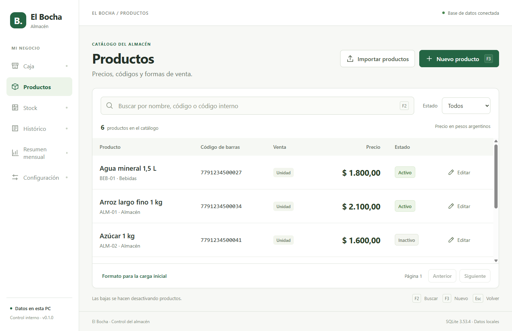
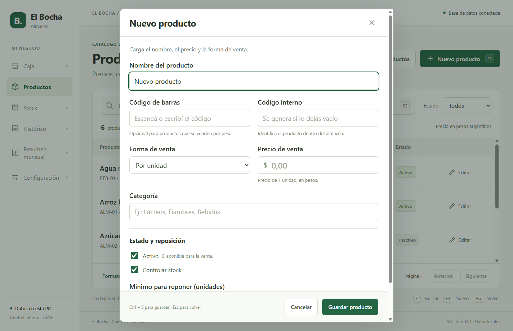

# Entrega 01 — Escritorio y catálogo

17 de septiembre de 2026 · versión 0.1.0 · rama `feature/desktop-catalog`.

## Disponible

- Aplicación de escritorio con datos locales en SQLite y funcionamiento sin internet.
- Productos: crear, editar, activar/desactivar y buscar por nombre, código de barras o código interno.
- Presentaciones por unidad o kilo, categorías, precio y mínimo para reposición.
- Búsqueda sin distinguir mayúsculas/tildes y códigos guardados como texto, conservando ceros iniciales.
- Carga CSV UTF-8: revisión de altas, cambios de precio y errores por fila antes de guardar.
- Aplicación completa del lote en una transacción; reintentar el mismo archivo no duplica productos.
- Navegación con F2/F3, guardado con Ctrl + S y cierre con Esc.
- Migraciones con checksum y respaldo de la base existente antes de actualizar el esquema.
- Worker separado para SQL, renderer aislado y contrato IPC limitado/validado.
- Persistencia de borrador preparada en el backend para la futura Caja, con control de revisión.

## Ejecutar

```powershell
npm run dev
```

El ejecutable de prueba está en `release/win-unpacked/El Bocha POS.exe`.
Se generó también `release/El Bocha POS Setup 0.1.0.exe`; falta la prueba de
instalación/actualización en la PC del cliente.
La base de desarrollo se guarda en `%APPDATA%/ElBochaPOS-dev/data/bocha.sqlite`;
la versión empaquetada utiliza `%APPDATA%/ElBochaPOS/data/bocha.sqlite`.
Estas bases son independientes. Las pruebas utilizan carpetas temporales.

El catálogo inicia vacío. [CSV de ejemplo](../resources/productos-ejemplo.csv).
Se exige formato de precio argentino: `12.000,50` o `12000,50`.
Para productos por kilo, el precio corresponde a un kilo y el mínimo admite
decimales como `0,500`. No completar `stock_inicial` hasta implementar Stock;
la aplicación lo rechaza explícitamente.

## Pantallas reales

Ejemplos cargados exclusivamente en una base temporal para las capturas.





## Verificación

Windows local, Node 24.13.0, Electron 44.4.1, better-sqlite3 13.0.3.

| Comando | Resultado |
|---|---|
| `npm run check` | Tipos, lint, 30 pruebas y builds desktop/web correctos |
| `npm run test:e2e` | 3 escenarios de escritorio correctos |
| `npm run pack:win` | Ejecutable Windows x64 generado |
| `npm run dist:win` | Instalador de esta versión de desarrollo generado |
| `npm run test:packaged` | 3 escenarios sobre el ejecutable empaquetado correctos |
| `npm run docker:check` | Tipos, lint, 30 pruebas y builds correctos en Linux |

Se verificaron carga de 2.000 productos, rechazo de duplicado en fila 1.500,
conflictos de edición, confirmación de precios, paginación, exclusión de inactivos,
rollback de migración fallida y conservación del respaldo anterior. La revisión
de código detectó y corrigió reconexiones concurrentes, estabilidad del código
generado en reintentos, recuperación de base vacía y búsqueda de códigos Unicode.

Búsqueda SQL sobre 2.000 productos: **p95 5,14 ms**, 100 consultas, PC de desarrollo.
Esta medición excluye IPC, render y la PC del cliente; no constituye aceptación
del tiempo total de respuesta en el almacén.

## Pendiente

Esta entrega permite administrar productos; todavía no permite cobrar ventas.

1. Stock: conteo inicial, entradas, ajustes y registro de movimientos.
2. Caja: captura del scanner USB, carrito, descuentos y recuperación del borrador en pantalla.
3. Peso: cálculo en gramos y venta de productos por kilo.
4. Ventas: efectivo/tarjeta, guardado definitivo y precios/nombres históricos.
5. Histórico, resumen mensual, bajo stock y backup manual/restauración.
6. Pruebas con scanner físico, PC de referencia, errores de disco/cierre forzado e instalador final.

El backend ya bloquea cambios de unidad si detecta movimientos o ventas, pero
la integración completa con esos módulos se validará al implementarlos. El
respaldo previo a una migración no reemplaza el módulo de backups para el usuario.
Los checklists de revisión de Agus y validación con hardware mantienen su estado
pendiente. No se presenta esta versión como lista para operar la caja del comercio.
