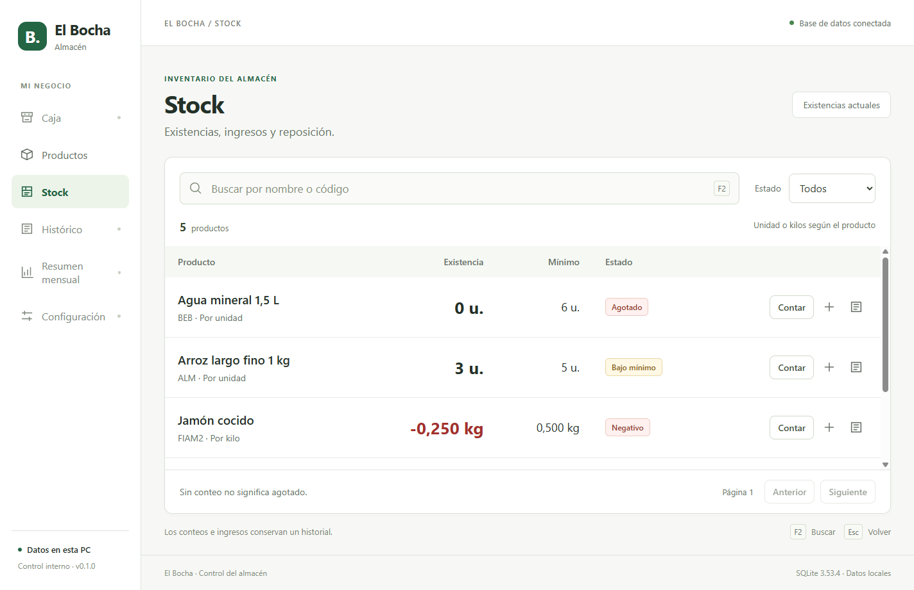
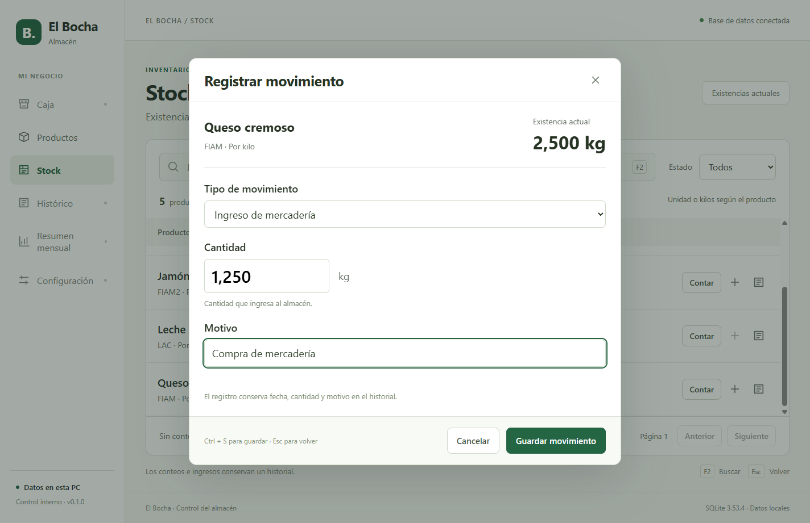

# Entrega 02 — Stock

17 de septiembre de 2026 · incremento sobre escritorio y catálogo 0.1.0.

## Disponible

- Conteo inicial de cantidades reales: unidades enteras o kilos con hasta tres decimales.
- Ingreso de mercadería y merma, con cantidad, fecha y motivo.
- Nuevo conteo que ajusta por diferencia y conserva el movimiento.
- Estados separados: sin conteo, agotado, bajo mínimo, negativo, disponible y sin control.
- Búsqueda y filtros de estado, con mínimo de reposición visible.
- Historial de movimientos por producto y rango de fechas, en horario argentino.
- CSV con conteo inicial opcional; exige confirmar que proviene de un conteo físico.
- Protección de cantidades existentes: una importación no reemplaza un conteo ya iniciado.
- Desactivar control conserva el historial; reactivarlo exige un nuevo conteo.
- Confirmación explícita con motivo para saldos negativos.
- Registros pendientes conservados antes del envío; consulta del resultado original antes de reintentar después de un cierre o reinicio.

Balance y movimiento se guardan juntos en SQLite. Una clave de operación evita
duplicados y detecta si se intenta reutilizarla con otros datos. Un cambio de
existencias o de producto desde que se abrió el formulario exige recargarlo.

## Uso

Ejecutar `npm run dev` y entrar a **Stock**.

**Contar** registra cuánto hay realmente. **+** registra ingreso o merma.
El botón de historial muestra el motivo y el saldo resultante de cada movimiento.
F2 enfoca la búsqueda; Ctrl + S guarda un formulario; Esc vuelve.

La cantidad por kilo se ingresa como `2,500`: se guardan 2.500 gramos.
Para productos unitarios, ingresar `10`, sin fracciones. El mínimo se modifica
desde Productos. “Sin conteo” conserva cantidad desconocida, no un cero ficticio.

Si aparece **Registro pendiente de confirmar**, consultar su resultado antes de
registrar otra operación. El reintento conserva la misma clave y los mismos datos.
Descartar consulta primero la base: si ya estaba guardado, recupera ese resultado.
La intención pendiente se guarda en el perfil local de la app; la verdad del
inventario permanece en SQLite.

## Pantallas reales

Datos de ejemplo cargados exclusivamente en una base temporal para las capturas.

## Evidencia

Windows de desarrollo; Node 24.13.0, Electron 44.4.1 y SQLite local.

| Verificación | Resultado |
|---|---|
| Tipos, lint y builds escritorio/web | Correctos |
| Pruebas de lógica e integración | 41 correctas |
| Recorridos Playwright | 5 correctos, incluido reinicio con ingreso confirmado sin duplicación |
| Ejecutable e instalador Windows | Regenerados con Stock |
| Suite sobre ejecutable empaquetado | 5 recorridos correctos |
| Docker | Suite y builds verificados en Linux |

Fixtures: 3.000 g + ingreso de 2.000 g - merma de 100 g = 4.900 g;
100 reintentos generan un solo movimiento. Un fallo al insertar el movimiento
revierte también el balance. Se probaron cero contado, reactivación del control,
rechazo de cambio de unidad con historial, conflictos de revisión, carga de
2.000 productos con conteos y conciliación de todos sus saldos contra movimientos.

La paginación se verificó con movimientos de igual timestamp. Un registro a
2026-10-01 01:30 UTC queda en la fecha comercial argentina 2026-09-30.
La migración 002 → 003 conserva el catálogo y no inventa cantidades.

Reposición de 2.000 productos, 30 consultas: **p95 3,57 ms** para SQL y DTOs en
esta PC. Excluye interfaz, IPC y PC del cliente; no es una medición física en el comercio.

## Pendiente

Estado al momento de esta entrega. El backend de venta/anulación y sus
movimientos SALE/VOID se agregó después en la [entrega 03](entrega-03-backend-ventas.md).

Caja todavía no cobra ventas. El descuento de stock al confirmar y su reversión
al anular se implementarán en la misma transacción de Ventas (006). Stock no
reserva mercadería por productos agregados a un carrito.

El repositorio ofrece escritura dentro de una transacción existente como base
para esa integración; todavía no se generan movimientos SALE/VOID ni sus FK.
Faltan también peso en Caja, medios de pago, histórico de ventas, resumen mensual,
backup de usuario y pruebas finales en el equipo del cliente.

La revisión de código detectó el riesgo de perder la clave ante confirmación
incierta y se corrigió conservando intención/clave y consultando el resultado.
No se publica ni se instala en el cliente desde esta entrega de desarrollo.
