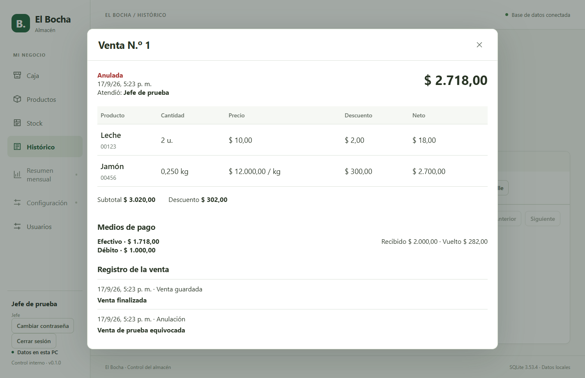

# Entrega 05 — Caja e Histórico conectados

## Disponible

- Caja conectada al catálogo, borrador personal, ventas y stock.
- Captura USB tipo teclado: código seguido de Enter, cola ordenada y códigos con ceros iniciales.
- Búsqueda manual, cantidades, retiro de productos, descuentos porcentuales o fijos.
- Fiambres: ingreso en gramos o kilos, cálculo exacto, porciones independientes.
- Cobro en efectivo, débito, crédito, transferencia u otro, con pagos mixtos y vuelto.
- Histórico con fechas y estados; detalle con nombres y precios guardados al vender, pagos y usuario responsable.
- Anulación con motivo y devolución de los movimientos originales, sin duplicar reposición.

## Protección de operaciones

El borrador se guarda automáticamente y se confirma su guardado antes de navegar o cerrar sesión. Al volver, el cajero elige recuperar o descartar. Cada usuario tiene su propio borrador.

Antes de enviar un cobro se conserva su identificador y contenido. Si la respuesta es incierta, Caja queda bloqueada hasta consultar o reintentar la misma operación. Un Enter del scanner no confirma el pago: se utiliza F8 o el botón de confirmación.

Los cambios de precio exigen revisión; un cambio de unidad exige retirar y agregar nuevamente el producto. Las reglas definitivas se validan en el worker de SQLite, con permisos por rol.

## Atajos

F2 captura · F3 búsqueda · F4 descuento · F6 producto por kilo · F8 cobro/confirmación · Esc vuelve de un diálogo.

## Verificación y límites

`npm run check`: correcto, 73 pruebas unitarias/integración en 18 archivos, tipos, lint y builds. Suite de escritorio: 8 recorridos correctos; el recorrido ampliado de Caja pasó nuevamente con 100 lecturas, edición, recuperación y cancelación. Revisión de código: hallazgos de unidad y concurrencia corregidos con regresiones. Tests con bases temporales y lector simulado como teclado; pendiente validar el lector físico y tiempos en la PC del almacén.

El autoguardado tiene un intervalo de 300 ms. Una interrupción abrupta antes de persistir puede perder los últimos cambios del borrador. Las ventas confirmadas se conservan transaccionalmente.

Pendientes: resumen mensual, backup/restauración desde Configuración y eventual transporte web con autenticación apropiada. La aplicación actual continúa siendo de escritorio; no incluye servidor web ni hosting.

## Pantalla verificada

