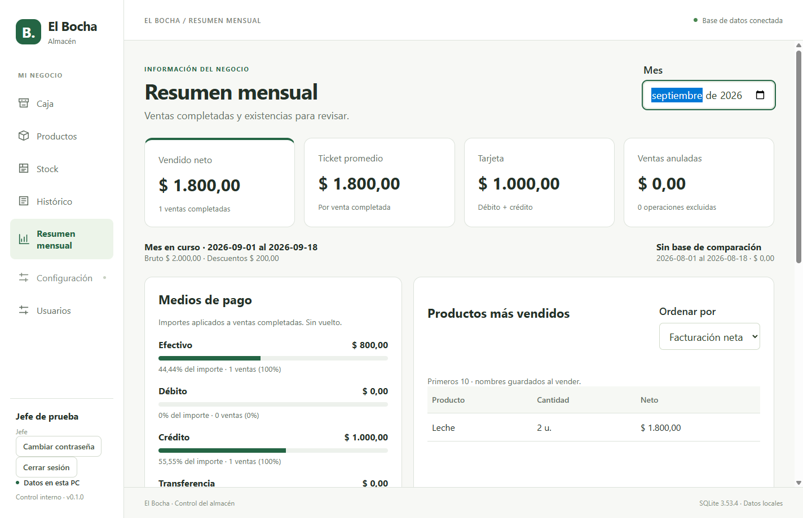

# Entrega 06 — Resumen mensual

## Disponible para el jefe

- Total bruto, descuentos, vendido neto, cantidad de ventas y ticket promedio.
- Efectivo, débito, crédito, transferencia y otros: importe aplicado, participación y cantidad de ventas. Tarjeta agrupa débito y crédito.
- Ventas diarias y comparación con el mes anterior, con rangos explícitos. El mes abierto compara los mismos días; febrero se trunca al último día.
- Productos destacados por facturación, unidades y kilos en rankings separados.
- Stock actual bajo mínimo, agotado o negativo, con venta del mes y posición por facturación como ayuda de revisión.

## Criterio de cifras y permisos

Las ventas anuladas se muestran por separado y se excluyen de netos, pagos y rankings del mes original. Se usan los descuentos y nombres históricos de las líneas. El efectivo cuenta sólo el importe aplicado, sin sumar el vuelto. Una venta mixta puede participar en varios medios.

El worker consulta en una lectura coherente de SQLite; no se guardan tablas de totales que puedan quedar desactualizadas. Supervisor y vendedor no pueden consultar el reporte, aunque invoquen directamente la API.

La ayuda de stock muestra existencias actuales aun al elegir un mes pasado; excluye productos inactivos y cantidades desconocidas. No genera compras automáticas ni pronósticos.

## Evidencia

- `npm run check`: 76 pruebas en 21 archivos; tipos, lint y builds correctos.
- Versión empaquetada Windows: **9 recorridos correctos** (arranque/reinicio, dashboard, productos, importación, ventas IPC, Caja/Histórico, recuperación de stock, Stock UI y roles). Instalador NSIS regenerado; la prueba ejecuta win-unpacked, no el asistente de instalación en la PC del cliente.
- E2E mensual: mes vacío, pagos aplicados, anulaciones, stock actual y denegación por rol comprobados.
- Fixture SQL en SQLite temporal: 100.000 ventas con pagos y detalles, 2.000 productos, netos conciliados. Consulta + DTO: **406 ms** en Windows x64 / Node 24.13.0, PC de desarrollo. Medición individual con datos recién cargados, sin transporte ni render; no certifica rendimiento en la PC del almacén.
- Docker: 76 pruebas, tipos, lint y builds correctos.
- Revisión de código sin hallazgos pendientes. No se requiere migración nueva.

[Registro de medición Windows](../resources/entrega-06/benchmark-windows.json).

Pendiente la aceptación con datos del negocio y hardware objetivo. Próximo módulo: configuración y backup/restauración. El hosting web continúa fuera de este incremento.

